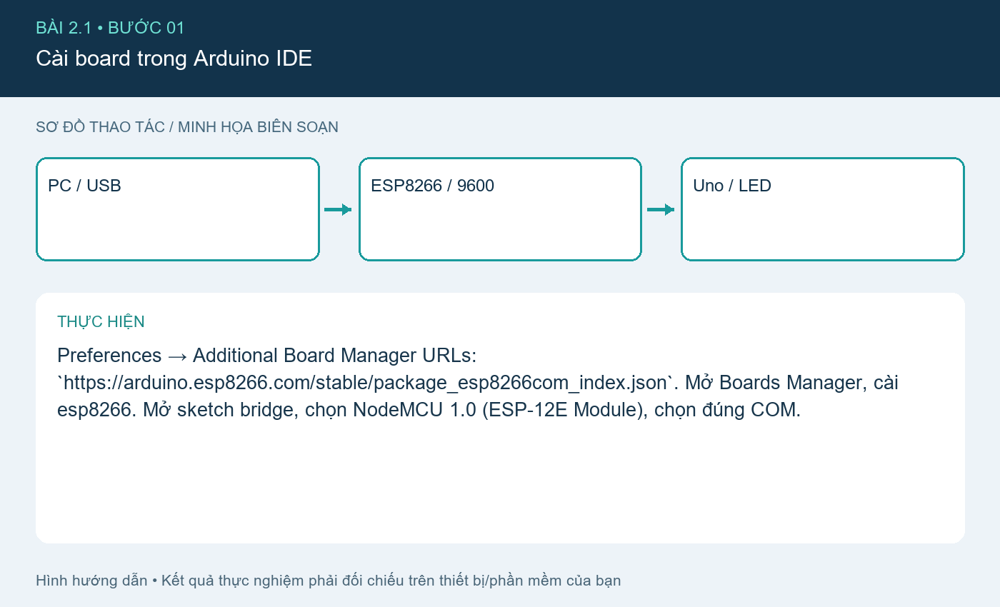
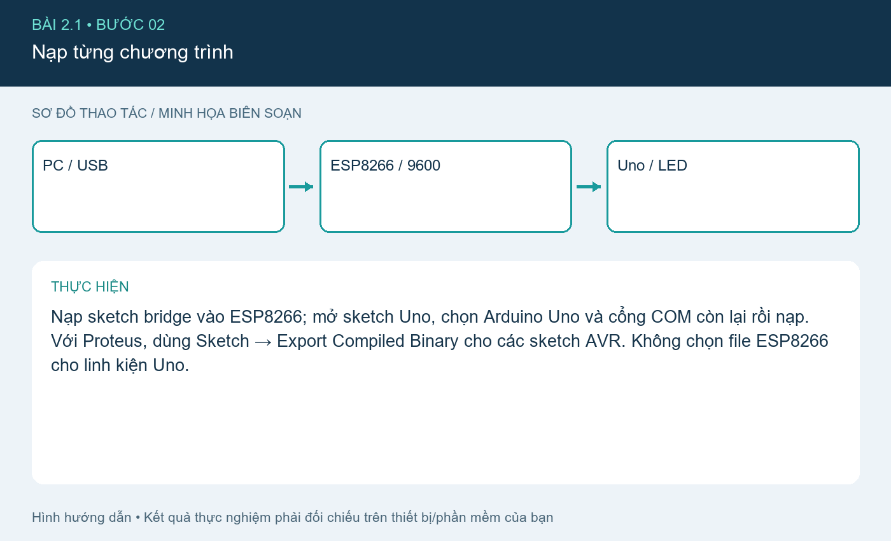
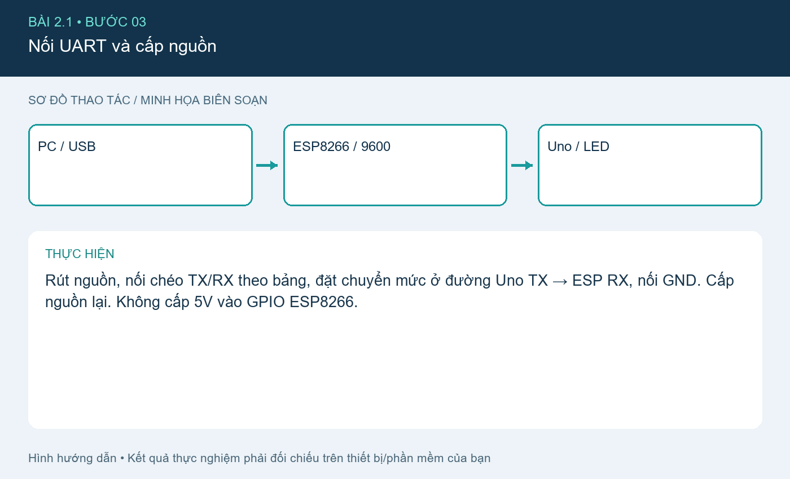
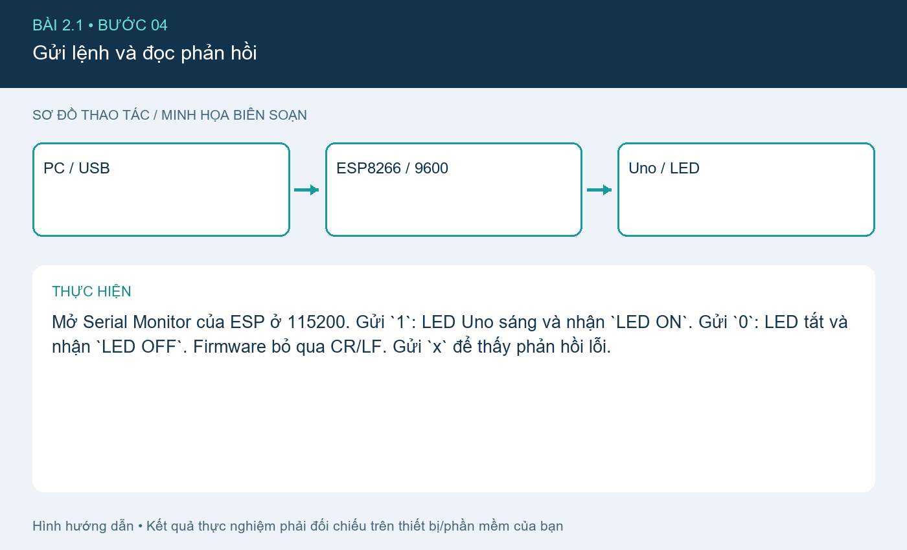
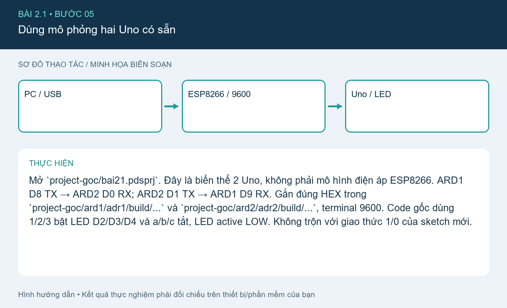

# Bài 2.1. UART giữa ESP8266 và Arduino Uno

Nguồn: [đề gốc](../tai-lieu-goc/BTH2_UART.pdf), trang 3-6. Số bài nhỏ được chuẩn hóa theo số bài thực hành; xem đối chiếu ở README.

## Chuẩn bị

NodeMCU ESP8266, Arduino Uno, LED/điện trở 330 Ω hoặc LED D13 tích hợp, mạch chuyển mức 5V→3.3V, dây nối, Arduino IDE. Cài core ESP8266 và Arduino AVR. Dùng hai cáp USB cấp nguồn cho hai board.

## Kết nối và cấu hình

| ESP8266 NodeMCU | Arduino Uno | Ghi chú |
|---|---|---|
| D1 / GPIO5 TX | D10 RX | Dữ liệu 3.3V từ ESP sang Uno |
| D2 / GPIO4 RX | D9 TX | Bắt buộc qua chuyển mức 5V→3.3V; có thể dùng chia áp 1kΩ từ TX, 2kΩ từ nút RX xuống GND |
| GND | GND | Chung đất |

Firmware: `2.1_ESP8266_Bridge/2.1_ESP8266_Bridge.ino` và `2.1_UNO_LED/2.1_UNO_LED.ino`. Link giữa board là 9600 8N1; USB ESP là 115200; USB Uno là 9600. Trong PDF LED dùng ký tự `0` bật/`1` tắt; bản triển khai này chuẩn hóa `1` bật/`0` tắt và ghi rõ giao thức ở đây.

## Thực hiện từng bước

### Bước 1. Cài board trong Arduino IDE

Preferences → Additional Board Manager URLs: `https://arduino.esp8266.com/stable/package_esp8266com_index.json`. Mở Boards Manager, cài esp8266. Mở sketch bridge, chọn NodeMCU 1.0 (ESP-12E Module), chọn đúng COM.

**Đối chiếu tài liệu gốc, trang 3** (ảnh/giá trị mẫu trong đề, không phải kết quả mới; áp dụng hiệu chỉnh trong hướng dẫn):

### Bước 2. Nạp từng chương trình

Nạp sketch bridge vào ESP8266; mở sketch Uno, chọn Arduino Uno và cổng COM còn lại rồi nạp. Với Proteus, dùng Sketch → Export Compiled Binary cho các sketch AVR. Không chọn file ESP8266 cho linh kiện Uno.

### Bước 3. Nối UART và cấp nguồn

Rút nguồn, nối chéo TX/RX theo bảng, đặt chuyển mức ở đường Uno TX → ESP RX, nối GND. Cấp nguồn lại. Không cấp 5V vào GPIO ESP8266.

**Đối chiếu tài liệu gốc, trang 4** (ảnh/giá trị mẫu trong đề, không phải kết quả mới; áp dụng hiệu chỉnh trong hướng dẫn):

### Bước 4. Gửi lệnh và đọc phản hồi

Mở Serial Monitor của ESP ở 115200. Gửi `1`: LED Uno sáng và nhận `LED ON`. Gửi `0`: LED tắt và nhận `LED OFF`. Firmware bỏ qua CR/LF. Gửi `x` để thấy phản hồi lỗi.

### Bước 5. Dùng mô phỏng hai Uno có sẵn

Mở `project-goc/bai21.pdsprj`. Đây là biến thể 2 Uno, không phải mô hình điện áp ESP8266. ARD1 D8 TX → ARD2 D0 RX; ARD2 D1 TX → ARD1 D9 RX. Gắn đúng HEX trong `project-goc/ard1/adr1/build/...` và `project-goc/ard2/adr2/build/...`, terminal 9600. Code gốc dùng 1/2/3 bật LED D2/D3/D4 và a/b/c tắt, LED active LOW. Không trộn với giao thức 1/0 của sketch mới.

## Kiểm tra và kết quả cần thu

Thử chuỗi `1,0,x,1,0`; lưu ảnh LED và Serial tương ứng. Nếu không nhận: đo chung GND, kiểm tra hướng TX/RX, đúng COM và đúng baud. Bản HEX gốc được lưu để tái sử dụng; cần biên dịch lại khi thay code.

## Giải thích và trả lời câu hỏi

UART là truyền nối tiếp bất đồng bộ: hai phía thống nhất baud, số bit dữ liệu, parity, stop bits. TX phải vào RX. Baud USB và baud SoftwareSerial có thể khác vì đó là hai đường độc lập. Ký tự rác thường do sai baud, thiếu đất hoặc điện áp không đúng.

## Bằng chứng thực hành

Các hình `images/*-buoc-*.png` là sơ đồ hướng dẫn biên soạn, không phải ảnh chụp kết quả chạy. [Xem toàn bộ trang đề gốc](../tai-lieu-goc/README.md). Tạo thư mục `ket-qua/` tại bài này để lưu ảnh chụp thật, log Serial, pcapng hoặc XML sau khi chạy. Không điền số đo khi chưa thực nghiệm.
