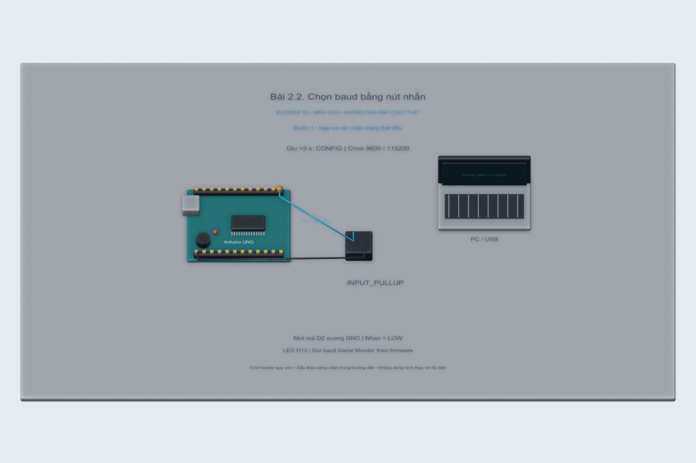
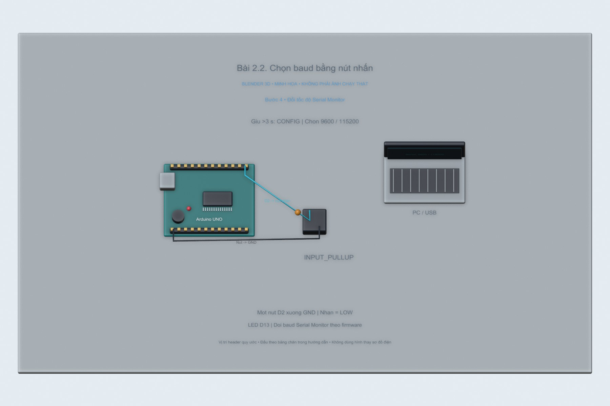

# Bài 2.2. Chọn baud bằng nút nhấn

Nguồn: [đề gốc](../tai-lieu-goc/BTH2_UART.pdf), trang 7. Số bài nhỏ được chuẩn hóa theo số bài thực hành; xem đối chiếu ở README.

## Chuẩn bị

Arduino Uno, nút nhấn, dây nối và Serial Monitor; sketch `2.2_Baud_Button`.

## Kết nối và cấu hình

Nút D2→GND, dùng INPUT_PULLUP; không nhấn=HIGH, nhấn=LOW. LED onboard D13 active HIGH. Baud ban đầu 9600. File Proteus gốc `project-goc/bai22_.pdsprj` có thể dùng cách đấu LED active LOW khác: đối chiếu mạch trước khi thay HEX.

<!-- blender-intro -->
## Xem mô hình khi chưa có đủ linh kiện

[Tải cảnh Blender bài 2.2](../mo-phong-3d/2.2/bai-2.2.blend) · [Cách mở, xoay và xem timeline](../mo-phong-3d/README.md) · [Ảnh linh kiện trên mạng và nguồn](../docs/linh-kien/README.md).

Các hình theo bước dưới đây là **cảnh Blender 3D minh họa bố trí và tín hiệu**. Mốc trên timeline tương ứng số bước; vị trí hạt tín hiệu chỉ diễn họa hướng truyền. Phần nạp code/click menu làm theo chỉ dẫn bằng chữ và ảnh giao diện gốc bên dưới; hình 3D không giả làm màn hình phần mềm hay kết quả đo.

**Đọc cảnh:** xanh lơ/cam/tím là các đường tín hiệu có nhãn; dây đỏ là nguồn, dây đen là GND trong cảnh mạch điện. Với cảnh mạng, mũi tên chỉ luồng logic. Header được giản lược để dễ nhìn, nên dùng bảng nối dây trong bài để tìm chân thật.
<!-- /blender-intro -->

## Thực hiện từng bước

### Bước 1. Nạp và xác nhận trạng thái đầu

Mở `2.2_Baud_Button/2.2_Baud_Button.ino`, chọn Uno, nạp code, mở Serial Monitor 9600. Phải thấy `RUN 9600`.

### Bước 2. Vào chế độ cấu hình

Nhấn giữ nút lâu hơn 3 giây rồi nhả. Code chống dội 30 ms. Nhận `CONFIG`, LED nháy nhanh ba lần.

### Bước 3. Chọn tốc độ 9600 hoặc 115200

Trong CONFIG, nhấn ngắn một lần chọn 9600; nhấn hai lần cách nhau dưới 600 ms chọn 115200. Chờ 600 ms sau lần nhấn cuối. LED nháy một/hai lần. Ba lần trở lên bị từ chối; không ngầm coi là hai lần.

### Bước 4. Đổi tốc độ Serial Monitor

Đọc thông báo `Switch terminal to ...` ở tốc độ cũ rồi đổi Serial Monitor sang tốc độ mới. Nhận `BAUD=...` trên tốc độ mới. Ký tự rác trong lúc hai phía khác baud là hiện tượng dự kiến.

### Bước 5. Thoát và kiểm tra lại

Giữ hơn 3 giây rồi nhả để nhận RUN. Nhấn ngắn ở RUN không đổi baud. Reset board: trở về 9600 do bài này chưa lưu EEPROM.

## Kiểm tra và kết quả cần thu

Kiểm tra nhấn 2.9 s không đổi mode, >3 s có đổi; nhấn một/hai/ba lần cho ba kết quả tương ứng; giữ nút rồi nhả không tạo thêm click. Lưu video/ảnh Serial ở cả hai baud.

## Giải thích và trả lời câu hỏi

Chống dội giúp một lần bấm không tạo nhiều sự kiện. Khoảng chờ nhóm click phân biệt nhấn đơn và đôi. Thông báo trước khi đổi baud cần `Serial.flush()` để đợi UART truyền xong. LED Uno tích hợp là active HIGH; code cũ trong mạch Proteus có thể dùng LED mắc lên VCC nên active LOW.

## Bằng chứng thực hành

Các hình Blender trong bài là minh họa tự dựng; ảnh giao diện từ PDF được ghi nguồn riêng. Chưa có ảnh phần cứng của người dùng cho bài này, nên chưa xác nhận kết quả thực nghiệm. [Xem toàn bộ trang đề gốc](../tai-lieu-goc/README.md). Tạo thư mục `ket-qua/` tại bài này để lưu ảnh chụp thật, log Serial, pcapng hoặc XML sau khi chạy. Không điền số đo khi chưa thực nghiệm.
