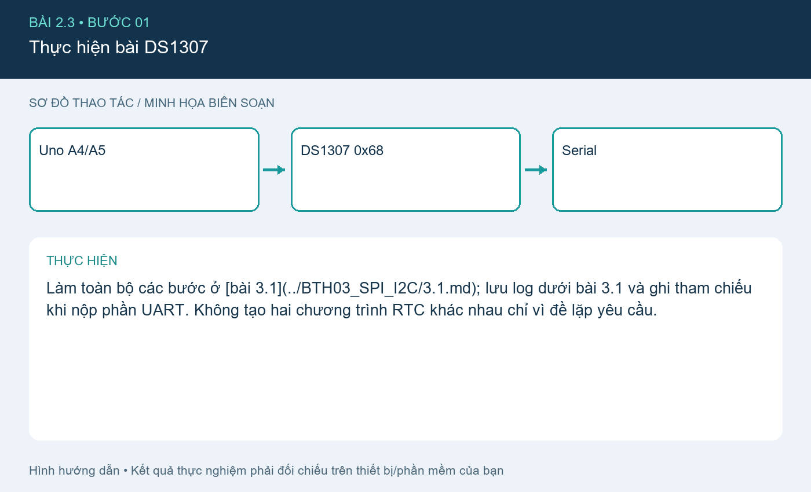

# Bài 2.3. Mục I²C được liệt kê trong đề UART

Nguồn: [đề gốc](../tai-lieu-goc/BTH2_UART.pdf), trang 3. Số bài nhỏ được chuẩn hóa theo số bài thực hành; xem đối chiếu ở README.

## Chuẩn bị

Đề UART liệt kê Bài 1.3 I²C DS1307 nhưng không có phần hướng dẫn riêng. Yêu cầu này trùng bài 3.1; dùng đầy đủ chương trình và thao tác ở liên kết bên dưới.

## Kết nối và cấu hình

[Mở bài 3.1 DS1307](../BTH03_SPI_I2C/3.1.md). Uno A4 SDA, A5 SCL, DS1307 địa chỉ 0x68.

## Thực hiện từng bước

### Bước 1. Thực hiện bài DS1307

Làm toàn bộ các bước ở [bài 3.1](../BTH03_SPI_I2C/3.1.md); lưu log dưới bài 3.1 và ghi tham chiếu khi nộp phần UART. Không tạo hai chương trình RTC khác nhau chỉ vì đề lặp yêu cầu.

## Kiểm tra và kết quả cần thu

Serial hiển thị đủ ngày/tháng/năm giờ/phút/giây mỗi giây.

## Giải thích và trả lời câu hỏi

I²C dùng clock SCL và bus địa chỉ, khác UART TX/RX không có clock chung.

## Bằng chứng thực hành

Các hình `images/*-buoc-*.png` là sơ đồ hướng dẫn biên soạn, không phải ảnh chụp kết quả chạy. [Xem toàn bộ trang đề gốc](../tai-lieu-goc/README.md). Tạo thư mục `ket-qua/` tại bài này để lưu ảnh chụp thật, log Serial, pcapng hoặc XML sau khi chạy. Không điền số đo khi chưa thực nghiệm.
