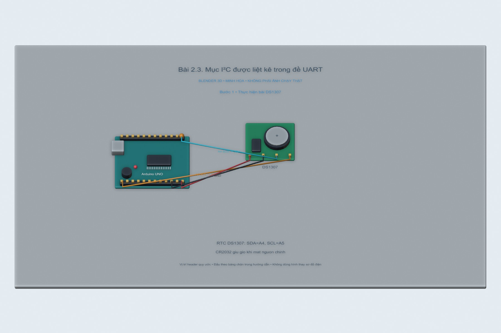
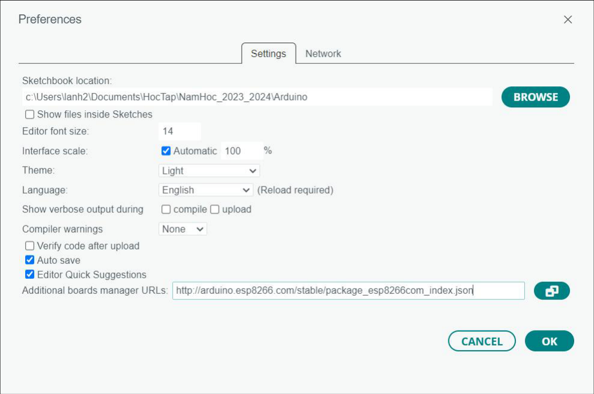

# Bài 2.3. Mục I²C được liệt kê trong đề UART

Nguồn: [đề gốc](../tai-lieu-goc/BTH2_UART.pdf), trang 3. Số bài nhỏ được chuẩn hóa theo số bài thực hành; xem đối chiếu ở README.

## Chuẩn bị

Đề UART liệt kê Bài 1.3 I²C DS1307 nhưng không có phần hướng dẫn riêng. Yêu cầu này trùng bài 3.1; dùng đầy đủ chương trình và thao tác ở liên kết bên dưới.

## Kết nối và cấu hình

[Mở bài 3.1 DS1307](../BTH03_SPI_I2C/3.1.md). Uno A4 SDA, A5 SCL, DS1307 địa chỉ 0x68.

<!-- blender-intro -->
## Xem mô hình khi chưa có đủ linh kiện

[Tải cảnh Blender bài 2.3](../mo-phong-3d/2.3/bai-2.3.blend) · [Cách mở, xoay và xem timeline](../mo-phong-3d/README.md) · [Ảnh linh kiện trên mạng và nguồn](../docs/linh-kien/README.md).

Các hình theo bước dưới đây là **cảnh Blender 3D minh họa bố trí và tín hiệu**. Mốc trên timeline tương ứng số bước; vị trí hạt tín hiệu chỉ diễn họa hướng truyền. Phần nạp code/click menu làm theo chỉ dẫn bằng chữ và ảnh giao diện gốc bên dưới; hình 3D không giả làm màn hình phần mềm hay kết quả đo.

**Đọc cảnh:** xanh lơ/cam/tím là các đường tín hiệu có nhãn; dây đỏ là nguồn, dây đen là GND trong cảnh mạch điện. Với cảnh mạng, mũi tên chỉ luồng logic. Header được giản lược để dễ nhìn, nên dùng bảng nối dây trong bài để tìm chân thật.
<!-- /blender-intro -->

## Thực hiện từng bước

### Bước 1. Thực hiện bài DS1307

Làm toàn bộ các bước ở [bài 3.1](../BTH03_SPI_I2C/3.1.md); lưu log dưới bài 3.1 và ghi tham chiếu khi nộp phần UART. Không tạo hai chương trình RTC khác nhau chỉ vì đề lặp yêu cầu.

## Kiểm tra và kết quả cần thu

Serial hiển thị đủ ngày/tháng/năm giờ/phút/giây mỗi giây.

## Giải thích và trả lời câu hỏi

I²C dùng clock SCL và bus địa chỉ, khác UART TX/RX không có clock chung.

## Bằng chứng thực hành

Các hình Blender trong bài là minh họa tự dựng; ảnh giao diện từ PDF được ghi nguồn riêng. Chưa có ảnh phần cứng của người dùng cho bài này, nên chưa xác nhận kết quả thực nghiệm. [Xem toàn bộ trang đề gốc](../tai-lieu-goc/README.md). Tạo thư mục `ket-qua/` tại bài này để lưu ảnh chụp thật, log Serial, pcapng hoặc XML sau khi chạy. Không điền số đo khi chưa thực nghiệm.

<!-- source-crops -->
## Ảnh giao diện / mạch trong tài liệu gốc

Các ảnh sau lấy từ đúng các trang đề của bài. Khoanh vùng và mũi tên có sẵn trong nguồn; địa chỉ, COM, tên thiết bị và phiên bản là ví dụ. Áp dụng các hiệu chỉnh trong phần thao tác ở trên.

**Trang 3, hình 1** — [mở trang gốc](../tai-lieu-goc/trang/BTH2_UART/page-03.jpg).

<!-- /source-crops -->
