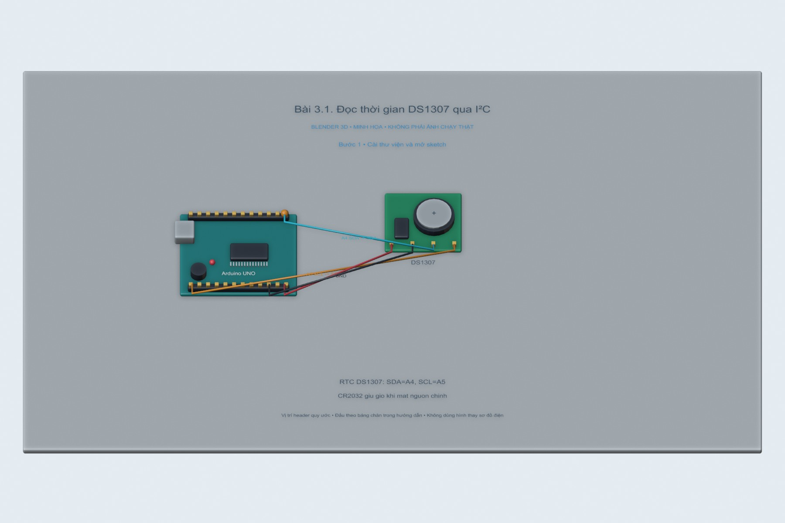
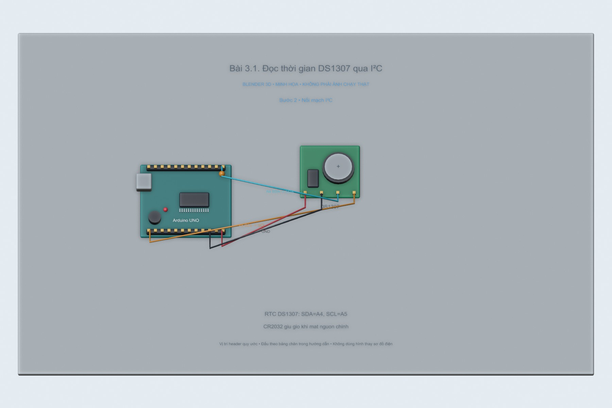
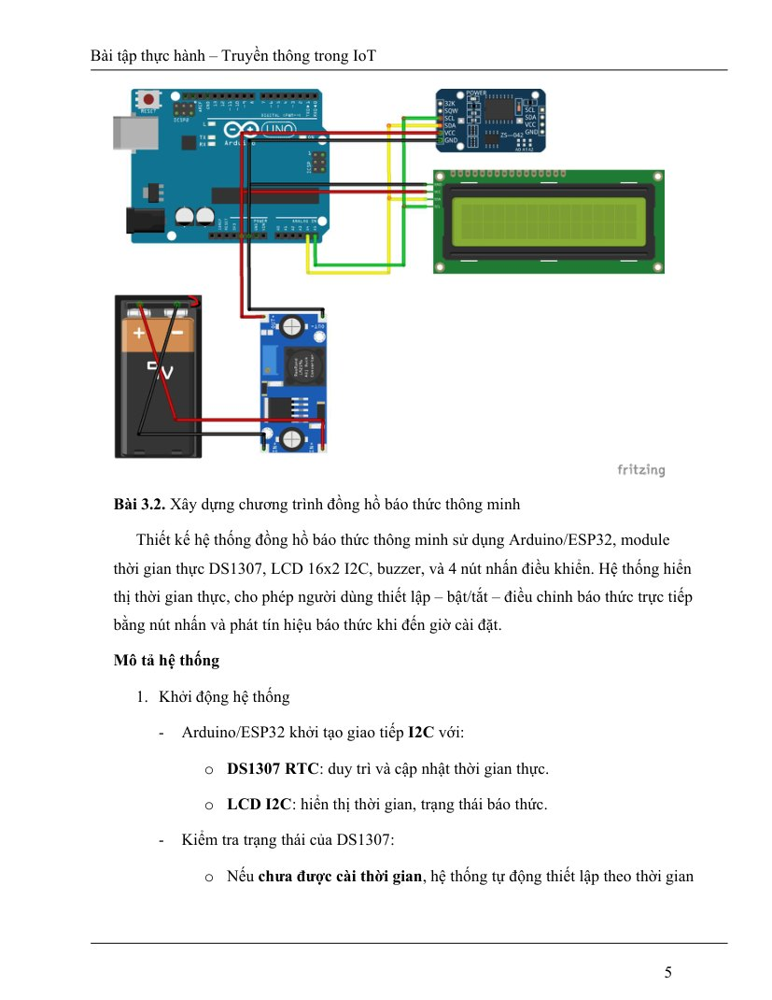
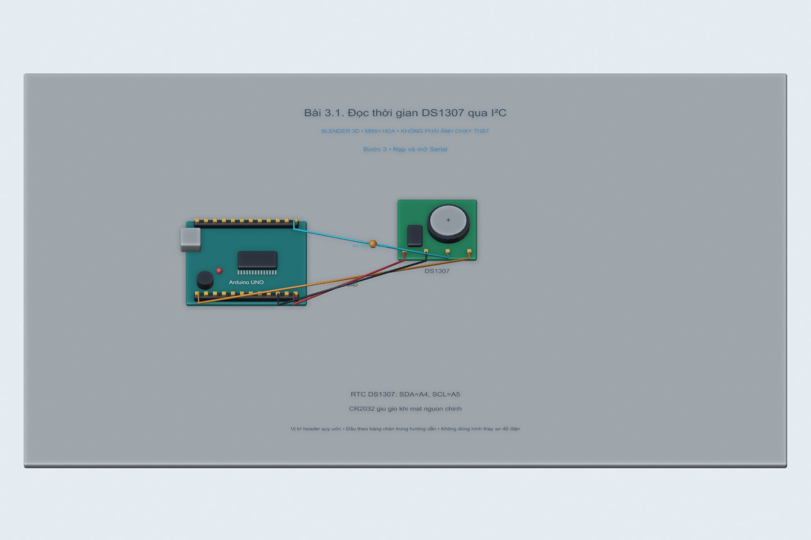
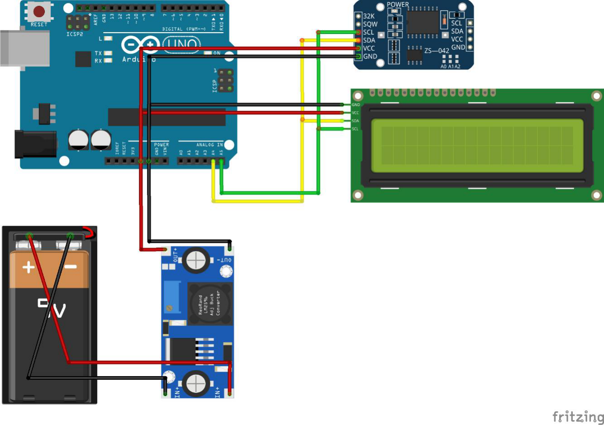

# Bài 3.1. Đọc thời gian DS1307 qua I²C

DS1307 lưu thời gian ngay cả khi vi điều khiển mất nguồn, miễn là pin dự phòng còn hoạt động. Bài này đọc ngày giờ từ DS1307 qua I²C và đưa lên Serial Monitor mỗi giây.

Nguồn: [đề gốc](../tai-lieu-goc/BTH3_SPI_I2C.pdf), trang 3-5.

## Dụng cụ và phần mềm

Uno, module DS1307 có pin RTC, Arduino IDE; cài RTClib 2.1.4 và Adafruit BusIO. Sketch `3.1_RTC_Serial`.

## Kết nối và cấu hình

| Uno | DS1307 |
|---|---|
| A4 | SDA |
| A5 | SCL |
| 5V | VCC module 5V |
| GND | GND |

DS1307 có địa chỉ 0x68. Khi dùng ESP32 phải kiểm tra mức pull-up và dùng chuyển mức phù hợp; bản mã nộp này chọn Uno để khớp file Proteus.

<!-- blender-intro -->
## Hình minh họa

Các ảnh 3D mô tả cách bố trí linh kiện; chân nối xem ở bảng phía trên. Có thể mở [file Blender bài 3.1](../mo-phong-3d/3.1/bai-3.1.blend) để xem các mốc của từng bước.
<!-- /blender-intro -->

## Các bước thực hiện

### Bước 1. Cài thư viện và mở sketch

Library Manager → cài RTClib của Adafruit; chấp nhận BusIO phụ thuộc. Mở `3.1_RTC_Serial/3.1_RTC_Serial.ino` và chọn Uno.

### Bước 2. Nối mạch I²C

Nối SDA/SCL/VCC/GND theo bảng, kiểm tra pin dự phòng đúng loại module. SDA và SCL cần pull-up; module RTC thường có sẵn. Không nhầm chân SQW với SCL.

**Hình tham khảo trong đề, trang 5:**

### Bước 3. Nạp và mở Serial

Nạp sketch. Serial Monitor 9600 hiển thị `DD/MM/YYYY - HH:MM:SS` mỗi giây. Nếu RTC chưa chạy, chương trình đặt thời gian từ thời điểm biên dịch; nó không tự đồng bộ giờ Internet.

### Bước 4. Kiểm tra duy trì giờ

Tắt nguồn Uno khoảng một phút rồi bật lại, giữ pin RTC. Thời gian phải tiếp tục, không trở lại giờ compile. Nếu cần cài lại, thêm tạm `rtc.adjust(DateTime(2026,10,15,20,0,0));` vào setup, sửa thành giờ thực của bạn, nạp một lần rồi bỏ dòng này và nạp lại.

## Nội dung kiểm tra

Kiểm tra log tăng từng giây, ngày hợp lệ và giữ giờ sau ngắt nguồn. Gặp `DS1307 not found`: kiểm tra SDA/SCL và địa chỉ 0x68, nguồn, GND.

## Nhận xét và trả lời câu hỏi

Pin RTC duy trì bộ đếm khi mất nguồn chính. `rtc.isrunning()` kiểm tra bit dừng oscillator, không chứng minh giờ hiện tại chính xác. millis() lập lịch đọc, DS1307 mới là nguồn thời gian. Khi mất thiết bị I²C, chương trình dừng với thông báo rõ thay vì in ngày rác.

## Kết quả của bài

Chương trình đọc RTC đã biên dịch thành công. Chưa có số đo từ DS1307 trong lần làm này, nên việc giữ giờ sau khi ngắt nguồn vẫn cần kiểm tra với module và pin thực tế.

<!-- source-crops -->
## Hình tham khảo từ tài liệu thực hành

Các hình trích từ đề giúp đối chiếu vị trí nút và cách bố trí. IP, cổng COM và tên thiết bị trong hình là ví dụ của tài liệu.

**Trang 5, hình 1** — [mở trang gốc](../tai-lieu-goc/trang/BTH3_SPI_I2C/page-05.jpg).

<!-- /source-crops -->
