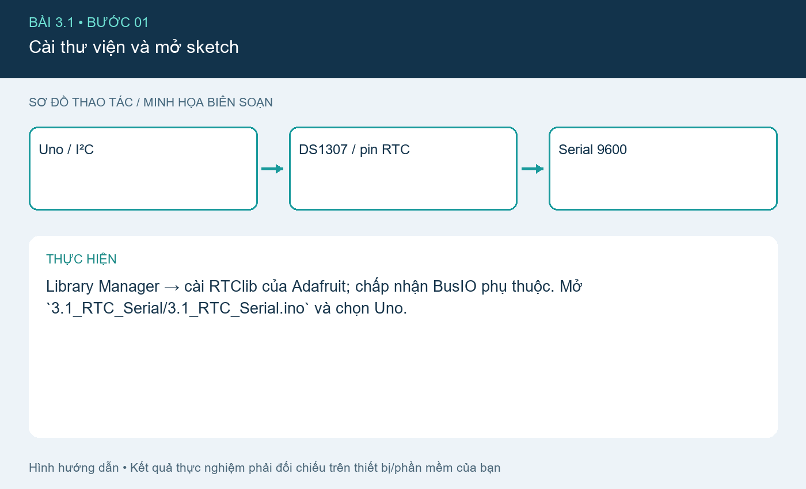
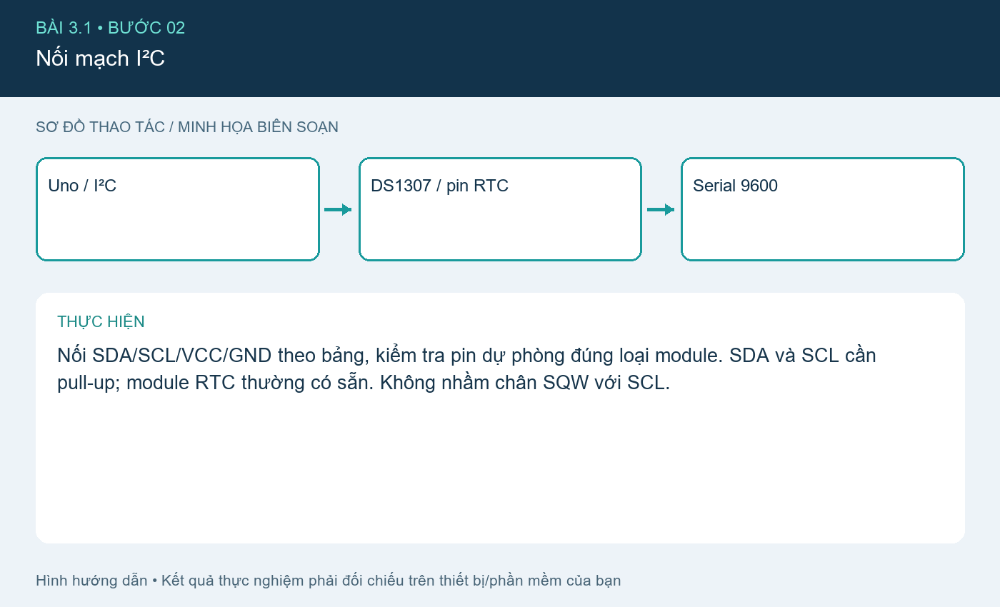
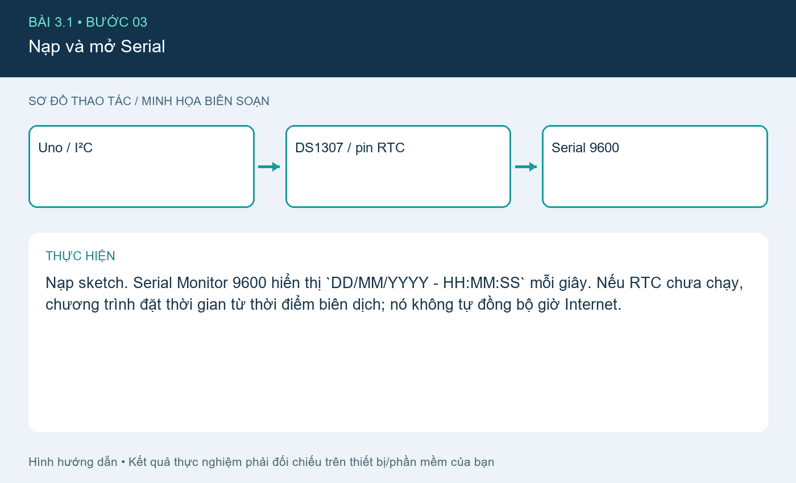
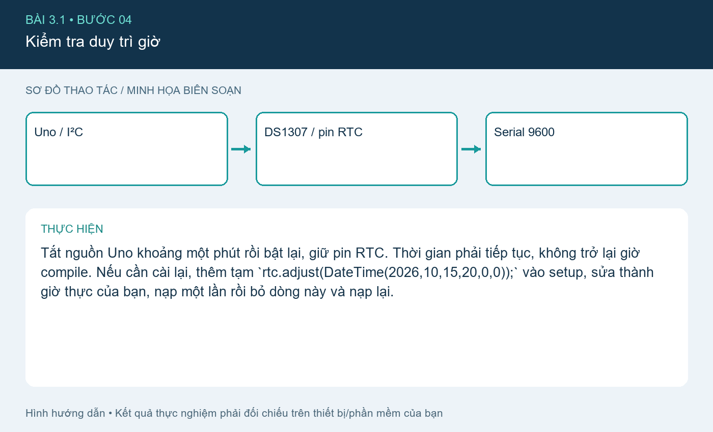

# Bài 3.1. Đọc thời gian DS1307 qua I²C

Nguồn: [đề gốc](../tai-lieu-goc/BTH3_SPI_I2C.pdf), trang 3-5. Số bài nhỏ được chuẩn hóa theo số bài thực hành; xem đối chiếu ở README.

## Chuẩn bị

Uno, module DS1307 có pin RTC, Arduino IDE; cài RTClib 2.1.4 và Adafruit BusIO. Sketch `3.1_RTC_Serial`.

## Kết nối và cấu hình

| Uno | DS1307 |
|---|---|
| A4 | SDA |
| A5 | SCL |
| 5V | VCC module 5V |
| GND | GND |

DS1307 có địa chỉ 0x68. Khi dùng ESP32 phải kiểm tra mức pull-up và dùng chuyển mức phù hợp; bản mã nộp này chọn Uno để khớp file Proteus.

## Thực hiện từng bước

### Bước 1. Cài thư viện và mở sketch

Library Manager → cài RTClib của Adafruit; chấp nhận BusIO phụ thuộc. Mở `3.1_RTC_Serial/3.1_RTC_Serial.ino` và chọn Uno.

### Bước 2. Nối mạch I²C

Nối SDA/SCL/VCC/GND theo bảng, kiểm tra pin dự phòng đúng loại module. SDA và SCL cần pull-up; module RTC thường có sẵn. Không nhầm chân SQW với SCL.

### Bước 3. Nạp và mở Serial

Nạp sketch. Serial Monitor 9600 hiển thị `DD/MM/YYYY - HH:MM:SS` mỗi giây. Nếu RTC chưa chạy, chương trình đặt thời gian từ thời điểm biên dịch; nó không tự đồng bộ giờ Internet.

### Bước 4. Kiểm tra duy trì giờ

Tắt nguồn Uno khoảng một phút rồi bật lại, giữ pin RTC. Thời gian phải tiếp tục, không trở lại giờ compile. Nếu cần cài lại, thêm tạm `rtc.adjust(DateTime(2026,10,15,20,0,0));` vào setup, sửa thành giờ thực của bạn, nạp một lần rồi bỏ dòng này và nạp lại.

## Kiểm tra và kết quả cần thu

Kiểm tra log tăng từng giây, ngày hợp lệ và giữ giờ sau ngắt nguồn. Gặp `DS1307 not found`: kiểm tra SDA/SCL và địa chỉ 0x68, nguồn, GND.

## Giải thích và trả lời câu hỏi

Pin RTC duy trì bộ đếm khi mất nguồn chính. `rtc.isrunning()` kiểm tra bit dừng oscillator, không chứng minh giờ hiện tại chính xác. millis() lập lịch đọc, DS1307 mới là nguồn thời gian. Khi mất thiết bị I²C, chương trình dừng với thông báo rõ thay vì in ngày rác.

## Bằng chứng thực hành

Các hình `images/*-buoc-*.png` là sơ đồ hướng dẫn biên soạn, không phải ảnh chụp kết quả chạy. [Xem toàn bộ trang đề gốc](../tai-lieu-goc/README.md). Tạo thư mục `ket-qua/` tại bài này để lưu ảnh chụp thật, log Serial, pcapng hoặc XML sau khi chạy. Không điền số đo khi chưa thực nghiệm.
