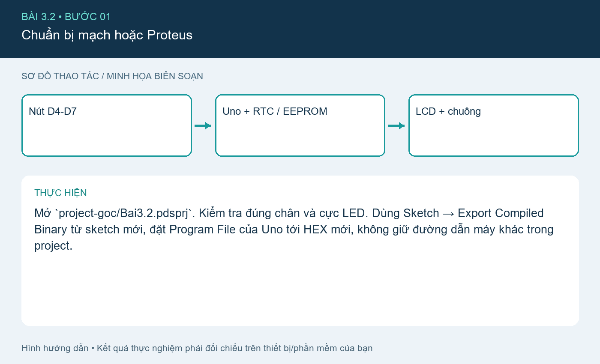
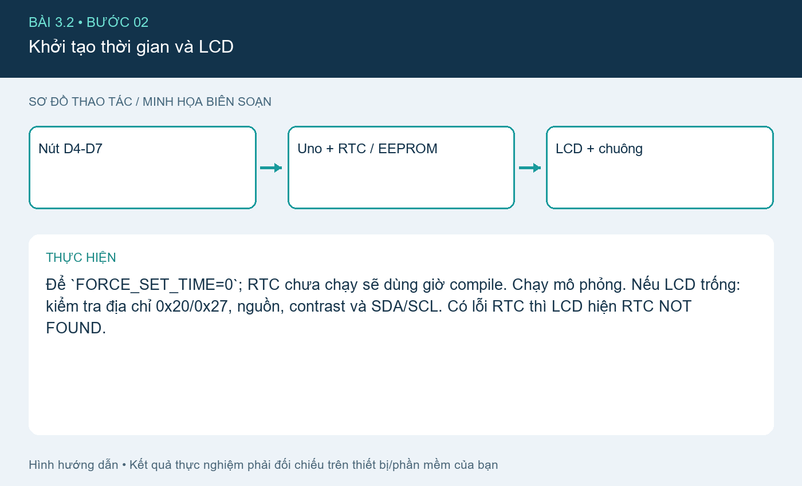
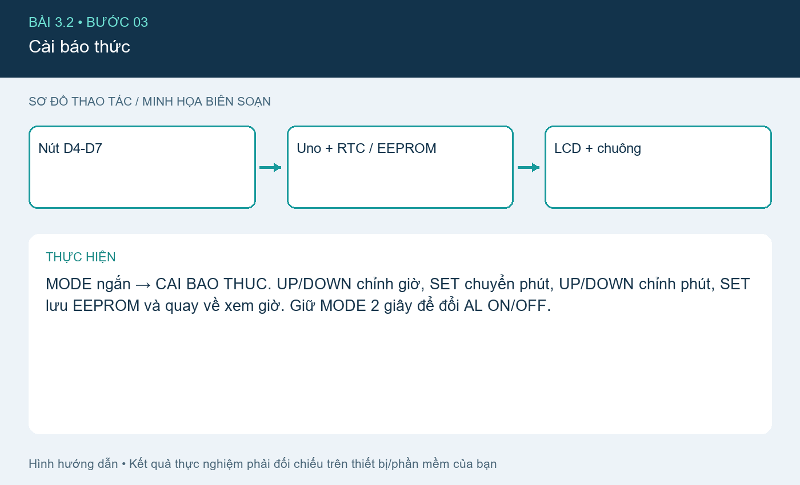
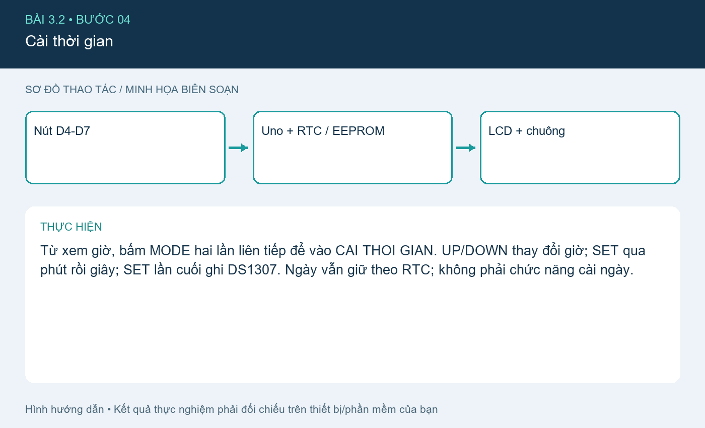
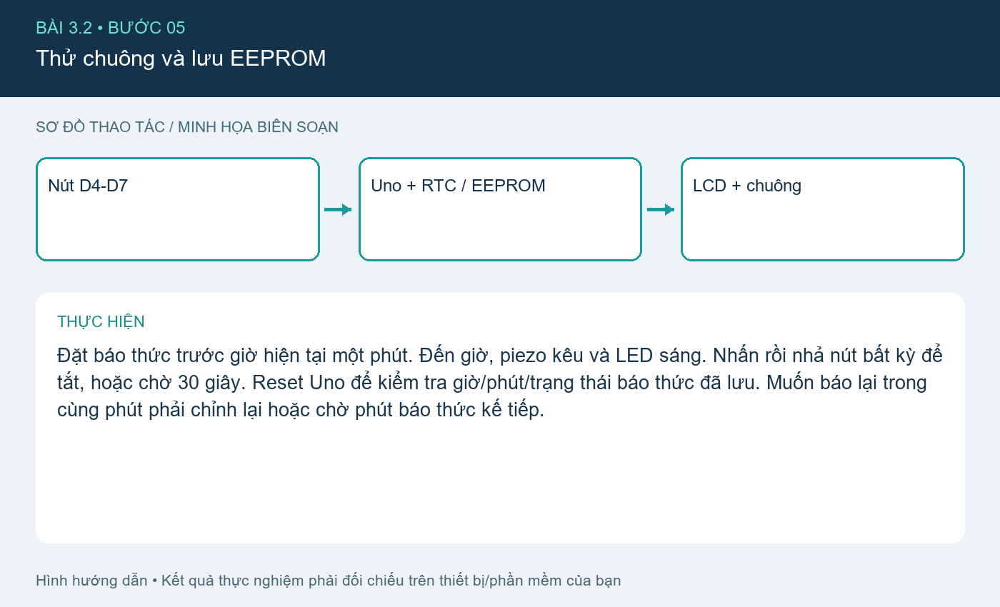

# Bài 3.2. Đồng hồ báo thức thông minh

Nguồn: [đề gốc](../tai-lieu-goc/BTH3_SPI_I2C.pdf), trang 5-7. Số bài nhỏ được chuẩn hóa theo số bài thực hành; xem đối chiếu ở README.

## Chuẩn bị

Uno, DS1307, LCD1602 I²C, 4 nút, piezo thụ động, LED, điện trở. RTClib + LiquidCrystal_I2C (đã biên dịch với bản 2.0.0). Sketch `3.2_Alarm_Clock`. Bản code gốc được giữ trong `project-goc/`.

## Kết nối và cấu hình

| Tín hiệu | Chân Uno |
|---|---|
| SDA chung RTC + LCD | A4 |
| SCL chung RTC + LCD | A5 |
| MODE / UP / DOWN / SET | D4 / D5 / D6 / D7, nút xuống GND |
| LED | D8, active LOW theo mạch gốc, có điện trở |
| Piezo | D9, chân còn lại GND |

LCD mặc định 0x20 theo Proteus; module thực thường 0x27 hoặc 0x3F. Đổi constructor theo địa chỉ đo được. `showLine` chỉ in 16 ký tự/dòng; buffer định dạng đã tăng từ 17 lên 32 byte để không tràn khi định dạng dòng ngày + báo thức.

## Thực hiện từng bước

### Bước 1. Chuẩn bị mạch hoặc Proteus

Mở `project-goc/Bai3.2.pdsprj`. Kiểm tra đúng chân và cực LED. Dùng Sketch → Export Compiled Binary từ sketch mới, đặt Program File của Uno tới HEX mới, không giữ đường dẫn máy khác trong project.

### Bước 2. Khởi tạo thời gian và LCD

Để `FORCE_SET_TIME=0`; RTC chưa chạy sẽ dùng giờ compile. Chạy mô phỏng. Nếu LCD trống: kiểm tra địa chỉ 0x20/0x27, nguồn, contrast và SDA/SCL. Có lỗi RTC thì LCD hiện RTC NOT FOUND.

### Bước 3. Cài báo thức

MODE ngắn → CAI BAO THUC. UP/DOWN chỉnh giờ, SET chuyển phút, UP/DOWN chỉnh phút, SET lưu EEPROM và quay về xem giờ. Giữ MODE 2 giây để đổi AL ON/OFF.

### Bước 4. Cài thời gian

Từ xem giờ, bấm MODE hai lần liên tiếp để vào CAI THOI GIAN. UP/DOWN thay đổi giờ; SET qua phút rồi giây; SET lần cuối ghi DS1307. Ngày vẫn giữ theo RTC; không phải chức năng cài ngày.

### Bước 5. Thử chuông và lưu EEPROM

Đặt báo thức trước giờ hiện tại một phút. Đến giờ, piezo kêu và LED sáng. Nhấn rồi nhả nút bất kỳ để tắt, hoặc chờ 30 giây. Reset Uno để kiểm tra giờ/phút/trạng thái báo thức đã lưu. Muốn báo lại trong cùng phút phải chỉnh lại hoặc chờ phút báo thức kế tiếp.

## Kiểm tra và kết quả cần thu

Test UP từ 23→00, DOWN từ 00→23; phút 59→00; giữ MODE không làm đổi nhiều lần; EEPROM còn sau reset; bất kỳ nút tắt chuông; tự tắt 30 giây. Lưu ảnh ba màn hình và log lỗi nếu RTC vắng mặt.

## Giải thích và trả lời câu hỏi

MODE dài 2 s khác MODE ngắn để tránh nhầm bật/tắt và chuyển mode. EEPROM.update hạn chế ghi lại byte không đổi. Khóa theo phút ngăn chuông lặp liên tục sau khi tắt. Bản này giữ hành vi LED sáng trong khi chuông, không tự chớp; đề cho LED là tùy chọn. Thông tin ngày + giờ báo thức dài hơn 16 cột nên LCD có thể cắt ký tự cuối, không được viết quá buffer.

## Bằng chứng thực hành

Các hình `images/*-buoc-*.png` là sơ đồ hướng dẫn biên soạn, không phải ảnh chụp kết quả chạy. [Xem toàn bộ trang đề gốc](../tai-lieu-goc/README.md). Tạo thư mục `ket-qua/` tại bài này để lưu ảnh chụp thật, log Serial, pcapng hoặc XML sau khi chạy. Không điền số đo khi chưa thực nghiệm.
