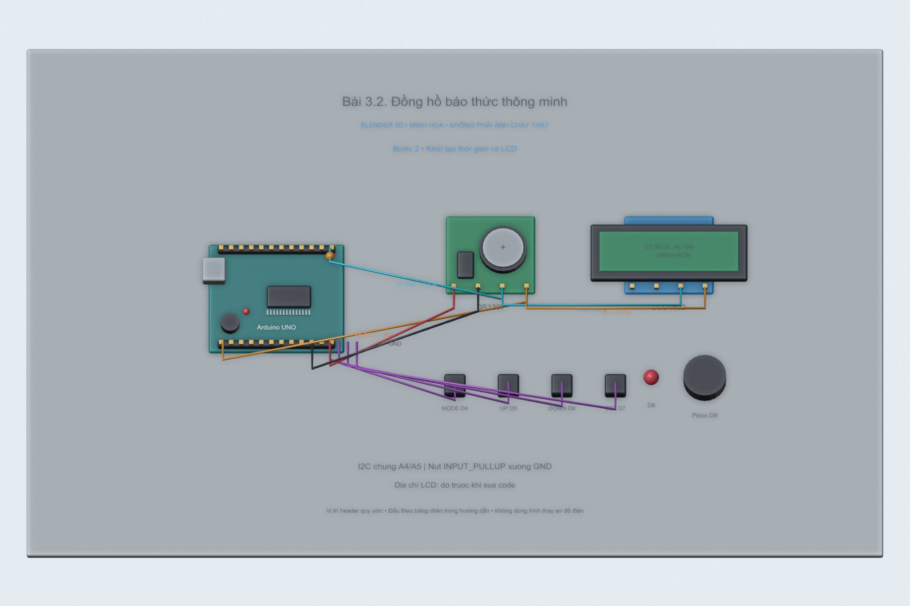
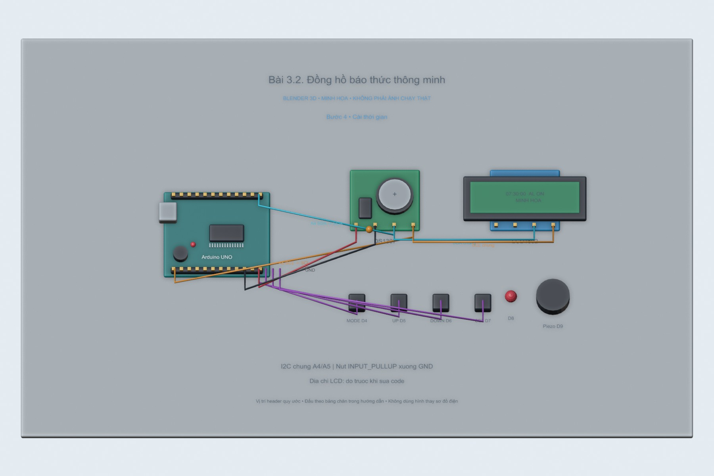
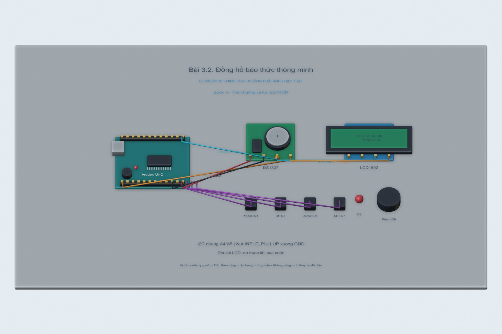

# Bài 3.2. Đồng hồ báo thức thông minh

Bài này mở rộng mạch DS1307 thành đồng hồ báo thức: LCD hiển thị giờ, bốn nút dùng để chỉnh giờ và đặt báo thức, còn piezo báo khi đến thời điểm đã chọn. Giờ báo thức được lưu vào EEPROM để giữ lại sau khi reset Uno.

Nguồn: [đề gốc](../tai-lieu-goc/BTH3_SPI_I2C.pdf), trang 5-7.

## Dụng cụ và phần mềm

Uno, DS1307, LCD1602 I²C, 4 nút, piezo thụ động, LED, điện trở. RTClib + LiquidCrystal_I2C (đã biên dịch với bản 2.0.0). Sketch `3.2_Alarm_Clock`. Bản code gốc được giữ trong `project-goc/`.

## Kết nối và cấu hình

| Tín hiệu | Chân Uno |
|---|---|
| SDA chung RTC + LCD | A4 |
| SCL chung RTC + LCD | A5 |
| MODE / UP / DOWN / SET | D4 / D5 / D6 / D7, nút xuống GND |
| LED | D8, active LOW theo mạch gốc, có điện trở |
| Piezo | D9, chân còn lại GND |

LCD mặc định 0x20 theo Proteus; module thực thường 0x27 hoặc 0x3F. Đổi constructor theo địa chỉ đo được. `showLine` chỉ in 16 ký tự/dòng; buffer định dạng tăng từ 17 lên 32 byte và dùng snprintf để giới hạn độ dài, thuận tiện khi mở rộng hiển thị. Với định dạng hiện tại, dòng dài nhất có 16 ký tự.

<!-- blender-intro -->
## Hình minh họa

Các ảnh 3D mô tả cách bố trí linh kiện; chân nối xem ở bảng phía trên. Có thể mở [file Blender bài 3.2](../mo-phong-3d/3.2/bai-3.2.blend) để xem các mốc của từng bước.
<!-- /blender-intro -->

## Các bước thực hiện

### Bước 1. Chuẩn bị mạch hoặc Proteus

Mở `project-goc/Bai3.2.pdsprj`. Kiểm tra đúng chân và cực LED. Dùng Sketch → Export Compiled Binary từ sketch mới, đặt Program File của Uno tới HEX mới, không giữ đường dẫn máy khác trong project.

### Bước 2. Khởi tạo thời gian và LCD

Để `FORCE_SET_TIME=0`; RTC chưa chạy sẽ dùng giờ compile. Chạy mô phỏng. Nếu LCD trống: kiểm tra địa chỉ 0x20/0x27, nguồn, contrast và SDA/SCL. Có lỗi RTC thì LCD hiện RTC NOT FOUND.

### Bước 3. Cài báo thức

MODE ngắn → CAI BAO THUC. UP/DOWN chỉnh giờ, SET chuyển phút, UP/DOWN chỉnh phút, SET lưu EEPROM và quay về xem giờ. Giữ MODE 2 giây để đổi AL ON/OFF.

### Bước 4. Cài thời gian

Từ xem giờ, bấm MODE hai lần liên tiếp để vào CAI THOI GIAN. UP/DOWN thay đổi giờ; SET qua phút rồi giây; SET lần cuối ghi DS1307. Ngày vẫn giữ theo RTC; không phải chức năng cài ngày.

### Bước 5. Thử chuông và lưu EEPROM

Đặt báo thức trước giờ hiện tại một phút. Đến giờ, piezo kêu và LED sáng. Nhấn rồi nhả nút bất kỳ để tắt, hoặc chờ 30 giây. Reset Uno để kiểm tra giờ/phút/trạng thái báo thức đã lưu. Muốn báo lại trong cùng phút phải chỉnh lại hoặc chờ phút báo thức kế tiếp.

## Nội dung kiểm tra

Test UP từ 23→00, DOWN từ 00→23; phút 59→00; giữ MODE không làm đổi nhiều lần; EEPROM còn sau reset; bất kỳ nút tắt chuông; tự tắt 30 giây. Lưu ảnh ba màn hình và log lỗi nếu RTC vắng mặt.

## Nhận xét và trả lời câu hỏi

MODE dài 2 s khác MODE ngắn để tránh nhầm bật/tắt và chuyển mode. EEPROM.update hạn chế ghi lại byte không đổi. Khóa theo phút ngăn chuông lặp liên tục sau khi tắt. Bản này giữ hành vi LED sáng trong khi chuông, không tự chớp; đề cho LED là tùy chọn. Dòng ngày + giờ báo thức hiện có đúng 16 ký tự, vừa LCD. Khi thêm chữ hoặc đổi định dạng, showLine vẫn giới hạn 16 cột và snprintf giới hạn buffer.

## Kết quả của bài

Sketch báo thức đã biên dịch. Mạch cần được chạy tiếp để kiểm tra LCD, thời điểm chuông kêu và dữ liệu EEPROM sau reset; hình hiện tại dùng để giải thích cách bố trí mạch và thứ tự thao tác.

<!-- source-crops -->
## Hình tham khảo từ tài liệu thực hành

Các hình trích từ đề giúp đối chiếu vị trí nút và cách bố trí. IP, cổng COM và tên thiết bị trong hình là ví dụ của tài liệu.

**Trang 5, hình 1** — [mở trang gốc](../tai-lieu-goc/trang/BTH3_SPI_I2C/page-05.jpg).

<!-- /source-crops -->
