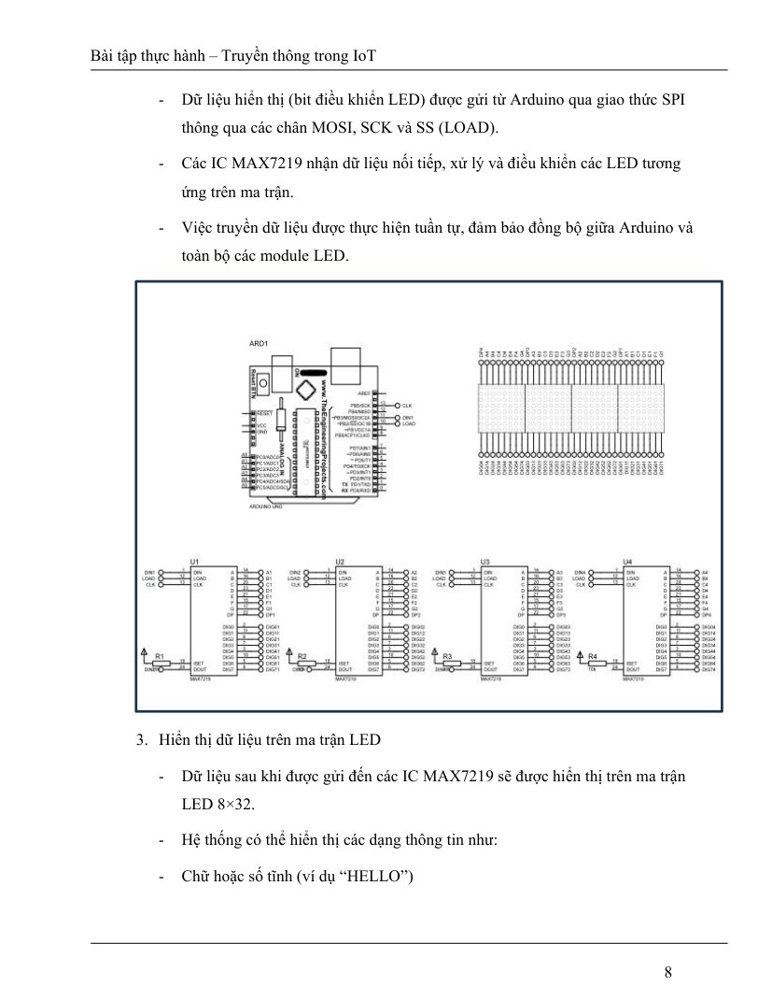
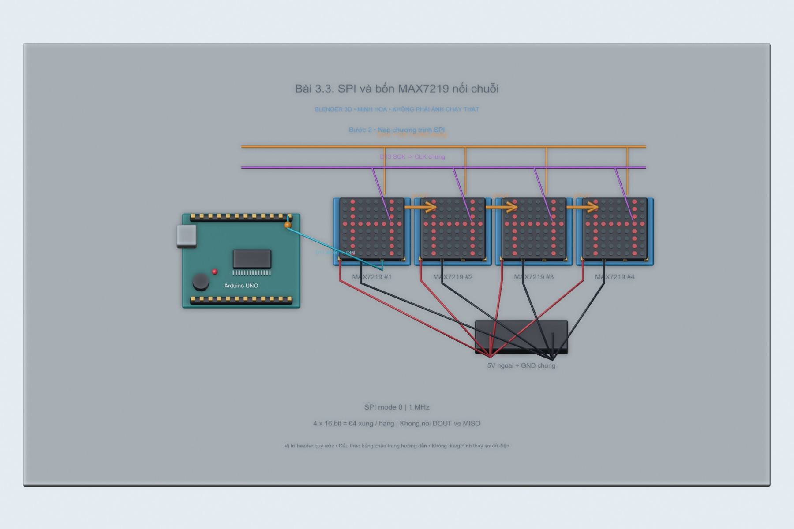
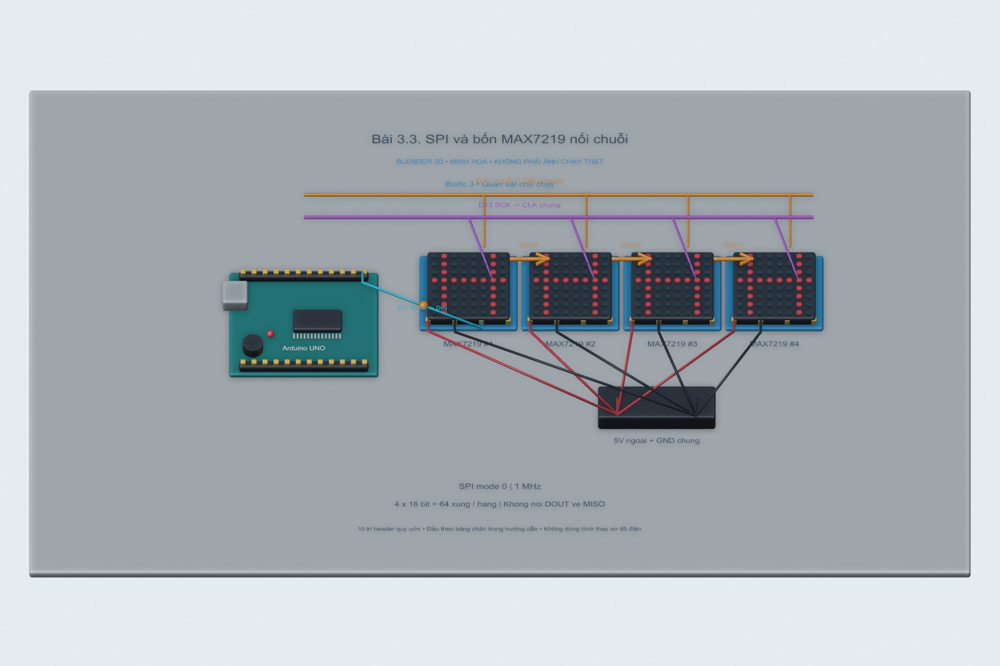
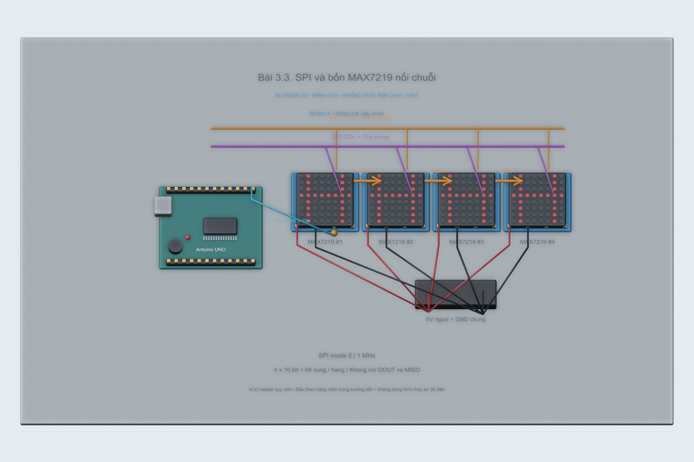
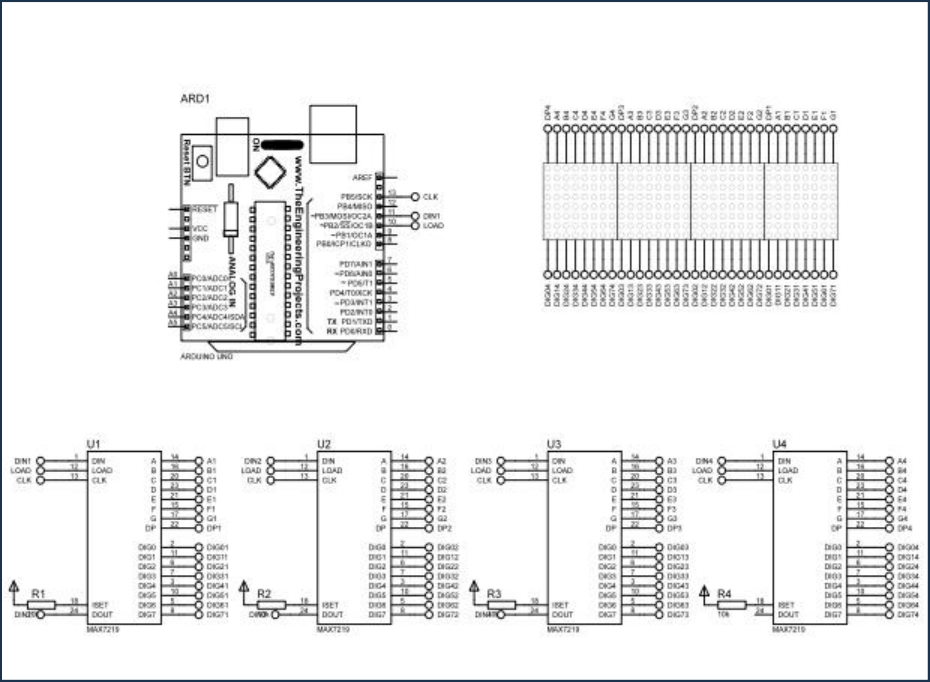

# Bài 3.3. SPI và bốn MAX7219 nối chuỗi

Nguồn: [đề gốc](../tai-lieu-goc/BTH3_SPI_I2C.pdf), trang 7-9. Số bài nhỏ được chuẩn hóa theo số bài thực hành; xem đối chiếu ở README.

## Chuẩn bị

Uno, bốn module MAX7219 ma trận 8×8, nguồn 5V đủ dòng, dây; không cần thư viện ngoài SPI tích hợp.

## Kết nối và cấu hình

Uno D11 MOSI→DIN module 1; D13 SCK→CLK các module; D10→CS/LOAD các module. DOUT module 1→DIN module 2, tiếp tục đến module 4. VCC/GND nối chung. Không nối DOUT về Uno MISO: bài này chỉ ghi dữ liệu. Lắp module thành 8×32.

<!-- blender-intro -->
## Xem mô hình khi chưa có đủ linh kiện

[Tải cảnh Blender bài 3.3](../mo-phong-3d/3.3/bai-3.3.blend) · [Cách mở, xoay và xem timeline](../mo-phong-3d/README.md) · [Ảnh linh kiện trên mạng và nguồn](../docs/linh-kien/README.md).

Các hình theo bước dưới đây là **cảnh Blender 3D minh họa bố trí và tín hiệu**. Mốc trên timeline tương ứng số bước; vị trí hạt tín hiệu chỉ diễn họa hướng truyền. Phần nạp code/click menu làm theo chỉ dẫn bằng chữ và ảnh giao diện gốc bên dưới; hình 3D không giả làm màn hình phần mềm hay kết quả đo.

**Đọc cảnh:** xanh lơ/cam/tím là các đường tín hiệu có nhãn; dây đỏ là nguồn, dây đen là GND trong cảnh mạch điện. Với cảnh mạng, mũi tên chỉ luồng logic. Header được giản lược để dễ nhìn, nên dùng bảng nối dây trong bài để tìm chân thật.
<!-- /blender-intro -->

## Thực hiện từng bước

### Bước 1. Đấu chuỗi ma trận

Tắt nguồn, nối DIN/DOUT đúng chiều mũi tên, CLK/LOAD đi chung. Dùng nguồn 5V ngoài đủ dòng cho ma trận và nối GND với Uno; tránh lấy toàn bộ dòng LED qua GPIO.

**Đối chiếu tài liệu gốc, trang 8** (ảnh/giá trị mẫu trong đề, không phải kết quả mới; áp dụng hiệu chỉnh trong hướng dẫn):

### Bước 2. Nạp chương trình SPI

Mở `3.3_MAX7219/3.3_MAX7219.ino`, chọn Uno, nạp. Code đặt SPI mode 0, 1 MHz, MSB first; CS kéo LOW khi dịch và HIGH để chốt.

### Bước 3. Quan sát chữ chạy

HELLO được ghép thành cột trong mảng `columns` và dịch cửa sổ 32 cột mỗi 90 ms. Nếu chữ lộn/ngược, kiểm tra hướng xoay module và thứ tự module; đổi cách ánh xạ row/column theo module thực.

### Bước 4. Khảo sát cấu hình

Đổi thanh ghi intensity 0x0A từ 3 thành 1 hoặc 7 để so sánh sáng. Đổi chu kỳ 90 ms để thấy tốc độ. Chụp logic analyzer SCK/MOSI/CS nếu có: mỗi lần gửi một hàng có 4×16=64 xung clock.

## Kiểm tra và kết quả cần thu

Cả bốn module hiển thị và chữ chạy qua hết 32 cột; không chỉ module đầu. Kiểm tra thanh ghi shutdown, decode-mode, scan-limit, display-test và intensity đã khởi tạo.

## Giải thích và trả lời câu hỏi

Mỗi IC nhận 16 bit: 8 bit địa chỉ + 8 bit dữ liệu. Gửi dữ liệu cho IC xa nhất trước vì dữ liệu đi xuyên qua các shift register. MAX7219 không dùng địa chỉ như I²C; chân LOAD quyết định thời điểm chốt dữ liệu cho cả chuỗi.

## Bằng chứng thực hành

Các hình Blender trong bài là minh họa tự dựng; ảnh giao diện từ PDF được ghi nguồn riêng. Chưa có ảnh phần cứng của người dùng cho bài này, nên chưa xác nhận kết quả thực nghiệm. [Xem toàn bộ trang đề gốc](../tai-lieu-goc/README.md). Tạo thư mục `ket-qua/` tại bài này để lưu ảnh chụp thật, log Serial, pcapng hoặc XML sau khi chạy. Không điền số đo khi chưa thực nghiệm.

<!-- source-crops -->
## Ảnh giao diện / mạch trong tài liệu gốc

Các ảnh sau lấy từ đúng các trang đề của bài. Khoanh vùng và mũi tên có sẵn trong nguồn; địa chỉ, COM, tên thiết bị và phiên bản là ví dụ. Áp dụng các hiệu chỉnh trong phần thao tác ở trên.

**Trang 8, hình 1** — [mở trang gốc](../tai-lieu-goc/trang/BTH3_SPI_I2C/page-08.jpg).

<!-- /source-crops -->
