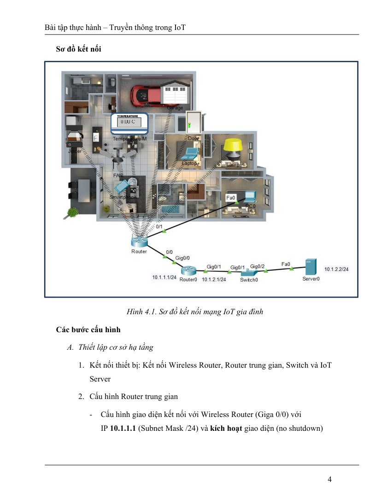
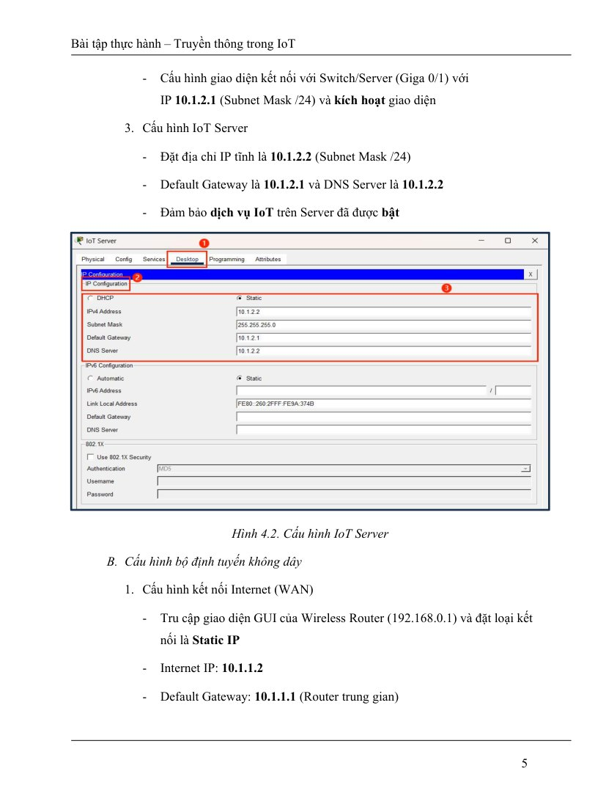
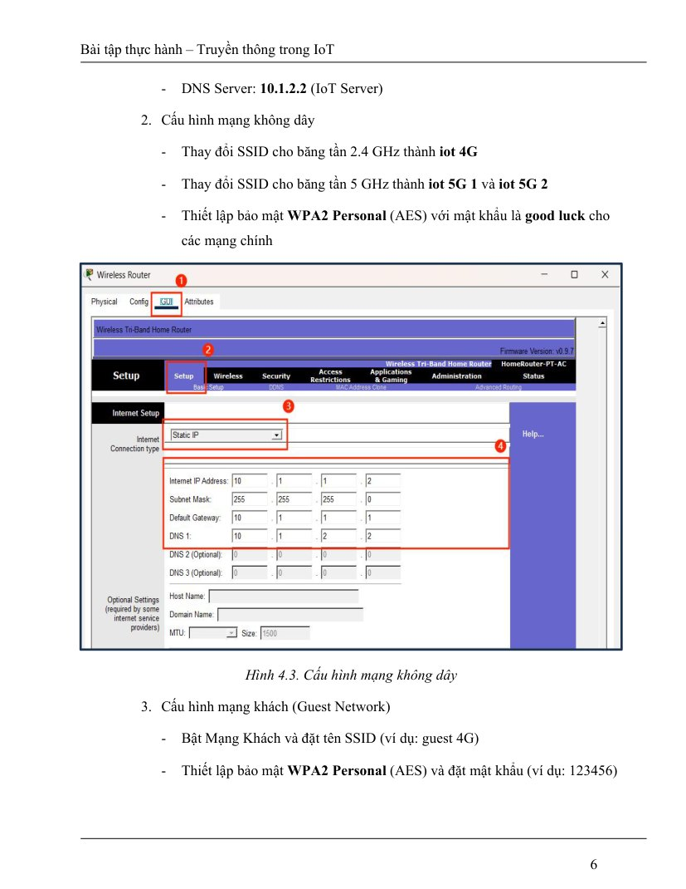
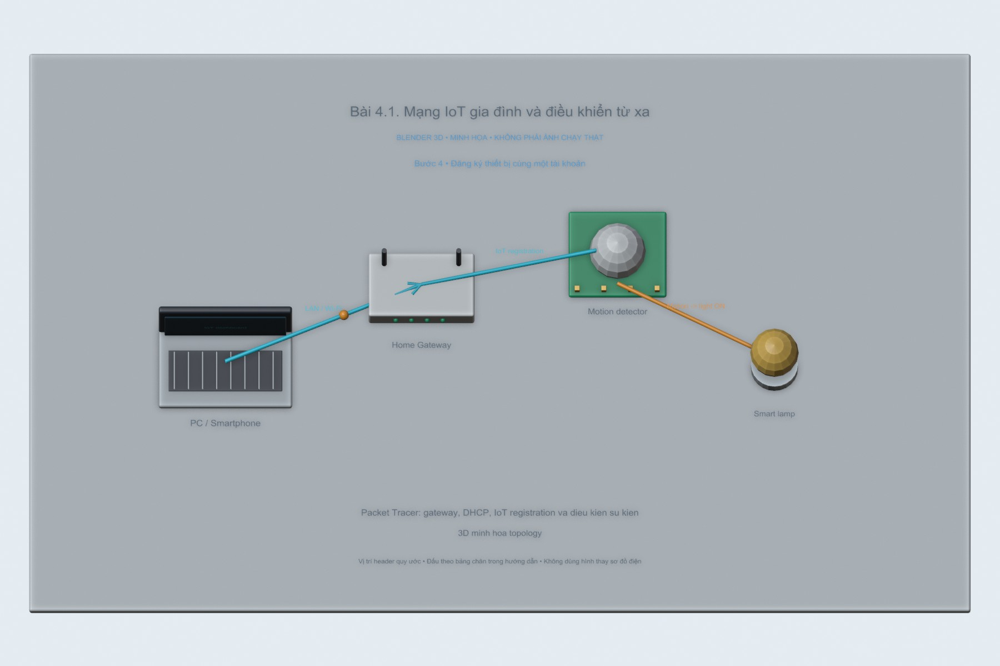
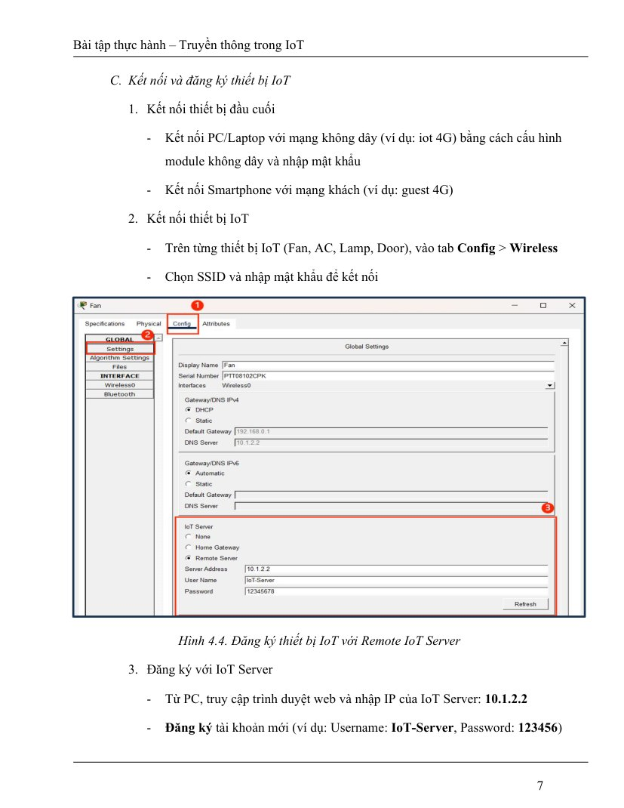
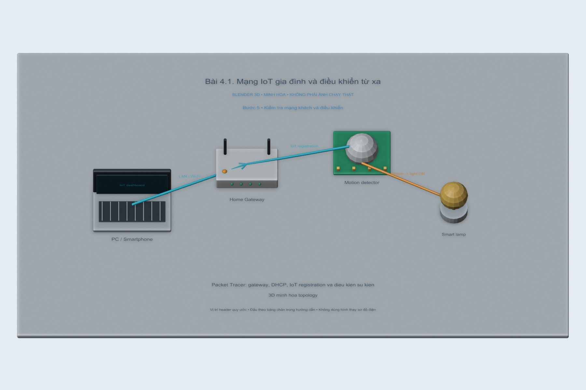
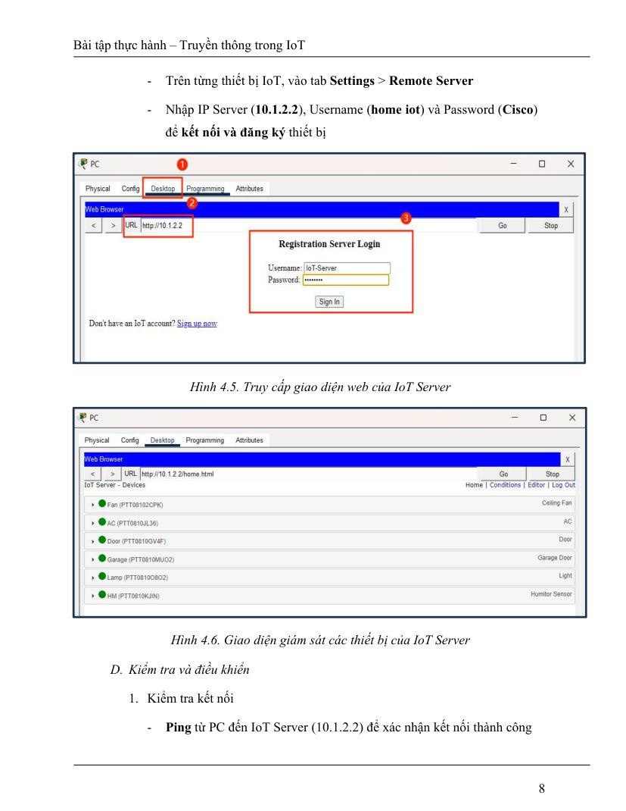

# Bài 4.1. Mạng IoT gia đình và điều khiển từ xa

Bài này bố trí một mạng gia đình trong Packet Tracer, gồm router, máy chủ IoT và các thiết bị trong nhà. Sau phần địa chỉ IP là cấu hình đăng ký thiết bị với máy chủ để có thể điều khiển từ máy tính.

Nguồn: [đề gốc](../tai-lieu-goc/BTH4_ETHERNET-TCPIP.pdf), trang 3-9.

## Dụng cụ và phần mềm

Cisco Packet Tracer có IoT devices; dùng `project-goc/BTH4.pkt` làm file xuất phát. Em dùng file project ban đầu để bố trí lại mạng và thêm các điều kiện của bài. Phần kết quả phía cuối ghi những mục chưa chạy lại trên Packet Tracer.

## Kết nối và cấu hình

| Thiết bị/cổng | IP / Mask | Gateway |
|---|---|---|
| Router trung gian G0/0 | 10.1.1.1 /24 | trực tiếp |
| Router trung gian G0/1 | 10.1.2.1 /24 | trực tiếp |
| Wireless Router WAN | 10.1.1.2 /24 | 10.1.1.1 |
| Wireless Router LAN | 192.168.0.1 /24 | NAT/DHCP |
| IoT Server | 10.1.2.2 /24 | 10.1.2.1 |
| PC/IoT | DHCP 192.168.0.x | 192.168.0.1 |

DNS dùng 10.1.2.2 nếu bật dịch vụ DNS hoặc truy cập IP trực tiếp. Router nối hai mạng trực tiếp nên không cần static route giữa 10.1.1.0/24 và 10.1.2.0/24. Tên cổng có thể là G0/0/0 tùy model; sửa trong `router.cfg` cho đúng thiết bị.

<!-- blender-intro -->
## Hình minh họa

Các ảnh 3D mô tả vị trí các thành phần và hướng trao đổi dữ liệu. Có thể mở [file Blender bài 4.1](../mo-phong-3d/4.1/bai-4.1.blend) để xem các mốc của từng bước.
<!-- /blender-intro -->

## Các bước thực hiện

### Bước 1. Tạo bản lưu và bố trí topology

Mở BTH4.pkt → Save As `BTH4-1.pkt`. Kiểm tra Wireless Router WAN → Router G0/0 và Router G0/1 → Switch → IoT Server; sử dụng cáp phù hợp, đợi đèn link xanh.

**Hình tham khảo trong đề, trang 4:**

### Bước 2. Đặt IP Router và Server

Dán `router.cfg` vào CLI, điều chỉnh tên interface. Server → Desktop → IP Configuration: IP 10.1.2.2, mask 255.255.255.0, gateway 10.1.2.1. Services → IoT: bật On.

**Hình tham khảo trong đề, trang 5:**

### Bước 3. Cấu hình Wireless Router

GUI → Internet Setup → Static IP: 10.1.1.2/24, gateway 10.1.1.1. LAN 192.168.0.1 và bật DHCP. Wireless: SSID `iot 4G`; WPA2 Personal/AES, mật khẩu lab tối thiểu 8 ký tự. Mật khẩu `123456` trong PDF quá ngắn cho WPA2 thực tế; dùng `LabIot-2026` trong mô phỏng.

**Hình tham khảo trong đề, trang 6:**

### Bước 4. Đăng ký thiết bị cùng một tài khoản

PC nhận DHCP, mở http://10.1.2.2 và Sign Up một tài khoản lab. Fan/AC/Lamp/Door → Config → Wireless0: cùng SSID/mật khẩu. IoT Server: Remote Server 10.1.2.2 và đúng tài khoản vừa tạo. PDF dùng hai bộ tài khoản không thống nhất; không trộn chúng.

**Hình tham khảo trong đề, trang 7:**

### Bước 5. Kiểm tra mạng khách và điều khiển

Nếu dùng Home Router có guest network, bật guest với mật khẩu ≥8 ký tự; kết nối smartphone và kiểm tra có truy cập được server theo chính sách guest của model đó. PC ping 10.1.2.2; mở IoT web, bật/tắt từng thiết bị. Guest isolation có thể chặn liên lạc LAN; không khẳng định chỉ bật WPA2 là cách ly hoàn toàn.

**Hình tham khảo trong đề, trang 8:**

## Nội dung kiểm tra

Lưu BTH4-1.pkt sau khi PC ping server được và Fan/AC/Lamp/Door xuất hiện trong tài khoản. Chụp topology, IP Server, WAN router, DHCP PC và trang điều khiển. Nếu ping lỗi: kiểm tra no shutdown, gateway và WAN cable.

## Nhận xét và trả lời câu hỏi

Ethernet chuyển frame theo MAC trên từng liên kết; router định tuyến theo IP. TCP cung cấp luồng tin có thứ tự và gửi lại; UDP không tạo kết nối. DHCP cấp IP cho LAN, NAT trên home router đưa client ra mạng 10.1.1.0. WPA2 bảo vệ kết nối Wi-Fi, không thay thế tài khoản IoT Server hay phân đoạn mạng.

## Kết quả của bài

File Packet Tracer ban đầu và cấu hình router được lưu cùng bài. Sơ đồ phía trên là phần bố trí cần thực hiện; em chưa có ảnh chạy lại Packet Tracer để xác nhận từng thiết bị đã đăng ký thành công.

<!-- source-crops -->
## Hình tham khảo từ tài liệu thực hành

Các hình trích từ đề giúp đối chiếu vị trí nút và cách bố trí. IP, cổng COM và tên thiết bị trong hình là ví dụ của tài liệu.

**Trang 4, hình 1** — [mở trang gốc](../tai-lieu-goc/trang/BTH4_ETHERNET-TCPIP/page-04.jpg).

**Trang 5, hình 1** — [mở trang gốc](../tai-lieu-goc/trang/BTH4_ETHERNET-TCPIP/page-05.jpg).

**Trang 6, hình 1** — [mở trang gốc](../tai-lieu-goc/trang/BTH4_ETHERNET-TCPIP/page-06.jpg).

**Trang 7, hình 1** — [mở trang gốc](../tai-lieu-goc/trang/BTH4_ETHERNET-TCPIP/page-07.jpg).

**Trang 8, hình 1** — [mở trang gốc](../tai-lieu-goc/trang/BTH4_ETHERNET-TCPIP/page-08.jpg).

**Trang 8, hình 2** — [mở trang gốc](../tai-lieu-goc/trang/BTH4_ETHERNET-TCPIP/page-08.jpg).

<!-- /source-crops -->
