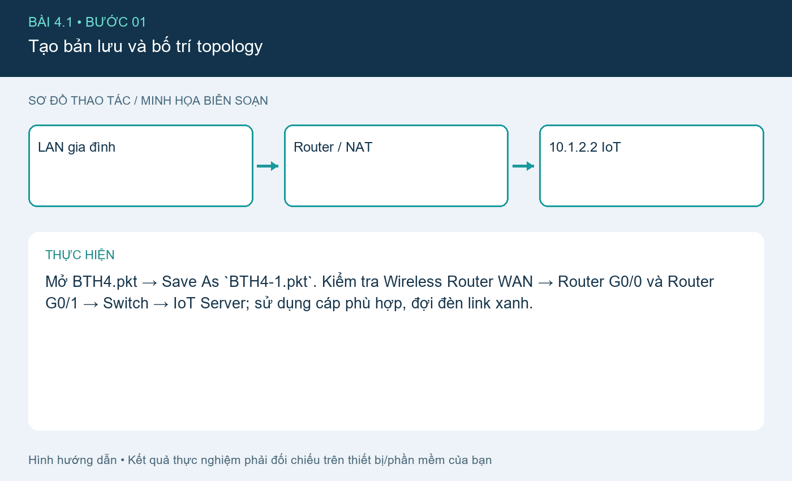
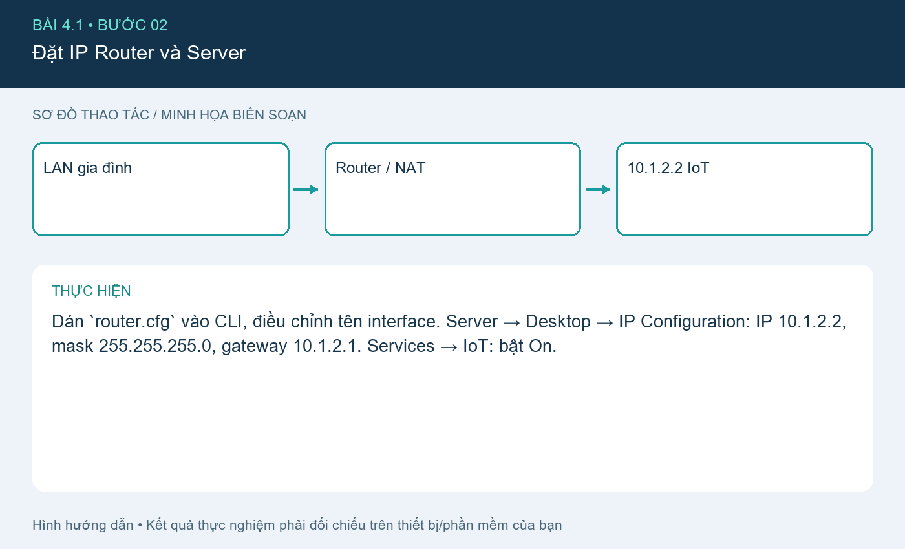
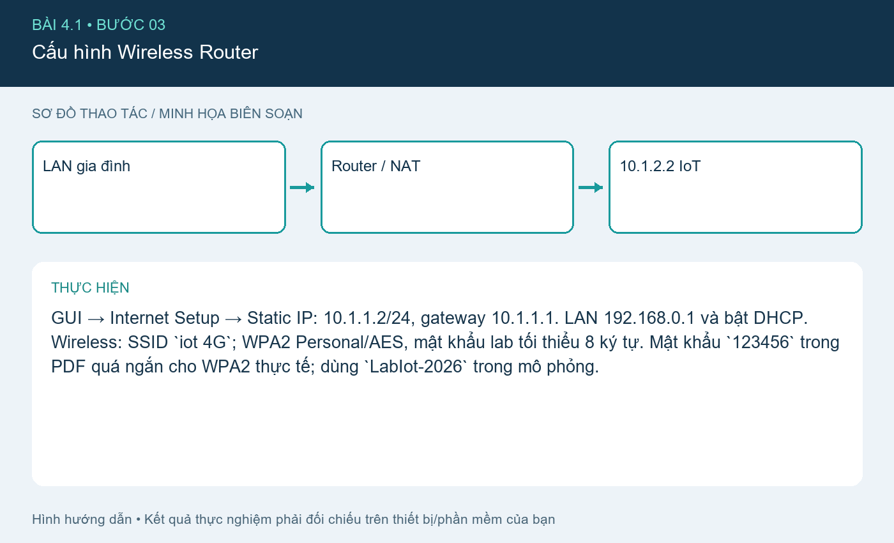
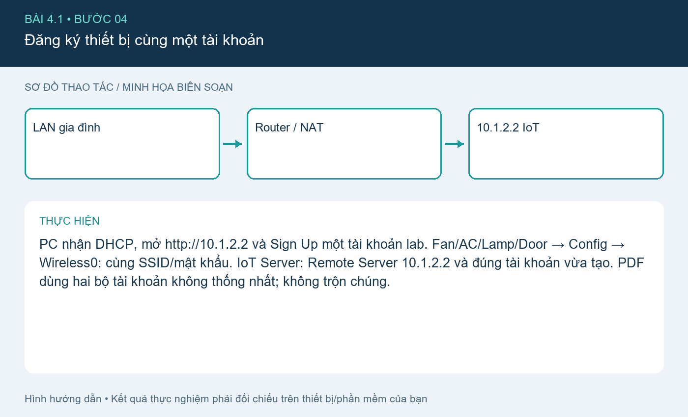
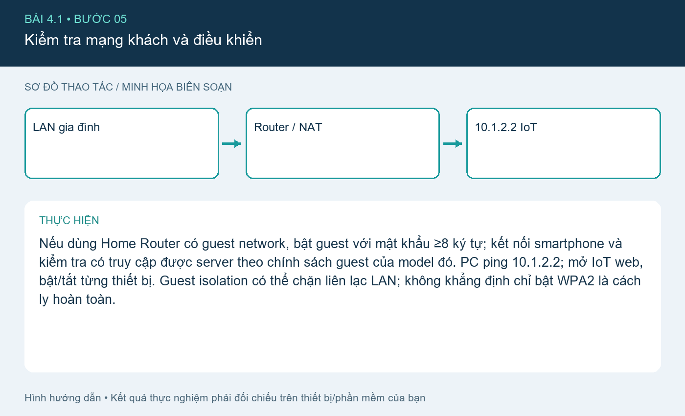

# Bài 4.1. Mạng IoT gia đình và điều khiển từ xa

Nguồn: [đề gốc](../tai-lieu-goc/BTH4_ETHERNET-TCPIP.pdf), trang 3-9. Số bài nhỏ được chuẩn hóa theo số bài thực hành; xem đối chiếu ở README.

## Chuẩn bị

Cisco Packet Tracer có IoT devices; dùng `project-goc/BTH4.pkt` làm file xuất phát. File này là hiện trạng do bạn cung cấp, chưa có xác nhận rằng đã chứa đủ cả ba bài. Các cấu hình bổ sung dưới đây là phần cần áp dụng và kiểm tra trong Packet Tracer.

## Kết nối và cấu hình

| Thiết bị/cổng | IP / Mask | Gateway |
|---|---|---|
| Router trung gian G0/0 | 10.1.1.1 /24 | trực tiếp |
| Router trung gian G0/1 | 10.1.2.1 /24 | trực tiếp |
| Wireless Router WAN | 10.1.1.2 /24 | 10.1.1.1 |
| Wireless Router LAN | 192.168.0.1 /24 | NAT/DHCP |
| IoT Server | 10.1.2.2 /24 | 10.1.2.1 |
| PC/IoT | DHCP 192.168.0.x | 192.168.0.1 |

DNS dùng 10.1.2.2 nếu bật dịch vụ DNS hoặc truy cập IP trực tiếp. Router nối hai mạng trực tiếp nên không cần static route giữa 10.1.1.0/24 và 10.1.2.0/24. Tên cổng có thể là G0/0/0 tùy model; sửa trong `router.cfg` cho đúng thiết bị.

## Thực hiện từng bước

### Bước 1. Tạo bản lưu và bố trí topology

Mở BTH4.pkt → Save As `BTH4-1.pkt`. Kiểm tra Wireless Router WAN → Router G0/0 và Router G0/1 → Switch → IoT Server; sử dụng cáp phù hợp, đợi đèn link xanh.

### Bước 2. Đặt IP Router và Server

Dán `router.cfg` vào CLI, điều chỉnh tên interface. Server → Desktop → IP Configuration: IP 10.1.2.2, mask 255.255.255.0, gateway 10.1.2.1. Services → IoT: bật On.

### Bước 3. Cấu hình Wireless Router

GUI → Internet Setup → Static IP: 10.1.1.2/24, gateway 10.1.1.1. LAN 192.168.0.1 và bật DHCP. Wireless: SSID `iot 4G`; WPA2 Personal/AES, mật khẩu lab tối thiểu 8 ký tự. Mật khẩu `123456` trong PDF quá ngắn cho WPA2 thực tế; dùng `LabIot-2026` trong mô phỏng.

### Bước 4. Đăng ký thiết bị cùng một tài khoản

PC nhận DHCP, mở http://10.1.2.2 và Sign Up một tài khoản lab. Fan/AC/Lamp/Door → Config → Wireless0: cùng SSID/mật khẩu. IoT Server: Remote Server 10.1.2.2 và đúng tài khoản vừa tạo. PDF dùng hai bộ tài khoản không thống nhất; không trộn chúng.

### Bước 5. Kiểm tra mạng khách và điều khiển

Nếu dùng Home Router có guest network, bật guest với mật khẩu ≥8 ký tự; kết nối smartphone và kiểm tra có truy cập được server theo chính sách guest của model đó. PC ping 10.1.2.2; mở IoT web, bật/tắt từng thiết bị. Guest isolation có thể chặn liên lạc LAN; không khẳng định chỉ bật WPA2 là cách ly hoàn toàn.

## Kiểm tra và kết quả cần thu

Lưu BTH4-1.pkt sau khi PC ping server được và Fan/AC/Lamp/Door xuất hiện trong tài khoản. Chụp topology, IP Server, WAN router, DHCP PC và trang điều khiển. Nếu ping lỗi: kiểm tra no shutdown, gateway và WAN cable.

## Giải thích và trả lời câu hỏi

Ethernet chuyển frame theo MAC trên từng liên kết; router định tuyến theo IP. TCP cung cấp luồng tin có thứ tự và gửi lại; UDP không tạo kết nối. DHCP cấp IP cho LAN, NAT trên home router đưa client ra mạng 10.1.1.0. WPA2 bảo vệ kết nối Wi-Fi, không thay thế tài khoản IoT Server hay phân đoạn mạng.

## Bằng chứng thực hành

Các hình `images/*-buoc-*.png` là sơ đồ hướng dẫn biên soạn, không phải ảnh chụp kết quả chạy. [Xem toàn bộ trang đề gốc](../tai-lieu-goc/README.md). Tạo thư mục `ket-qua/` tại bài này để lưu ảnh chụp thật, log Serial, pcapng hoặc XML sau khi chạy. Không điền số đo khi chưa thực nghiệm.
