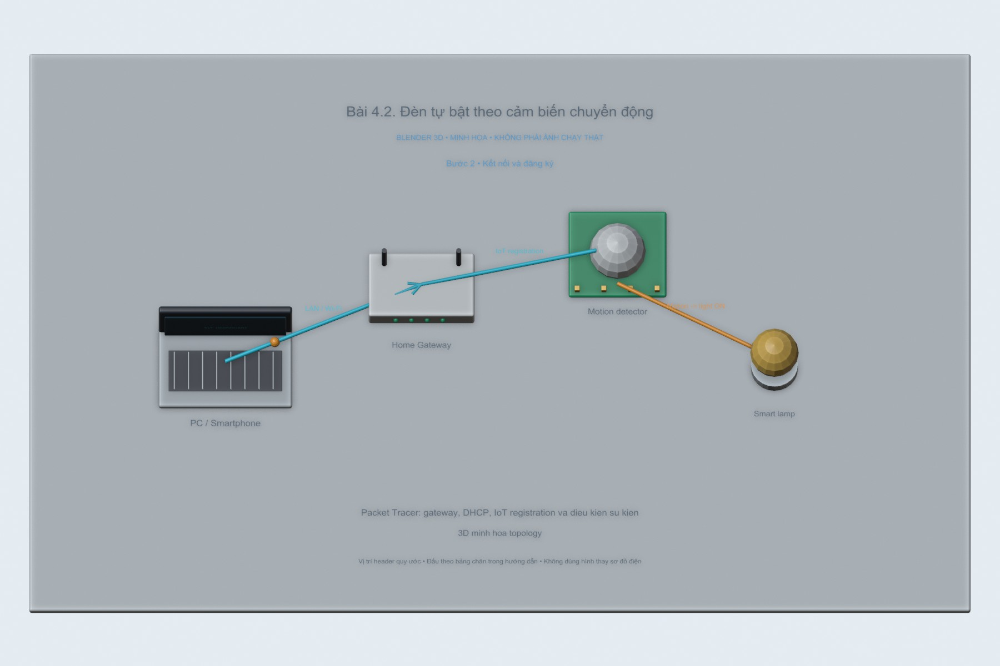
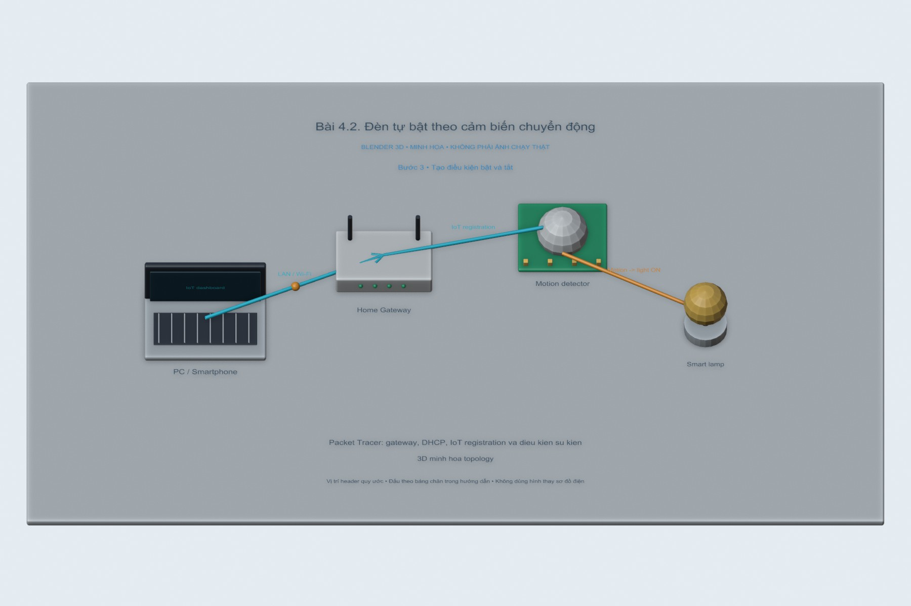
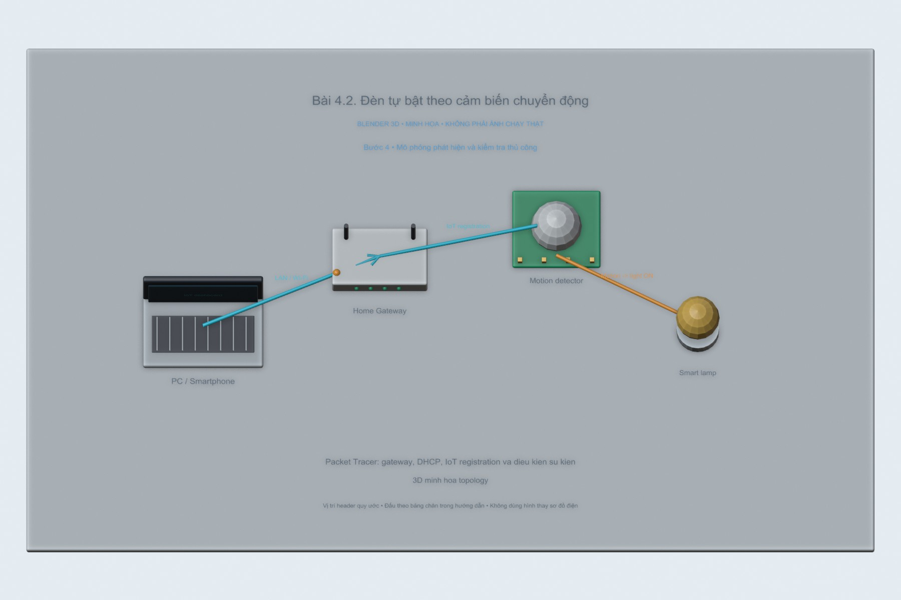

# Bài 4.2. Đèn tự bật theo cảm biến chuyển động

Đèn được điều khiển theo trạng thái của cảm biến chuyển động trong mô hình Packet Tracer. Phần cần theo dõi là điều kiện bật và điều kiện tắt, vì chỉ tạo quy tắc bật thì đèn có thể giữ nguyên trạng thái sau khi cảm biến hết phát hiện.

Nguồn: [đề gốc](../tai-lieu-goc/BTH4_ETHERNET-TCPIP.pdf), trang 9-13.

## Dụng cụ và phần mềm

Cisco Packet Tracer có IoT devices; dùng `project-goc/BTH4.pkt` làm file xuất phát. Em dùng file project ban đầu để bố trí lại mạng và thêm các điều kiện của bài. Phần kết quả phía cuối ghi những mục chưa chạy lại trên Packet Tracer. Hoàn thành 4.1 trước.

## Kết nối và cấu hình

| Thiết bị/cổng | IP / Mask | Gateway |
|---|---|---|
| Router trung gian G0/0 | 10.1.1.1 /24 | trực tiếp |
| Router trung gian G0/1 | 10.1.2.1 /24 | trực tiếp |
| Wireless Router WAN | 10.1.1.2 /24 | 10.1.1.1 |
| Wireless Router LAN | 192.168.0.1 /24 | NAT/DHCP |
| IoT Server | 10.1.2.2 /24 | 10.1.2.1 |
| PC/IoT | DHCP 192.168.0.x | 192.168.0.1 |

DNS dùng 10.1.2.2 nếu bật dịch vụ DNS hoặc truy cập IP trực tiếp. Router nối hai mạng trực tiếp nên không cần static route giữa 10.1.1.0/24 và 10.1.2.0/24. Tên cổng có thể là G0/0/0 tùy model; sửa trong `router.cfg` cho đúng thiết bị.

<!-- blender-intro -->
## Hình minh họa

Các ảnh 3D mô tả vị trí các thành phần và hướng trao đổi dữ liệu. Có thể mở [file Blender bài 4.2](../mo-phong-3d/4.2/bai-4.2.blend) để xem các mốc của từng bước.
<!-- /blender-intro -->

## Các bước thực hiện

### Bước 1. Tạo bản bài chiếu sáng

Save As từ BTH4-1.pkt thành BTH4-2.pkt. Thêm Motion Sensor và Lamp; chọn module wireless nếu thiết bị chưa có.

### Bước 2. Kết nối và đăng ký

Config → Wireless0 → SSID iot 4G, WPA2 tương ứng. Đăng ký cả Motion Sensor và Lamp vào Remote IoT Server 10.1.2.2 bằng đúng tài khoản của bài 4.1.

**Hình tham khảo trong đề, trang 10:**

### Bước 3. Tạo điều kiện bật và tắt

Trong trang web IoT Server → Conditions, tạo rule Motion Sensor: chuyển động=true → Lamp On. Tạo rule thứ hai chuyển động=false → Lamp Off. Tên thuộc tính có thể là Motion/State theo model; chọn giá trị qua dropdown. Các rule được chép ở conditions.csv.

**Hình tham khảo trong đề, trang 12:**

### Bước 4. Mô phỏng phát hiện và kiểm tra thủ công

ALT + nhấn chuột trái vào Motion Sensor để kích hoạt theo hướng dẫn của model; có bản Packet Tracer dùng thao tác tương tác trong workspace. Xem giá trị cảm biến đổi, đèn bật; khi hết chuyển động đèn tắt. Thử Off từ web; nếu cảm biến vẫn true, rule có thể bật lại, cần phân biệt với mất quyền điều khiển.

## Nội dung kiểm tra

Đầu vào false→true→false phải cho đèn Off→On→Off. Lưu BTH4-2.pkt và ảnh hai rule + hai trạng thái.

## Nhận xét và trả lời câu hỏi

Rule true chỉ bật mà không tự tạo hành động khi false. Bổ sung rule false để có chu trình bật/tắt. Điều khiển thủ công trong khi automation còn điều kiện đúng không bảo đảm giữ trạng thái Off; muốn ưu tiên thủ công cần thêm biến/mode riêng.

## Kết quả của bài

Hai điều kiện bật và tắt được trình bày riêng để dễ kiểm tra. Phần này chưa có bản .pkt đã chạy và lưu lại với kết quả đầy đủ; các ảnh 3D mô tả hoạt động dự kiến của đèn và cảm biến.

<!-- source-crops -->
## Hình tham khảo từ tài liệu thực hành

Các hình trích từ đề giúp đối chiếu vị trí nút và cách bố trí. IP, cổng COM và tên thiết bị trong hình là ví dụ của tài liệu.

**Trang 10, hình 1** — [mở trang gốc](../tai-lieu-goc/trang/BTH4_ETHERNET-TCPIP/page-10.jpg).

**Trang 11, hình 1** — [mở trang gốc](../tai-lieu-goc/trang/BTH4_ETHERNET-TCPIP/page-11.jpg).

**Trang 12, hình 1** — [mở trang gốc](../tai-lieu-goc/trang/BTH4_ETHERNET-TCPIP/page-12.jpg).

<!-- /source-crops -->
