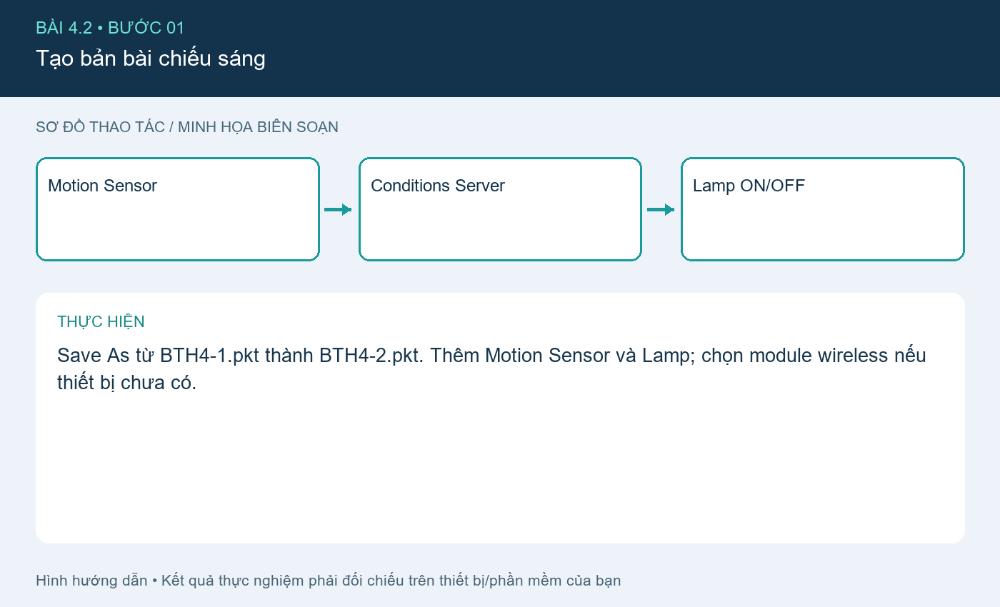
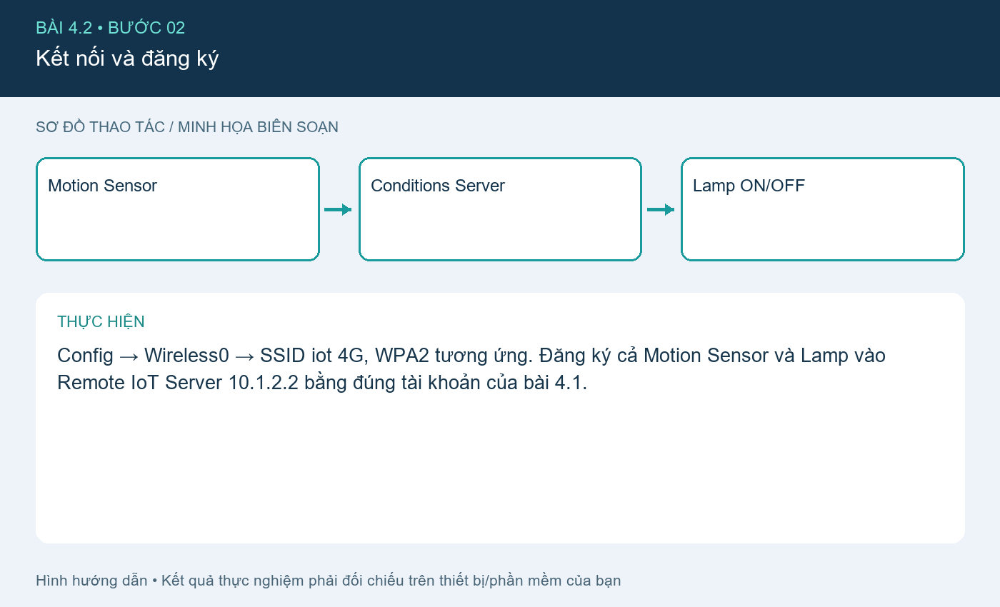
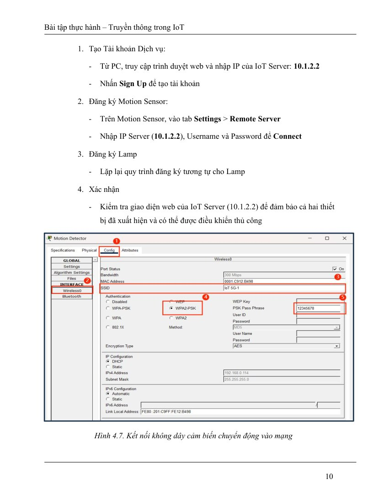
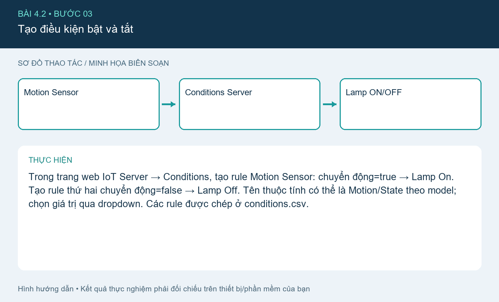
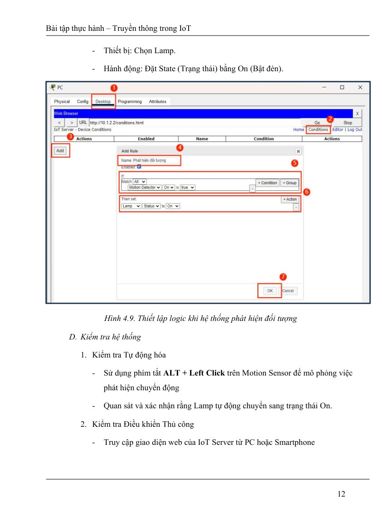
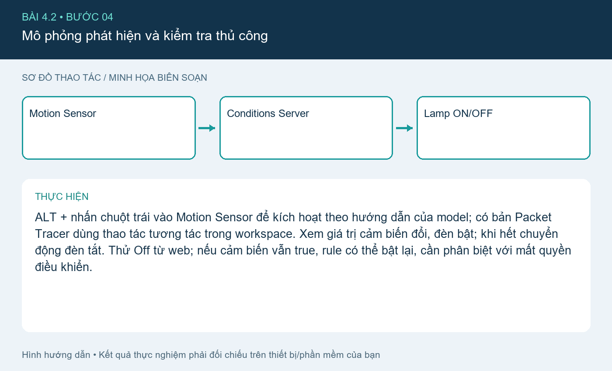

# Bài 4.2. Đèn tự bật theo cảm biến chuyển động

Nguồn: [đề gốc](../tai-lieu-goc/BTH4_ETHERNET-TCPIP.pdf), trang 9-13. Số bài nhỏ được chuẩn hóa theo số bài thực hành; xem đối chiếu ở README.

## Chuẩn bị

Cisco Packet Tracer có IoT devices; dùng `project-goc/BTH4.pkt` làm file xuất phát. File này là hiện trạng do bạn cung cấp, chưa có xác nhận rằng đã chứa đủ cả ba bài. Các cấu hình bổ sung dưới đây là phần cần áp dụng và kiểm tra trong Packet Tracer. Hoàn thành 4.1 trước.

## Kết nối và cấu hình

| Thiết bị/cổng | IP / Mask | Gateway |
|---|---|---|
| Router trung gian G0/0 | 10.1.1.1 /24 | trực tiếp |
| Router trung gian G0/1 | 10.1.2.1 /24 | trực tiếp |
| Wireless Router WAN | 10.1.1.2 /24 | 10.1.1.1 |
| Wireless Router LAN | 192.168.0.1 /24 | NAT/DHCP |
| IoT Server | 10.1.2.2 /24 | 10.1.2.1 |
| PC/IoT | DHCP 192.168.0.x | 192.168.0.1 |

DNS dùng 10.1.2.2 nếu bật dịch vụ DNS hoặc truy cập IP trực tiếp. Router nối hai mạng trực tiếp nên không cần static route giữa 10.1.1.0/24 và 10.1.2.0/24. Tên cổng có thể là G0/0/0 tùy model; sửa trong `router.cfg` cho đúng thiết bị.

## Thực hiện từng bước

### Bước 1. Tạo bản bài chiếu sáng

Save As từ BTH4-1.pkt thành BTH4-2.pkt. Thêm Motion Sensor và Lamp; chọn module wireless nếu thiết bị chưa có.

### Bước 2. Kết nối và đăng ký

Config → Wireless0 → SSID iot 4G, WPA2 tương ứng. Đăng ký cả Motion Sensor và Lamp vào Remote IoT Server 10.1.2.2 bằng đúng tài khoản của bài 4.1.

**Đối chiếu tài liệu gốc, trang 10** (ảnh/giá trị mẫu trong đề, không phải kết quả mới; áp dụng hiệu chỉnh trong hướng dẫn):

### Bước 3. Tạo điều kiện bật và tắt

Trong trang web IoT Server → Conditions, tạo rule Motion Sensor: chuyển động=true → Lamp On. Tạo rule thứ hai chuyển động=false → Lamp Off. Tên thuộc tính có thể là Motion/State theo model; chọn giá trị qua dropdown. Các rule được chép ở conditions.csv.

**Đối chiếu tài liệu gốc, trang 12** (ảnh/giá trị mẫu trong đề, không phải kết quả mới; áp dụng hiệu chỉnh trong hướng dẫn):

### Bước 4. Mô phỏng phát hiện và kiểm tra thủ công

ALT + nhấn chuột trái vào Motion Sensor để kích hoạt theo hướng dẫn của model; có bản Packet Tracer dùng thao tác tương tác trong workspace. Xem giá trị cảm biến đổi, đèn bật; khi hết chuyển động đèn tắt. Thử Off từ web; nếu cảm biến vẫn true, rule có thể bật lại, cần phân biệt với mất quyền điều khiển.

## Kiểm tra và kết quả cần thu

Đầu vào false→true→false phải cho đèn Off→On→Off. Lưu BTH4-2.pkt và ảnh hai rule + hai trạng thái.

## Giải thích và trả lời câu hỏi

Rule true chỉ bật mà không tự tạo hành động khi false. Bổ sung rule false để có chu trình bật/tắt. Điều khiển thủ công trong khi automation còn điều kiện đúng không bảo đảm giữ trạng thái Off; muốn ưu tiên thủ công cần thêm biến/mode riêng.

## Bằng chứng thực hành

Các hình `images/*-buoc-*.png` là sơ đồ hướng dẫn biên soạn, không phải ảnh chụp kết quả chạy. [Xem toàn bộ trang đề gốc](../tai-lieu-goc/README.md). Tạo thư mục `ket-qua/` tại bài này để lưu ảnh chụp thật, log Serial, pcapng hoặc XML sau khi chạy. Không điền số đo khi chưa thực nghiệm.
