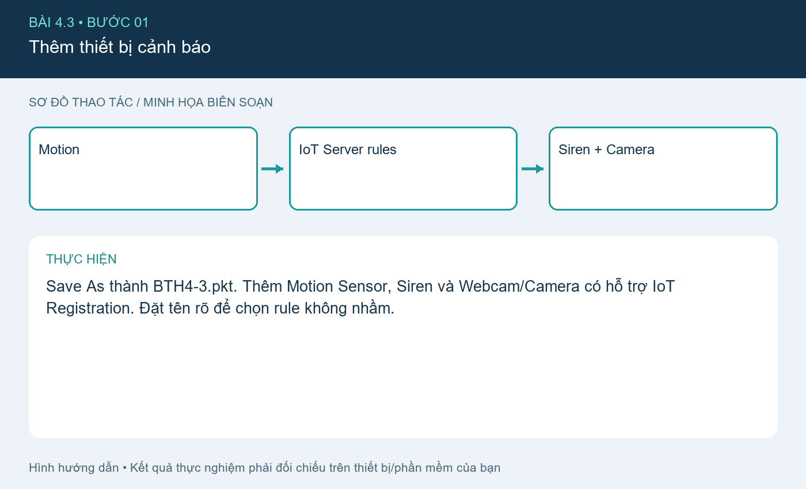
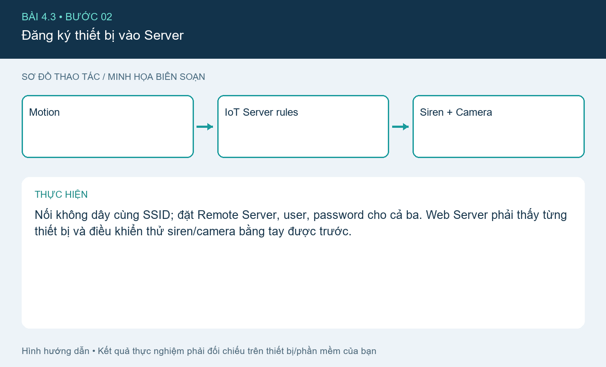
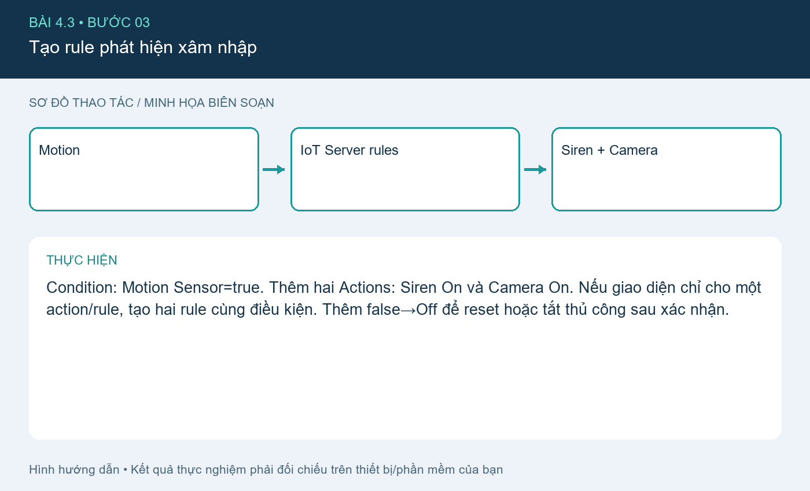
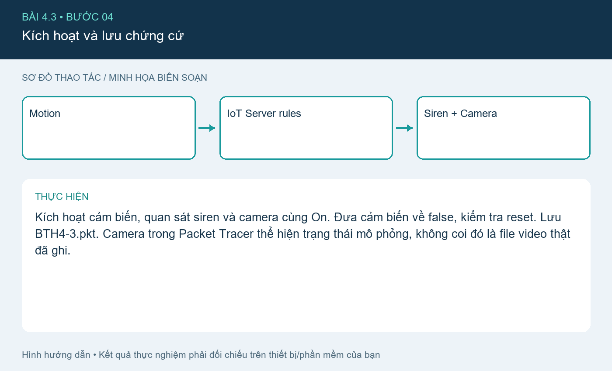

# Bài 4.3. Báo xâm nhập với còi và camera

Nguồn: [đề gốc](../tai-lieu-goc/BTH4_ETHERNET-TCPIP.pdf), trang 13. Số bài nhỏ được chuẩn hóa theo số bài thực hành; xem đối chiếu ở README.

## Chuẩn bị

Cisco Packet Tracer có IoT devices; dùng `project-goc/BTH4.pkt` làm file xuất phát. File này là hiện trạng do bạn cung cấp, chưa có xác nhận rằng đã chứa đủ cả ba bài. Các cấu hình bổ sung dưới đây là phần cần áp dụng và kiểm tra trong Packet Tracer. Hoàn thành mạng bài 4.1.

## Kết nối và cấu hình

| Thiết bị/cổng | IP / Mask | Gateway |
|---|---|---|
| Router trung gian G0/0 | 10.1.1.1 /24 | trực tiếp |
| Router trung gian G0/1 | 10.1.2.1 /24 | trực tiếp |
| Wireless Router WAN | 10.1.1.2 /24 | 10.1.1.1 |
| Wireless Router LAN | 192.168.0.1 /24 | NAT/DHCP |
| IoT Server | 10.1.2.2 /24 | 10.1.2.1 |
| PC/IoT | DHCP 192.168.0.x | 192.168.0.1 |

DNS dùng 10.1.2.2 nếu bật dịch vụ DNS hoặc truy cập IP trực tiếp. Router nối hai mạng trực tiếp nên không cần static route giữa 10.1.1.0/24 và 10.1.2.0/24. Tên cổng có thể là G0/0/0 tùy model; sửa trong `router.cfg` cho đúng thiết bị.

## Thực hiện từng bước

### Bước 1. Thêm thiết bị cảnh báo

Save As thành BTH4-3.pkt. Thêm Motion Sensor, Siren và Webcam/Camera có hỗ trợ IoT Registration. Đặt tên rõ để chọn rule không nhầm.

### Bước 2. Đăng ký thiết bị vào Server

Nối không dây cùng SSID; đặt Remote Server, user, password cho cả ba. Web Server phải thấy từng thiết bị và điều khiển thử siren/camera bằng tay được trước.

### Bước 3. Tạo rule phát hiện xâm nhập

Condition: Motion Sensor=true. Thêm hai Actions: Siren On và Camera On. Nếu giao diện chỉ cho một action/rule, tạo hai rule cùng điều kiện. Thêm false→Off để reset hoặc tắt thủ công sau xác nhận.

### Bước 4. Kích hoạt và lưu chứng cứ

Kích hoạt cảm biến, quan sát siren và camera cùng On. Đưa cảm biến về false, kiểm tra reset. Lưu BTH4-3.pkt. Camera trong Packet Tracer thể hiện trạng thái mô phỏng, không coi đó là file video thật đã ghi.

## Kiểm tra và kết quả cần thu

Kiểm thử không chuyển động không báo; có chuyển động bật cả hai; mất mạng không tự chứng minh chức năng vẫn chạy. Chụp topology, danh sách thiết bị và rule.

## Giải thích và trả lời câu hỏi

Một sự kiện có thể kích hoạt nhiều action. Tách tên cảm biến, điều kiện và trạng thái output giúp tìm lỗi. Đây là mô hình IDS chức năng đơn giản; không có thuật toán phân loại xâm nhập hoặc bằng chứng video ngoài khả năng của thiết bị mô phỏng.

## Bằng chứng thực hành

Các hình `images/*-buoc-*.png` là sơ đồ hướng dẫn biên soạn, không phải ảnh chụp kết quả chạy. [Xem toàn bộ trang đề gốc](../tai-lieu-goc/README.md). Tạo thư mục `ket-qua/` tại bài này để lưu ảnh chụp thật, log Serial, pcapng hoặc XML sau khi chạy. Không điền số đo khi chưa thực nghiệm.
