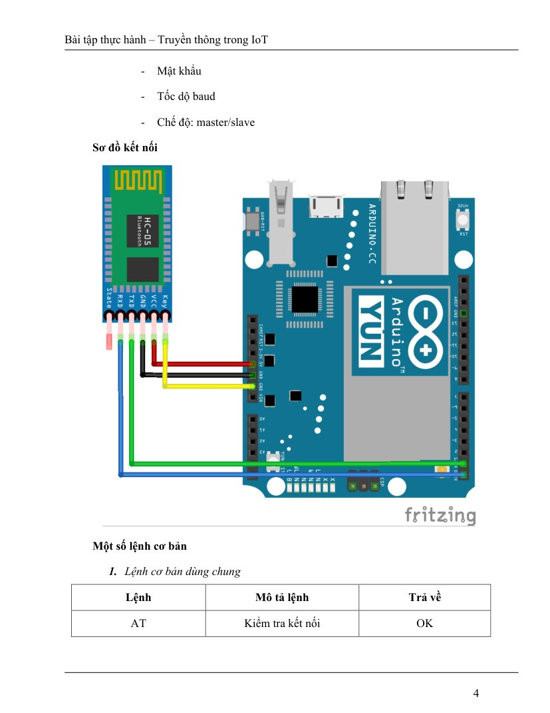
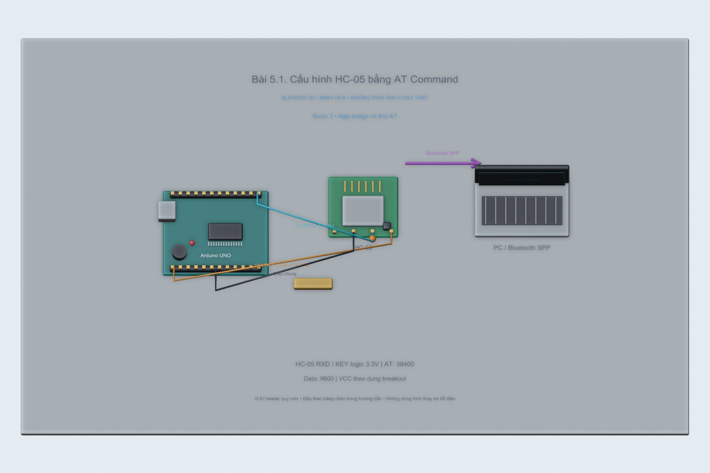
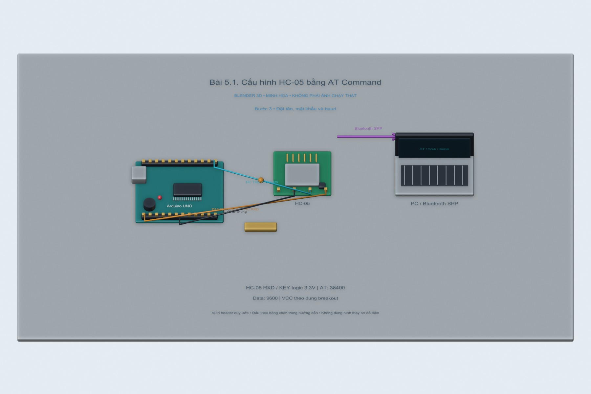
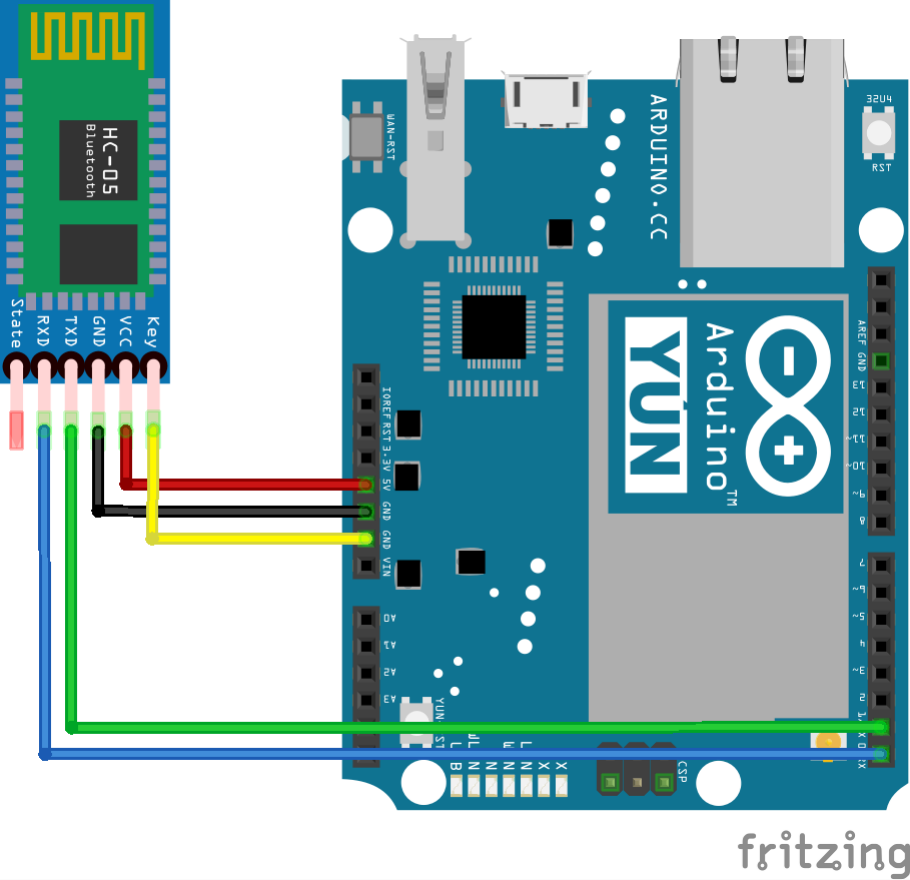

# Bài 5.1. Cấu hình HC-05 bằng AT Command

Nguồn: [đề gốc](../tai-lieu-goc/BTH5_BLUETOOTH.pdf), trang 3-6. Số bài nhỏ được chuẩn hóa theo số bài thực hành; xem đối chiếu ở README.

## Chuẩn bị

Uno, module HC-05, chia áp 1kΩ/2kΩ, Serial Monitor. Firmware bridge `5.1_AT_Bridge`.

## Kết nối và cấu hình

HC-05 TXD→Uno D10; Uno D11→chia áp→HC-05 RXD; GND chung. VCC breakout theo thông số module (thường hỗ trợ 5V qua regulator), KEY/EN và RX logic 3.3V. KEY không nối thẳng 5V như mô tả thiếu phân biệt trong PDF.

<!-- blender-intro -->
## Xem mô hình khi chưa có đủ linh kiện

[Tải cảnh Blender bài 5.1](../mo-phong-3d/5.1/bai-5.1.blend) · [Cách mở, xoay và xem timeline](../mo-phong-3d/README.md) · [Ảnh linh kiện trên mạng và nguồn](../docs/linh-kien/README.md).

Các hình theo bước dưới đây là **cảnh Blender 3D minh họa bố trí và tín hiệu**. Mốc trên timeline tương ứng số bước; vị trí hạt tín hiệu chỉ diễn họa hướng truyền. Phần nạp code/click menu làm theo chỉ dẫn bằng chữ và ảnh giao diện gốc bên dưới; hình 3D không giả làm màn hình phần mềm hay kết quả đo.

**Đọc cảnh:** xanh lơ/cam/tím là các đường tín hiệu có nhãn; dây đỏ là nguồn, dây đen là GND trong cảnh mạch điện. Với cảnh mạng, mũi tên chỉ luồng logic. Header được giản lược để dễ nhìn, nên dùng bảng nối dây trong bài để tìm chân thật.
<!-- /blender-intro -->

## Thực hiện từng bước

### Bước 1. Vào chế độ AT đầy đủ

Ngắt nguồn module. Giữ nút KEY khi cấp nguồn theo loại breakout hoặc kéo KEY mức 3.3V trước khi cấp nguồn. LED thường nháy chậm. Chế độ AT đầy đủ HC-05 thường là 38400; HC-06/firmware khác có thể khác.

**Đối chiếu tài liệu gốc, trang 4** (ảnh/giá trị mẫu trong đề, không phải kết quả mới; áp dụng hiệu chỉnh trong hướng dẫn):

### Bước 2. Nạp bridge và thử AT

Nạp `5.1_AT_Bridge`, Serial Monitor 9600 và Both NL & CR. Gửi `AT`, mong đợi OK. Lưu ý USB 9600 khác link SoftwareSerial 38400 trong AT mode.

### Bước 3. Đặt tên, mật khẩu và baud

Thử lần lượt `AT+VERSION?`, `AT+NAME=IoT-HC05`, `AT+PSWD=4567`, `AT+UART=9600,0,0`, `AT+ROLE=0`, `AT+ADDR?`. Dùng dấu ?/tham số theo firmware thực; các ví dụ typo PASWD, AT_LINK trong PDF cần sửa. Stop bit `0` thường là 1 stop bit trên HC-05.

### Bước 4. Thử Master/Slave khi có hai module

Ghi địa chỉ slave, đặt master `AT+ROLE=1`, `AT+CMODE=0`, `AT+BIND=...` và `AT+LINK=...` nếu firmware hỗ trợ. PDF ghi MODE nhưng lệnh nhiều HC-05 dùng CMODE. Sau cấu hình, cắt nguồn, bỏ KEY để vào data mode 9600, ghép nối từ điện thoại/PC.

## Kiểm tra và kết quả cần thu

Ghi lệnh + phản hồi thực, tên mới xuất hiện khi scan, baud data mode đúng9600. Nếu không có OK: kiểm tra KEY, CRLF, 38400 và đường RX qua chuyển mức.

## Giải thích và trả lời câu hỏi

HC-05 là Bluetooth Classic SPP, không phải BLE GATT. AT mode cấu hình module; data mode chuyển byte UART. Trả lời OK phụ thuộc firmware nên ghi cả AT+VERSION? trong báo cáo.

## Bằng chứng thực hành

Các hình Blender trong bài là minh họa tự dựng; ảnh giao diện từ PDF được ghi nguồn riêng. Chưa có ảnh phần cứng của người dùng cho bài này, nên chưa xác nhận kết quả thực nghiệm. [Xem toàn bộ trang đề gốc](../tai-lieu-goc/README.md). Tạo thư mục `ket-qua/` tại bài này để lưu ảnh chụp thật, log Serial, pcapng hoặc XML sau khi chạy. Không điền số đo khi chưa thực nghiệm.

<!-- source-crops -->
## Ảnh giao diện / mạch trong tài liệu gốc

Các ảnh sau lấy từ đúng các trang đề của bài. Khoanh vùng và mũi tên có sẵn trong nguồn; địa chỉ, COM, tên thiết bị và phiên bản là ví dụ. Áp dụng các hiệu chỉnh trong phần thao tác ở trên.

**Trang 4, hình 1** — [mở trang gốc](../tai-lieu-goc/trang/BTH5_BLUETOOTH/page-04.jpg).

<!-- /source-crops -->
