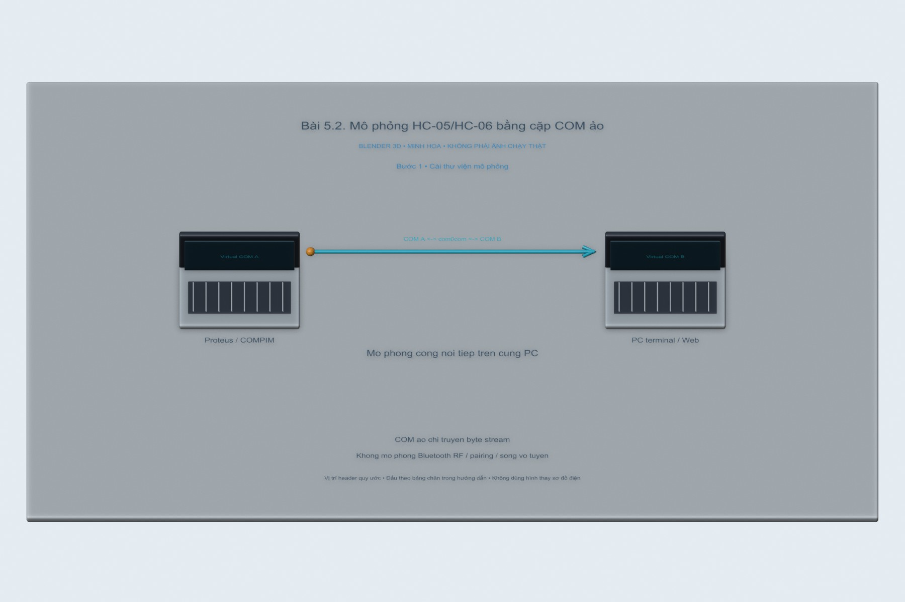
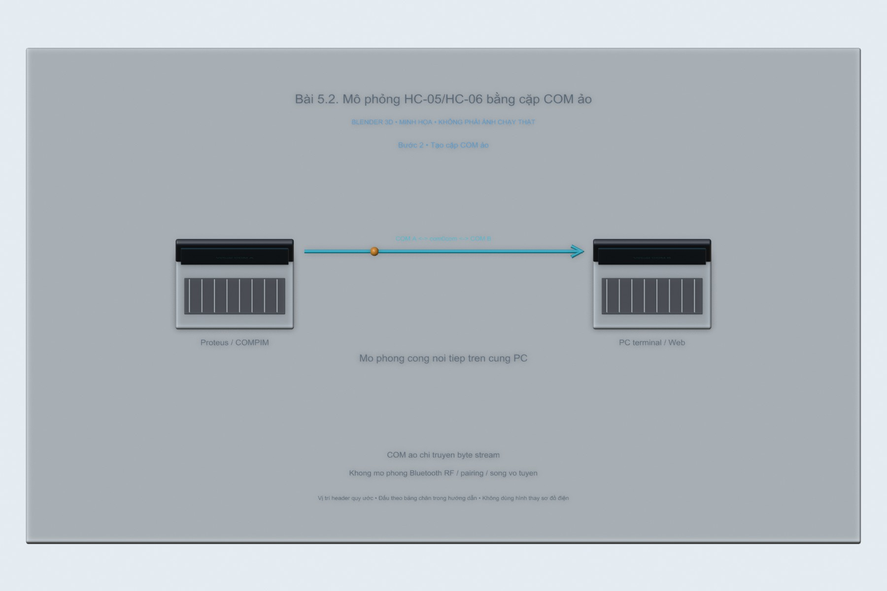
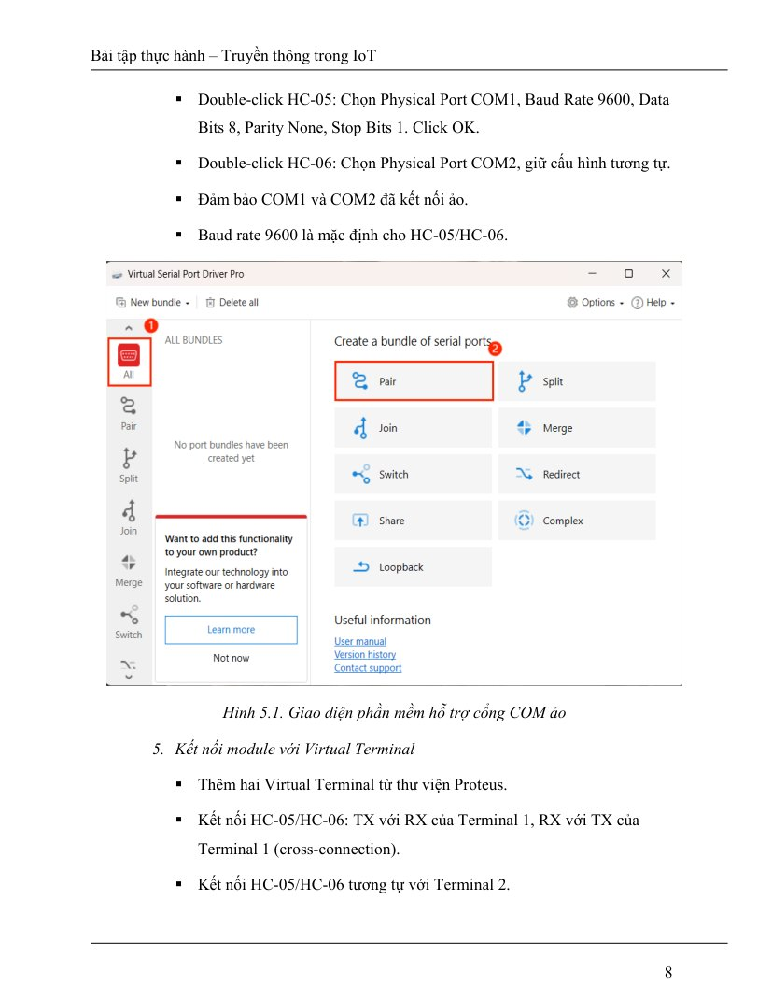
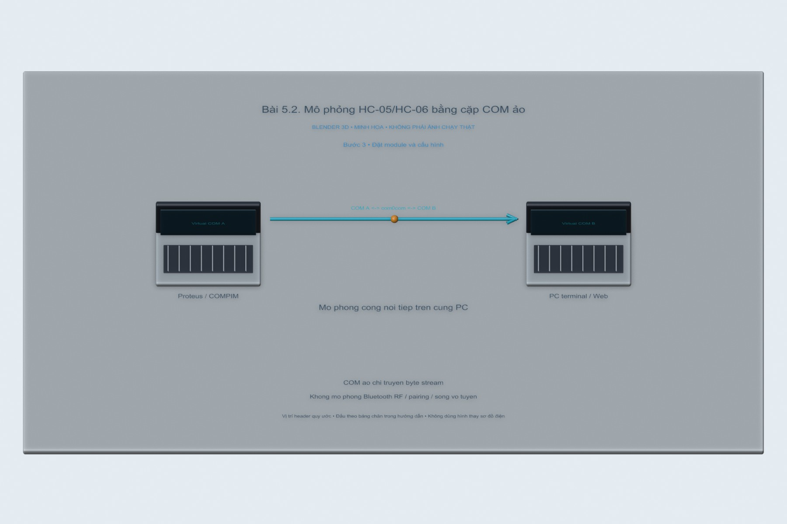
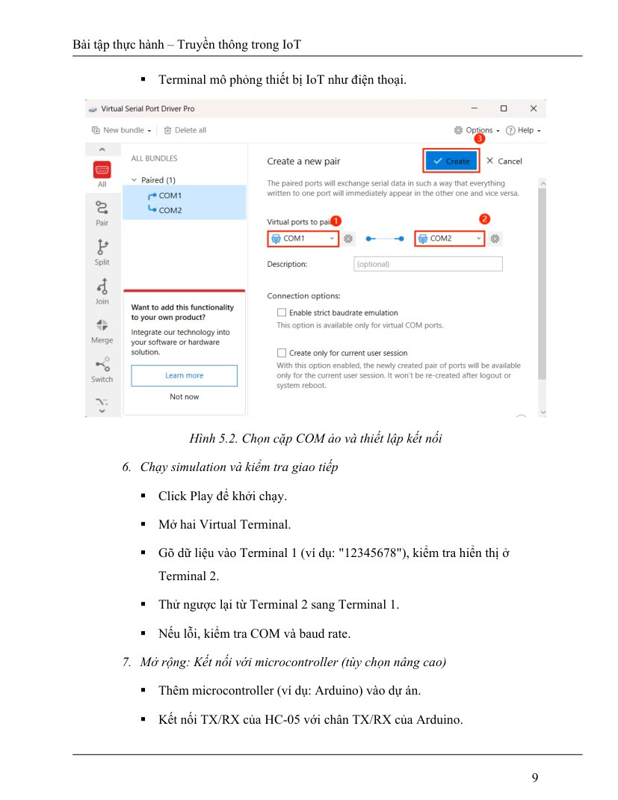
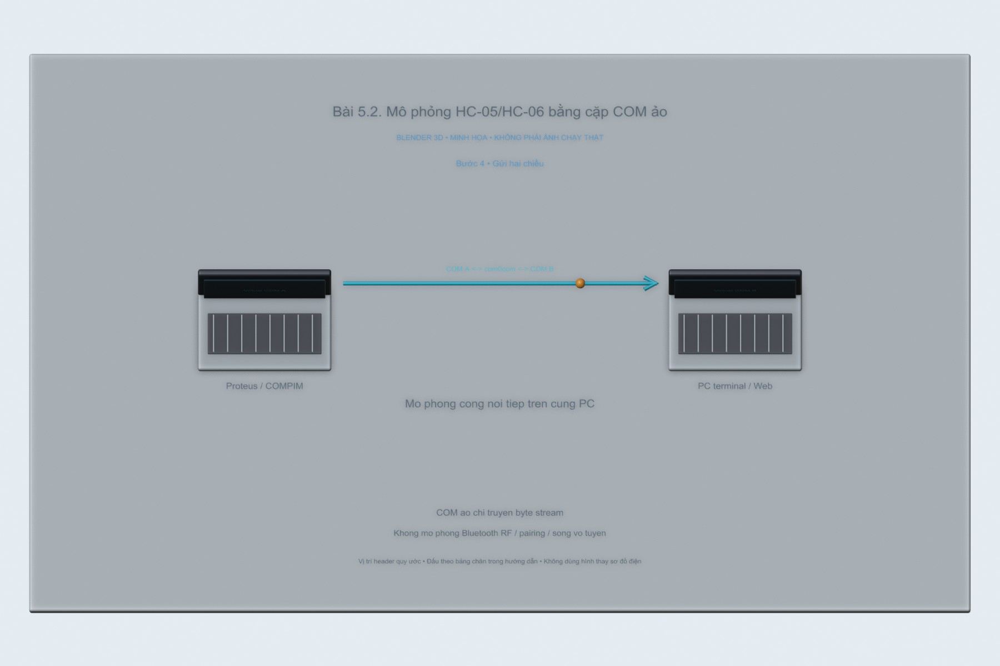
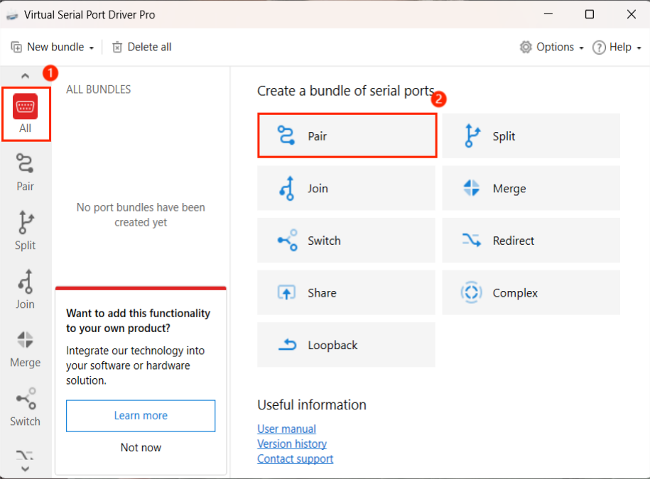
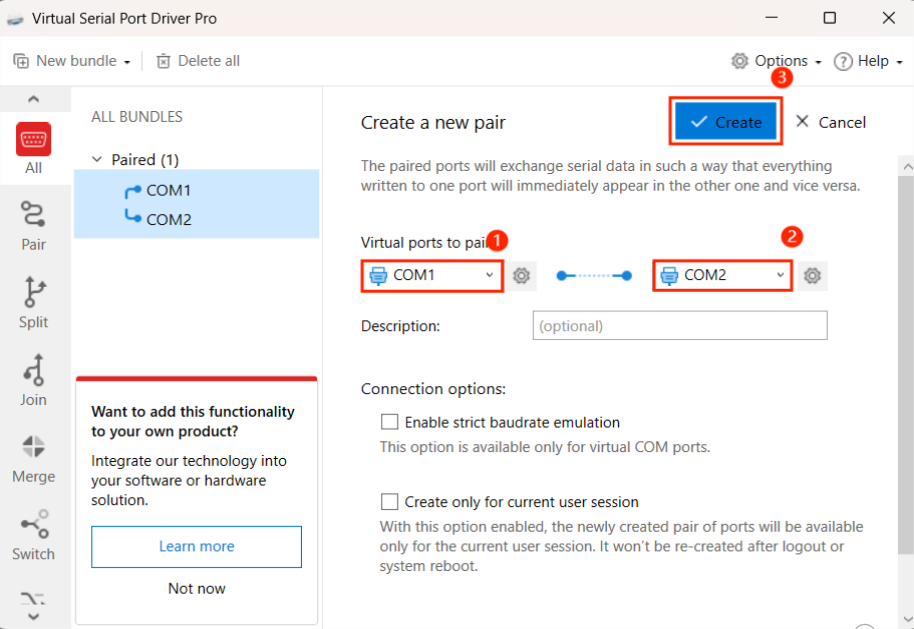

# Bài 5.2. Mô phỏng HC-05/HC-06 bằng cặp COM ảo

Cặp cổng COM ảo giúp kiểm tra luồng Serial khi chưa có đủ module Bluetooth. Dữ liệu ghi vào một đầu sẽ xuất hiện ở đầu còn lại; cách này dùng để thử chương trình trên PC, còn đường truyền vô tuyến HC-05 phải kiểm tra riêng.

Nguồn: [đề gốc](../tai-lieu-goc/BTH5_BLUETOOTH.pdf), trang 6-10.

## Dụng cụ và phần mềm

Proteus + thư viện Bluetooth đúng phiên bản, phần mềm tạo cặp COM ảo hợp lệ (ví dụ com0com hoặc công cụ theo đề), hai Virtual Terminal.

## Kết nối và cấu hình

Ví dụ tạo cặp COM10↔COM11 thay vì chiếm COM phần cứng. HC-05 Physical Port COM10; HC-06 COM11. Mỗi module TX→RXD terminal và RX←TXD terminal; tất cả 9600,8,N,1. Tên cổng chỉ là ví dụ: chọn cổng thật trên máy.

<!-- blender-intro -->
## Hình minh họa

Các ảnh 3D mô tả cách bố trí linh kiện; chân nối xem ở bảng phía trên. Có thể mở [file Blender bài 5.2](../mo-phong-3d/5.2/bai-5.2.blend) để xem các mốc của từng bước.
<!-- /blender-intro -->

## Các bước thực hiện

### Bước 1. Cài thư viện mô phỏng

Theo hướng dẫn nhà cung cấp thư viện, đặt .LIB/.IDX vào Library Path thực của Proteus; đường dẫn thay đổi theo bản cài. Khởi động lại và kiểm tra Pick Devices có module. Không đưa thư viện thương mại không có quyền vào repo.

### Bước 2. Tạo cặp COM ảo

Trong công cụ virtual port, tạo COM10 và COM11 nối null-modem. Xác nhận cả hai xuất hiện và không bị Arduino IDE/terminal khác giữ mở.

**Hình tham khảo trong đề, trang 8:**

### Bước 3. Đặt module và cấu hình

Tạo project Proteus mới, thêm hai module và hai terminal. Đặt Physical Port/baud cho từng module theo bảng. Nối chéo TX/RX riêng từng cặp module-terminal.

**Hình tham khảo trong đề, trang 9:**

### Bước 4. Gửi hai chiều

Run simulation, gõ `HELLO-A` ở terminal A và xác nhận terminal B nhận; thử `HELLO-B` chiều ngược lại. Tắt Local Echo nếu cần phân biệt ký tự tự hiển thị và dữ liệu nhận. Lưu project với Save As BTH5-2.pdsprj.

## Nội dung kiểm tra

Hai chiều nhận đúng chuỗi, không ký tự rác. Nếu port busy, chỉ cho một ứng dụng mở mỗi đầu COM; hai phía khác nhau phải dùng hai đầu của cặp.

## Nhận xét và trả lời câu hỏi

Cặp COM ảo mô phỏng đường byte nối tiếp, không mô phỏng đầy đủ sóng RF, pairing Bluetooth hoặc bảo mật. Vì thế test thành công không chứng minh kết nối vô tuyến HC-05 thực đã chạy.

## Kết quả của bài

Máy đã nhận được các cổng com0com, gồm COM5 và COM6. Phần thử đường truyền hai đầu vẫn cần làm với chương trình Serial; cặp COM ảo không đánh giá khoảng cách hay chất lượng sóng Bluetooth.

<!-- source-crops -->
## Hình tham khảo từ tài liệu thực hành

Các hình trích từ đề giúp đối chiếu vị trí nút và cách bố trí. IP, cổng COM và tên thiết bị trong hình là ví dụ của tài liệu.

**Trang 8, hình 1** — [mở trang gốc](../tai-lieu-goc/trang/BTH5_BLUETOOTH/page-08.jpg).

**Trang 9, hình 1** — [mở trang gốc](../tai-lieu-goc/trang/BTH5_BLUETOOTH/page-09.jpg).

<!-- /source-crops -->
