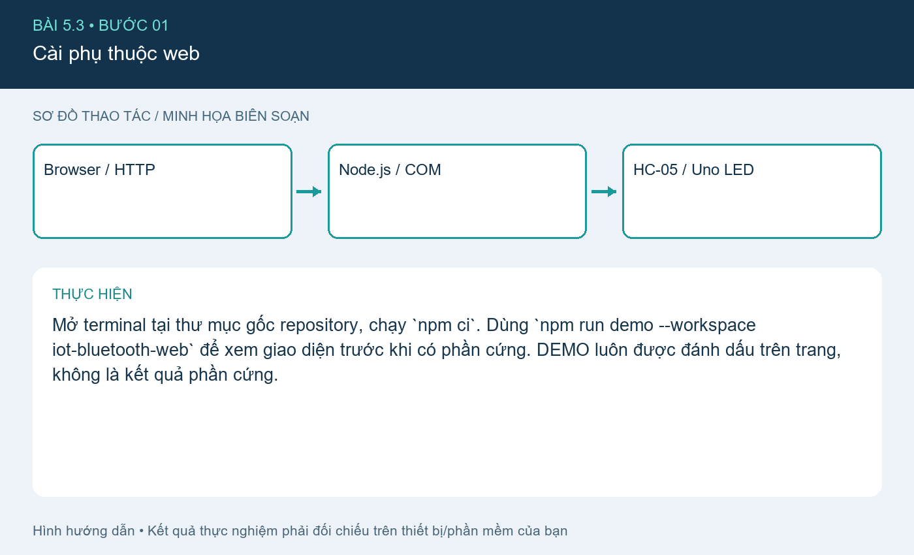
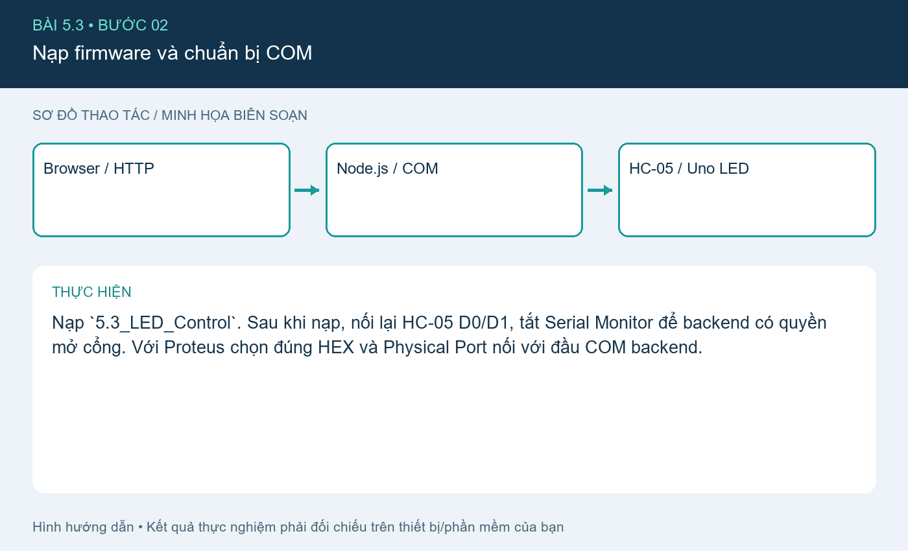
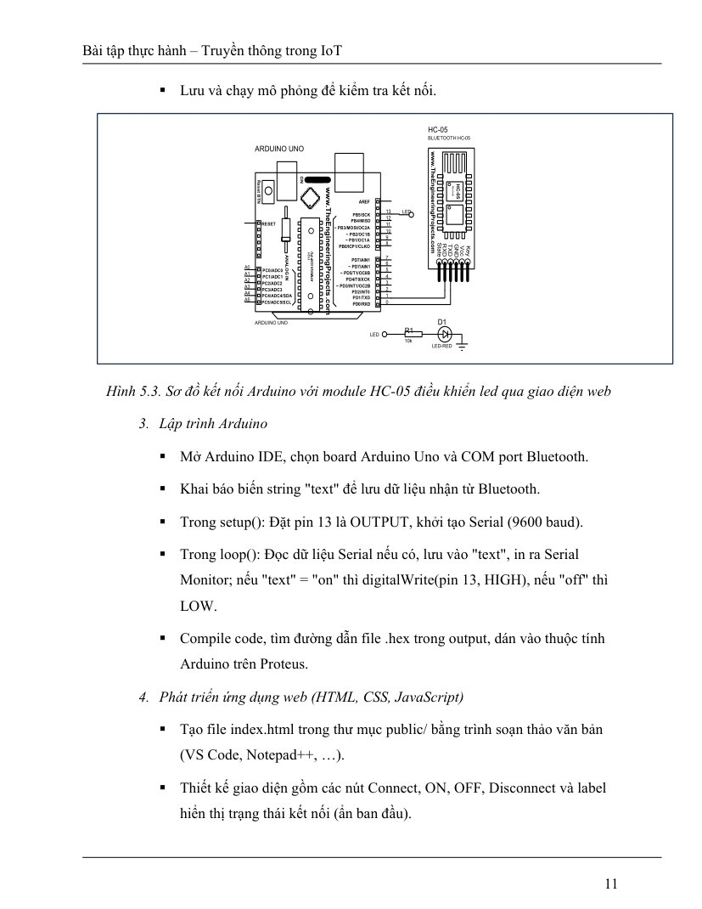
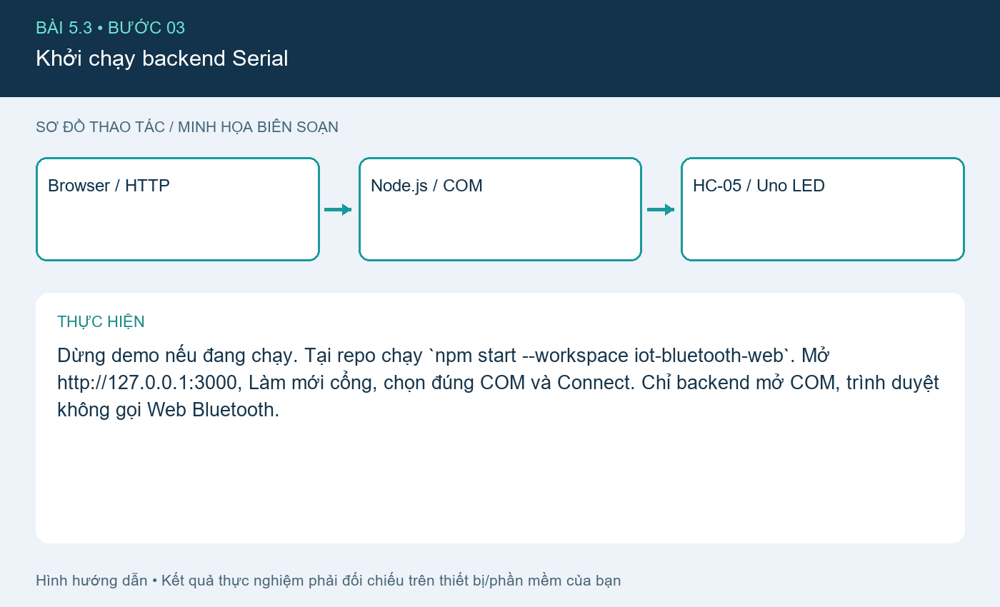
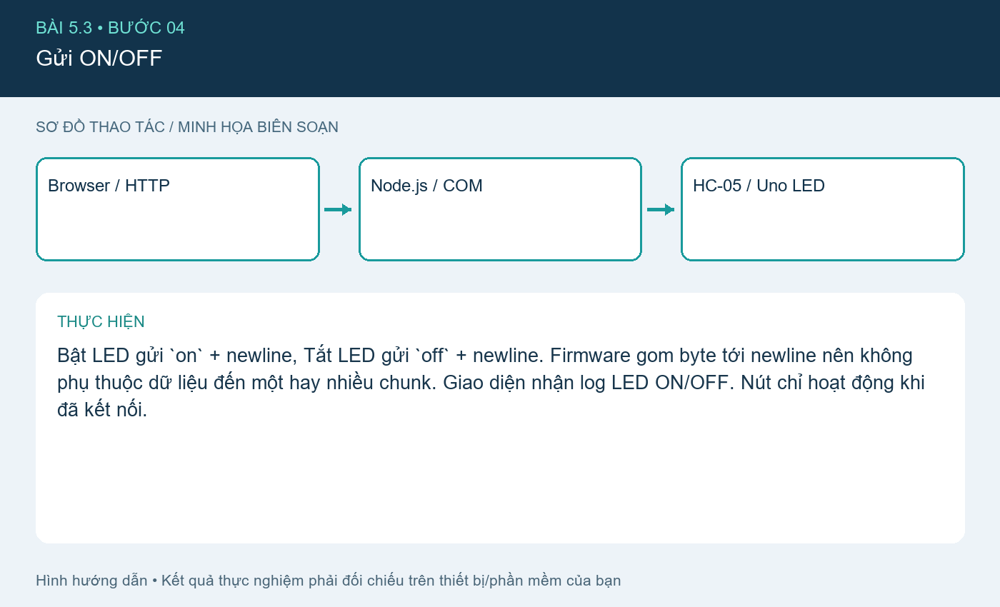
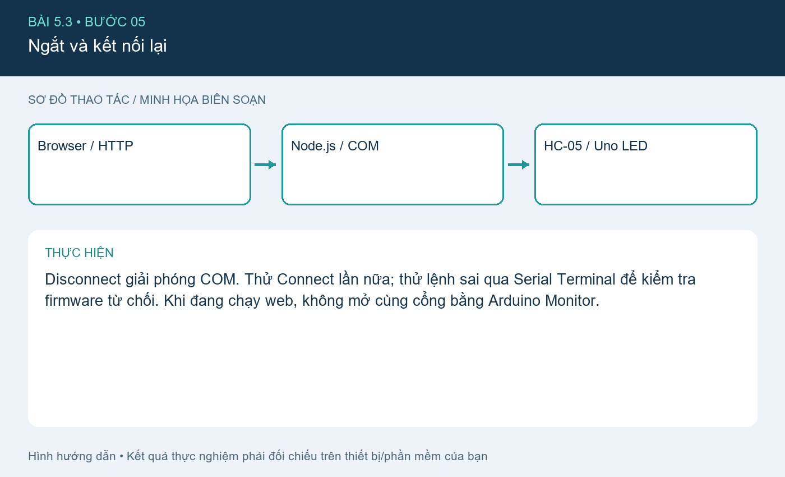

# Bài 5.3. Điều khiển LED qua Bluetooth và WebApp

Nguồn: [đề gốc](../tai-lieu-goc/BTH5_BLUETOOTH.pdf), trang 10-13. Số bài nhỏ được chuẩn hóa theo số bài thực hành; xem đối chiếu ở README.

## Chuẩn bị

Node.js 20+, npm, Uno + HC-05 hoặc Proteus/COM ảo. Dùng web/server.cjs, giao diện web/public và sketch 5.3_LED_Control.

## Kết nối và cấu hình

Data mode HC-05 9600 8N1. Với firmware dùng UART cứng: HC-05 TX→Uno D0 RX, Uno D1 TX→chia áp→HC-05 RX; LED D13. Rút TX/RX khi nạp USB. Trên PC ghép đôi HC-05 để tạo cổng SPP, hoặc dùng đầu COM còn lại của mô phỏng.

## Thực hiện từng bước

### Bước 1. Cài phụ thuộc web

Mở terminal tại thư mục gốc repository, chạy `npm ci`. Dùng `npm run demo --workspace iot-bluetooth-web` để xem giao diện trước khi có phần cứng. DEMO luôn được đánh dấu trên trang, không là kết quả phần cứng.

### Bước 2. Nạp firmware và chuẩn bị COM

Nạp `5.3_LED_Control`. Sau khi nạp, nối lại HC-05 D0/D1, tắt Serial Monitor để backend có quyền mở cổng. Với Proteus chọn đúng HEX và Physical Port nối với đầu COM backend.

**Đối chiếu tài liệu gốc, trang 11** (ảnh/giá trị mẫu trong đề, không phải kết quả mới; áp dụng hiệu chỉnh trong hướng dẫn):

### Bước 3. Khởi chạy backend Serial

Dừng demo nếu đang chạy. Tại repo chạy `npm start --workspace iot-bluetooth-web`. Mở http://127.0.0.1:3000, Làm mới cổng, chọn đúng COM và Connect. Chỉ backend mở COM, trình duyệt không gọi Web Bluetooth.

### Bước 4. Gửi ON/OFF

Bật LED gửi `on` + newline, Tắt LED gửi `off` + newline. Firmware gom byte tới newline nên không phụ thuộc dữ liệu đến một hay nhiều chunk. Giao diện nhận log LED ON/OFF. Nút chỉ hoạt động khi đã kết nối.

### Bước 5. Ngắt và kết nối lại

Disconnect giải phóng COM. Thử Connect lần nữa; thử lệnh sai qua Serial Terminal để kiểm tra firmware từ chối. Khi đang chạy web, không mở cùng cổng bằng Arduino Monitor.

## Kiểm tra và kết quả cần thu

Connect/Disconnect nhiều lần không kẹt port; ON/OFF làm thay đổi LED thực; request command ngoài on/off bị từ chối; gỡ cáp làm trang báo mất kết nối. Lưu ảnh web và mạch cùng trạng thái.

## Giải thích và trả lời câu hỏi

Đề vừa nhắc Web Bluetooth vừa mô tả backend Serial: chọn triển khai backend Serial vì HC-05/06 dùng SPP, Web Bluetooth API phục vụ BLE GATT và không thay được SPP. Browser→HTTP→Node→COM→HC05/Proteus→Uno là luồng đúng ở đây. Backend mặc định chỉ nghe 127.0.0.1.

## Bằng chứng thực hành

Các hình `images/*-buoc-*.png` là sơ đồ hướng dẫn biên soạn, không phải ảnh chụp kết quả chạy. [Xem toàn bộ trang đề gốc](../tai-lieu-goc/README.md). Tạo thư mục `ket-qua/` tại bài này để lưu ảnh chụp thật, log Serial, pcapng hoặc XML sau khi chạy. Không điền số đo khi chưa thực nghiệm.
