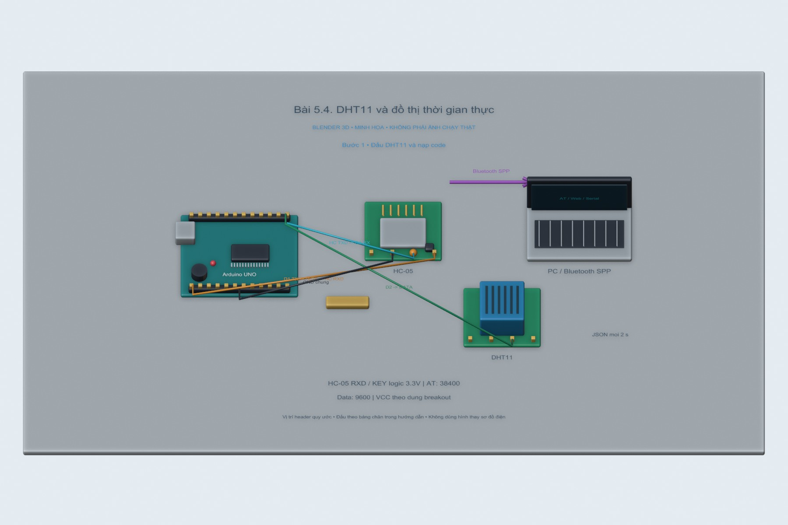
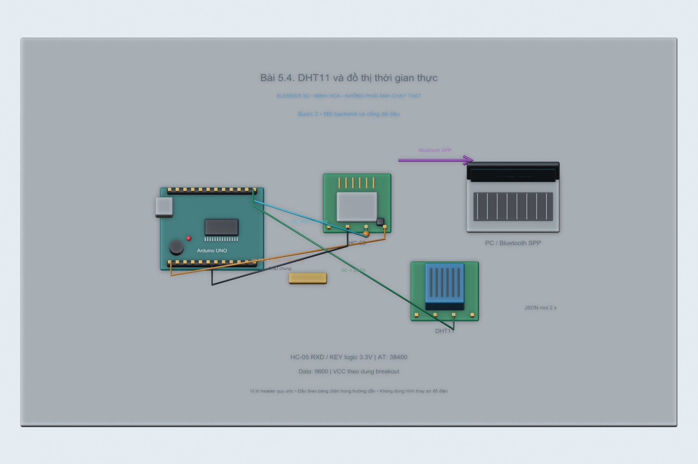
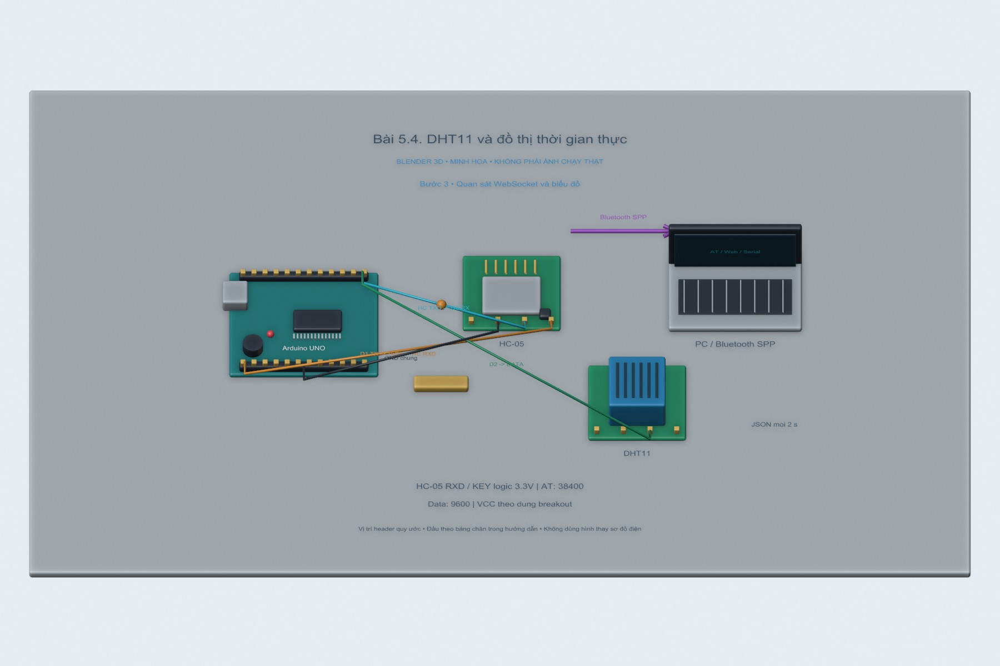

# Bài 5.4. DHT11 và đồ thị thời gian thực

Dữ liệu nhiệt độ và độ ẩm được đóng thành từng dòng JSON, đưa từ Serial lên trang web bằng WebSocket. Biểu đồ giữ 60 điểm gần nhất để dễ theo dõi sự thay đổi mà không tích lũy dữ liệu mãi trong trình duyệt.

Nguồn: [đề gốc](../tai-lieu-goc/BTH5_BLUETOOTH.pdf), trang 13.

## Dụng cụ và phần mềm

Arduino Uno, DHT11, điện trở pull-up theo module, HC-05/COM ảo; thư viện DHT sensor library + Adafruit Unified Sensor; backend web như 5.3.

## Kết nối và cấu hình

DHT11 DATA→D2, VCC/GND theo module; sensor trần cần pull-up khoảng 4.7kΩ–10kΩ giữa DATA và VCC. UART 9600 tới HC-05 hoặc mô phỏng như bài 5.3. Firmware `5.4_DHT11` phát JSON một dòng mỗi 2s.

<!-- blender-intro -->
## Hình minh họa

Các ảnh 3D mô tả cách bố trí linh kiện; chân nối xem ở bảng phía trên. Có thể mở [file Blender bài 5.4](../mo-phong-3d/5.4/bai-5.4.blend) để xem các mốc của từng bước.
<!-- /blender-intro -->

## Các bước thực hiện

### Bước 1. Đấu DHT11 và nạp code

Cài DHT sensor library và phụ thuộc; nạp `5.4_DHT11`. Ban đầu dùng USB Serial 9600 kiểm tra dòng dạng {"temp":28.0,"hum":65.0}; nếu lỗi đọc sẽ có trường error thay vì số đo giả.

### Bước 2. Mở backend và cổng dữ liệu

Chạy `npm start --workspace iot-bluetooth-web`, chọn COM của luồng cảm biến và Connect. Dừng Arduino Monitor trước khi mở cổng trên web. Cùng backend dùng cho 5.3/5.4 nhưng chỉ nạp một sketch tại một thời điểm.

### Bước 3. Quan sát WebSocket và biểu đồ

Mỗi dòng JSON hợp lệ được backend chuyển qua WebSocket. Trang hiện nhiệt độ/độ ẩm, giữ tối đa 60 điểm, tránh mảng tăng vô hạn. Khung đồ thị hiển thị 0–50°C phù hợp DHT11; giá trị ngoài khung bị chặn trên biểu đồ, số vẫn hiện.

### Bước 4. Thử lỗi và ghi nhận

Rút DATA cảm biến rồi quan sát log lỗi, không biến lỗi thành 0°C. Nối lại và chờ chu kỳ đọc. Chụp chart sau vài chục mẫu; dùng chế độ DEMO chỉ để kiểm tra UI, nhãn DEMO phải còn hiển thị.

## Nội dung kiểm tra

Nhận dữ liệu thực, đơn vị đúng, chu kỳ khoảng 2s, chart không vượt 60 điểm. Khi cảm biến lỗi không sinh điểm giả. File ghi lại cần kèm thời điểm và loại sensor.

## Nhận xét và trả lời câu hỏi

DHT11 có tốc độ lấy mẫu thấp nên không đọc liên tục trong vòng lặp. Newline phân cách bản tin JSON trên stream UART; sự kiện data của Serial không bảo đảm tương ứng đúng một bản tin. WebSocket đưa dữ liệu từ server ra web mà không polling HTTP liên tục.

## Kết quả của bài

Luồng WebSocket đã được kiểm tra bằng dữ liệu DEMO; sketch DHT11 cũng đã biên dịch. Các giá trị nhiệt độ, độ ẩm dùng trong lần thử phần mềm chưa phải số đo cảm biến.
