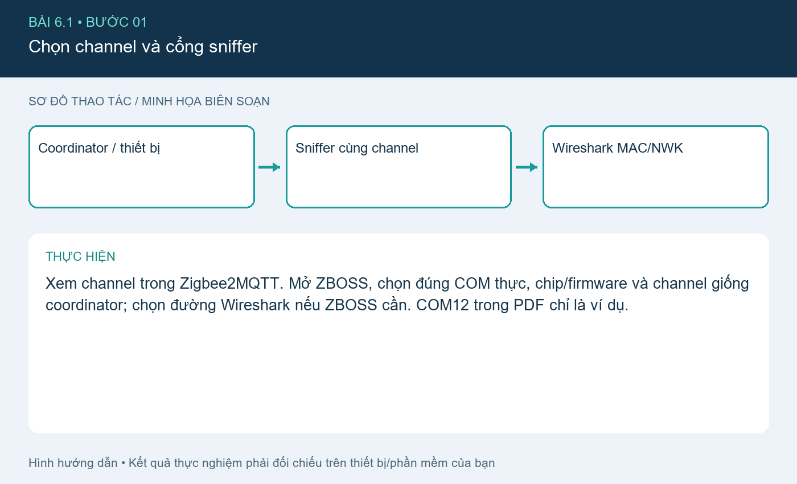
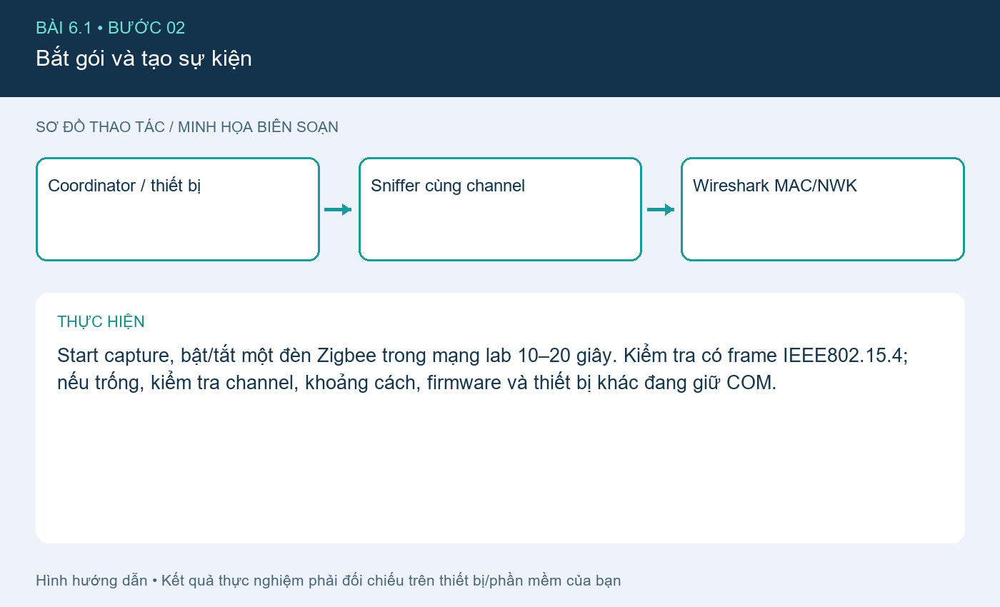
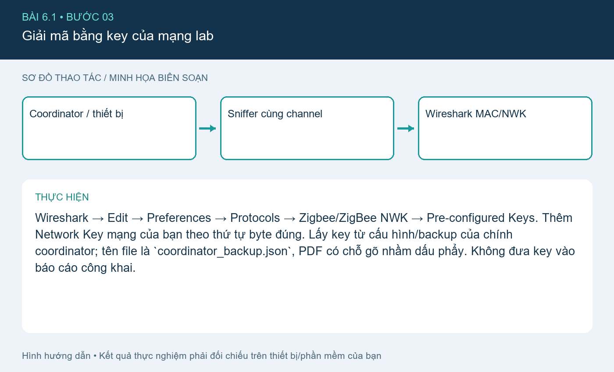
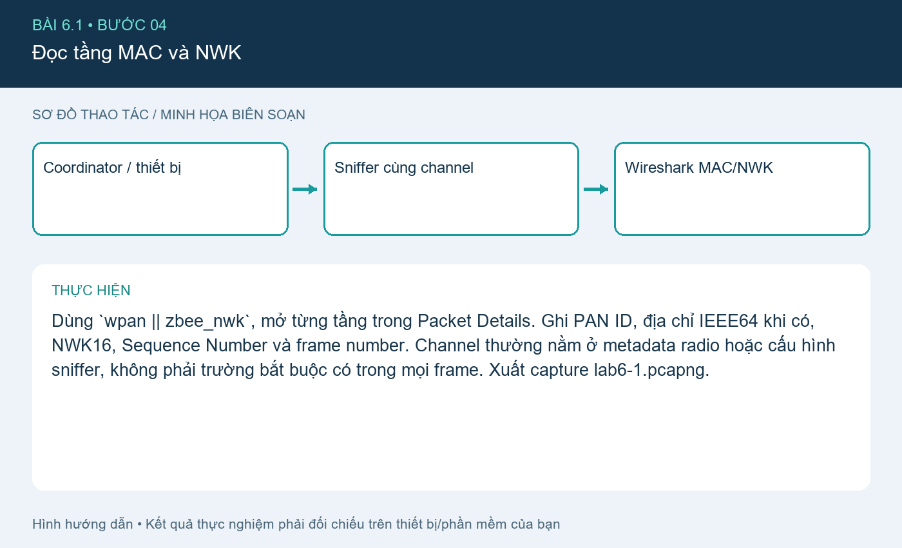

# Bài 6.1. Bắt và phân tích MAC/NWK Zigbee

Nguồn: [đề gốc](../tai-lieu-goc/BTH6_ZigBee.pdf), trang 4-8. Số bài nhỏ được chuẩn hóa theo số bài thực hành; xem đối chiếu ở README.

## Chuẩn bị

Đã làm [cài đặt hệ thống](CAI_DAT.md); coordinator + thiết bị Zigbee riêng cho lab và **sniffer thứ hai** (ví dụ CC2531 với sniffer firmware), Wireshark + ZBOSS phù hợp phần cứng. File capture-fields.csv là mẫu ghi các trường thực.

## Kết nối và cấu hình

Coordinator nối HA/Zigbee2MQTT; sniffer USB nối máy capture riêng hoặc passthrough phù hợp. Cả hai phải cùng channel Zigbee (ví dụ15). Không flash sniffer firmware lên chính coordinator đang phục vụ mạng rồi mong cả hai vai trò cùng chạy.

## Thực hiện từng bước

### Bước 1. Chọn channel và cổng sniffer

Xem channel trong Zigbee2MQTT. Mở ZBOSS, chọn đúng COM thực, chip/firmware và channel giống coordinator; chọn đường Wireshark nếu ZBOSS cần. COM12 trong PDF chỉ là ví dụ.

### Bước 2. Bắt gói và tạo sự kiện

Start capture, bật/tắt một đèn Zigbee trong mạng lab 10–20 giây. Kiểm tra có frame IEEE802.15.4; nếu trống, kiểm tra channel, khoảng cách, firmware và thiết bị khác đang giữ COM.

### Bước 3. Giải mã bằng key của mạng lab

Wireshark → Edit → Preferences → Protocols → Zigbee/ZigBee NWK → Pre-configured Keys. Thêm Network Key mạng của bạn theo thứ tự byte đúng. Lấy key từ cấu hình/backup của chính coordinator; tên file là `coordinator_backup.json`, PDF có chỗ gõ nhầm dấu phẩy. Không đưa key vào báo cáo công khai.

### Bước 4. Đọc tầng MAC và NWK

Dùng `wpan || zbee_nwk`, mở từng tầng trong Packet Details. Ghi PAN ID, địa chỉ IEEE64 khi có, NWK16, Sequence Number và frame number. Channel thường nằm ở metadata radio hoặc cấu hình sniffer, không phải trường bắt buộc có trong mọi frame. Xuất capture lab6-1.pcapng.

## Kiểm tra và kết quả cần thu

Có ít nhất một gói đọc được MAC/NWK, bảng ghi rõ frame number và địa chỉ; thêm ảnh Packet Details. Trường không tồn tại trong frame ghi N/A, không điền theo suy đoán.

## Giải thích và trả lời câu hỏi

IEEE64/EUI64 định danh dài; short address16 do mạng cấp có thể thay đổi khi join lại. Coordinator thường dùng NWK0x0000. MAC address trên một hop có thể là router tiếp sức, trong khi nguồn/đích NWK biểu diễn thiết bị đầu/cuối của đường nhiều hop. Zigbee2.4GHz thông dụng dùng các kênh11–26; không suy từ số kênh Wi-Fi. Địa chỉ cụ thể và Sequence Number phải lấy từ capture, không có đáp án số cố định.

## Bằng chứng thực hành

Các hình `images/*-buoc-*.png` là sơ đồ hướng dẫn biên soạn, không phải ảnh chụp kết quả chạy. [Xem toàn bộ trang đề gốc](../tai-lieu-goc/README.md). Tạo thư mục `ket-qua/` tại bài này để lưu ảnh chụp thật, log Serial, pcapng hoặc XML sau khi chạy. Không điền số đo khi chưa thực nghiệm.
