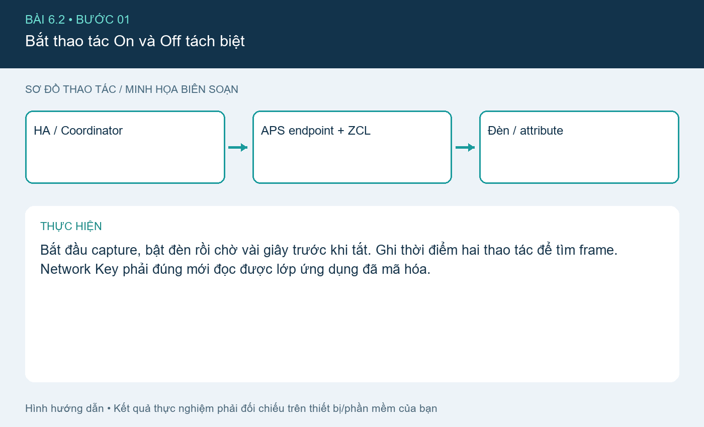
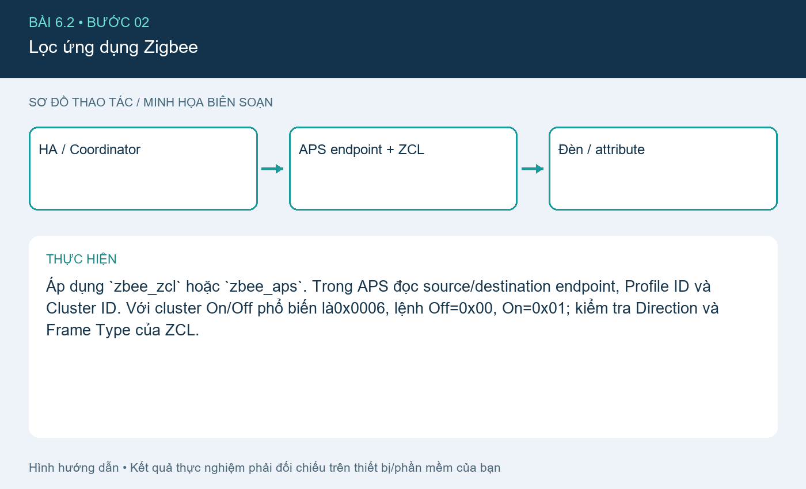
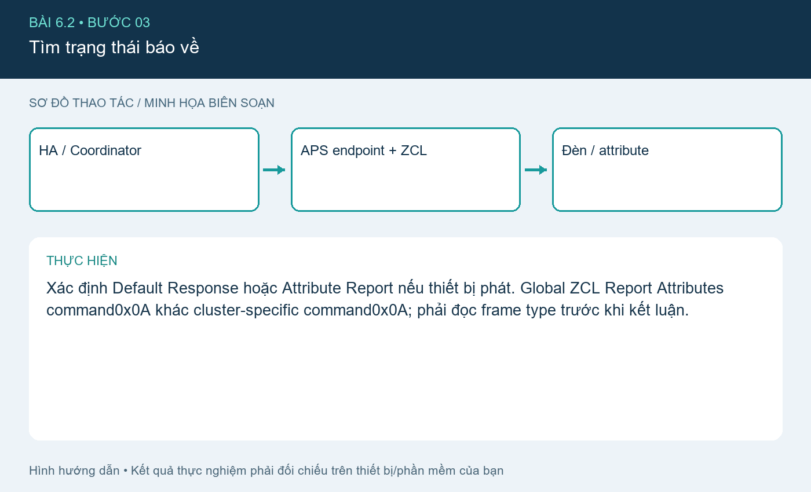
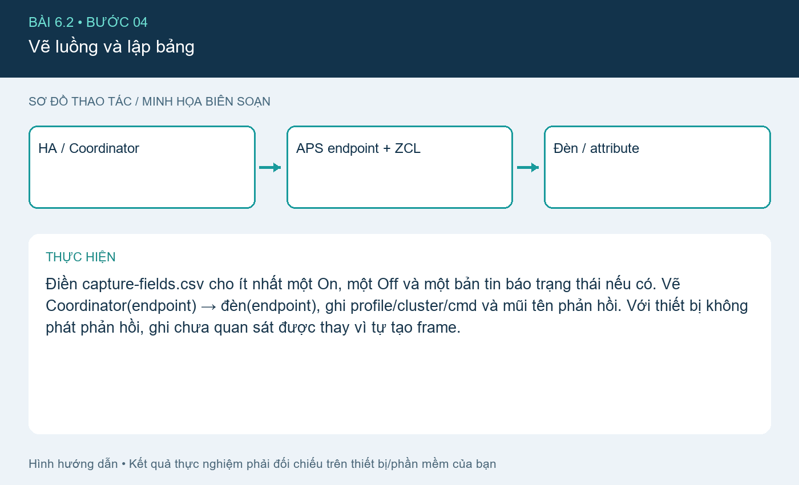

# Bài 6.2. ZCL/APS: On, Off và Attribute Report

Nguồn: [đề gốc](../tai-lieu-goc/BTH6_ZigBee.pdf), trang 8-9. Số bài nhỏ được chuẩn hóa theo số bài thực hành; xem đối chiếu ở README.

## Chuẩn bị

Đã làm [cài đặt hệ thống](CAI_DAT.md); coordinator + thiết bị Zigbee riêng cho lab và **sniffer thứ hai** (ví dụ CC2531 với sniffer firmware), Wireshark + ZBOSS phù hợp phần cứng. File capture-fields.csv là mẫu ghi các trường thực.

## Kết nối và cấu hình

Coordinator nối HA/Zigbee2MQTT; sniffer USB nối máy capture riêng hoặc passthrough phù hợp. Cả hai phải cùng channel Zigbee (ví dụ15). Không flash sniffer firmware lên chính coordinator đang phục vụ mạng rồi mong cả hai vai trò cùng chạy.

## Thực hiện từng bước

### Bước 1. Bắt thao tác On và Off tách biệt

Bắt đầu capture, bật đèn rồi chờ vài giây trước khi tắt. Ghi thời điểm hai thao tác để tìm frame. Network Key phải đúng mới đọc được lớp ứng dụng đã mã hóa.

### Bước 2. Lọc ứng dụng Zigbee

Áp dụng `zbee_zcl` hoặc `zbee_aps`. Trong APS đọc source/destination endpoint, Profile ID và Cluster ID. Với cluster On/Off phổ biến là0x0006, lệnh Off=0x00, On=0x01; kiểm tra Direction và Frame Type của ZCL.

### Bước 3. Tìm trạng thái báo về

Xác định Default Response hoặc Attribute Report nếu thiết bị phát. Global ZCL Report Attributes command0x0A khác cluster-specific command0x0A; phải đọc frame type trước khi kết luận.

### Bước 4. Vẽ luồng và lập bảng

Điền capture-fields.csv cho ít nhất một On, một Off và một bản tin báo trạng thái nếu có. Vẽ Coordinator(endpoint) → đèn(endpoint), ghi profile/cluster/cmd và mũi tên phản hồi. Với thiết bị không phát phản hồi, ghi chưa quan sát được thay vì tự tạo frame.

## Kiểm tra và kết quả cần thu

Hai dòng On/Off đủ endpoint/profile/cluster/cmd/frame number; ít nhất một ảnh phân rã APS+ZCL; luồng gửi và phản hồi đối chiếu được capture.

## Giải thích và trả lời câu hỏi

ZCL (Zigbee Cluster Library) chuẩn hóa dữ liệu và lệnh ứng dụng. Cluster gom thuộc tính/lệnh cùng chức năng như On/Off0x0006. Profile ID xác định ngữ cảnh ứng dụng, ví dụ Home Automation0x0104; Endpoint là điểm ứng dụng trên thiết bị. MAC ACK chỉ xác nhận một hop nhận frame, không phải xác nhận đèn đã thực hiện lệnh.

## Bằng chứng thực hành

Các hình `images/*-buoc-*.png` là sơ đồ hướng dẫn biên soạn, không phải ảnh chụp kết quả chạy. [Xem toàn bộ trang đề gốc](../tai-lieu-goc/README.md). Tạo thư mục `ket-qua/` tại bài này để lưu ảnh chụp thật, log Serial, pcapng hoặc XML sau khi chạy. Không điền số đo khi chưa thực nghiệm.
