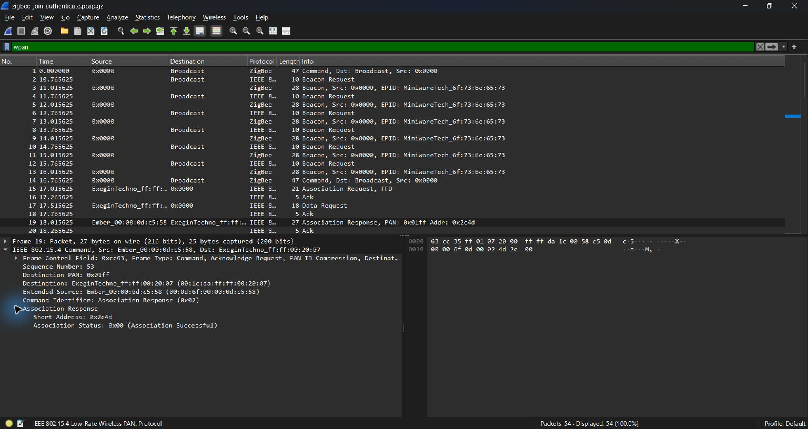
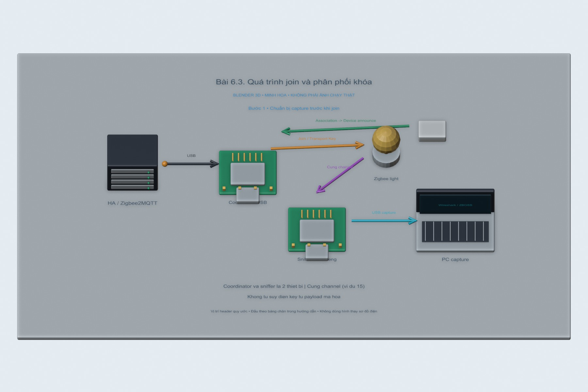
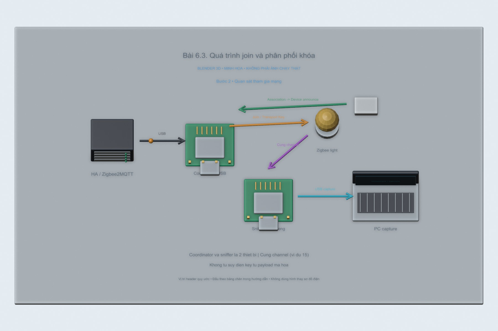
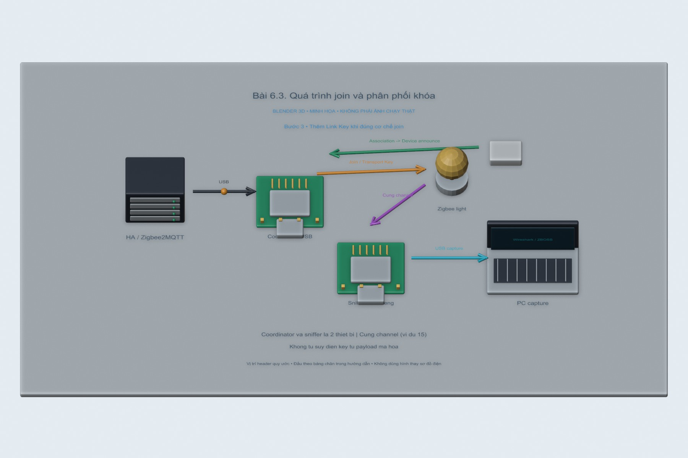
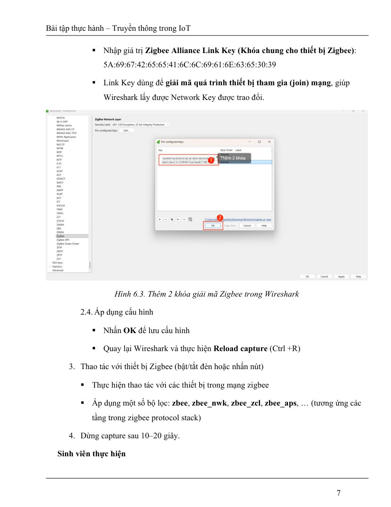
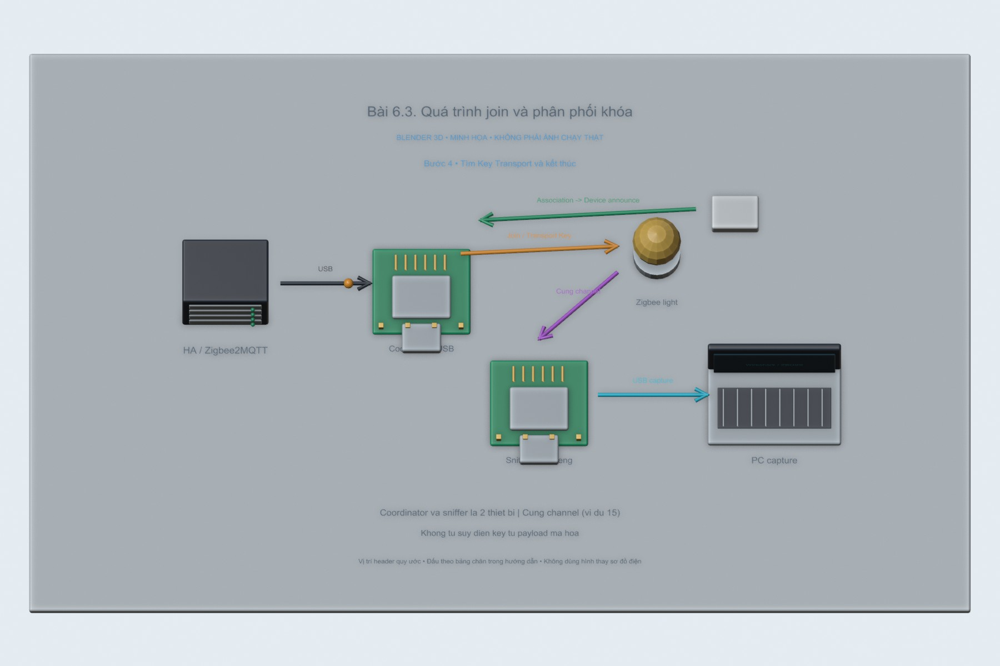

# Bài 6.3. Quá trình join và phân phối khóa

Khi một thiết bị mới tham gia mạng, có thể quan sát các bước tìm mạng, xin gia nhập và trao đổi bảo mật. Em dùng bản ghi mẫu để đọc lại quá trình này vì bộ linh kiện hiện tại chỉ có CC2531.

Nguồn: [đề gốc](../tai-lieu-goc/BTH6_ZigBee.pdf), trang 10-11.

## Dụng cụ và phần mềm

Phần đọc bản ghi trong lần làm này nằm ở [ghi chép CC2531 và Zigbee mẫu](ket-qua/README.md). Em quan sát frame 15/19 để xem Association Request/Response, rồi frame 21 để đọc APS Security Header.

Đã làm [cài đặt hệ thống](CAI_DAT.md); coordinator + thiết bị Zigbee riêng cho lab và **sniffer thứ hai** (ví dụ CC2531 với sniffer firmware), Wireshark + ZBOSS phù hợp phần cứng. File capture-fields.csv là mẫu ghi các trường thực.

## Kết nối và cấu hình

Coordinator nối HA/Zigbee2MQTT; sniffer USB nối máy capture riêng hoặc passthrough phù hợp. Cả hai phải cùng channel Zigbee (ví dụ15). Không flash sniffer firmware lên chính coordinator đang phục vụ mạng rồi mong cả hai vai trò cùng chạy.

<!-- blender-intro -->
## Hình minh họa

Các ảnh 3D mô tả vị trí các thành phần và hướng trao đổi dữ liệu. Có thể mở [file Blender bài 6.3](../mo-phong-3d/6.3/bai-6.3.blend) để xem các mốc của từng bước.
<!-- /blender-intro -->

## Các bước thực hiện

### Bước 1. Chuẩn bị capture trước khi join

Dùng thiết bị thử nghiệm có thể reset; bắt gói trước, rồi mở Permit join trong Zigbee2MQTT. Coordinator và sniffer cùng channel. Reset thiết bị theo tài liệu để vào pairing.

### Bước 2. Quan sát tham gia mạng

Chờ join thành công trong log Zigbee2MQTT. Đánh dấu MAC Association, Device Announce và trao đổi APS liên quan nếu xuất hiện trong loại join đang thử; không phải mọi thiết bị đều có đúng cùng một chuỗi frame.

### Bước 3. Thêm Link Key khi đúng cơ chế join

Default global link key ASCII ZigBeeAlliance09 tương ứng hex `5a:69:67:42:65:65:41:6c:6c:69:61:6e:63:65:30:39`. Chỉ hữu ích với thiết bị thực sự dùng khóa đó; install-code/link key riêng cần đúng key. Thêm trong Wireshark và reload capture.

**Hình tham khảo trong đề, trang 7:**

### Bước 4. Tìm Key Transport và kết thúc

Lọc `zbee_aps`, tìm APS Command Transport Key trong Packet Details/Info. Ghi frame/source/destination, key type, key sequence nhưng che giá trị key. Đóng Permit join; lưu pcap trong nơi riêng, báo cáo công khai chỉ dùng ảnh đã che key.

## Nội dung kiểm tra

Lưu bảng sự kiện join + frame number thực, một frame Key Transport nếu quan sát được, giải thích vì sao không giải mã được nếu thiếu key/capture. Không tuyên bố key mẫu trong PDF là key mạng của bạn.

## Nhận xét và trả lời câu hỏi

Trust Center Link Key bảo vệ trao đổi giữa thiết bị và Trust Center, gồm phân phối khóa theo kiểu join. Network Key bảo vệ NWK traffic trong mạng và được các thành viên dùng chung theo cơ chế cấu hình. Để giải mã join cần đúng link key và bắt đúng quá trình; sau join cần network key. Chỉ có global link key không bảo đảm giải mã mọi mạng Zigbee3 có install-code/TCLK riêng. Transport Key là command tầng APS, dù bên ngoài vẫn được bọc NWK/MAC.

## Kết quả của bài

Bản ghi mẫu có Association Request, Association Response và hai frame APS được bảo vệ. Em đọc được các trường bên ngoài; nội dung lệnh APS còn mã hóa nên chưa xác nhận Transport Key bằng phần payload đã giải mã.
