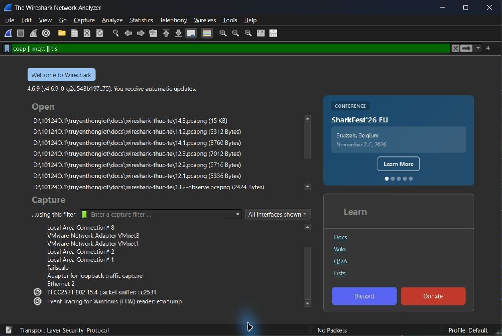
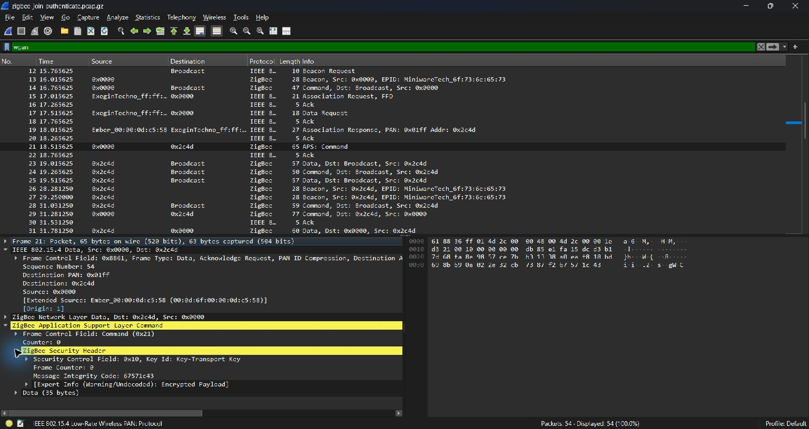

# Ghi chép thử CC2531 và đọc gói Zigbee

## Thiết bị em đang có

Em hiện chỉ có một USB CC2531, loại anten in trên bo mạch, chưa có coordinator và đèn hoặc cảm biến Zigbee khác. Vì vậy em làm phần nhận thiết bị trên Windows trước, rồi dùng một bản ghi có sẵn để tập đọc các tầng giao thức.

Lúc mới cắm USB, Windows nhận tên **CC2531 USB Dongle** nhưng báo Code 28. Sau khi cài driver WinUSB của Microsoft, trạng thái chuyển sang OK, Code 0. Phiên bản driver đang dùng là 10.0.26100.9549. Dongle trả lời được các lệnh cấp nguồn radio, chọn kênh 11, bắt đầu và dừng thu; lần này không cần ghi lại firmware.

Em thêm công cụ extcap theo [hướng dẫn wireshark-cc2531](https://github.com/andrebdo/wireshark-cc2531). Sau khi làm mới danh sách, Wireshark hiện **TI CC2531 802.15.4 packet sniffer** như hình.

Em thử quét các kênh 11–26, mỗi kênh khoảng 4 giây gồm thời gian khởi tạo radio. Kết quả đều là 0 gói. Khi thử riêng qua TShark trên kênh 11 trong 5 giây, chương trình cũng báo `0 packets captured`. Có thể xem [kết quả từng kênh](scan-report.json) và [file bắt thử kênh 11](wireshark-test-channel-11.pcapng); file này trống, chỉ dùng để ghi lại lần thử.

Lần quét ngắn chưa đủ để đánh giá chất lượng thu của dongle. Do chưa có thiết bị Zigbee riêng tạo dữ liệu, em chưa làm được phần bật/tắt đèn và bắt quá trình join trên mạng tự dựng.

## Đọc thêm bằng bản ghi mẫu

Em tải `zigbee-join-authenticate.pcap.gz` từ mục [SampleCaptures của Wireshark](https://wiki.wireshark.org/SampleCaptures). Đây là **bản ghi tham khảo của Wireshark Wiki**, không phải dữ liệu thu bằng CC2531 trong lần thử trên.

[Tải file từ nguồn](https://wiki.wireshark.org/uploads/__moin_import__/attachments/SampleCaptures/zigbee-join-authenticate.pcap.gz). SHA256 của bản tải về: `c6691c477d88c75ebfbe3ef7236dc766b01e6acaccaeea3fc03600f927aecc81`.

Em mở file trong Wireshark 4.6.9 và lọc `wpan`. Bản ghi có 54 frame IEEE 802.15.4; trong đó 28 frame được nhận dạng là Zigbee NWK và 2 frame có tầng APS. [Bảng các frame](mau-packets.csv) lưu lại những trường em đọc được.

### Từ yêu cầu gia nhập đến địa chỉ được cấp

Ở frame **15**, thiết bị `00:1c:da:ff:ff:00:20:07` gửi **Association Request** tới địa chỉ ngắn `0x0000`, PAN `0x01ff`. Đến frame **19**, **Association Response** cấp địa chỉ `0x2c4d`, trạng thái `0x00 — Association Successful`.

Qua hai frame này có thể phân biệt địa chỉ IEEE 64 bit của thiết bị với địa chỉ ngắn được cấp trong mạng. Các giá trị trên thuộc bản ghi mẫu; MAC và PAN của một mạng khác sẽ không nhất thiết giống như vậy.

### Phần bảo mật sau association

Frame **21** đi từ `0x0000` tới `0x2c4d`. Trong APS có Security Header, Key Id ghi **Key-Transport Key**, Frame Counter bằng 0 và phần dữ liệu còn mã hóa. Frame **35** cũng có APS được bảo vệ, Frame Counter bằng 1.

Em chưa thêm khóa để giải mã payload. Vì vậy, trường Key Id ở ngoài chưa đủ để khẳng định đã đọc được nội dung một lệnh Transport Key; cần phân biệt loại khóa dùng bảo vệ gói với command bên trong. Bản ghi này cũng chưa cho thấy On/Off/Attribute Report đã giải mã để điền kết quả cho bài 6.2.

## Nhận xét

Với bộ linh kiện hiện có, em đã kiểm tra được phần USB, driver và lệnh điều khiển sniffer. Việc đọc bản ghi mẫu giúp theo dõi Association Request/Response và các trường bảo mật, nhưng phần thu gói từ mạng tự dựng vẫn cần thêm coordinator và thiết bị Zigbee.

Ảnh trong trang này được chụp trực tiếp từ Wireshark: ảnh đầu là giao diện CC2531 trên máy, hai ảnh sau là lúc mở bản ghi mẫu. [Thông tin nguồn và hash](nguon-du-lieu.json) được lưu kèm để đối chiếu.
