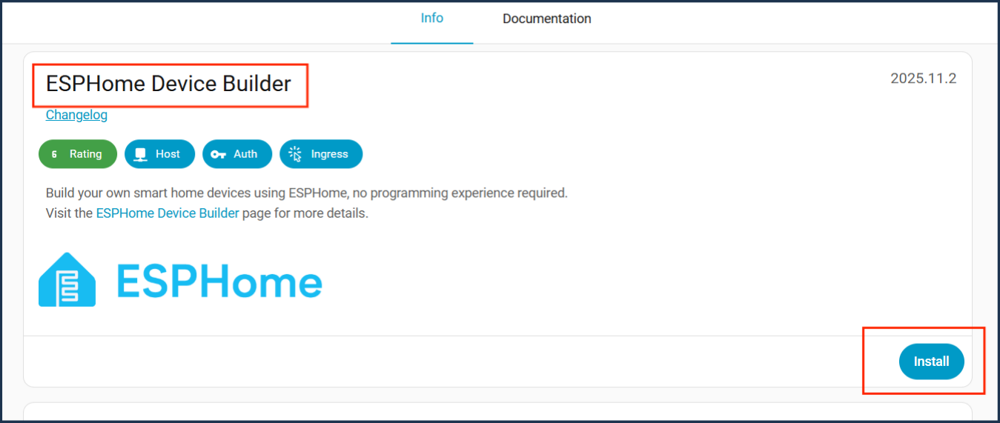
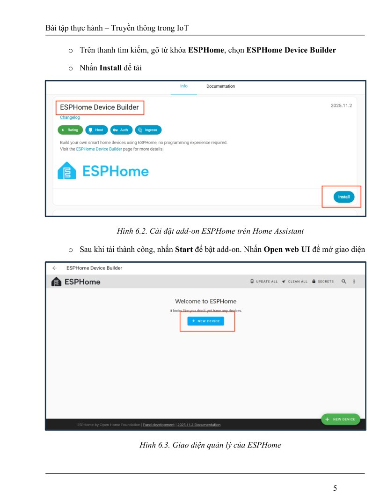
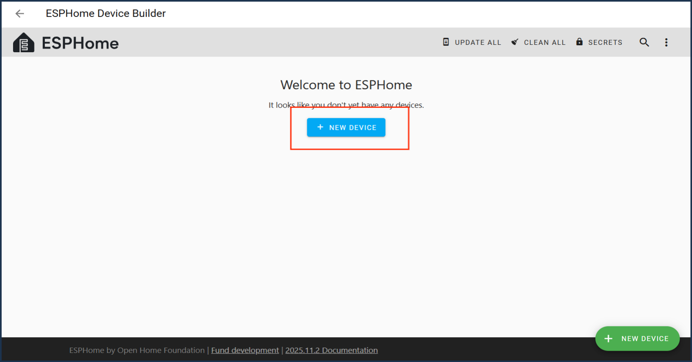
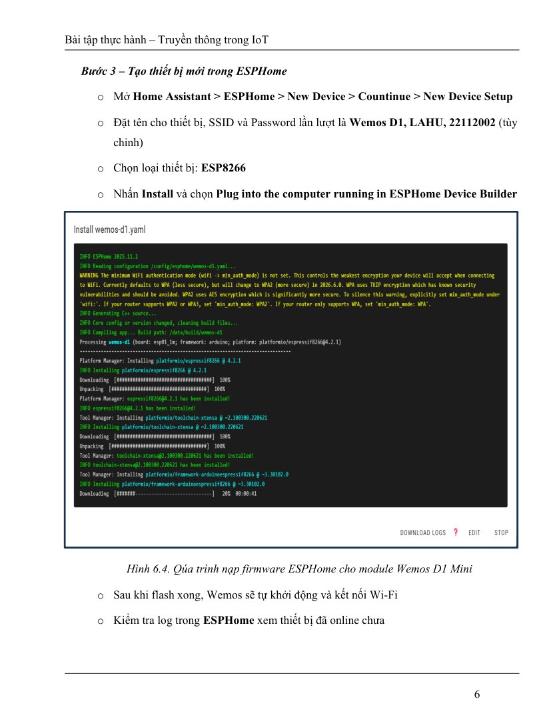
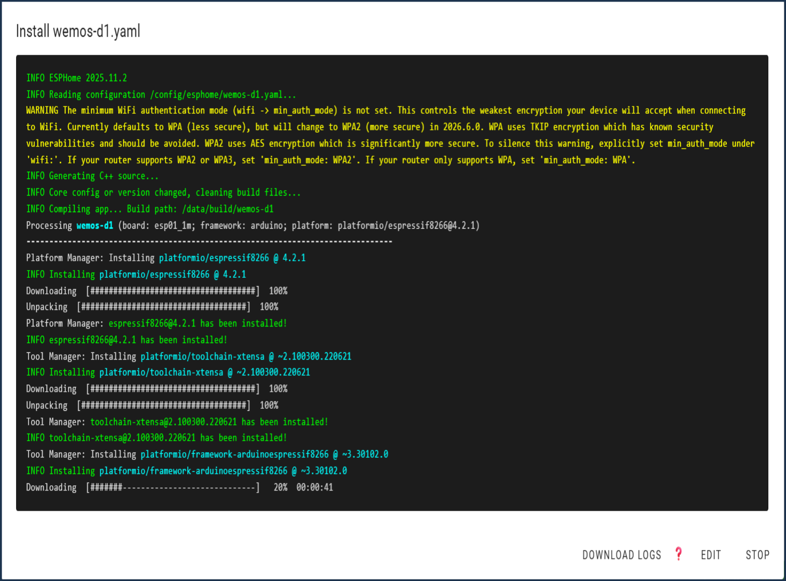
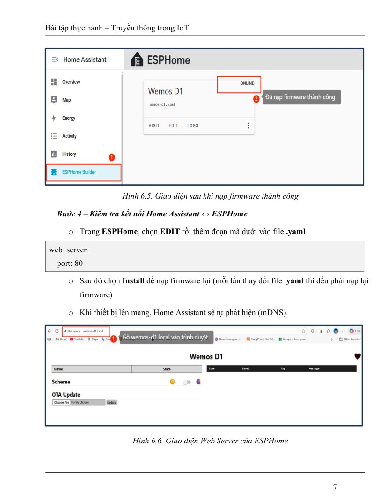
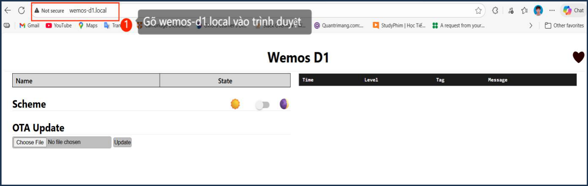
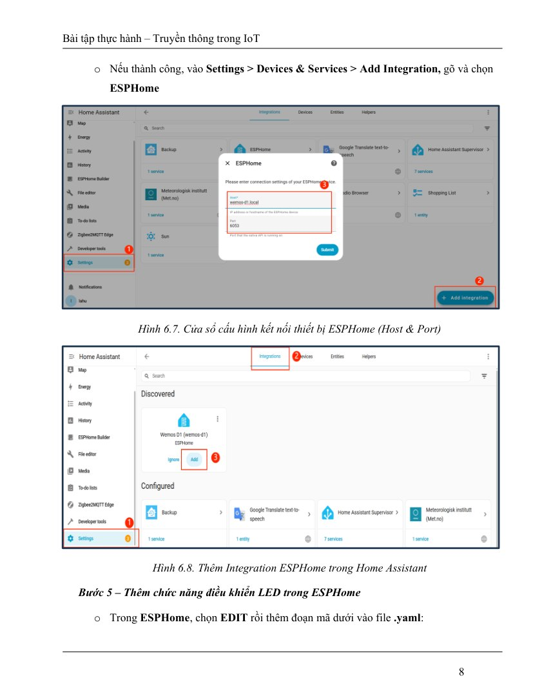
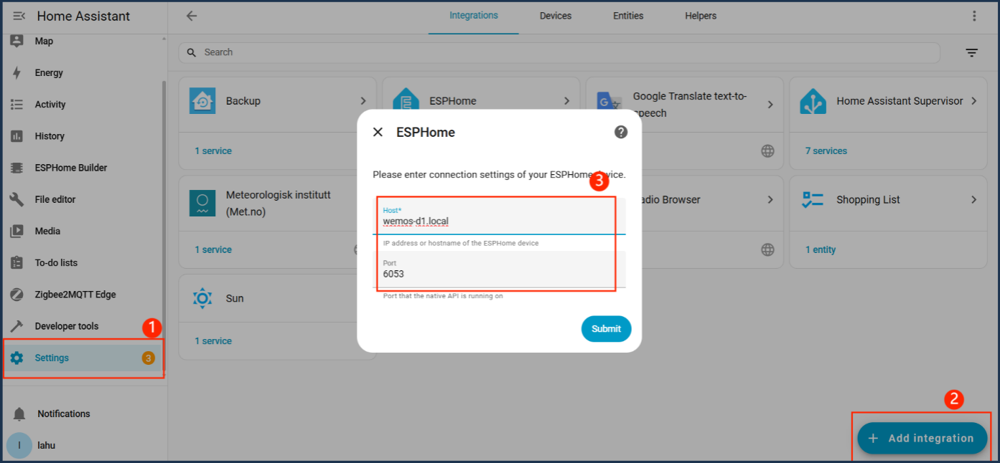

# Bài 8.1. Kết nối Wemos D1 mini bằng ESPHome

Nguồn: [đề gốc](../tai-lieu-goc/BTH8_WiFi.pdf), trang 4-10. Số bài nhỏ được chuẩn hóa theo số bài thực hành; xem đối chiếu ở README.

## Chuẩn bị

Wemos D1 mini ESP8266, cáp USB dữ liệu, Wi-Fi2.4GHz, Home Assistant OS và ESPHome Device Builder; xem cài HA ở bài6. File wemos-d1-mini.yaml cấu hình cả LED + DHT11, có thể bỏ khối sensor khi chưa lắp cảm biến.

## Kết nối và cấu hình

Wemos onboard LED D4/GPIO2 active LOW. DHT11 DATA→D2/GPIO4, VCC3.3V, GND chung; pull-up DATA lên3.3V theo module. Không dùng đầu ra relay điện lưới trong bài LED này. File `automation.yaml` dùng entity ID mẫu; phải thay theo ID Home Assistant tạo thực.

## Thực hiện từng bước

### Bước 1. Cài ESPHome Device Builder

HA → Settings → Apps/Add-ons → Store → ESPHome Device Builder → Install → Start → Open Web UI. Đưa USB Wemos tới đúng máy chạy trình nạp; nếu builder trong VM, thiết lập passthrough USB hoặc dùng ESPHome Web để nạp từ PC.

**Đối chiếu tài liệu gốc, trang 5** (ảnh/giá trị mẫu trong đề, không phải kết quả mới; áp dụng hiệu chỉnh trong hướng dẫn):

### Bước 2. Tạo cấu hình và secrets

Tạo node `wemos-d1`, chọn ESP8266 d1_mini. Dùng wemos-d1-mini.yaml, sao secrets.example.yaml thành secrets.yaml và điền giá trị. Sinh khóa API32byte base64 bằng `python -c "import secrets,base64; print(base64.b64encode(secrets.token_bytes(32)).decode())"`. Nếu chưa có DHT11, bỏ toàn bộ khối sensor trước lần đầu.

**Đối chiếu tài liệu gốc, trang 6** (ảnh/giá trị mẫu trong đề, không phải kết quả mới; áp dụng hiệu chỉnh trong hướng dẫn):

### Bước 3. Validate và nạp lần đầu USB

Trong Builder chọn Validate, rồi Install. Chọn USB nối vào máy đang thực hiện flash; không chọn host HA nếu USB đang ở PC. Compile và flash, chờ log kết nối Wi-Fi, ghi IP. Các lần sau có thể dùng OTA khi thiết bị truy cập được.

**Đối chiếu tài liệu gốc, trang 7** (ảnh/giá trị mẫu trong đề, không phải kết quả mới; áp dụng hiệu chỉnh trong hướng dẫn):

### Bước 4. Thêm integration và điều khiển LED

HA → Devices & services → ESPHome discovery hoặc Add Integration → ESPHome → IP/hostname, port6053, nhập đúng encryption key. Add entity Wemos LED lên Dashboard, bật/tắt và đối chiếu LED onboard.

**Đối chiếu tài liệu gốc, trang 8** (ảnh/giá trị mẫu trong đề, không phải kết quả mới; áp dụng hiệu chỉnh trong hướng dẫn):

### Bước 5. Kiểm tra web và OTA

Mở http://IP_ESP, nhập web_username/web_password từ secrets. Thay một friendly name rồi Validate và Install Wirelessly. ESP8266 OTA mặc định8266; ESP32 mặc định3232, không dùng một port cho mọi board như PDF. Không đổi IP/SSID ngay trong bài thử đầu.

## Kiểm tra và kết quả cần thu

Node online; LED đổi theo HA; API mã hóa kết nối; web cần mật khẩu; OTA thành công và thiết bị online lại. Nếu mDNS bị chặn, thử IP trực tiếp; NAT/guest isolation có thể làm discovery thất bại.

## Giải thích và trả lời câu hỏi

mDNS dùng multicast UDP5353, cho phép quảng bá hostname.local và dịch vụ trong LAN; khác DNS unicast tới DNS server. YAML được compile thành firmware.bin; thiết bị chạy binary, không chạy trực tiếp YAML. OTA chuyển firmware mới qua mạng, cần địa chỉ liên lạc được, đúng mật khẩu và đủ nguồn. API TCP6053 giúp HA trao đổi cập nhật liên tục; encryption key bảo vệ Native API. ESP32-S3 không có LED D4 tương đương: tham khảo [biến thể ESP32-S3 đã có](../BTH_WIFI_ESPHOME/README.md).

## Bằng chứng thực hành

Các hình theo bước là ảnh giao diện trong PDF BTH8_WiFi, trang 5–8; đây là ví dụ trong đề, không phải kết quả mới. Phiên bản UI và tên thiết bị có thể khác. [Xem toàn bộ trang đề gốc](../tai-lieu-goc/README.md). Tạo thư mục `ket-qua/` tại bài này để lưu ảnh chụp thật, log Serial, pcapng hoặc XML sau khi chạy. Không điền số đo khi chưa thực nghiệm.
