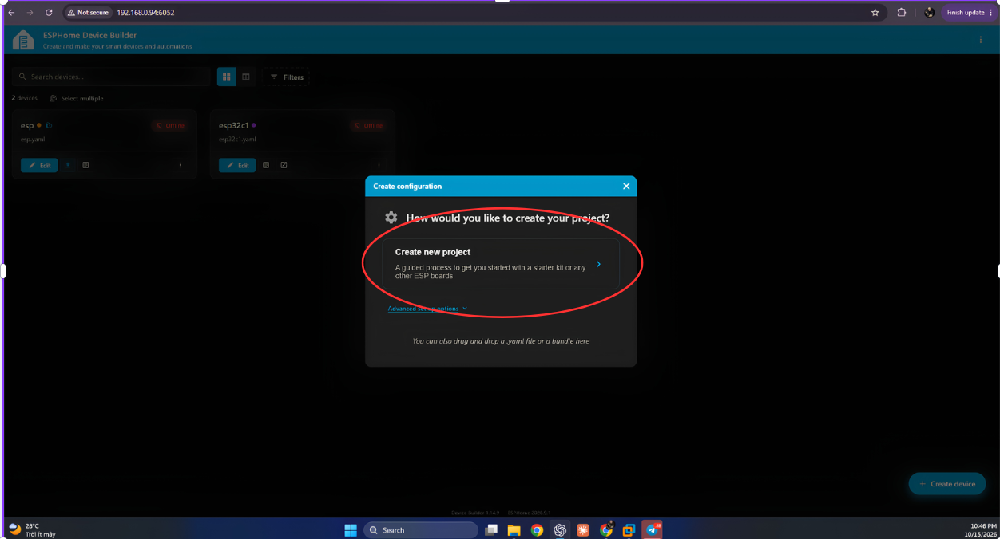
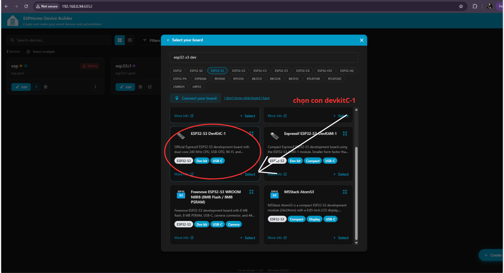
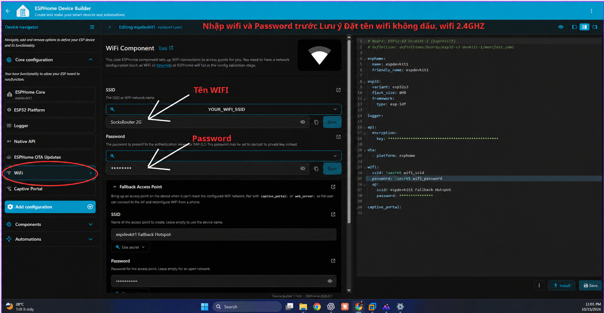
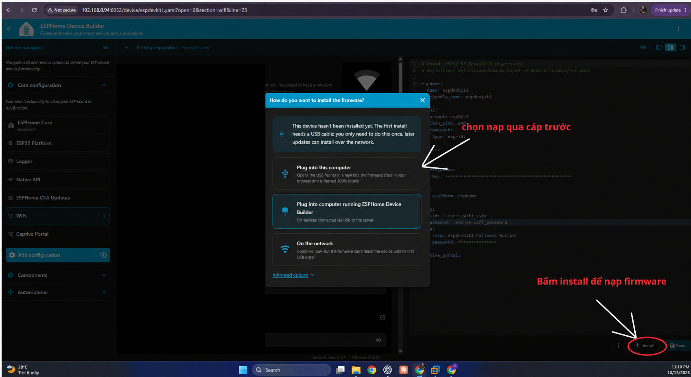
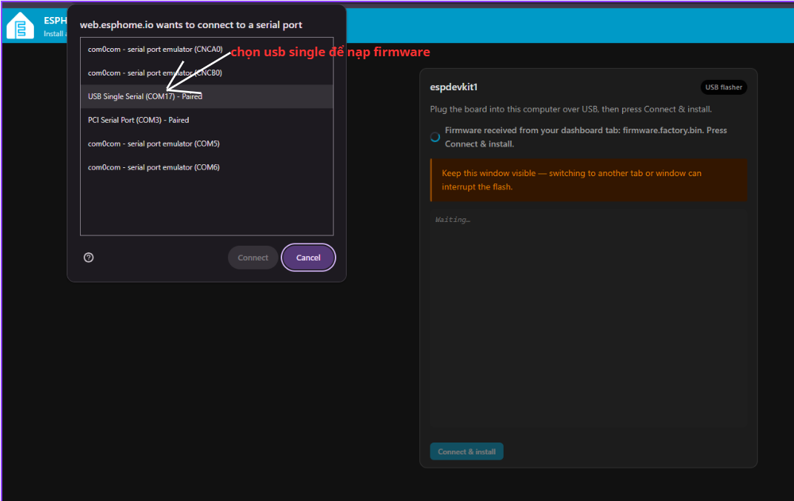
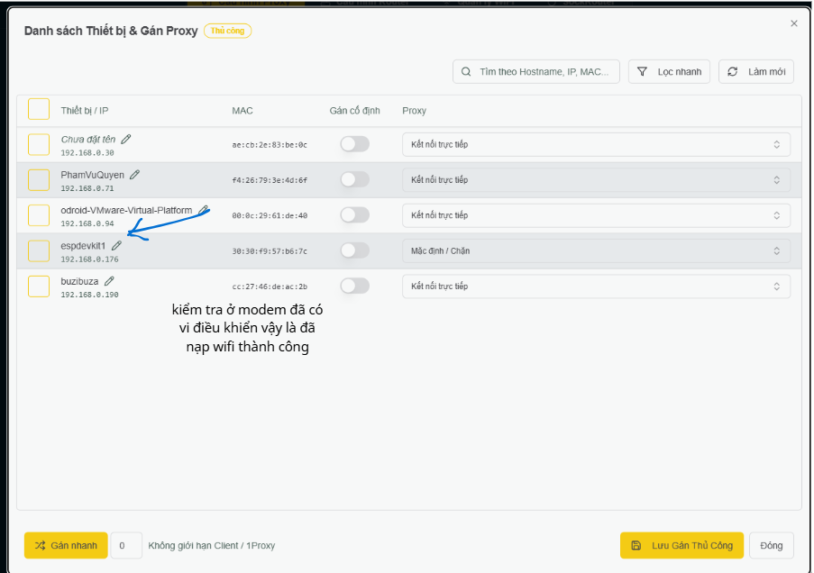
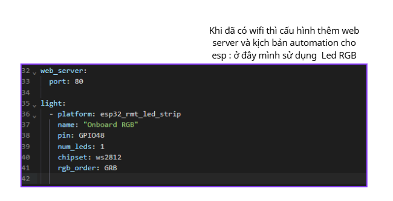
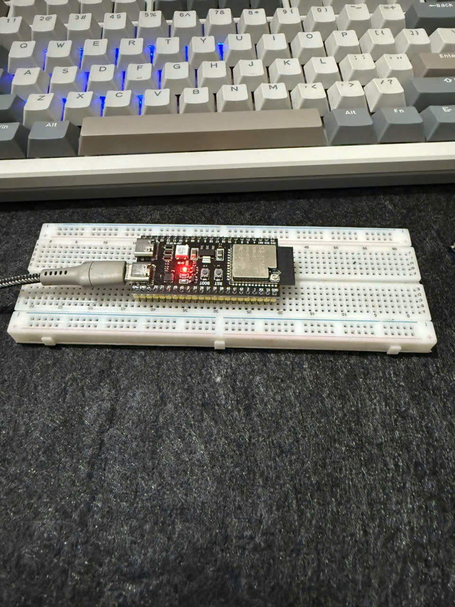
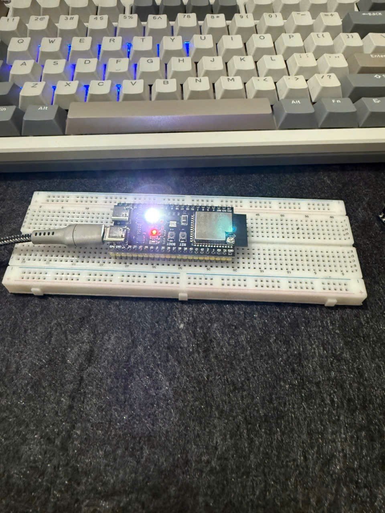

# Bài 8.1. ESP32-S3 DevKitC-1: tạo thiết bị, nạp USB, kết nối Wi-Fi và điều khiển LED RGB

Trong bài này, em dùng ESP32-S3 DevKitC-1 để tạo thiết bị ESPHome, nạp qua USB và cấu hình Wi-Fi. Sau khi board có IP, em bổ sung Web Server và LED RGB vào YAML để tiếp tục phần điều khiển. Đề gốc dùng Wemos D1 mini; [bản cấu hình Wemos](8.1-wemos.md) được để riêng.

Bộ ảnh bên dưới ghi lại các thao tác trong ESPHome và hai trạng thái LED trên board. Hai ảnh có thông tin Wi-Fi đã được che mật khẩu trước khi đưa lên GitHub.

## Chuẩn bị trước khi thao tác

- ESP32-S3 DevKitC-1, cáp USB **có truyền dữ liệu** và máy tính chạy Chrome/Edge.
- ESPHome Device Builder đã mở được trên máy chủ; trong ảnh là `http://192.168.0.94:6052`. Khi làm lại, dùng địa chỉ Builder đang chạy trong mạng.
- Wi-Fi **2.4 GHz**, đúng SSID và mật khẩu. Giữ nguyên cách viết hoa, khoảng trắng và ký tự của SSID thật; không tự bỏ dấu nếu router đang dùng tên có dấu. Dùng SSID đơn giản không dấu là một lựa chọn thuận tiện khi tự cấu hình mạng lab.
- Xác định cáp đang cắm vào **PC mở trình duyệt** hay **máy chạy Builder/VM**. Hai nơi này quyết định lựa chọn nạp ở bước 4.

File đi kèm: [`espdevkit1.yaml`](espdevkit1.yaml), [`secrets.example.yaml`](secrets.example.yaml). YAML mẫu dùng ESP-IDF, flash 8 MB và LED GPIO48 theo board trong ảnh. Kiểm tra đúng dung lượng flash và chân LED của phiên bản board thật trước khi nạp; phiên bản DevKitC-1 v1.1 có thể dùng GPIO38 thay GPIO48: đối chiếu [tài liệu Espressif](https://documentation.espressif.com/esp-dev-kits/en/latest/esp32s3/esp-dev-kits-en-master-esp32s3.pdf) và revision board.

## Các bước thực hiện

### Bước 1. Mở Builder và chọn Create new project

1. Mở ESPHome Device Builder. Nếu dùng Home Assistant, vào **Settings → Apps/Add-ons → ESPHome Device Builder → Open Web UI**; nếu Builder chạy riêng, mở `http://IP_BUILDER:6052`.
2. Nhấn **Create device** ở góc dưới bên phải.
3. Trong hộp **Create configuration**, chọn **Create new project** đúng vùng khoanh đỏ bên dưới.
4. Đặt tên thiết bị, ví dụ `espdevkit1`. Tên node nên dùng chữ thường, số và dấu gạch ngang; không có khoảng trắng. Friendly name có thể dễ đọc hơn.



**Sau bước này:** trình hướng dẫn chuyển sang chọn board. Không chọn import một YAML của ESP8266 để dùng nguyên trạng cho ESP32-S3.

### Bước 2. Chọn đúng ESP32-S3 DevKitC-1

1. Tại **Select your board**, chọn nhóm **ESP32-S3**.
2. Tìm `esp32-s3 dev` hoặc `DevKitC-1` trong ô tìm kiếm.
3. Chọn thẻ **ESP32-S3 DevKitC-1**, rồi nhấn **+ Select** ở chính thẻ đó.
4. Kiểm tra tên đầy đủ: không nhầm **DevKitC-1** với **DevKitM-1**, ESP32 thường hoặc ESP8266.



**Đối chiếu YAML bên phải:** `variant: esp32s3`, framework `esp-idf`; `flash_size: 8MB` chỉ dùng khi board thật đúng 8 MB. Bản mẫu trong repo khai báo board tương ứng; không cần thêm các tùy chọn flash không thuộc cấu hình của board.

### Bước 3. Điền Wi-Fi và lưu cấu hình

1. Mở thiết bị vừa tạo, chọn **Edit**.
2. Trong **Device navigator** bên trái, bấm **WiFi** như vùng khoanh đỏ.
3. Ở phần **SSID**, nhập đúng tên mạng 2.4 GHz. Nếu giao diện dùng `!secret wifi_ssid`, nhập giá trị vào ô secret tương ứng và bấm **Save** cạnh trường đó.
4. Ở **Password**, điền mật khẩu vào giá trị của `wifi_password`, rồi **Save**. Không gõ mật khẩu thật vào đoạn YAML định đưa lên GitHub.
5. Bấm **Save** ở góc dưới bên phải để lưu cấu hình thiết bị. Các bản Builder có nút **Validate**: chạy Validate trước khi Install.



YAML cần giữ liên kết tới secret:

```yaml
wifi:
  ssid: !secret wifi_ssid
  password: !secret wifi_password
```

Nếu làm bằng file, sao `secrets.example.yaml` thành **secrets.yaml trong cùng thư mục** với `espdevkit1.yaml`. Điền thông tin riêng ở file đó. API encryption key phải là 32 byte được mã hóa Base64; dùng khóa Builder tạo sẵn hoặc sinh khóa riêng. Repo bỏ qua `secrets.yaml` khi commit.

**Chưa chuyển bước nếu:** Validate báo thiếu secret, sai thụt lề hoặc sai board. Lưu được YAML chưa có nghĩa đã nạp vào board.

### Bước 4. Bấm Install và chọn nơi cắm cáp USB

1. Cắm board bằng cáp USB dữ liệu. Đóng Arduino Serial Monitor hoặc chương trình đang giữ cổng của board.
2. Trong editor, bấm **Install** ở góc dưới bên phải, đúng vị trí khoanh đỏ.
3. Với cách trong ảnh — cáp cắm vào PC đang mở trình duyệt — chọn **Plug into this computer**. Trình duyệt mở USB flasher để thực hiện nạp từ PC.
4. Chỉ chọn **Plug into computer running ESPHome Device Builder** khi board thực sự cắm vào máy chủ chạy Builder. Nếu Builder chạy trong VM, USB phải được passthrough vào VM cho cách này.
5. Lần đầu board chưa có firmware kết nối mạng, vì vậy dùng USB trước. **On the network** dành cho lần cập nhật OTA sau khi thiết bị đã online và có OTA được cấu hình.



**Phân biệt quan trọng:** truy cập Builder trên VM bằng Chrome ở PC không làm cổng USB của PC tự xuất hiện trong VM. Chọn đúng nơi cắm cáp, không chọn theo nơi đang nhìn thấy cửa sổ web.

### Bước 5. Chọn cổng USB của board và nạp firmware

1. Chờ Builder biên dịch xong và chuyển firmware sang trang USB flasher.
2. Trên flasher bấm **Connect & install**; trình duyệt hiện danh sách cổng serial.
3. Trong ảnh, cổng board là **USB Single Serial (COM17)**. Chọn đúng cổng tương ứng trên máy bạn rồi **Connect**.
4. Không chọn các cổng **com0com / CNCA / CNCB** chỉ vì chúng cũng hiện trong danh sách: đó là cổng nối tiếp ảo. Một số board/cáp lại hiện tên **USB JTAG/serial**, **CP210x** hoặc **CH340**; nhận diện bằng cách rút/cắm board và xem cổng nào mất/xuất hiện.
5. Xác nhận cài đặt theo hộp thoại flasher, chờ ghi và kiểm tra hoàn tất. Giữ trang flasher hoạt động, không rút cáp trong khi ghi.



**Nếu không thấy cổng:** đổi cáp dữ liệu, kiểm tra driver, đóng ứng dụng giữ COM. Với một số board, giữ **BOOT**, nhấn rồi nhả **RESET/EN**, sau đó nhả BOOT để vào chế độ nạp. Thao tác đúng theo phiên bản board và thử kết nối lại.

### Bước 6. Xác nhận ESP đã vào Wi-Fi và lấy IP

1. Sau khi flash hoàn tất, để board khởi động lại và chờ kết nối Wi-Fi.
2. Mở danh sách thiết bị/DHCP của router hoặc công cụ quản lý mạng đang dùng. Tìm hostname **espdevkit1**.
3. Ảnh cho thấy thiết bị `espdevkit1` có địa chỉ **192.168.0.176**. Ghi lại IP được cấp trong mạng của bạn; không cố nhập .176 nếu board nhận một IP khác.
4. Đối chiếu thêm log ESPHome: kết nối Wi-Fi thành công và IP phải khớp. Nếu Builder vẫn hiện Offline, thử Logs theo IP; discovery có thể bị chặn dù board đã vào mạng.



Trong danh sách mạng đã thấy hostname và IP của board. Sau bước Wi-Fi, cần nạp thêm cấu hình Web Server và kiểm tra Native API để dùng được hai dịch vụ này.

### Bước 7. Thêm Web Server và LED RGB, nạp lại rồi kiểm tra

1. Quay về Builder → **Edit** thiết bị.
2. Thêm hai khối `web_server` và `light` ở cấp ngoài cùng, ngang hàng với `wifi`, `api`, `logger`. Không đặt chúng bên trong khối `wifi`.
3. Dùng cấu hình theo hình: Web Server cổng 80 và LED RGB WS2812, một bóng, GPIO48, thứ tự GRB.



```yaml
web_server:
  port: 80

light:
  - platform: esp32_rmt_led_strip
    name: "Onboard RGB"
    pin: GPIO48
    num_leds: 1
    chipset: ws2812
    rgb_order: GRB
    restore_mode: ALWAYS_OFF
```

4. **Save → Validate → Install**. Vì board đã có Wi-Fi và OTA, có thể chọn **On the network** nếu Builder liên lạc được tới board; nếu chưa được, tiếp tục nạp USB như bước 4–5. Thay YAML rồi chỉ Save sẽ **chưa** thay đổi firmware đang chạy trên board.
5. Chờ board online lại. Từ PC cùng mạng mở **`http://IP_ESP`**, ví dụ `http://192.168.0.176` trong lần chụp này; cổng 80 có thể bỏ khỏi URL.
6. Trong trang thiết bị, tìm **Onboard RGB**, thử bật/tắt và đổi màu, đối chiếu LED trên board. Nếu giao diện có entity nhưng LED không sáng, kiểm tra pin RGB theo revision board; không đổi GPIO ngẫu nhiên hoặc dùng cấu hình LED D4 của Wemos.
7. Muốn điều khiển từ Home Assistant: **Settings → Devices & services → Add integration → ESPHome**, nhập IP/hostname, cổng **6053**, rồi nhập API encryption key khi được yêu cầu. Thêm entity **Onboard RGB** vào Dashboard và thử lại.

### Ảnh mạch trong lúc thực hành

| RGB chưa phát sáng rõ | RGB phát sáng |
|---|---|
|  |  |

Board được đặt trên breadboard và cấp nguồn qua USB. Ở cả hai ảnh, LED nguồn đỏ đều sáng; ảnh thứ hai thấy RGB phát sáng rõ hơn. Phần RGB bị chói nên khó xác định chính xác màu từ ảnh. Em chưa có ảnh trang Web Server tương ứng để đối chiếu thao tác điều khiển với trạng thái LED.

## Kiểm tra sau khi nạp

| Phần kiểm tra | Dấu hiệu cần thấy | Nếu chưa đạt |
|---|---|---|
| Tạo đúng board | ESP32-S3 DevKitC-1, framework phù hợp | Quay lại bước 2 |
| Nạp lần đầu | Flasher báo ghi thành công, board khởi động lại | Kiểm tra cáp/COM/chế độ BOOT |
| Wi-Fi | Hostname/IP trong router và log ESPHome khớp nhau | Kiểm tra SSID, mật khẩu, 2.4 GHz |
| Web Server | Mở được http://IP_ESP sau lần nạp có web_server | Kiểm tra đã nạp lại và cùng mạng |
| RGB | Nút và màu trên web khớp LED thật | Kiểm tra GPIO/revision và WS2812 |
| Home Assistant | Integration kết nối, entity RGB điều khiển được | Kiểm tra IP, 6053, encryption key |

## Nhận xét

**Wi-Fi, API, Web Server là ba phần khác nhau.** Wi-Fi đưa board lên mạng; Native API giúp Home Assistant giao tiếp với ESP; Web Server tạo trang HTTP của chính board. Có IP không có nghĩa đã có cả hai dịch vụ kia.

**mDNS** quảng bá tên `.local` và dịch vụ trong LAN qua UDP5353. Nếu multicast bị chặn, dùng IP trực tiếp để kiểm tra trước.

**YAML → firmware → nạp:** Builder biên dịch YAML thành firmware; USB hoặc OTA đưa firmware đó lên chip. Cần nạp lại sau khi thêm component. ESP32 native OTA thường dùng cổng 3232, Native API6053, Web Server80; ba cổng không thay thế nhau.

**Automation:** khối `light` tạo thực thể điều khiển RGB, chưa tự tạo quy tắc bật theo cảm biến hay thời gian. Phần tự động hóa có trigger/action làm ở [bài 8.4](8.4.md); dùng entity RGB thực tế của ESP32-S3 nếu tiếp tục bằng board này. [Bài 8.3](8.3.md) ghi rõ cách nối DHT theo board.

## File cấu hình và nguồn ảnh

- [`espdevkit1.yaml`](espdevkit1.yaml): bản cấu hình đủ Wi-Fi, API, OTA, Web Server và RGB.
- [`secrets.example.yaml`](secrets.example.yaml): mẫu, sao thành secrets.yaml và điền thông tin riêng.
- [Đề gốc bài 8](../tai-lieu-goc/BTH8_WiFi.pdf): dùng Wemos D1 mini; không trộn chân D4/D2 của Wemos với tên chân trên ESP32-S3.
- [Trạng thái kiểm thử](../docs/KIEM_THU.md): ghi lại phần YAML đã kiểm tra và những nội dung cần thử tiếp trên board.
