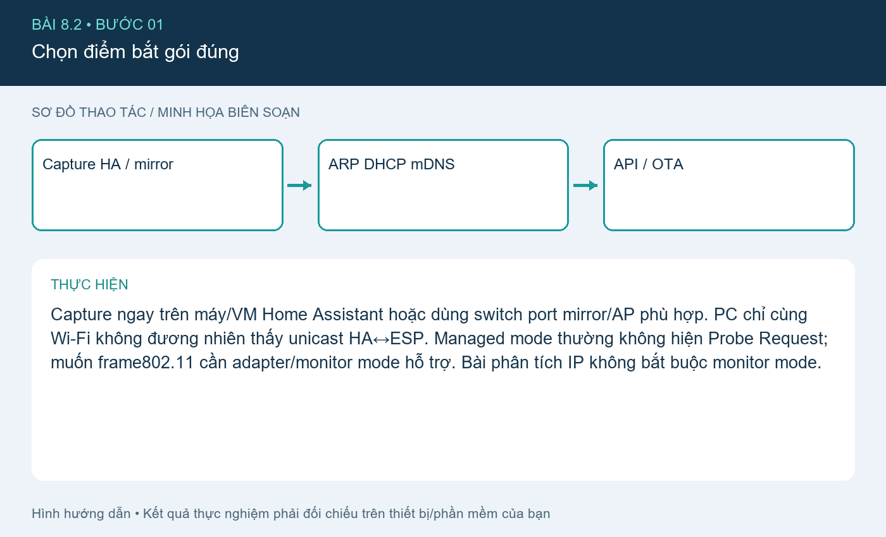
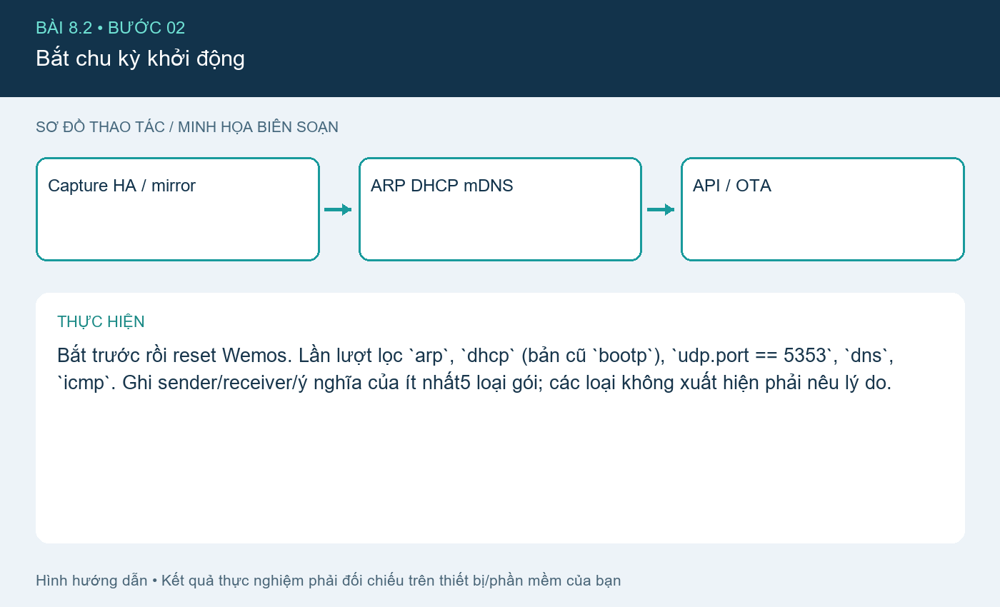
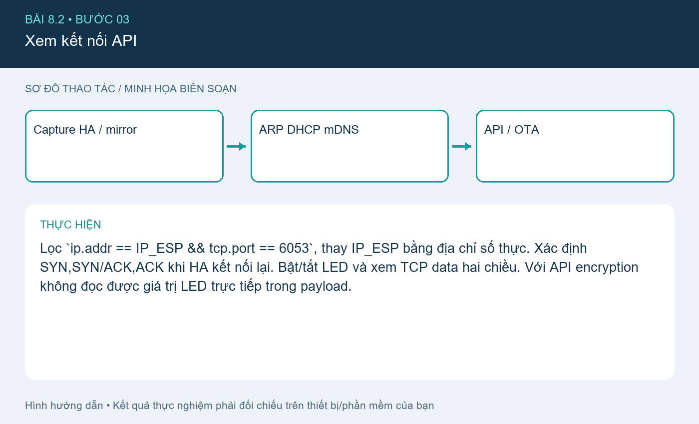
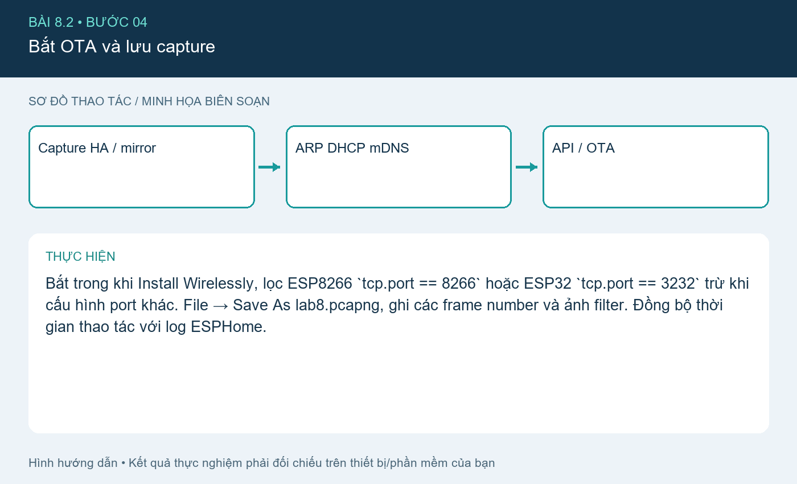

# Bài 8.2. Phân tích gói ESPHome bằng Wireshark

Nguồn: [đề gốc](../tai-lieu-goc/BTH8_WiFi.pdf), trang 10-13. Số bài nhỏ được chuẩn hóa theo số bài thực hành; xem đối chiếu ở README.

## Chuẩn bị

Wemos D1 mini ESP8266, cáp USB dữ liệu, Wi-Fi2.4GHz, Home Assistant OS và ESPHome Device Builder; xem cài HA ở bài6. File wemos-d1-mini.yaml cấu hình cả LED + DHT11, có thể bỏ khối sensor khi chưa lắp cảm biến.

## Kết nối và cấu hình

Wemos onboard LED D4/GPIO2 active LOW. DHT11 DATA→D2/GPIO4, VCC3.3V, GND chung; pull-up DATA lên3.3V theo module. Không dùng đầu ra relay điện lưới trong bài LED này. File `automation.yaml` dùng entity ID mẫu; phải thay theo ID Home Assistant tạo thực.

## Thực hiện từng bước

### Bước 1. Chọn điểm bắt gói đúng

Capture ngay trên máy/VM Home Assistant hoặc dùng switch port mirror/AP phù hợp. PC chỉ cùng Wi-Fi không đương nhiên thấy unicast HA↔ESP. Managed mode thường không hiện Probe Request; muốn frame802.11 cần adapter/monitor mode hỗ trợ. Bài phân tích IP không bắt buộc monitor mode.

### Bước 2. Bắt chu kỳ khởi động

Bắt trước rồi reset Wemos. Lần lượt lọc `arp`, `dhcp` (bản cũ `bootp`), `udp.port == 5353`, `dns`, `icmp`. Ghi sender/receiver/ý nghĩa của ít nhất5 loại gói; các loại không xuất hiện phải nêu lý do.

### Bước 3. Xem kết nối API

Lọc `ip.addr == IP_ESP && tcp.port == 6053`, thay IP_ESP bằng địa chỉ số thực. Xác định SYN,SYN/ACK,ACK khi HA kết nối lại. Bật/tắt LED và xem TCP data hai chiều. Với API encryption không đọc được giá trị LED trực tiếp trong payload.

### Bước 4. Bắt OTA và lưu capture

Bắt trong khi Install Wirelessly, lọc ESP8266 `tcp.port == 8266` hoặc ESP32 `tcp.port == 3232` trừ khi cấu hình port khác. File → Save As lab8.pcapng, ghi các frame number và ảnh filter. Đồng bộ thời gian thao tác với log ESPHome.

## Kiểm tra và kết quả cần thu

Bảng tối thiểu5 loại gói có chức năng, vai trò, IP/MAC nguồn/đích và frame number. Ghi rõ capture ở interface nào, API có encryption hay không, OTA port thực.

## Giải thích và trả lời câu hỏi

ARP hỏi MAC của IP cùng subnet; DHCP trao địa chỉ; mDNS quảng bá thiết bị; DNS tra tên dịch vụ bên ngoài nếu có; TCP tạo kết nối tin cậy cho API/OTA. Không phải mỗi lần reset đều có đủ Discover/Offer/Request/ACK vì DHCP client có thể dùng lease cũ. Probe Request thuộc tầng liên kết802.11, không phải UDP/TCP.

## Bằng chứng thực hành

Các hình `images/*-buoc-*.png` là sơ đồ hướng dẫn biên soạn, không phải ảnh chụp kết quả chạy. [Xem toàn bộ trang đề gốc](../tai-lieu-goc/README.md). Tạo thư mục `ket-qua/` tại bài này để lưu ảnh chụp thật, log Serial, pcapng hoặc XML sau khi chạy. Không điền số đo khi chưa thực nghiệm.
