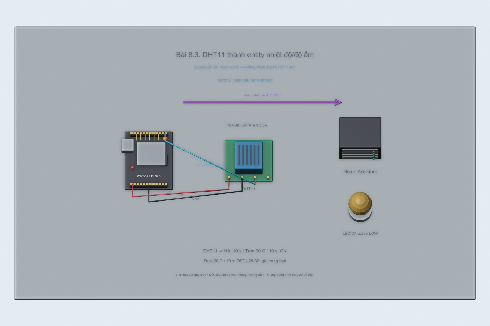
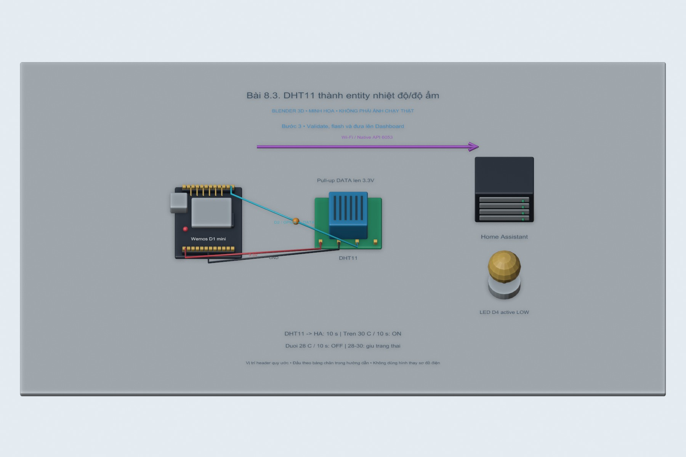
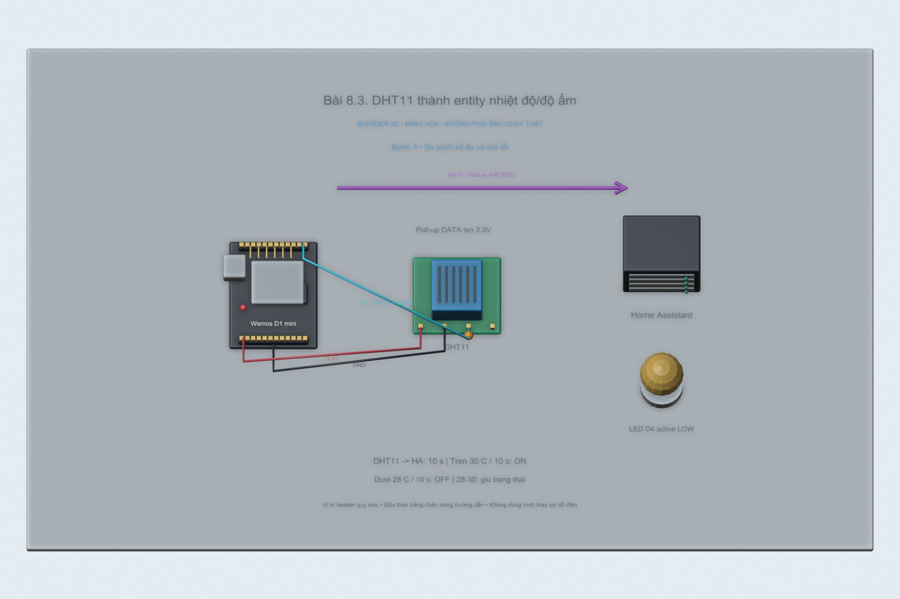

# Bài 8.3. DHT11 thành entity nhiệt độ/độ ẩm

Sau khi ESPHome kết nối được Wi-Fi, bước tiếp theo là thêm DHT11 và đưa nhiệt độ, độ ẩm vào Home Assistant. Cấu hình có hai cách nối cho Wemos và ESP32-S3 để tránh dùng nhầm tên chân giữa hai board.

Nguồn: [đề gốc](../tai-lieu-goc/BTH8_WiFi.pdf), trang 13-14.

## Dụng cụ và phần mềm

Wemos D1 mini ESP8266, cáp USB dữ liệu, Wi-Fi2.4GHz, Home Assistant OS và ESPHome Device Builder; xem cài HA ở bài 6. File wemos-d1-mini.yaml cấu hình cả LED + DHT11, có thể bỏ khối sensor khi chưa lắp cảm biến.

## Kết nối và cấu hình

Wemos onboard LED D4/GPIO2 active LOW. DHT11 DATA→D2/GPIO4, VCC3.3V, GND chung; pull-up DATA lên3.3V theo module. Không dùng đầu ra relay điện lưới trong bài LED này. File `automation.yaml` dùng entity ID mẫu; phải thay theo ID Home Assistant tạo thực.

## Nếu tiếp tục bằng ESP32-S3 của bài 8.1

Bạn đã có ESP32-S3 DevKitC-1; chỉ cần bổ sung DHT11 nếu muốn lấy số đo thật. Mô hình Blender bên dưới giữ biến thể Wemos theo đề gốc. Với board thực tế của bạn, dùng bảng sau:

| DHT11 | ESP32-S3 DevKitC-1 | Lưu ý |
|---|---|---|
| VCC | 3V3 | Kiểm tra module hỗ trợ 3.3V |
| GND | GND | Chung đất |
| DATA | GPIO4 | Dùng số GPIO4, không ghi tên D2 của Wemos |
| Pull-up DATA | 4.7kΩ–10kΩ lên 3V3 nếu module chưa có | Không kéo lên 5V |

Mở [`espdevkit1-dht.yaml`](espdevkit1-dht.yaml), giữ file [`espdevkit1.yaml`](espdevkit1.yaml) cùng thư mục vì cấu hình dùng `packages`. Validate rồi Install file `espdevkit1-dht.yaml` để có cả RGB và cảm biến. Sau nạp, vào ESPHome Logs kiểm tra **Temperature / Humidity**; trong Home Assistant mở thiết bị ESP DevKit 1 và lấy đúng entity ID được tạo. Các bước dashboard và thử lỗi bên dưới vẫn áp dụng.

Khi chưa có DHT11, chỉ xem mô hình và cấu hình; chưa có dữ liệu cảm biến thì không ghi nhiệt độ/độ ẩm giả thành kết quả thực hành.

<!-- blender-intro -->
## Hình minh họa

Các ảnh 3D mô tả cách bố trí linh kiện; chân nối xem ở bảng phía trên. Có thể mở [file Blender bài 8.3](../mo-phong-3d/8.3/bai-8.3.blend) để xem các mốc của từng bước.
<!-- /blender-intro -->

## Các bước thực hiện

### Bước 1. Đấu sensor đúng điện áp

Tắt nguồn, nối DHT11 VCC3.3V/GND/DATA D2. Nếu module kéo DATA lên5V, sửa pull-up hoặc chọn module3.3V để bảo vệ GPIO.

### Bước 2. Bật cấu hình sensor

Giữ khối sensor platform dht trong wemos-d1-mini.yaml, model DHT11, update_interval10s. Nếu dùng DHT22 thay model; DS18B20 cần component khác, không đổi tên model đơn thuần.

### Bước 3. Validate, flash và đưa lên Dashboard

Validate, OTA/USB. Xem log các giá trị có đơn vị; HA nhận hai entity Temperature/Humidity qua Native API. Thêm Sensor/History Graph card bằng đúng entity ID thực.

### Bước 4. So sánh số đo và thử lỗi

Đối chiếu số trên log với Dashboard. Tháo DATA để xem unavailable/NaN; không coi unavailable là0. Khôi phục dây và xác nhận sensor cập nhật lại. Ghi thời điểm và khoảng lấy mẫu.

## Nội dung kiểm tra

Có hai entity đúng đơn vị, graph có dữ liệu theo thời gian, lỗi sensor được phân biệt với số0.

## Nhận xét và trả lời câu hỏi

Entity đại diện trạng thái thiết bị trong HA; sensor không cần tự publish MQTT vì đang dùng ESPHome Native API. DHT11 có độ phân giải/độ chính xác giới hạn, chỉ làm bài quan sát, không lấy giá trị mô phỏng làm số đo.

## Kết quả của bài

Cấu hình YAML cho Wemos và ESP32-S3 đã qua bước kiểm tra của ESPHome. Phần DHT11 chưa có số đo trên board; cần đối chiếu chân DATA, kiểu cảm biến và entity sau khi nạp.
