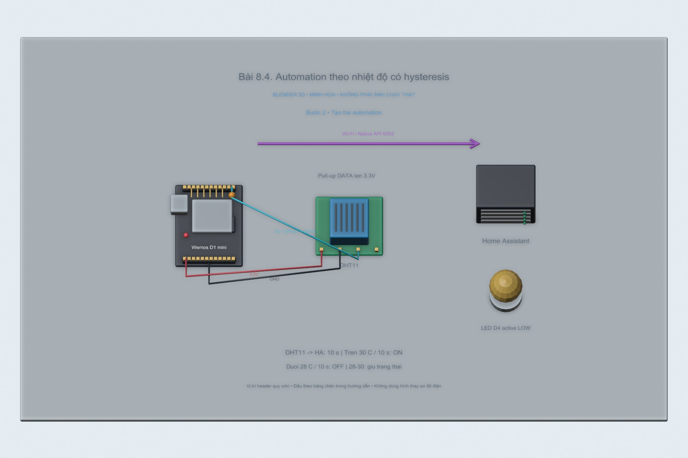
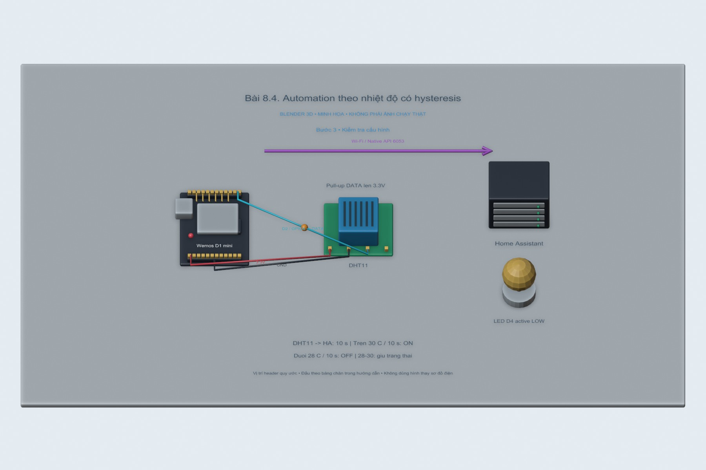
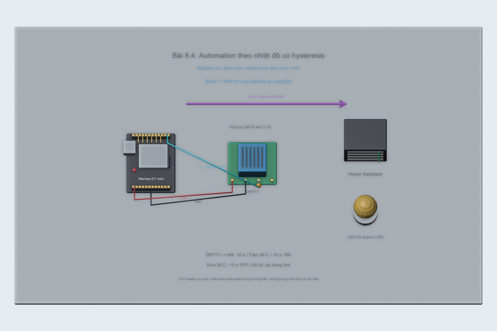

# Bài 8.4. Automation theo nhiệt độ có hysteresis

Nguồn: [đề gốc](../tai-lieu-goc/BTH8_WiFi.pdf), trang 14. Số bài nhỏ được chuẩn hóa theo số bài thực hành; xem đối chiếu ở README.

## Chuẩn bị

Wemos D1 mini ESP8266, cáp USB dữ liệu, Wi-Fi2.4GHz, Home Assistant OS và ESPHome Device Builder; xem cài HA ở bài6. File wemos-d1-mini.yaml cấu hình cả LED + DHT11, có thể bỏ khối sensor khi chưa lắp cảm biến. Hoàn thành8.3. Nếu dùng ESP32-S3 ở bài 8.1, chọn Temperature từ espdevkit1-dht.yaml và entity Onboard RGB; thay cả sensor ID lẫn light ID trong automation.yaml theo thiết bị thực, không giữ ID Wemos.

## Kết nối và cấu hình

Wemos onboard LED D4/GPIO2 active LOW. DHT11 DATA→D2/GPIO4, VCC3.3V, GND chung; pull-up DATA lên3.3V theo module. Không dùng đầu ra relay điện lưới trong bài LED này. File `automation.yaml` dùng entity ID mẫu; phải thay theo ID Home Assistant tạo thực.

<!-- blender-intro -->
## Xem mô hình khi chưa có đủ linh kiện

[Tải cảnh Blender bài 8.4](../mo-phong-3d/8.4/bai-8.4.blend) · [Cách mở, xoay và xem timeline](../mo-phong-3d/README.md) · [Ảnh linh kiện trên mạng và nguồn](../docs/linh-kien/README.md).

Các hình theo bước dưới đây là **cảnh Blender 3D minh họa bố trí và tín hiệu**. Mốc trên timeline tương ứng số bước; vị trí hạt tín hiệu chỉ diễn họa hướng truyền. Phần nạp code/click menu làm theo chỉ dẫn bằng chữ và ảnh giao diện gốc bên dưới; hình 3D không giả làm màn hình phần mềm hay kết quả đo.

**Đọc cảnh:** xanh lơ/cam/tím là các đường tín hiệu có nhãn; dây đỏ là nguồn, dây đen là GND trong cảnh mạch điện. Với cảnh mạng, mũi tên chỉ luồng logic. Header được giản lược để dễ nhìn, nên dùng bảng nối dây trong bài để tìm chân thật.
<!-- /blender-intro -->

## Thực hiện từng bước

### Bước 1. Lấy đúng entity ID

Developer Tools → States tìm Temperature và Wemos LED, copy entity ID. Đừng đoán chỉ từ friendly name; ID có thể khác wemos_d1_temperature.

### Bước 2. Tạo hai automation

Dùng automation.yaml: nhiệt độ trên30°C liên tục10s → light.turn_on; dưới28°C10s → light.turn_off. Đổi entity IDs. Có thể tạo qua UI rồi Edit in YAML từng automation; nếu dán vào automations.yaml giữ dạng list.

### Bước 3. Kiểm tra cấu hình

HA → Developer Tools → YAML → Check configuration (nếu có) rồi reload automations. Vào từng automation → Traces. Nút Run actions chỉ kiểm tra action, không kiểm tra numeric_state trigger.

### Bước 4. Kiểm tra vượt ngưỡng và vùng giữa

Với môi trường lab có thể tạm dùng ngưỡng gần nhiệt độ phòng, hoặc Developer Tools đặt giá trị thử để kiểm tra logic rồi trả lại sensor thực. Phải đi từ dưới lên trên30 để trigger; giữa28–30 giữ trạng thái cũ; xuống dưới28 để tắt. Khôi phục ngưỡng sau thử.

## Kiểm tra và kết quả cần thu

Chụp Trace cho hai nhánh và bảng thử các trạng thái dưới28,28–30,trên30. Ghi rõ giá trị thử bằng Developer Tools hay cảm biến thật.

## Giải thích và trả lời câu hỏi

Hai ngưỡng khác nhau tạo hysteresis, tránh bật/tắt liên tục quanh30°C. numeric_state chỉ kích hoạt khi đi qua ngưỡng, không chạy lại mọi cập nhật còn trên ngưỡng. Điều kiện for10s loại nhiễu ngắn nhưng bộ đếm có thể mất khi reload/restart.

## Bằng chứng thực hành

Các hình Blender trong bài là minh họa tự dựng; ảnh giao diện từ PDF được ghi nguồn riêng. Chưa có ảnh phần cứng của người dùng cho bài này, nên chưa xác nhận kết quả thực nghiệm. [Xem toàn bộ trang đề gốc](../tai-lieu-goc/README.md). Tạo thư mục `ket-qua/` tại bài này để lưu ảnh chụp thật, log Serial, pcapng hoặc XML sau khi chạy. Không điền số đo khi chưa thực nghiệm.
