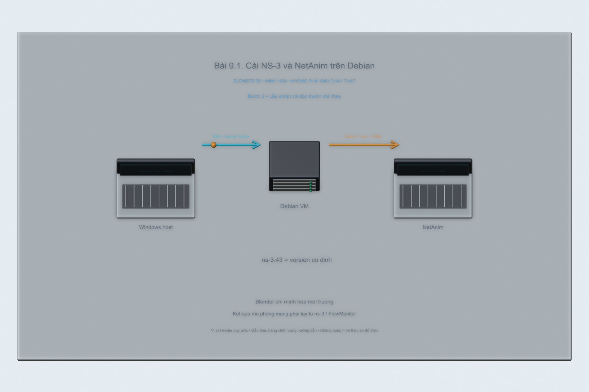
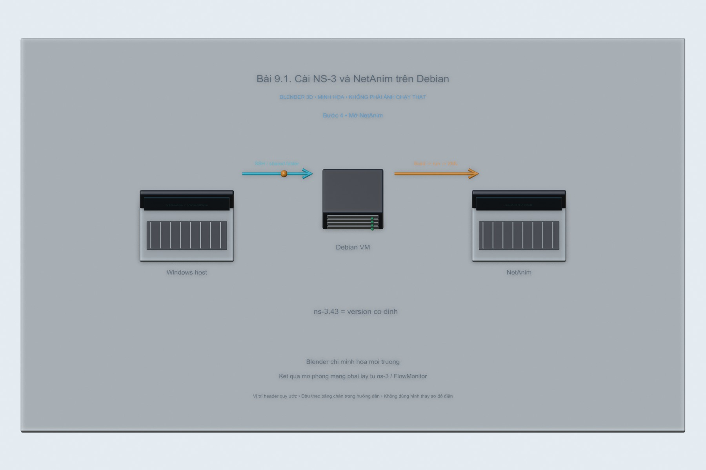
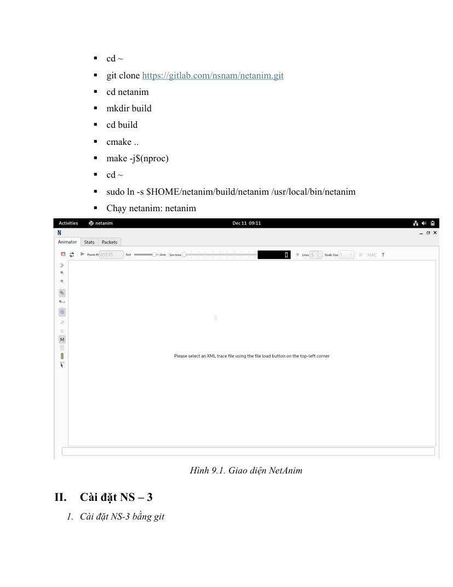
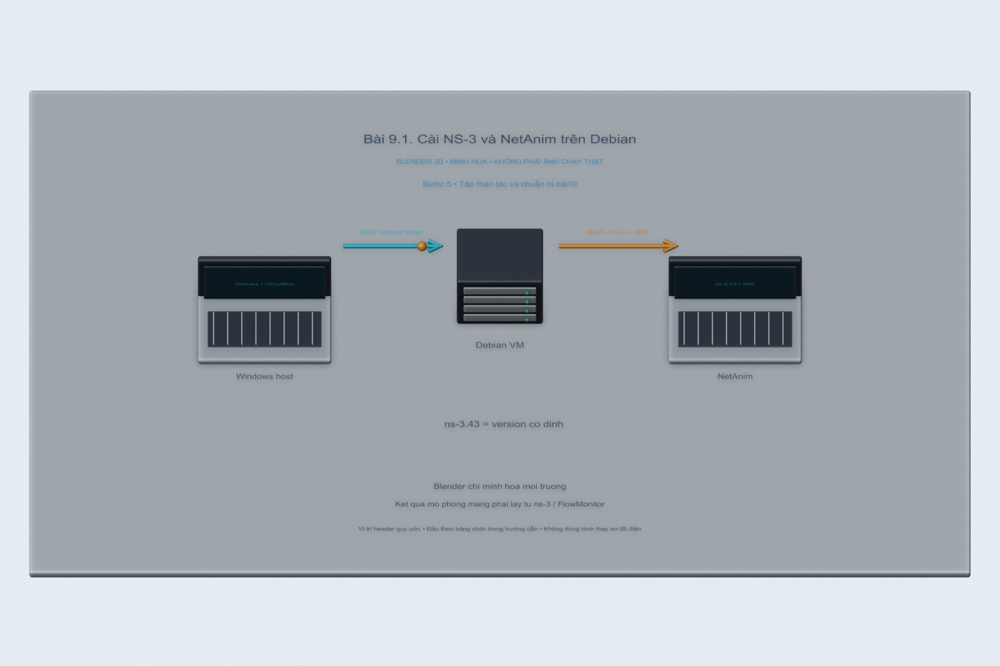
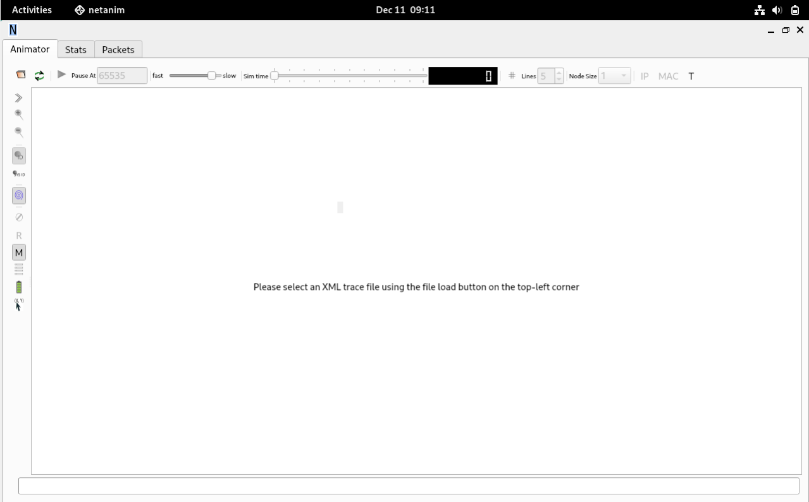

# Bài 9.1. Cài NS-3 và NetAnim trên Debian

NS-3 chạy trên Linux, còn NetAnim dùng để xem lại hoạt động của mô hình. Phần này ghi lại môi trường cài đặt và các lệnh build để chuẩn bị cho bài LTE tiếp theo.

Nguồn: [đề gốc](../tai-lieu-goc/BTH9_Huong_dan_tai_NS3.pdf), trang 1-5.

## Dụng cụ và phần mềm

Máy ảo Debian/Ubuntu64, RAM gợi ý≥4GB, ít nhất vài GB trống cho build; mạng tải gói. Bộ tài liệu bài 9 là hướng dẫn cài, không có thêm đề9.x riêng.

## Kết nối và cấu hình

Chạy trên Linux VM, không chạy trực tiếp shell script bằng PowerShell Windows. File install-ns3.sh cố định ns-3.43 để tái lập API; `ns-3-dev` liên tục thay đổi nên không trộn đường dẫn.

<!-- blender-intro -->
## Hình minh họa

Các ảnh 3D mô tả vị trí các thành phần và hướng trao đổi dữ liệu. Có thể mở [file Blender bài 9.1](../mo-phong-3d/9.1/bai-9.1.blend) để xem các mốc của từng bước.
<!-- /blender-intro -->

## Các bước thực hiện

### Bước 1. Chuẩn bị Linux

Làm Debian ở [bài 6/CAI_DAT](../BTH06_ZIGBEE/CAI_DAT.md). SSH vào VM. Chạy `sudo apt update` và `git --version`, kiểm tra quyền sudo của user thường.

### Bước 2. Lấy script và đọc trước khi chạy

Clone repository trong VM hoặc copy BTH09_NS3. Đọc install-ns3.sh; script cài build-essential, Python3, CMake, Ninja, Qt5 và phụ thuộc. Chạy `bash install-ns3.sh` bằng user thường có sudo, không dùng root cho build.

### Bước 3. Xác nhận NS-3

Sau build: `cd ~/ns-3.43` rồi `./ns3 run hello-simulator`. Phải thấy Hello Simulator. Script chỉ dùng2 job để tránh VM ít RAM hết bộ nhớ. Lỗi compiler bị killed thường do thiếu RAM; thử `./ns3 build -j 1`.

### Bước 4. Mở NetAnim

Nếu source NetAnim hỗ trợ CMake, executable thường ở ~/netanim/build; nếu dùng qmake nằm thư mục source. Dùng `find ~/netanim -type f -executable -iname "netanim*"` để xác định rồi chạy trong desktop Linux. SSH terminal không có display thì cần phiên desktop/X11; build thành công chưa bảo đảm GUI mở được.

**Hình tham khảo trong đề, trang 3:**

### Bước 5. Tập thao tác và chuẩn bị bài 10

scratch/ là nơi đặt code mô phỏng; examples/ là ví dụ; src/ chứa module. Lệnh cơ bản `pwd`, `ls`, `cd`, `mkdir`, `cp`; vim: i để nhập, Esc → :wq để lưu. Đặt file LTE của bài 10 vào scratch rồi chạy bằng ./ns3.

## Nội dung kiểm tra

Lưu version/tag, output hello-simulator và ảnh NetAnim. Máy Windows hiện tại không có Linux/WSL được xác nhận nên không ghi rằng mô phỏng LTE đã chạy ở đây.

## Nhận xét và trả lời câu hỏi

NS-3 mô phỏng rời rạc theo sự kiện, khác trình giả lập board. NetAnim đọc XML animation, FlowMonitor đọc thống kê IP khác file animation. Không mở lte-lab1.xml trong NetAnim nếu đó là XML FlowMonitor; NetAnim dùng lte.xml.

## Kết quả của bài

Kịch bản LTE của bài tiếp theo đã build và chạy trên Ubuntu của GitHub Actions. Phần cài NS-3/NetAnim và mở GUI trên máy Linux cục bộ chưa được thực hiện trong lần này.

<!-- source-crops -->
## Hình tham khảo từ tài liệu thực hành

Các hình trích từ đề giúp đối chiếu vị trí nút và cách bố trí. IP, cổng COM và tên thiết bị trong hình là ví dụ của tài liệu.

**Trang 3, hình 1** — [mở trang gốc](../tai-lieu-goc/trang/BTH9_Huong_dan_tai_NS3/page-03.jpg).

<!-- /source-crops -->
