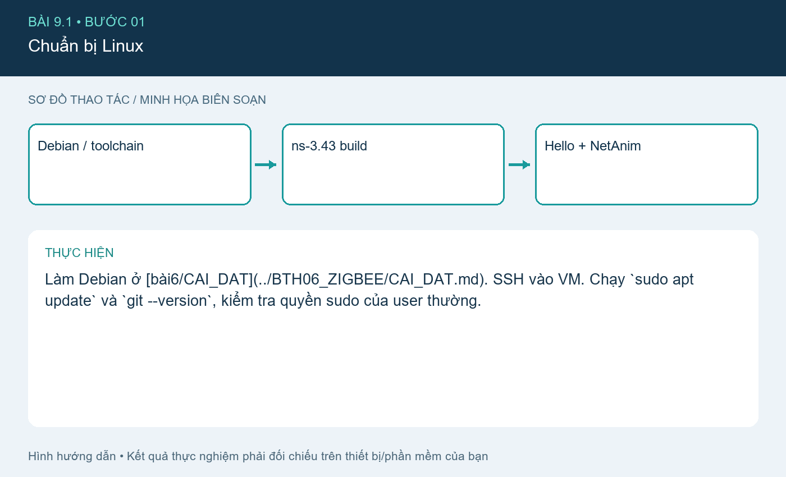
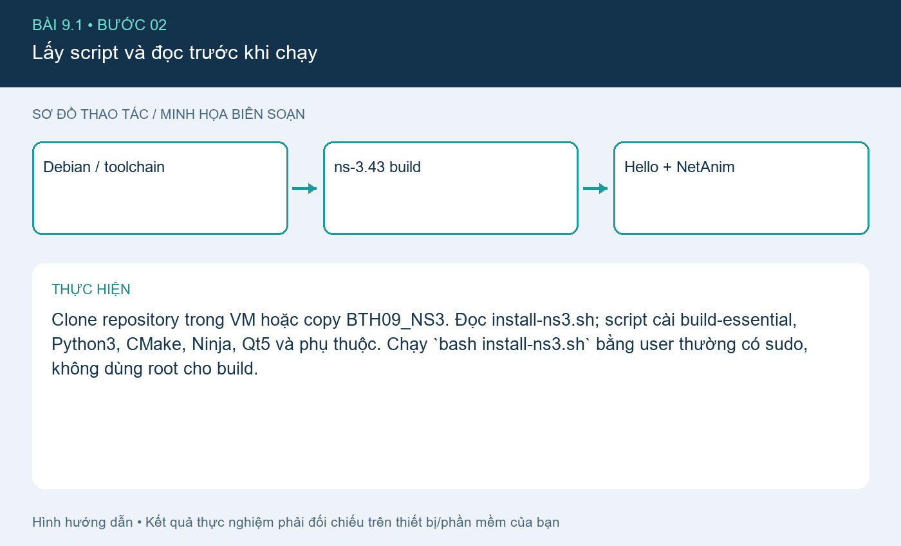
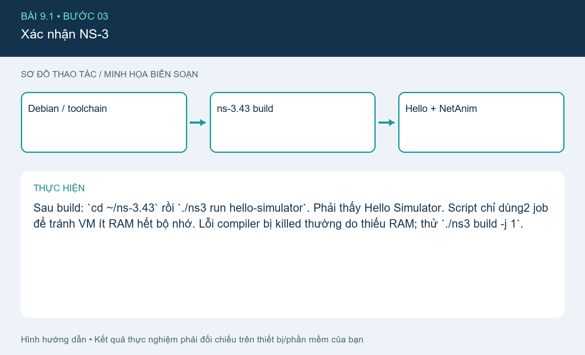
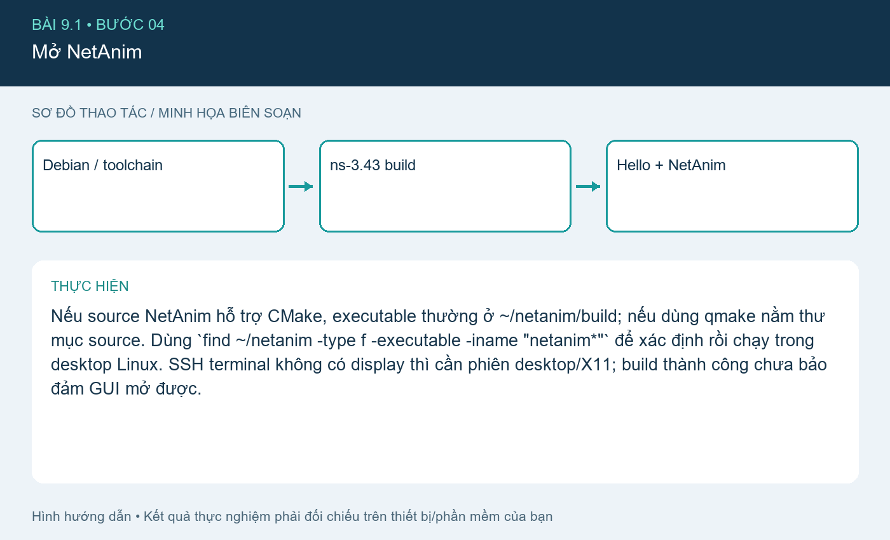
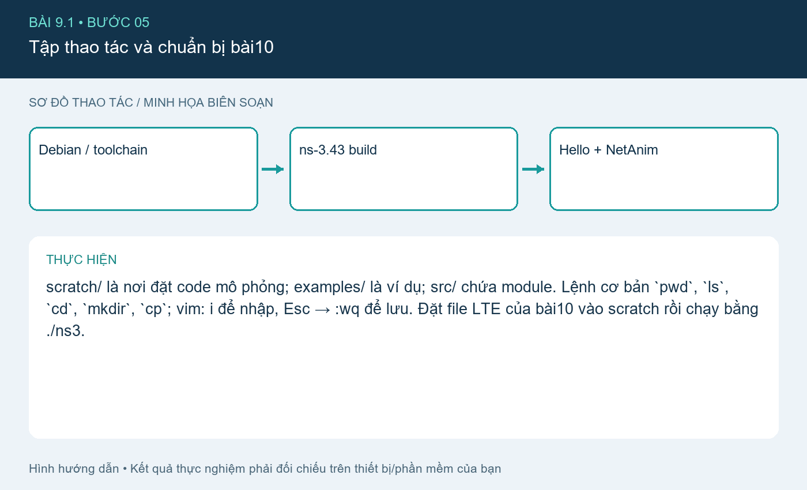

# Bài 9.1. Cài NS-3 và NetAnim trên Debian

Nguồn: [đề gốc](../tai-lieu-goc/BTH9_Huong_dan_tai_NS3.pdf), trang 1-5. Số bài nhỏ được chuẩn hóa theo số bài thực hành; xem đối chiếu ở README.

## Chuẩn bị

Máy ảo Debian/Ubuntu64, RAM gợi ý≥4GB, ít nhất vài GB trống cho build; mạng tải gói. Bộ tài liệu bài9 là hướng dẫn cài, không có thêm đề9.x riêng.

## Kết nối và cấu hình

Chạy trên Linux VM, không chạy trực tiếp shell script bằng PowerShell Windows. File install-ns3.sh cố định ns-3.43 để tái lập API; `ns-3-dev` liên tục thay đổi nên không trộn đường dẫn.

## Thực hiện từng bước

### Bước 1. Chuẩn bị Linux

Làm Debian ở [bài6/CAI_DAT](../BTH06_ZIGBEE/CAI_DAT.md). SSH vào VM. Chạy `sudo apt update` và `git --version`, kiểm tra quyền sudo của user thường.

### Bước 2. Lấy script và đọc trước khi chạy

Clone repository trong VM hoặc copy BTH09_NS3. Đọc install-ns3.sh; script cài build-essential, Python3, CMake, Ninja, Qt5 và phụ thuộc. Chạy `bash install-ns3.sh` bằng user thường có sudo, không dùng root cho build.

### Bước 3. Xác nhận NS-3

Sau build: `cd ~/ns-3.43` rồi `./ns3 run hello-simulator`. Phải thấy Hello Simulator. Script chỉ dùng2 job để tránh VM ít RAM hết bộ nhớ. Lỗi compiler bị killed thường do thiếu RAM; thử `./ns3 build -j 1`.

### Bước 4. Mở NetAnim

Nếu source NetAnim hỗ trợ CMake, executable thường ở ~/netanim/build; nếu dùng qmake nằm thư mục source. Dùng `find ~/netanim -type f -executable -iname "netanim*"` để xác định rồi chạy trong desktop Linux. SSH terminal không có display thì cần phiên desktop/X11; build thành công chưa bảo đảm GUI mở được.

**Đối chiếu tài liệu gốc, trang 3** (ảnh/giá trị mẫu trong đề, không phải kết quả mới; áp dụng hiệu chỉnh trong hướng dẫn):

### Bước 5. Tập thao tác và chuẩn bị bài10

scratch/ là nơi đặt code mô phỏng; examples/ là ví dụ; src/ chứa module. Lệnh cơ bản `pwd`, `ls`, `cd`, `mkdir`, `cp`; vim: i để nhập, Esc → :wq để lưu. Đặt file LTE của bài10 vào scratch rồi chạy bằng ./ns3.

## Kiểm tra và kết quả cần thu

Lưu version/tag, output hello-simulator và ảnh NetAnim. Máy Windows hiện tại không có Linux/WSL được xác nhận nên không ghi rằng mô phỏng LTE đã chạy ở đây.

## Giải thích và trả lời câu hỏi

NS-3 mô phỏng rời rạc theo sự kiện, khác trình giả lập board. NetAnim đọc XML animation, FlowMonitor đọc thống kê IP khác file animation. Không mở lte-lab1.xml trong NetAnim nếu đó là XML FlowMonitor; NetAnim dùng lte.xml.

## Bằng chứng thực hành

Các hình `images/*-buoc-*.png` là sơ đồ hướng dẫn biên soạn, không phải ảnh chụp kết quả chạy. [Xem toàn bộ trang đề gốc](../tai-lieu-goc/README.md). Tạo thư mục `ket-qua/` tại bài này để lưu ảnh chụp thật, log Serial, pcapng hoặc XML sau khi chạy. Không điền số đo khi chưa thực nghiệm.
