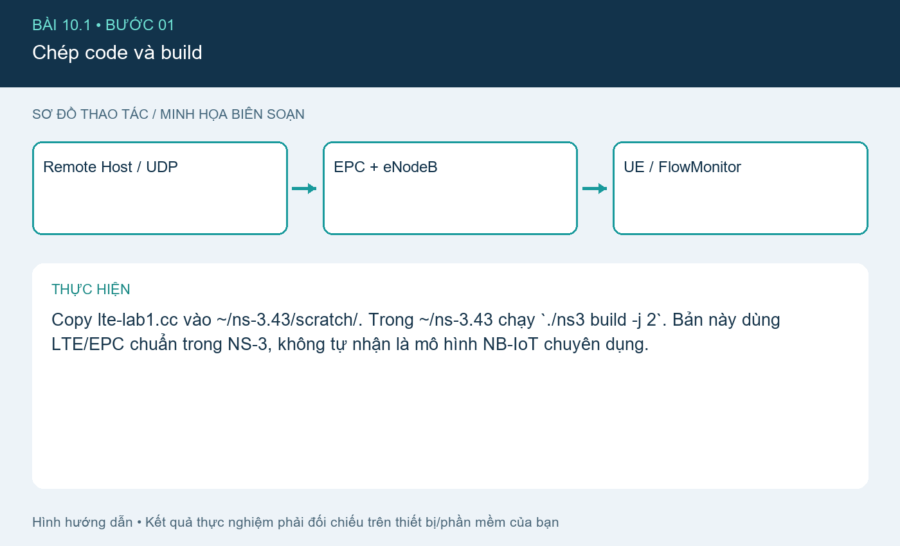
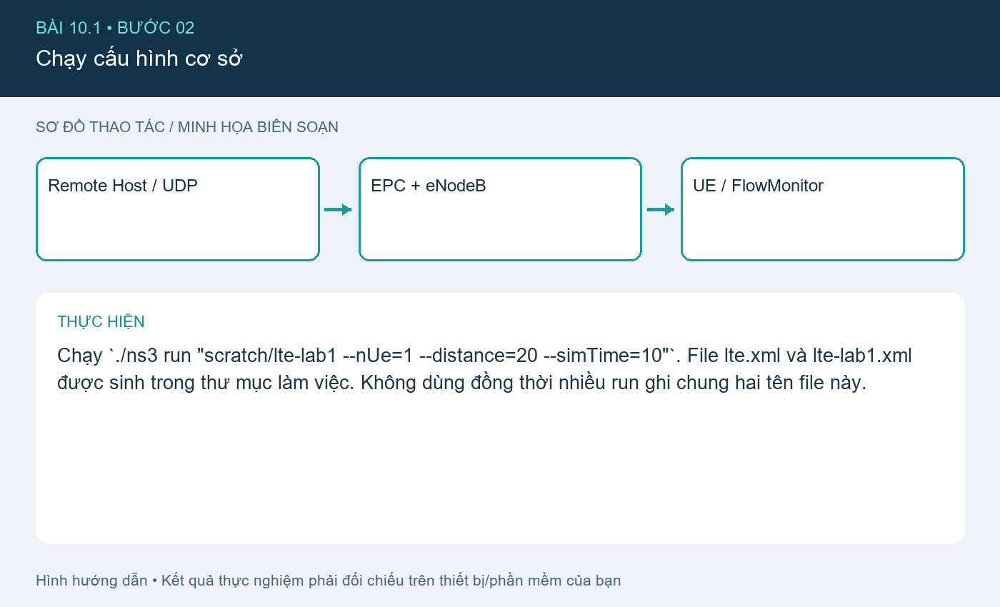
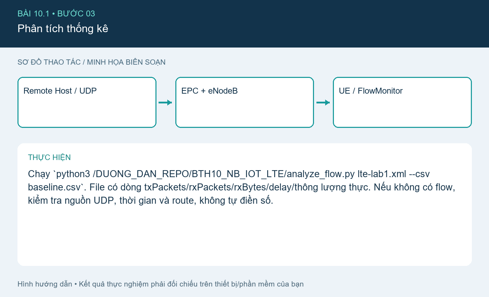
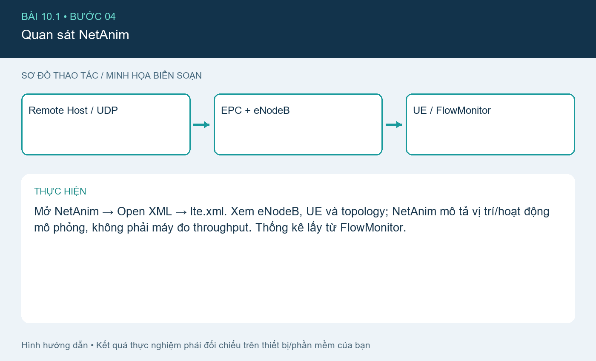
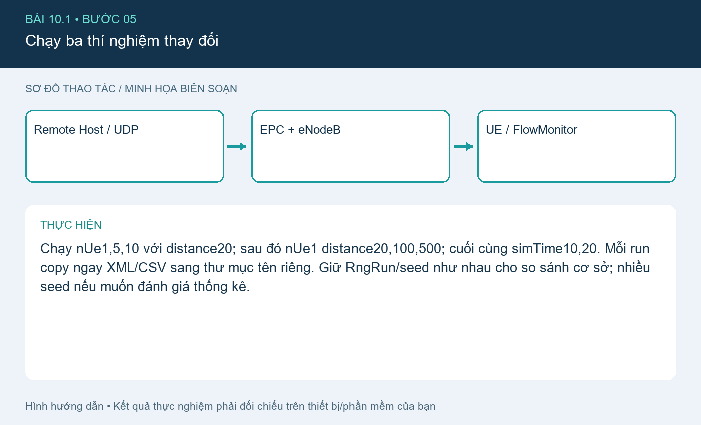

# Bài 10.1. Mạng LTE/EPC có lưu lượng và FlowMonitor

Nguồn: [đề gốc](../tai-lieu-goc/BTH10_NB-IoT_LTE.pdf), trang 3-9. Số bài nhỏ được chuẩn hóa theo số bài thực hành; xem đối chiếu ở README.

## Chuẩn bị

Linux + ns-3.43 đã cài theo bài9; NetAnim cho desktop; Python3 chuẩn không cần thư viện ngoài để chạy analyze_flow.py.

## Kết nối và cấu hình

Topology: Remote Host → point-to-point → PGW/EPC → eNodeB → UE. Remote Host có route7.0.0.0/8 tới PGW; UE dùng gateway EPC. Ứng dụng UDP trên remote gửi128byte/100ms tới UE. File đề chỉ tạo node mà chưa tạo ứng dụng phát nên có thể không có IP flow; bản này bổ sung nguồn dữ liệu và route.

## Thực hiện từng bước

### Bước 1. Chép code và build

Copy lte-lab1.cc vào ~/ns-3.43/scratch/. Trong ~/ns-3.43 chạy `./ns3 build -j 2`. Bản này dùng LTE/EPC chuẩn trong NS-3, không tự nhận là mô hình NB-IoT chuyên dụng.

### Bước 2. Chạy cấu hình cơ sở

Chạy `./ns3 run "scratch/lte-lab1 --nUe=1 --distance=20 --simTime=10"`. File lte.xml và lte-lab1.xml được sinh trong thư mục làm việc. Không dùng đồng thời nhiều run ghi chung hai tên file này.

### Bước 3. Phân tích thống kê

Chạy `python3 /DUONG_DAN_REPO/BTH10_NB_IOT_LTE/analyze_flow.py lte-lab1.xml --csv baseline.csv`. File có dòng txPackets/rxPackets/rxBytes/delay/thông lượng thực. Nếu không có flow, kiểm tra nguồn UDP, thời gian và route, không tự điền số.

### Bước 4. Quan sát NetAnim

Mở NetAnim → Open XML → lte.xml. Xem eNodeB, UE và topology; NetAnim mô tả vị trí/hoạt động mô phỏng, không phải máy đo throughput. Thống kê lấy từ FlowMonitor.

### Bước 5. Chạy ba thí nghiệm thay đổi

Chạy nUe1,5,10 với distance20; sau đó nUe1 distance20,100,500; cuối cùng simTime10,20. Mỗi run copy ngay XML/CSV sang thư mục tên riêng. Giữ RngRun/seed như nhau cho so sánh cơ sở; nhiều seed nếu muốn đánh giá thống kê.

## Kiểm tra và kết quả cần thu

Nộp XML animation + FlowMonitor, CSV và bảng so sánh3 nhóm thí nghiệm. Kết quả phải có txPackets>0 và giải thích mất gói/trễ. Chưa có XML thực trong repository này nên không có bảng số liệu LTE tự tạo.

## Giải thích và trả lời câu hỏi

txPackets/rxPackets là số packet IP phát/nhận theo flow; txBytes/rxBytes bao gồm byte ở tầng IP, không chỉ payload128byte. flowId là định danh do FlowMonitor gán, classifier chứa source/destination IP/port. delaySum là tổng trễ của các gói đã nhận; mean delay=delaySum/rxPackets. minDelay/maxDelay là cực trị. Delivery ratio=rx/tx; throughput ở script=rxBytes×8/(lastRx-firstTx)/1000 kbps, phải ghi rõ khoảng đo.

Tăng UE chia sẻ tài nguyên vô tuyến; tăng khoảng cách có thể thay đổi chất lượng kênh, tốc độ và mất gói theo mô hình propagation. Không khẳng định throughput luôn giảm theo một tỷ lệ cố định khi chưa chạy. simTime là lúc dừng nguồn; mô phỏng chạy thêm1s để gói đang đi tới nơi, giảm đếm mất gói giả.

Tên tài liệu là NB-IoT/LTE nhưng bài được giao chỉ yêu cầu LTE cơ bản. Muốn đánh giá NB-IoT cần model hỗ trợ NB-IoT riêng, không đổi nhãn của kết quả LTE.

## Bằng chứng thực hành

Các hình `images/*-buoc-*.png` là sơ đồ hướng dẫn biên soạn, không phải ảnh chụp kết quả chạy. [Xem toàn bộ trang đề gốc](../tai-lieu-goc/README.md). Tạo thư mục `ket-qua/` tại bài này để lưu ảnh chụp thật, log Serial, pcapng hoặc XML sau khi chạy. Không điền số đo khi chưa thực nghiệm.
