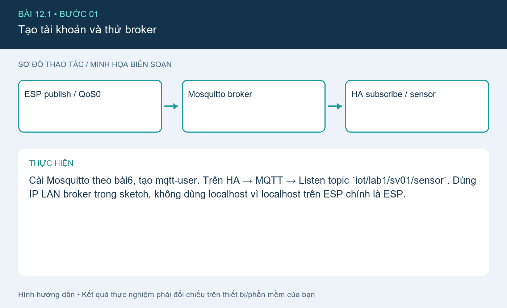
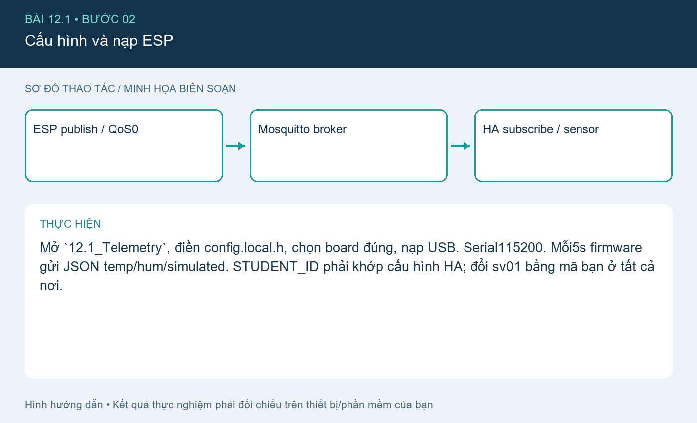
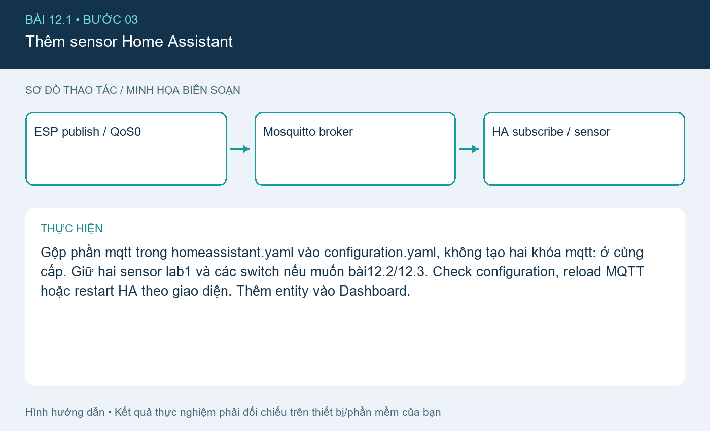
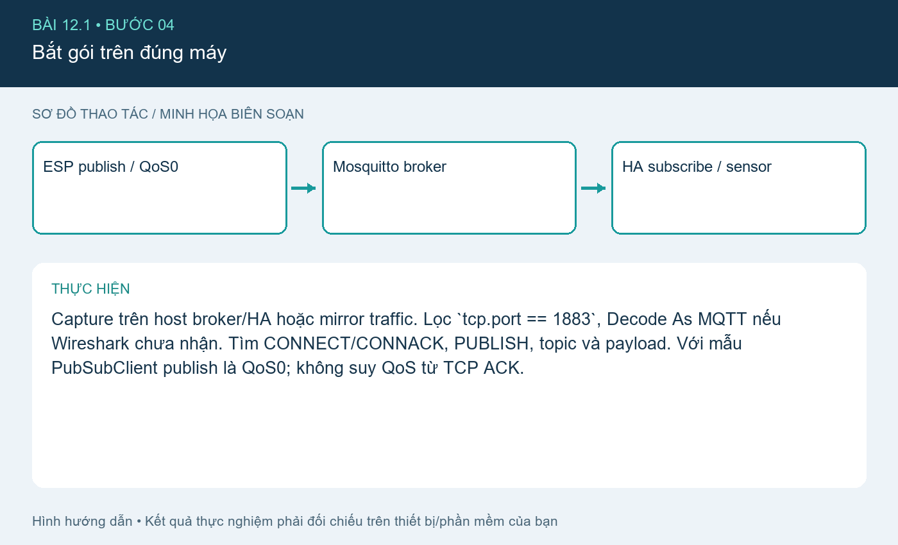
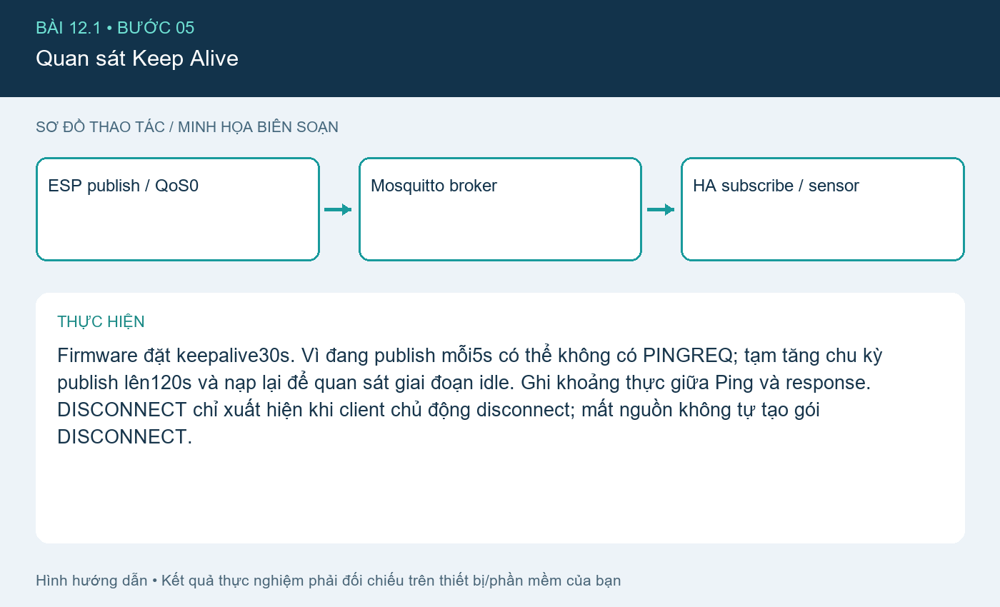

# Bài 12.1. Publish dữ liệu và phân tích gói MQTT

Nguồn: [đề gốc](../tai-lieu-goc/BTH12_MQTT.pdf), trang 3-12. Số bài nhỏ được chuẩn hóa theo số bài thực hành; xem đối chiếu ở README.

## Chuẩn bị

ESP8266 D1 mini/NodeMCU hoặc ESP32 DevKit thông thường, Wi-Fi LAN, Mosquitto+Home Assistant theo bài6, Arduino IDE. Cài PubSubClient2.8. Các sketch chọn WiFi.h/ESP8266WiFi.h theo core. Dữ liệu bài12.1 là dữ liệu mô phỏng được gắn simulated=true.

## Kết nối và cấu hình

ESP8266 dùng LED_BUILTIN active LOW; ESP32 dùng GPIO2 LED active HIGH theo config.example.h. ESP32-S3 thường không có LED đơn GPIO2; chọn GPIO ngoài phù hợp. Sao config.example.h thành config.local.h trong từng sketch và nhập SSID, password, MQTT_HOST, user, password và STUDENT_ID. Không commit file local.

## Thực hiện từng bước

### Bước 1. Tạo tài khoản và thử broker

Cài Mosquitto theo bài6, tạo mqtt-user. Trên HA → MQTT → Listen topic `iot/lab1/sv01/sensor`. Dùng IP LAN broker trong sketch, không dùng localhost vì localhost trên ESP chính là ESP.

### Bước 2. Cấu hình và nạp ESP

Mở `12.1_Telemetry`, điền config.local.h, chọn board đúng, nạp USB. Serial115200. Mỗi5s firmware gửi JSON temp/hum/simulated. STUDENT_ID phải khớp cấu hình HA; đổi sv01 bằng mã bạn ở tất cả nơi.

### Bước 3. Thêm sensor Home Assistant

Gộp phần mqtt trong homeassistant.yaml vào configuration.yaml, không tạo hai khóa mqtt: ở cùng cấp. Giữ hai sensor lab1 và các switch nếu muốn bài12.2/12.3. Check configuration, reload MQTT hoặc restart HA theo giao diện. Thêm entity vào Dashboard.

### Bước 4. Bắt gói trên đúng máy

Capture trên host broker/HA hoặc mirror traffic. Lọc `tcp.port == 1883`, Decode As MQTT nếu Wireshark chưa nhận. Tìm CONNECT/CONNACK, PUBLISH, topic và payload. Với mẫu PubSubClient publish là QoS0; không suy QoS từ TCP ACK.

### Bước 5. Quan sát Keep Alive

Firmware đặt keepalive30s. Vì đang publish mỗi5s có thể không có PINGREQ; tạm tăng chu kỳ publish lên120s và nạp lại để quan sát giai đoạn idle. Ghi khoảng thực giữa Ping và response. DISCONNECT chỉ xuất hiện khi client chủ động disconnect; mất nguồn không tự tạo gói DISCONNECT.

## Kiểm tra và kết quả cần thu

Sensor hiện dữ liệu mô phỏng đúng JSON; pcap có CONNECT/CONNACK/PUBLISH và topic trùng config; bảng nguồn/đích/port/MAC/seq/ack lấy từ capture, không lấy số mẫu trong hình đề.

## Giải thích và trả lời câu hỏi

ESP và Home Assistant đều là MQTT client; broker nhận publication và chuyển tới subscriber. Broker nghe1883; client dùng cổng nguồn động, có thể thay sau reconnect. L2 MAC phụ thuộc hop thực (Wi-Fi/Ethernet); L3 IP chỉ endpoint và protocolTCP; L4 TCP dùng seq/ack, đảm bảo byte stream có thứ tự và gửi lại; MQTT là giao thức tầng ứng dụng phía trên TCP.

CONNECT xin mở phiên MQTT; CONNACK chấp nhận/từ chối; PUBLISH mang topic/payload; PINGREQ/PINGRESP duy trì và kiểm tra kết nối khi idle. CONNECT plaintext1883 có thể lộ username/password; payload cũng đọc được. Dùng MQTT over TLS với kiểm chứng CA/hostname theo bài14.1 để bảo vệ đường truyền. Chụp MAC/IP/port/seq/ack thực và không công bố credential thật trong ảnh.

PubSubClient2.8 publish chỉ hỗ trợ QoS0; subscribe có thể yêu cầuQoS1. Không viết trong báo cáo rằng code này publishQoS1 chỉ vì subscribeQoS1.

## Bằng chứng thực hành

Các hình `images/*-buoc-*.png` là sơ đồ hướng dẫn biên soạn, không phải ảnh chụp kết quả chạy. [Xem toàn bộ trang đề gốc](../tai-lieu-goc/README.md). Tạo thư mục `ket-qua/` tại bài này để lưu ảnh chụp thật, log Serial, pcapng hoặc XML sau khi chạy. Không điền số đo khi chưa thực nghiệm.
