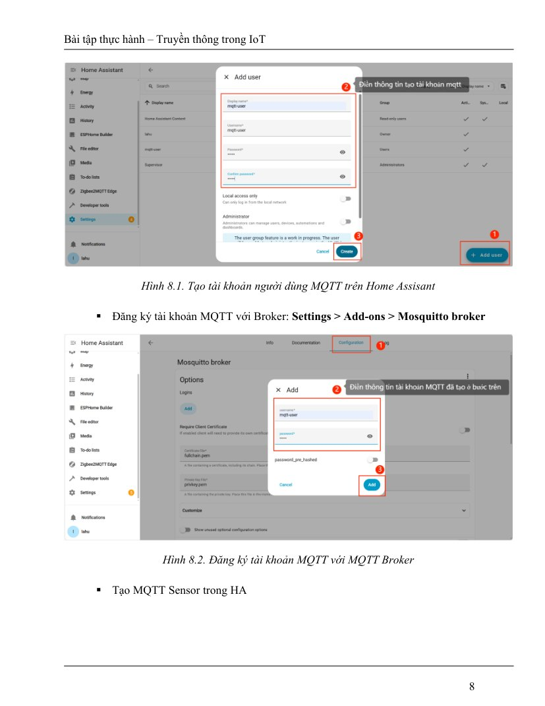
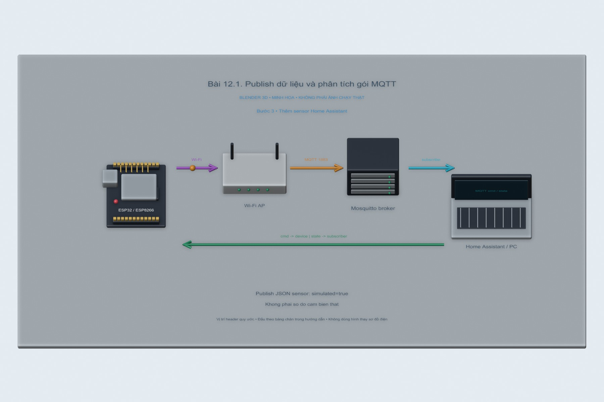
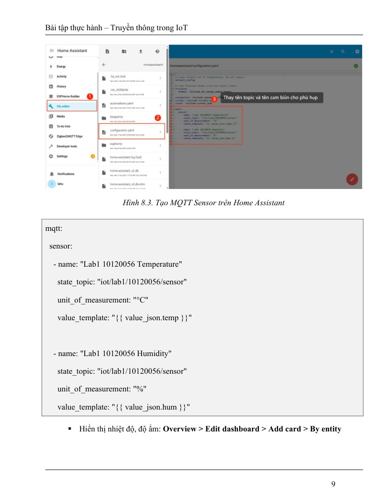
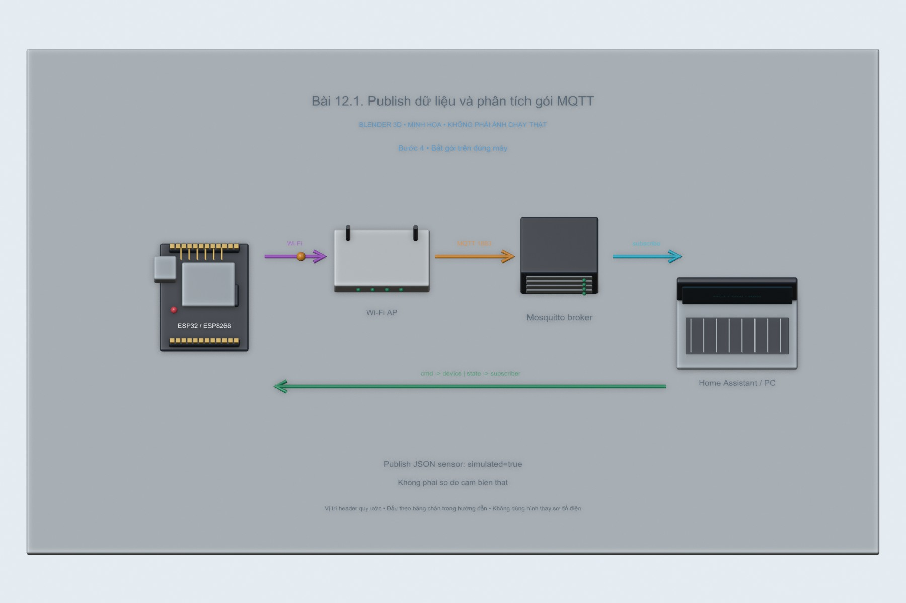
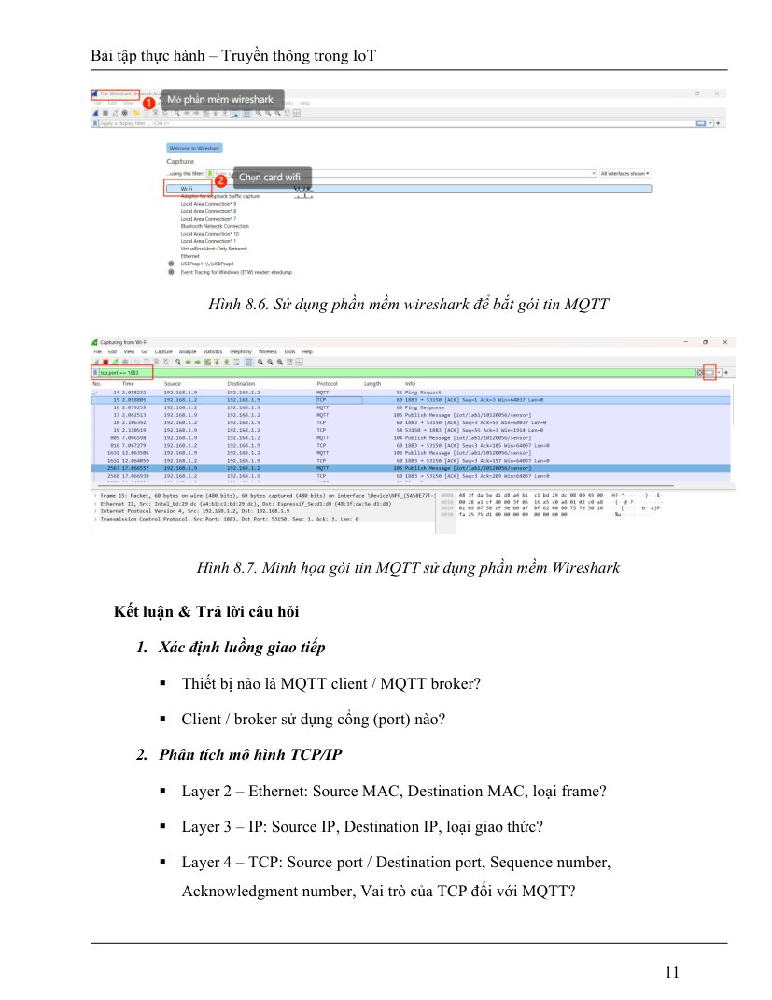

# Bài 12.1. Publish dữ liệu và phân tích gói MQTT

Trong lần thử trên PC, em cho một chương trình đóng vai cảm biến gửi ba mẫu dữ liệu lên MQTT broker, rồi dùng chương trình khác nhận lại. Wireshark giúp nhìn rõ topic, payload và các bản tin xác nhận QoS 1.

Nguồn: [đề gốc](../tai-lieu-goc/BTH12_MQTT.pdf), trang 3-12.

## Dụng cụ và phần mềm

Lần thử PC dùng Node.js 24.19.0, broker Aedes 0.51.3, MQTT.js 5.14.1 và Wireshark 4.6.9. Nếu làm tiếp trên mạch, cần ESP8266 D1 mini/NodeMCU hoặc ESP32, mạng Wi-Fi và broker MQTT; sketch dùng PubSubClient 2.8.

## Kết nối và cấu hình

ESP8266 dùng LED_BUILTIN active LOW; ESP32 dùng GPIO2 LED active HIGH theo config.example.h. ESP32-S3 thường không có LED đơn GPIO2; chọn GPIO ngoài phù hợp. Sao config.example.h thành config.local.h trong từng sketch và nhập SSID, password, MQTT_HOST, user, password và STUDENT_ID. Không commit file local.

<!-- actual-wireshark -->
## Thử trên PC và đọc kết quả Wireshark

Em chạy một publisher và một subscriber, sau đó gửi ba mẫu nhiệt độ 28; 28,5 và 29°C. Đây là dữ liệu tạo trên PC, trong JSON có `simulated: true` và `source: "PC"` để phân biệt với số đo DHT11.

Ở file `12.1.pcapng`, em lọc `mqtt` và chọn frame **19**. Phần MQTT hiện topic `iot/lab1/sv01/sensor`, QoS 1 và Message Identifier; bên phải đọc được JSON trong khung bytes. Có 6 bản tin PUBLISH vì mỗi mẫu đi từ publisher tới broker rồi từ broker tới subscriber.

[Cách mở, chọn frame và tái lập](../docs/wireshark-thuc-te/README.md) · [Số liệu đọc từ bản ghi](../docs/wireshark-thuc-te/analysis.json).

[12.1.pcapng](../docs/wireshark-thuc-te/12.1.pcapng) · [log](../docs/wireshark-thuc-te/12.1.log) · [CSV các frame](../docs/wireshark-thuc-te/12.1-packets.csv).

<!-- /actual-wireshark -->

<!-- blender-intro -->
## Hình minh họa

Các ảnh 3D mô tả vị trí các thành phần và hướng trao đổi dữ liệu. Có thể mở [file Blender bài 12.1](../mo-phong-3d/12.1/bai-12.1.blend) để xem các mốc của từng bước.
<!-- /blender-intro -->

## Thực hiện tiếp với ESP

### Bước 1. Tạo tài khoản và thử broker

Cài Mosquitto theo bài 6, tạo mqtt-user. Trên HA → MQTT → Listen topic `iot/lab1/sv01/sensor`. Dùng IP LAN broker trong sketch, không dùng localhost vì localhost trên ESP chính là ESP.

**Hình tham khảo trong đề, trang 8:**

### Bước 2. Cấu hình và nạp ESP

Mở `12.1_Telemetry`, điền config.local.h, chọn board đúng, nạp USB. Serial115200. Mỗi5s firmware gửi JSON temp/hum/simulated. STUDENT_ID phải khớp cấu hình HA; đổi sv01 bằng mã bạn ở tất cả nơi.

### Bước 3. Thêm sensor Home Assistant

Gộp phần mqtt trong homeassistant.yaml vào configuration.yaml, không tạo hai khóa mqtt: ở cùng cấp. Giữ hai sensor lab1 và các switch nếu muốn bài 12.2/12.3. Check configuration, reload MQTT hoặc restart HA theo giao diện. Thêm entity vào Dashboard.

**Hình tham khảo trong đề, trang 9:**

### Bước 4. Bắt gói trên đúng máy

Capture trên host broker/HA hoặc mirror traffic. Lọc `tcp.port == 1883`, Decode As MQTT nếu Wireshark chưa nhận. Tìm CONNECT/CONNACK, PUBLISH, topic và payload. Với mẫu PubSubClient publish là QoS0; không suy QoS từ TCP ACK.

**Hình tham khảo trong đề, trang 11:**

### Bước 5. Quan sát Keep Alive

Firmware đặt keepalive30s. Vì đang publish mỗi5s có thể không có PINGREQ; tạm tăng chu kỳ publish lên120s và nạp lại để quan sát giai đoạn idle. Ghi khoảng thực giữa Ping và response. DISCONNECT chỉ xuất hiện khi client chủ động disconnect; mất nguồn không tự tạo gói DISCONNECT.

## Kiểm tra khi chạy trên board

Sensor hiện dữ liệu mô phỏng đúng JSON; pcap có CONNECT/CONNACK/PUBLISH và topic trùng config; bảng nguồn/đích/port/MAC/seq/ack lấy từ capture, không lấy số mẫu trong hình đề.

## Nhận xét và trả lời câu hỏi

ESP và Home Assistant đều là MQTT client; broker nhận publication và chuyển tới subscriber. Broker nghe1883; client dùng cổng nguồn động, có thể thay sau reconnect. L2 MAC phụ thuộc hop thực (Wi-Fi/Ethernet); L3 IP chỉ endpoint và protocolTCP; L4 TCP dùng seq/ack, đảm bảo byte stream có thứ tự và gửi lại; MQTT là giao thức tầng ứng dụng phía trên TCP.

CONNECT xin mở phiên MQTT; CONNACK chấp nhận/từ chối; PUBLISH mang topic/payload; PINGREQ/PINGRESP duy trì và kiểm tra kết nối khi idle. CONNECT plaintext1883 có thể lộ username/password; payload cũng đọc được. Dùng MQTT over TLS với kiểm chứng CA/hostname theo bài 14.1 để bảo vệ đường truyền. Chụp MAC/IP/port/seq/ack thực và không công bố credential thật trong ảnh.

PubSubClient2.8 publish chỉ hỗ trợ QoS0; subscribe có thể yêu cầuQoS1. Không viết trong báo cáo rằng code này publishQoS1 chỉ vì subscribeQoS1.

## Kết quả của bài

Wireshark cho thấy đủ ba mẫu được gửi và chuyển tới subscriber. Vì em tạo số liệu trên PC, các giá trị 28–29°C chỉ phục vụ việc đọc payload; phần lấy dữ liệu từ cảm biến cần làm riêng trên board.

<!-- source-crops -->
## Hình tham khảo từ tài liệu thực hành

Các hình trích từ đề giúp đối chiếu vị trí nút và cách bố trí. IP, cổng COM và tên thiết bị trong hình là ví dụ của tài liệu.

**Trang 8, hình 1** — [mở trang gốc](../tai-lieu-goc/trang/BTH12_MQTT/page-08.jpg).

**Trang 8, hình 2** — [mở trang gốc](../tai-lieu-goc/trang/BTH12_MQTT/page-08.jpg).

**Trang 9, hình 1** — [mở trang gốc](../tai-lieu-goc/trang/BTH12_MQTT/page-09.jpg).

**Trang 10, hình 1** — [mở trang gốc](../tai-lieu-goc/trang/BTH12_MQTT/page-10.jpg).

**Trang 10, hình 2** — [mở trang gốc](../tai-lieu-goc/trang/BTH12_MQTT/page-10.jpg).

**Trang 11, hình 1** — [mở trang gốc](../tai-lieu-goc/trang/BTH12_MQTT/page-11.jpg).

**Trang 11, hình 2** — [mở trang gốc](../tai-lieu-goc/trang/BTH12_MQTT/page-11.jpg).

<!-- /source-crops -->
