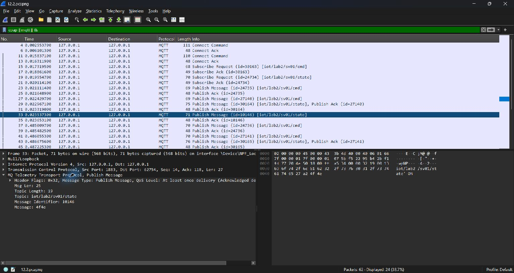
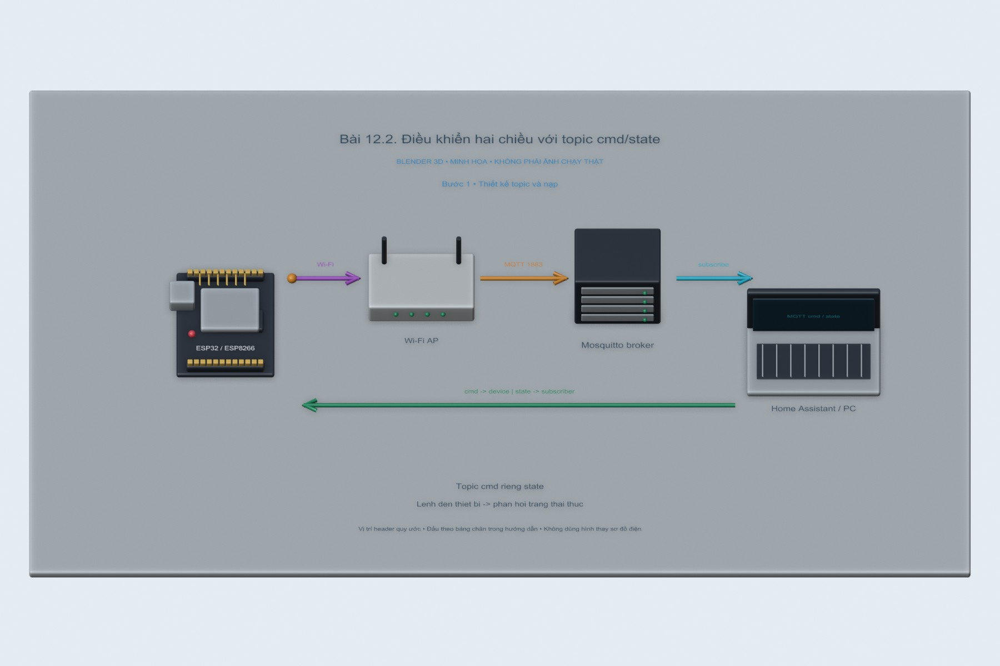
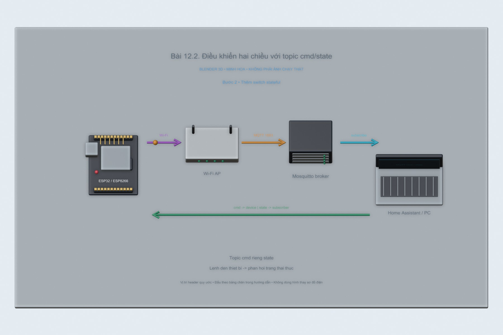

# Bài 12.2. Điều khiển hai chiều với topic cmd/state

Nguồn: [đề gốc](../tai-lieu-goc/BTH12_MQTT.pdf), trang 12-19. Số bài nhỏ được chuẩn hóa theo số bài thực hành; xem đối chiếu ở README.

## Chuẩn bị

ESP8266 D1 mini/NodeMCU hoặc ESP32 DevKit thông thường, Wi-Fi LAN, Mosquitto+Home Assistant theo bài6, Arduino IDE. Cài PubSubClient2.8. Các sketch chọn WiFi.h/ESP8266WiFi.h theo core. Dữ liệu bài12.1 là dữ liệu mô phỏng được gắn simulated=true.

## Kết nối và cấu hình

ESP8266 dùng LED_BUILTIN active LOW; ESP32 dùng GPIO2 LED active HIGH theo config.example.h. ESP32-S3 thường không có LED đơn GPIO2; chọn GPIO ngoài phù hợp. Sao config.example.h thành config.local.h trong từng sketch và nhập SSID, password, MQTT_HOST, user, password và STUDENT_ID. Không commit file local.

<!-- actual-wireshark -->
## Kết quả Wireshark thực tế trên PC — 16/10/2026

**Nguồn thực nghiệm:** chương trình PC trao đổi TCP/UDP thật trên Loopback, TShark/Npcap bắt gói và mở bằng Wireshark để chụp. Ảnh giữ nguyên. Các client PC thay vai trò thiết bị; chưa phải kết quả chạy board ESP/Home Assistant.

Mở `12.2.pcapng`, lọc `mqtt`. Các frame **23/27** chứa lệnh ON trên topic `iot/lab2/sv01/cmd`; frame **29/33** chứa phản hồi ON trên `iot/lab2/sv01/state`. Lệnh OFF và phản hồi tiếp theo ở nhóm frame **37–47**. Ảnh chọn frame **33**, thấy bytes `4f4e` tương ứng ON. Device trong lần chạy này là chương trình Node, chưa điều khiển LED vật lý.

[Cách mở, chọn frame và tái lập](../docs/wireshark-thuc-te/README.md) · [Bảng số liệu đo](../docs/wireshark-thuc-te/analysis.json).

[12.2.pcapng](../docs/wireshark-thuc-te/12.2.pcapng) · [log](../docs/wireshark-thuc-te/12.2.log) · [CSV từng packet](../docs/wireshark-thuc-te/12.2-packets.csv).

<!-- /actual-wireshark -->

<!-- blender-intro -->
## Xem mô hình khi chưa có đủ linh kiện

[Tải cảnh Blender bài 12.2](../mo-phong-3d/12.2/bai-12.2.blend) · [Cách mở, xoay và xem timeline](../mo-phong-3d/README.md) · [Ảnh linh kiện trên mạng và nguồn](../docs/linh-kien/README.md).

Các hình theo bước dưới đây là **cảnh Blender 3D minh họa bố trí và tín hiệu**. Mốc trên timeline tương ứng số bước; vị trí hạt tín hiệu chỉ diễn họa hướng truyền. Phần nạp code/click menu làm theo chỉ dẫn bằng chữ và ảnh giao diện gốc bên dưới; hình 3D không giả làm màn hình phần mềm hay kết quả đo.

**Đọc cảnh:** xanh lơ/cam/tím là các đường tín hiệu có nhãn; dây đỏ là nguồn, dây đen là GND trong cảnh mạch điện. Với cảnh mạng, mũi tên chỉ luồng logic. Header được giản lược để dễ nhìn, nên dùng bảng nối dây trong bài để tìm chân thật.
<!-- /blender-intro -->

## Thực hiện từng bước

### Bước 1. Thiết kế topic và nạp

Nạp `12.2_LED_Command`. Topic tạo từ STUDENT_ID: `iot/lab2/sv01/cmd` và `iot/lab2/sv01/state`. Client ID phải riêng cho từng board để không đẩy nhau khỏi broker.

### Bước 2. Thêm switch stateful

Dùng switch Lab2 trong homeassistant.yaml, command_topic và state_topic tách nhau, optimistic=false. Nếu dùng mã sinh viên khác đổi cả hai topic. Không gửi lệnh về state topic.

### Bước 3. Điều khiển và đối chiếu

Bật/tắt switch HA, ESP nhận ON/OFF, đổi LED, publish state lại. Lắng nghe `iot/lab2/sv01/#` để thấy luồng cmd rồi state. Firmware hỗ trợ TOGGLE để test terminal, payload khác bị bỏ.

### Bước 4. Thử trạng thái kết nối lại

Restart ESP: mặc định LED OFF rồi publish trạng thái thật sau connect. Restart HA khi ESP không phát gì có thể chưa thấy state ngay vì bài12.2 không retain; quan sát rồi làm bài12.3 để so sánh.

## Kiểm tra và kết quả cần thu

ON/OFF tác động LED và state đúng; payload INVALID không đổi LED; topic sai không tác động; có ảnh listen cmd/state và ảnh LED.

## Giải thích và trả lời câu hỏi

cmd là yêu cầu thực hiện, state là phản hồi trạng thái đã áp dụng. optimistic=false khiến UI chờ state. Tách hai topic tránh vòng phản hồi tự kích hoạt. TCP giao dữ liệu không có nghĩa bóng đèn vật lý đã bật; cần đo/feedback thực khi làm thiết bị thật.

## Bằng chứng thực hành

Các hình Blender trong bài là minh họa tự dựng; ảnh giao diện từ PDF được ghi nguồn riêng. Đã có ảnh và pcap từ chương trình PC ở phần kết quả bên trên; chưa có bằng chứng chạy board vật lý cho bài này. [Xem toàn bộ trang đề gốc](../tai-lieu-goc/README.md). Tạo thư mục `ket-qua/` tại bài này để lưu ảnh chụp thật, log Serial, pcapng hoặc XML sau khi chạy. Không điền số đo khi chưa thực nghiệm.
