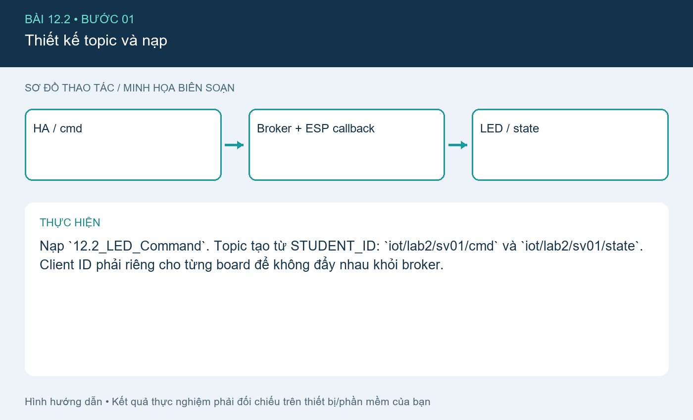
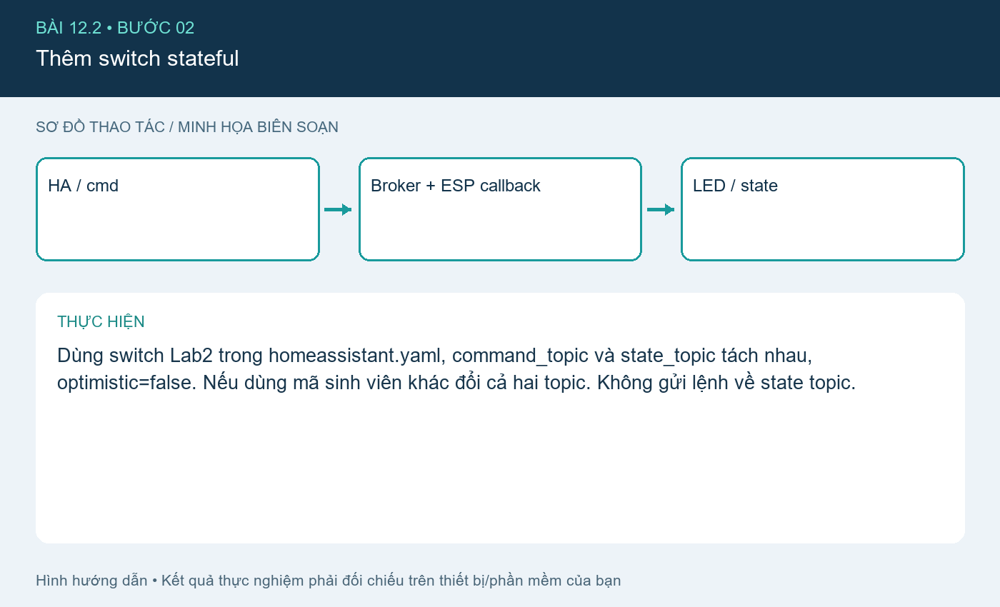
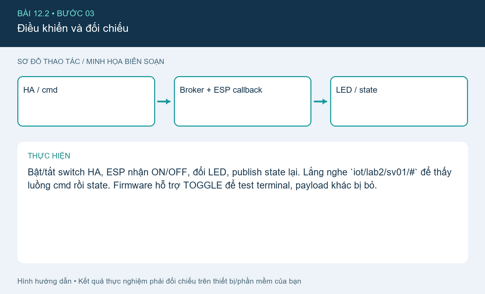
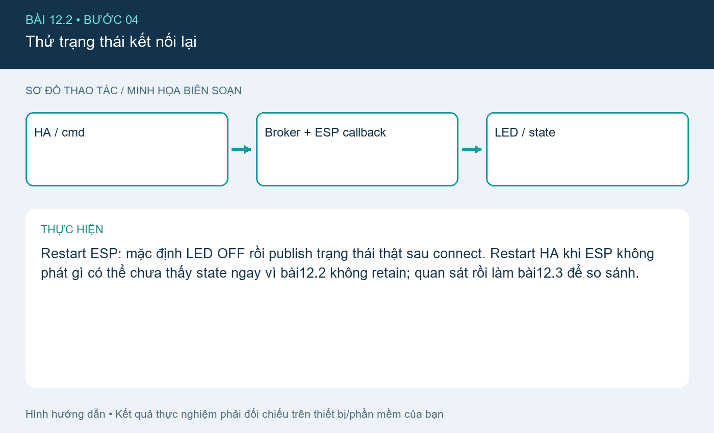

# Bài 12.2. Điều khiển hai chiều với topic cmd/state

Nguồn: [đề gốc](../tai-lieu-goc/BTH12_MQTT.pdf), trang 12-19. Số bài nhỏ được chuẩn hóa theo số bài thực hành; xem đối chiếu ở README.

## Chuẩn bị

ESP8266 D1 mini/NodeMCU hoặc ESP32 DevKit thông thường, Wi-Fi LAN, Mosquitto+Home Assistant theo bài6, Arduino IDE. Cài PubSubClient2.8. Các sketch chọn WiFi.h/ESP8266WiFi.h theo core. Dữ liệu bài12.1 là dữ liệu mô phỏng được gắn simulated=true.

## Kết nối và cấu hình

ESP8266 dùng LED_BUILTIN active LOW; ESP32 dùng GPIO2 LED active HIGH theo config.example.h. ESP32-S3 thường không có LED đơn GPIO2; chọn GPIO ngoài phù hợp. Sao config.example.h thành config.local.h trong từng sketch và nhập SSID, password, MQTT_HOST, user, password và STUDENT_ID. Không commit file local.

## Thực hiện từng bước

### Bước 1. Thiết kế topic và nạp

Nạp `12.2_LED_Command`. Topic tạo từ STUDENT_ID: `iot/lab2/sv01/cmd` và `iot/lab2/sv01/state`. Client ID phải riêng cho từng board để không đẩy nhau khỏi broker.

### Bước 2. Thêm switch stateful

Dùng switch Lab2 trong homeassistant.yaml, command_topic và state_topic tách nhau, optimistic=false. Nếu dùng mã sinh viên khác đổi cả hai topic. Không gửi lệnh về state topic.

### Bước 3. Điều khiển và đối chiếu

Bật/tắt switch HA, ESP nhận ON/OFF, đổi LED, publish state lại. Lắng nghe `iot/lab2/sv01/#` để thấy luồng cmd rồi state. Firmware hỗ trợ TOGGLE để test terminal, payload khác bị bỏ.

### Bước 4. Thử trạng thái kết nối lại

Restart ESP: mặc định LED OFF rồi publish trạng thái thật sau connect. Restart HA khi ESP không phát gì có thể chưa thấy state ngay vì bài12.2 không retain; quan sát rồi làm bài12.3 để so sánh.

## Kiểm tra và kết quả cần thu

ON/OFF tác động LED và state đúng; payload INVALID không đổi LED; topic sai không tác động; có ảnh listen cmd/state và ảnh LED.

## Giải thích và trả lời câu hỏi

cmd là yêu cầu thực hiện, state là phản hồi trạng thái đã áp dụng. optimistic=false khiến UI chờ state. Tách hai topic tránh vòng phản hồi tự kích hoạt. TCP giao dữ liệu không có nghĩa bóng đèn vật lý đã bật; cần đo/feedback thực khi làm thiết bị thật.

## Bằng chứng thực hành

Các hình `images/*-buoc-*.png` là sơ đồ hướng dẫn biên soạn, không phải ảnh chụp kết quả chạy. [Xem toàn bộ trang đề gốc](../tai-lieu-goc/README.md). Tạo thư mục `ket-qua/` tại bài này để lưu ảnh chụp thật, log Serial, pcapng hoặc XML sau khi chạy. Không điền số đo khi chưa thực nghiệm.
