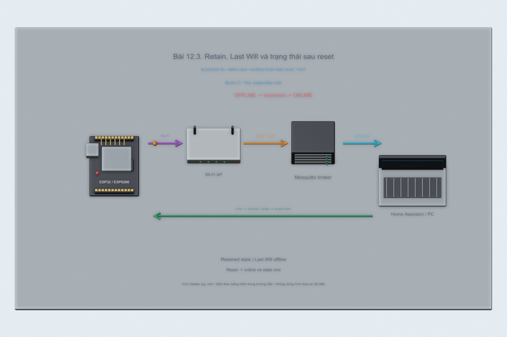
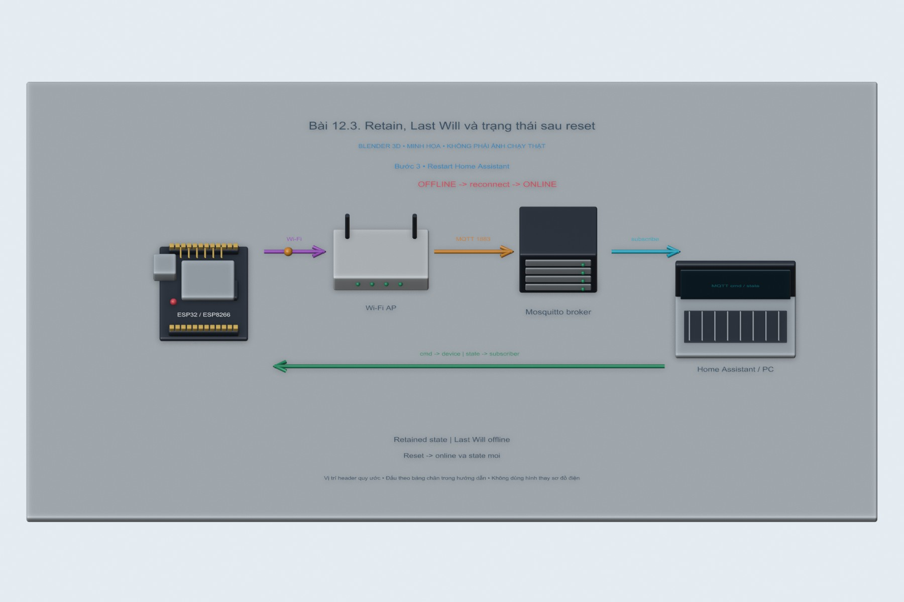
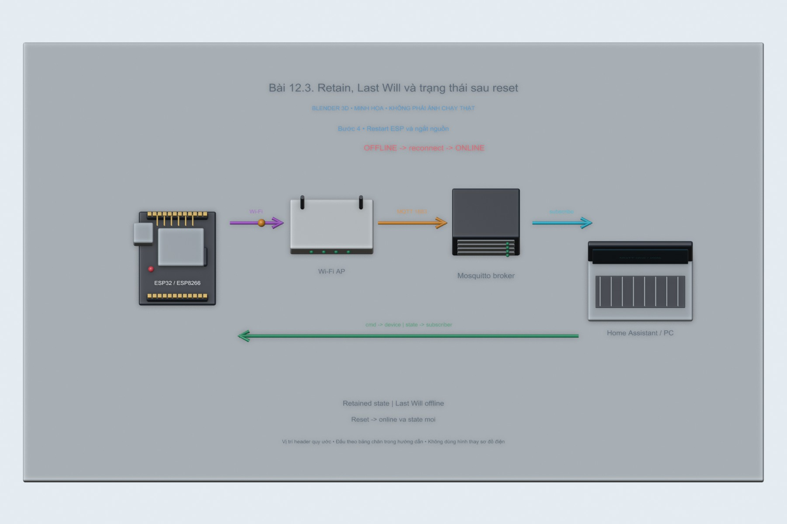
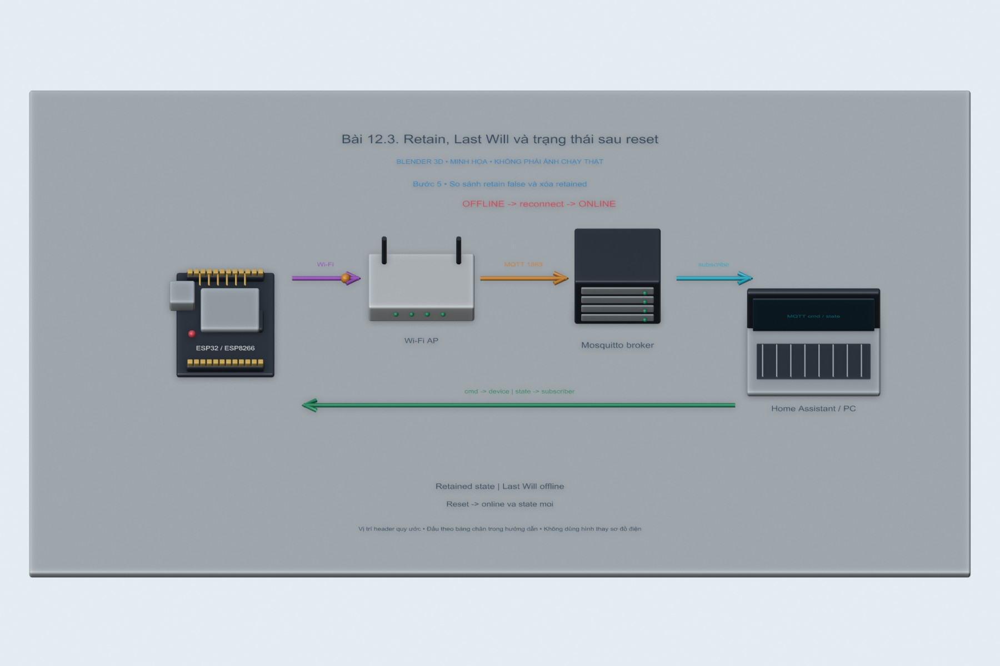

# Bài 12.3. Retain, Last Will và trạng thái sau reset

Em thử Retain và Last Will để xem một client vừa tham gia nhận được gì, và broker thông báo ra sao khi thiết bị mất kết nối. Trong lần thực hiện này, broker và các client đều chạy trên PC.

Nguồn: [đề gốc](../tai-lieu-goc/BTH12_MQTT.pdf), trang 19-26.

## Dụng cụ và phần mềm

Lần thử PC dùng Node.js 24.19.0, broker Aedes 0.51.3, MQTT.js 5.14.1 và Wireshark 4.6.9. Nếu làm tiếp trên mạch, cần ESP8266 D1 mini/NodeMCU hoặc ESP32, mạng Wi-Fi và broker MQTT; sketch dùng PubSubClient 2.8.

## Kết nối và cấu hình

ESP8266 dùng LED_BUILTIN active LOW; ESP32 dùng GPIO2 LED active HIGH theo config.example.h. ESP32-S3 thường không có LED đơn GPIO2; chọn GPIO ngoài phù hợp. Sao config.example.h thành config.local.h trong từng sketch và nhập SSID, password, MQTT_HOST, user, password và STUDENT_ID. Không commit file local.

<!-- actual-wireshark -->
## Thử trên PC và đọc kết quả Wireshark

Đầu tiên em cho một client gửi trạng thái rồi mới mở client thứ hai để nhận. Client đến muộn CONNECT ở frame **36**, SUBSCRIBE ở **42** và nhận ngay `online` ở **46**, sau đó nhận state ON ở **50**. Khi mở frame 46, cờ **Retain: Set** cho thấy đây là bản tin broker đã lưu.

Tiếp theo em chủ động đóng socket của client thiết bị mà không gửi MQTT DISCONNECT. Broker phát `offline` ở frame **58/60**, đúng với Last Will đã đăng ký. Ở ảnh thứ hai, payload offline đọc được trong khung bytes. Bản tin chuyển cho subscriber đang nghe có Retain=0; điều này khác với bản retained gửi cho một subscriber vừa đăng ký.

Qua lần thử này, em thấy Retain giúp client mới biết trạng thái gần nhất, còn Last Will báo việc mất kết nối bất thường. File `12.3.pcapng` có cả hai tình huống để xem lại.

[Cách mở, chọn frame và tái lập](../docs/wireshark-thuc-te/README.md) · [Số liệu đọc từ bản ghi](../docs/wireshark-thuc-te/analysis.json).

[12.3.pcapng](../docs/wireshark-thuc-te/12.3.pcapng) · [log](../docs/wireshark-thuc-te/12.3.log) · [CSV các frame](../docs/wireshark-thuc-te/12.3-packets.csv).

<!-- /actual-wireshark -->

<!-- blender-intro -->
## Hình minh họa

Các ảnh 3D mô tả vị trí các thành phần và hướng trao đổi dữ liệu. Có thể mở [file Blender bài 12.3](../mo-phong-3d/12.3/bai-12.3.blend) để xem các mốc của từng bước.
<!-- /blender-intro -->

## Thực hiện tiếp với ESP

### Bước 1. Nạp firmware có retained state

Mở `12.3_Retain_LWT`, nạp và dùng switch Lab3 trong homeassistant.yaml. Firmware retain state và LWT, note không retain. Lệnh cmd do HA gửi retain=false.

### Bước 2. Thử subscriber mới

Bật LED, dừng listen rồi bắt đầu nghe lại `iot/lab3/sv01/#`. Subscriber mới nhận ngay state retained và LWT ONLINE. note chỉ xuất hiện khi boot/reconnect, không phát lại tự động cho subscriber mới.

### Bước 3. Restart Home Assistant

Restart/reload phần MQTT HA, giữ ESP hoạt động. Khi HA subscribe lại, broker gửi retained state gần nhất, nên UI đồng bộ mà không đợi lệnh mới. Nếu availability chưa nhận ONLINE thì kiểm tra LWT topic và cấu hình switch.

### Bước 4. Restart ESP và ngắt nguồn

Reset ESP: LED vật lý khởi động OFF, reconnect publish retained OFF mới. Broker không tự bật lại LED chỉ nhờ retained state. Rút nguồn đột ngột: sau broker nhận biết mất kết nối, LWT OFFLINE xuất hiện; thời gian phụ thuộc keepalive và TCP. Retained state vẫn có thể còn ON nhưng availability=OFFLINE cảnh báo không chắc thiết bị đang hoạt động.

### Bước 5. So sánh retain false và xóa retained

Đổi publishState() tạm retain=false, nạp lại và thử subscriber mới. Trước test phải xóa retained cũ bằng `mosquitto_pub -h IP_BROKER -u mqtt-user -P MAT_KHAU_LAB -t iot/lab3/sv01/state -r -n`; không xóa bằng một message không-retain. Bật broker persistence để retained sống qua broker restart nếu cần.

## Kiểm tra khi chạy trên board

Bảng thử3 tình huống HA restart,ESP restart,mất nguồn; ghi LED vật lý,state,LWT và thời điểm. Chụp subscriber mới nhận retained. Không gọi retained là lưu mọi lần đo lâu dài.

## Nhận xét và trả lời câu hỏi

Retain giữ bản tin cuối cùng cho một topic tại broker, không phải lịch sử/database. Broker restart giữ được hay không còn tùy persistence. Retain=false không xóa retained cũ. Khi ESP restart, firmware đặt trạng thái vật lý OFF và publish sự thật mới; muốn khôi phục ON cần cơ chế lưu thiết bị hoặc desired-state riêng, không retained lệnh TOGGLE. LWT broker phát khi kết nối mất bất thường, không cần ESP còn nguồn để gửi.

## Kết quả của bài

Client đến muộn nhận ngay trạng thái retained. Khi client thiết bị bị ngắt socket, broker phát offline bằng Last Will. Phần restart Home Assistant và reset ESP ở hướng dẫn dưới đây chưa được thử trên phần cứng.
