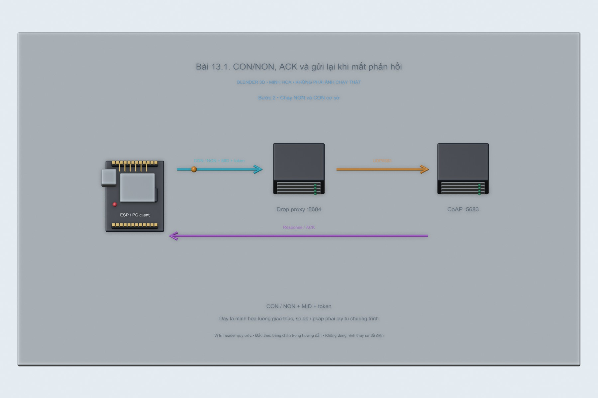
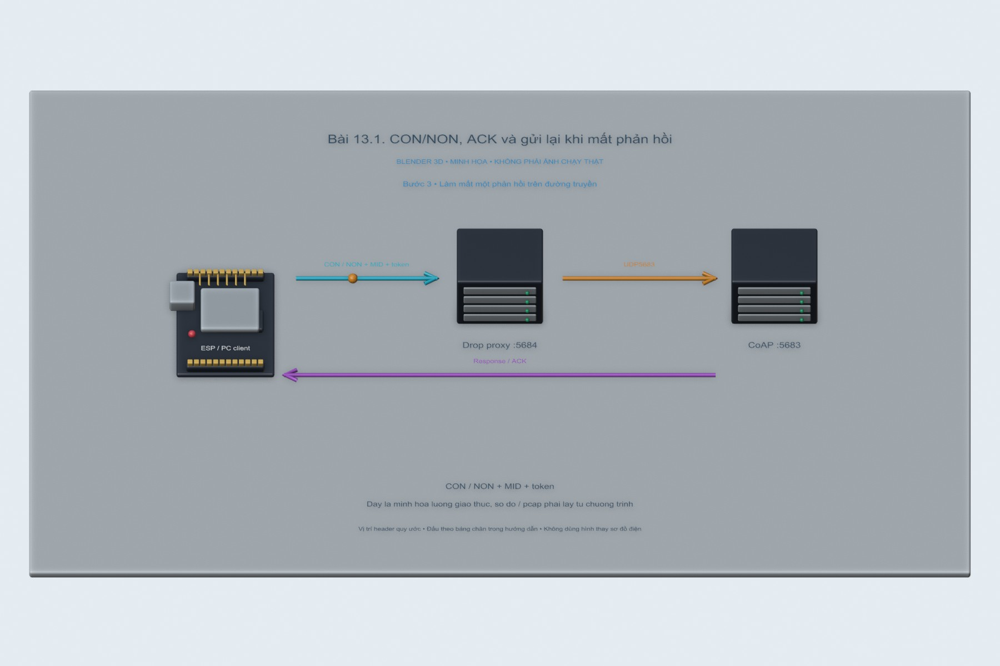
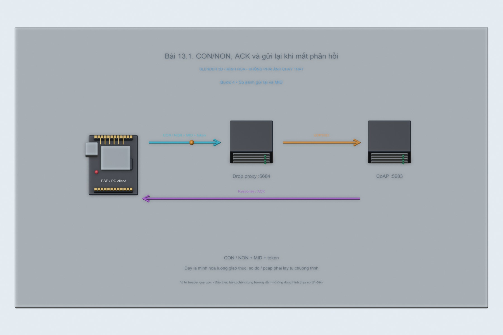
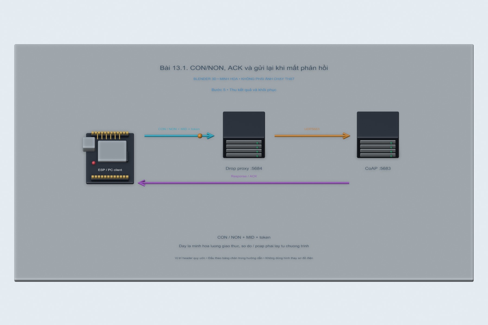

# Bài 13.1. CON/NON, ACK và gửi lại khi mất phản hồi

Nguồn: [đề gốc](../tai-lieu-goc/BTH13_CoAP.pdf), trang 3-9. Số bài nhỏ được chuẩn hóa theo số bài thực hành; xem đối chiếu ở README.

## Chuẩn bị

Node.js20+, npm ci tại gốc repo; ESP8266/ESP32 cùng LAN khi chạy phần cứng. Các sketch dùng CoapLab.h tự chứa, không phụ thuộc API observe/blockwise chưa chắc có của coap-simple-library. Node server dùng coap1.4.1.

## Kết nối và cấu hình

Server mặc định127.0.0.1:5683 để test trên PC. Khi dùng ESP, đặt HOST=0.0.0.0 cho server hoặc proxy trong terminal và cho phép UDP5683/5684 trên mạng lab; COAP_SERVER_IP trong config.local.h là IP LAN PC, không phải127.0.0.1. Cổng gửi ESP56830; reply đúng peer và token mới được nhận.

<!-- blender-intro -->
## Xem mô hình khi chưa có đủ linh kiện

[Tải cảnh Blender bài 13.1](../mo-phong-3d/13.1/bai-13.1.blend) · [Cách mở, xoay và xem timeline](../mo-phong-3d/README.md) · [Ảnh linh kiện trên mạng và nguồn](../docs/linh-kien/README.md).

Các hình theo bước dưới đây là **cảnh Blender 3D minh họa bố trí và tín hiệu**. Mốc trên timeline tương ứng số bước; vị trí hạt tín hiệu chỉ diễn họa hướng truyền. Phần nạp code/click menu làm theo chỉ dẫn bằng chữ và ảnh giao diện gốc bên dưới; hình 3D không giả làm màn hình phần mềm hay kết quả đo.

**Đọc cảnh:** xanh lơ/cam/tím là các đường tín hiệu có nhãn; dây đỏ là nguồn, dây đen là GND trong cảnh mạch điện. Với cảnh mạng, mũi tên chỉ luồng logic. Header được giản lược để dễ nhìn, nên dùng bảng nối dây trong bài để tìm chân thật.
<!-- /blender-intro -->

## Thực hiện từng bước

### Bước 1. Khởi động server phản hồi thật

Tại repo: `npm start --workspace iot-coap-labs`. Server xử lý POST /sensor/temp bằng2.04 OK. Khi dùng ESP, PowerShell đặt `$env:HOST="0.0.0.0"` trước lệnh. Trên Linux dùng `HOST=0.0.0.0 npm start --workspace iot-coap-labs`.

### Bước 2. Chạy NON và CON cơ sở

PC: `npm run client --workspace iot-coap-labs -- non` rồi `... -- con`. Hoặc nạp lần lượt sketch13.1_NON và13.1_CON, config IP/serverport5683. Lọc Wireshark `coap || udp.port == 5683`; localhost dùng Npcap Loopback Adapter.

### Bước 3. Làm mất một phản hồi trên đường truyền

Giữ server; mở terminal thứ hai chạy `node BTH13_COAP/node/drop-proxy.cjs`. Nó nghe5684, forward tới5683 và drop phản hồi đầu. Đặt COAP_PORT=5684 cho client PC hoặc COAP_SERVER_PORT5684 cho ESP. Mỗi thí nghiệm phải restart proxy để reset bộ đếm drop1.

### Bước 4. So sánh gửi lại và MID

CON khi mất reply gửi lại cùng MID/token; server trả cached response. Với ESP timeout đầu ngẫu nhiên2–3s, tối đa4 lần gửi lại và khoảng chờ nhân đôi. NON không tự retransmit khi không có reply. Log proxy FORWARD MID và DROP MID giúp đối chiếu; chuỗi POST mới không được nhầm với retransmit.

### Bước 5. Thu kết quả và khôi phục

Lưu pcap và log cho NON/CON có/mất reply; đưa client về5683, tắt proxy bằng Ctrl+C. Tắt Wi-Fi/server không nên được mô tả giống drop chính xác1 packet vì có thể sinh ICMP hoặc lỗi khác.

## Kiểm tra và kết quả cần thu

Hai bảng trường messageType,MID,token,time; CON có retry cùng MID sau khi proxy drop, NON không retry. Npm test trên máy đã kiểm tra trường hợp mất một response và nhận lại cached reply; ESP vẫn cần capture phần cứng.

## Giải thích và trả lời câu hỏi

Không gọi res.end() trên server CoAP thư viện không bảo đảm mất ACK: thư viện có thể tự gửi empty ACK. Vì vậy dùng UDP proxy làm mất packet thật. CON bảo đảm trao đổi bản tin bằng ACK/retry ở CoAP, không biến UDP thành byte stream có thứ tự như TCP. Retransmission giữ MID để nhận diện trùng; token ghép request/response. NON phù hợp telemetry lặp định kỳ chịu mất mẫu; CON hữu ích cho lệnh cần xác nhận nhưng vẫn cần xử lý trùng/idempotency. ACK xác nhận message, không tự chứng minh hành động vật lý thành công.

## Bằng chứng thực hành

Các hình Blender trong bài là minh họa tự dựng; ảnh giao diện từ PDF được ghi nguồn riêng. Chưa có ảnh phần cứng của người dùng cho bài này, nên chưa xác nhận kết quả thực nghiệm. [Xem toàn bộ trang đề gốc](../tai-lieu-goc/README.md). Tạo thư mục `ket-qua/` tại bài này để lưu ảnh chụp thật, log Serial, pcapng hoặc XML sau khi chạy. Không điền số đo khi chưa thực nghiệm.
