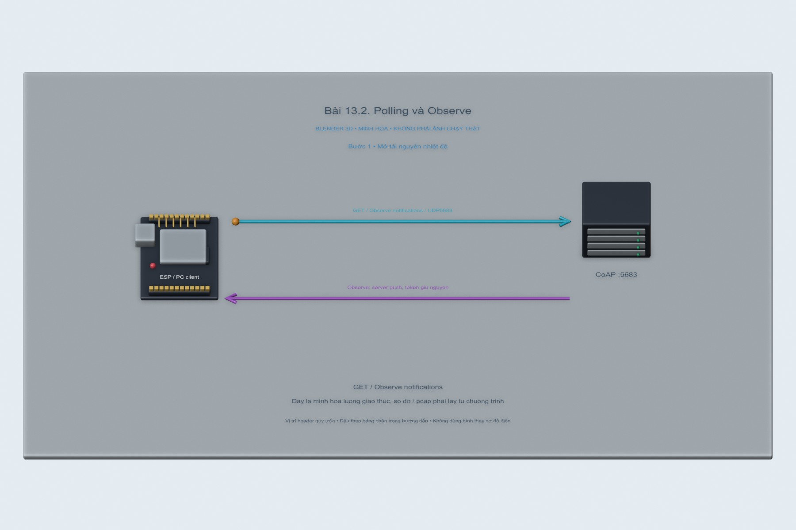
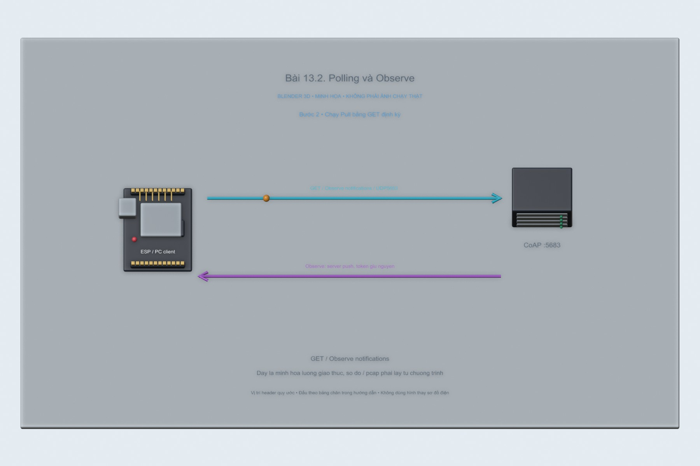
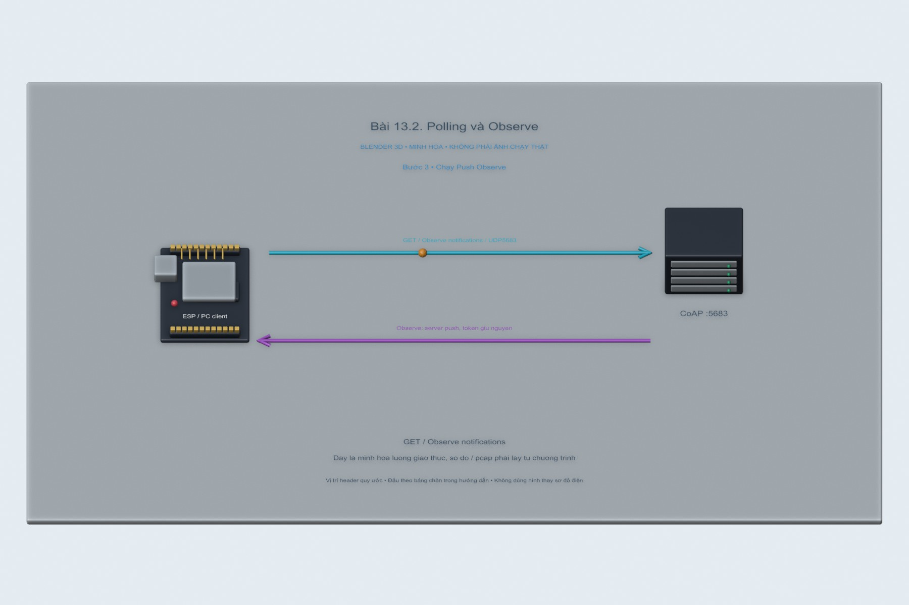
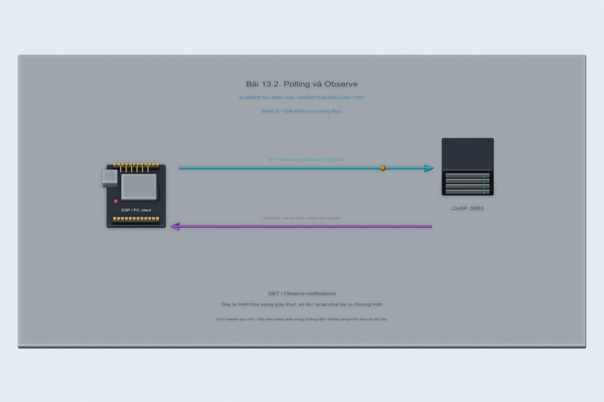

# Bài 13.2. Polling và Observe

Nguồn: [đề gốc](../tai-lieu-goc/BTH13_CoAP.pdf), trang 10-15. Số bài nhỏ được chuẩn hóa theo số bài thực hành; xem đối chiếu ở README.

## Chuẩn bị

Node.js20+, npm ci tại gốc repo; ESP8266/ESP32 cùng LAN khi chạy phần cứng. Các sketch dùng CoapLab.h tự chứa, không phụ thuộc API observe/blockwise chưa chắc có của coap-simple-library. Node server dùng coap1.4.1.

## Kết nối và cấu hình

Server mặc định127.0.0.1:5683 để test trên PC. Khi dùng ESP, đặt HOST=0.0.0.0 cho server hoặc proxy trong terminal và cho phép UDP5683/5684 trên mạng lab; COAP_SERVER_IP trong config.local.h là IP LAN PC, không phải127.0.0.1. Cổng gửi ESP56830; reply đúng peer và token mới được nhận.

<!-- actual-wireshark -->
## Kết quả Wireshark thực tế trên PC — 16/10/2026

**Nguồn thực nghiệm:** chương trình PC trao đổi TCP/UDP thật trên Loopback, TShark/Npcap bắt gói và mở bằng Wireshark để chụp. Ảnh giữ nguyên. Các client PC thay vai trò thiết bị; chưa phải kết quả chạy board ESP/Home Assistant.

Mở hai capture riêng và lọc `coap`. Polling: **30 GET + 30 response = 60 gói**, khoảng 2 giây giữa các GET. Observe: **1 GET đăng ký + 1 response đầu + 11 notification tiếp theo + 11 ACK rỗng = 24 gói**. Token của quan hệ Observe là `d6d72a92e60bd4a1`; MID thay đổi ở notification mới. Mỗi chương trình chạy trong cửa sổ ứng dụng 60 giây; capture có giới hạn 63 giây để bao trùm khởi động/dọn dẹp. Chỉ có traffic đến lần thay đổi dữ liệu trong cửa sổ đó được đếm. Nhiệt độ server là dữ liệu mô phỏng thay đổi mỗi 5 giây.

[Cách mở, chọn frame và tái lập](../docs/wireshark-thuc-te/README.md) · [Bảng số liệu đo](../docs/wireshark-thuc-te/analysis.json).

[13.2-poll.pcapng](../docs/wireshark-thuc-te/13.2-poll.pcapng) · [log](../docs/wireshark-thuc-te/13.2-poll.log) · [CSV từng packet](../docs/wireshark-thuc-te/13.2-poll-packets.csv).

[13.2-observe.pcapng](../docs/wireshark-thuc-te/13.2-observe.pcapng) · [log](../docs/wireshark-thuc-te/13.2-observe.log) · [CSV từng packet](../docs/wireshark-thuc-te/13.2-observe-packets.csv).

<!-- /actual-wireshark -->

<!-- blender-intro -->
## Xem mô hình khi chưa có đủ linh kiện

[Tải cảnh Blender bài 13.2](../mo-phong-3d/13.2/bai-13.2.blend) · [Cách mở, xoay và xem timeline](../mo-phong-3d/README.md) · [Ảnh linh kiện trên mạng và nguồn](../docs/linh-kien/README.md).

Các hình theo bước dưới đây là **cảnh Blender 3D minh họa bố trí và tín hiệu**. Mốc trên timeline tương ứng số bước; vị trí hạt tín hiệu chỉ diễn họa hướng truyền. Phần nạp code/click menu làm theo chỉ dẫn bằng chữ và ảnh giao diện gốc bên dưới; hình 3D không giả làm màn hình phần mềm hay kết quả đo.

**Đọc cảnh:** xanh lơ/cam/tím là các đường tín hiệu có nhãn; dây đỏ là nguồn, dây đen là GND trong cảnh mạch điện. Với cảnh mạng, mũi tên chỉ luồng logic. Header được giản lược để dễ nhìn, nên dùng bảng nối dây trong bài để tìm chân thật.
<!-- /blender-intro -->

## Thực hiện từng bước

### Bước 1. Mở tài nguyên nhiệt độ

Chạy Node server; tài nguyên /sensor/temp tăng nhiệt độ mô phỏng0.5 mỗi5s. Dữ liệu được ghi rõ simulated, không là nhiệt độ cảm biến thực.

### Bước 2. Chạy Pull bằng GET định kỳ

PC chạy `npm run client --workspace iot-coap-labs -- poll` trong20s, hoặc nạp13.2_Poll. ESP gửi một GET mỗi2s khi không có exchange chưa hoàn tất, luôn gọi vòng xử lý UDP trong loop.

### Bước 3. Chạy Push Observe

Dừng polling, chạy `... -- observe` hoặc nạp13.2_Observe. Client đăng ký GET Observe=0 một lần; server gửi notify khi biến nhiệt độ thay đổi. Node CLI tự dừng20s; ESP Observe chạy tới reset. Reset board để bắt đầu một capture riêng.

### Bước 4. Đếm gói, token và MID

Wireshark lọc coap, thêm cột Token, MID, Observe. Token của registration/notifications giữ quan hệ quan sát; MID đổi giữa notification riêng, retransmit cùng MID. Đếm cả ACK nếu notification là CON. Để đúng yêu cầu1 phút, kéo dài thí nghiệm ESP60s hoặc đổi timeout Node CLI từ20000 thành60000 trước khi chạy.

### Bước 5. Giải thích lưu lượng thực

Polling2s trong60s xấp xỉ30 request+30 response, còn Observe5s có một registration và khoảng12 notify cộng response/ACK tùy thư viện/thời điểm. Đây là dự đoán, không là số đo cố định. Lấy số thực từ pcap, ghi cửa sổ capture và kiểu CON/NON.

## Kiểm tra và kết quả cần thu

Có capture riêng Pull/Push, bảng đếm gói theo60s, token/MID thực và ít nhất2 notify khác giá trị. Client phải xử lý không trùng out-of-order Observe sequence trong phiên thử.

## Giải thích và trả lời câu hỏi

Sau registration, server chủ động gửi thông báo; Observe là quan hệ theo token, MID dùng phát hiện trùng ở tầng message. Poll có thể hỏi nhiều lần khi giá trị không đổi; Observe giảm request trong trường hợp cập nhật ít. Nếu sensor đổi rất nhanh hoặc observer cần keepalive/confirmable thì tổng overhead phụ thuộc cấu hình, không kết luận tiết kiệm mọi tình huống.

## Bằng chứng thực hành

Các hình Blender trong bài là minh họa tự dựng; ảnh giao diện từ PDF được ghi nguồn riêng. Đã có ảnh và pcap từ chương trình PC ở phần kết quả bên trên; chưa có bằng chứng chạy board vật lý cho bài này. [Xem toàn bộ trang đề gốc](../tai-lieu-goc/README.md). Tạo thư mục `ket-qua/` tại bài này để lưu ảnh chụp thật, log Serial, pcapng hoặc XML sau khi chạy. Không điền số đo khi chưa thực nghiệm.
