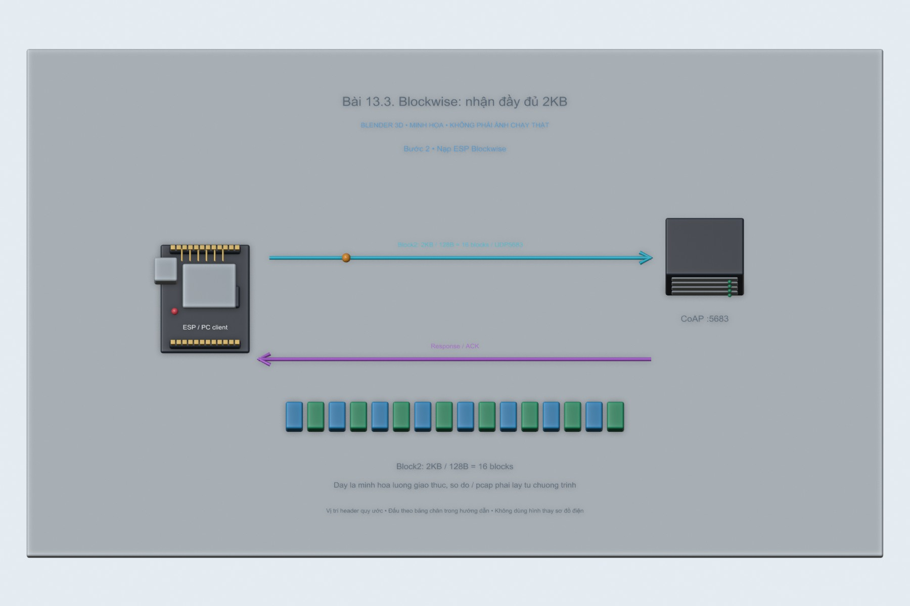
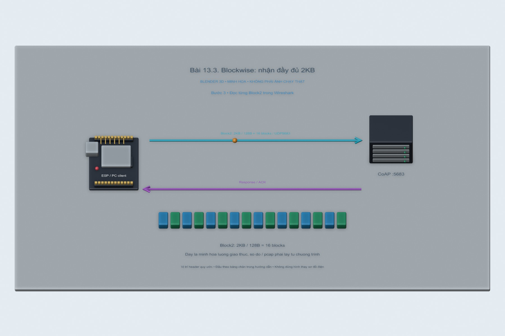

# Bài 13.3. Blockwise: nhận đầy đủ 2KB

Bài này tải một tài nguyên 2048 byte bằng CoAP Block2. Em chọn block 128 byte để theo dõi đủ 16 lần trao đổi và kiểm tra phần dữ liệu được ghép lại ở phía nhận.

Nguồn: [đề gốc](../tai-lieu-goc/BTH13_CoAP.pdf), trang 15-19.

## Dụng cụ và phần mềm

Phần PC dùng Node.js và coap 1.4.1, cài bằng `npm ci` ở gốc repo. Khi làm tiếp với ESP8266/ESP32, đặt board và server trong cùng LAN; các sketch dùng phần xử lý CoAP trong CoapLab.h đi kèm.

## Kết nối và cấu hình

Server mặc định127.0.0.1:5683 để test trên PC. Khi dùng ESP, đặt HOST=0.0.0.0 cho server hoặc proxy trong terminal và cho phép UDP5683/5684 trên mạng lab; COAP_SERVER_IP trong config.local.h là IP LAN PC, không phải127.0.0.1. Cổng gửi ESP56830; reply đúng peer và token mới được nhận.

<!-- actual-wireshark -->
## Thử trên PC và đọc kết quả Wireshark

Server trả tài nguyên `/firmware` gồm **2048 byte A**. Em cho client nhận từng block 128 byte; trong `13.3.pcapng` có **16 GET và 16 ACK Content**, tổng cộng 32 gói.

Ở frame **2**, Block2 có NUM=0, M=1 và size=128. Đến frame **32**, NUM=15 và M=0, nghĩa là đã đến block cuối. Khi mở phần ghép dữ liệu, Wireshark hiện **16 Blocks (2048 bytes)** cùng tab **Reassembled CoAP blocks (2048 bytes)** như ảnh thứ hai.

Em kiểm tra thêm nội dung và SHA256 bằng chương trình, kết quả nhận đủ 2048 byte A. Tên đường dẫn `/firmware` dùng cho bài học Block2; dữ liệu toàn A này không phải file để nạp vào vi điều khiển.

[Cách mở, chọn frame và tái lập](../docs/wireshark-thuc-te/README.md) · [Số liệu đọc từ bản ghi](../docs/wireshark-thuc-te/analysis.json).

[13.3.pcapng](../docs/wireshark-thuc-te/13.3.pcapng) · [log](../docs/wireshark-thuc-te/13.3.log) · [CSV các frame](../docs/wireshark-thuc-te/13.3-packets.csv).

<!-- /actual-wireshark -->

<!-- blender-intro -->
## Hình minh họa

Các ảnh 3D mô tả vị trí các thành phần và hướng trao đổi dữ liệu. Có thể mở [file Blender bài 13.3](../mo-phong-3d/13.3/bai-13.3.blend) để xem các mốc của từng bước.
<!-- /blender-intro -->

## Thực hiện tiếp với ESP

### Bước 1. Chạy server và thử client PC

Server trả /firmware bằng2048 byte A. `npm run client --workspace iot-coap-labs -- block` phải in bytes=2048. Đây là fixture minh họa giao thức, không phải firmware để flash.

### Bước 2. Nạp ESP Blockwise

Nạp13.3_Blockwise với IP đúng. Nó yêu cầu Block2 SZX3 tương ứng128 byte, chờ từng response và tự request NUM tiếp theo cho tới M=0. Các sketch mẫu chỉ in payloadlen một lần không đủ để chứng minh đã nhận toàn tài nguyên.

### Bước 3. Đọc từng Block2 trong Wireshark

Lọc coap, chọn GET/response /firmware. NUM từ 0 đến 15, M1 ở các block đầu và M0 ở cuối; SZX3 tức2^(3+4)=128. Token giữ cho chuỗi transfer, mỗi exchange có MID riêng. Serial phải in total2048 và PASS2048bytesA.

### Bước 4. Thử mất gói giữa chừng

Dùng proxy DROP=1 để mất response đầu và xem request cùng block/MID được gửi lại. Nếu tắt Wi-Fi, client có thể timeout; chương trình không lưu offset qua reset và không tự phục hồi transfer xuyên reboot. Khởi động lại để transfer mới từblock0.

### Bước 5. Đánh giá an toàn truyền firmware

Lưu log16 block và pcap. Với firmware thật cần kiểm tra kích thước, hash/chữ ký, version/chống rollback, nguồn tin tin cậy và cơ chế ghi an toàn. Payload toàn A chỉ kiểm tra lắp ghép, không bảo đảm bảo mật OTA.

## Kiểm tra khi chạy trên board

Đủ2048 byte,16block128 byte, M cuối0; file pcap đọc đượcNUM/M/SZX. npm test đã xác thực cả automatic reassembly lẫn16 request128 byte trên server thực.

## Nhận xét và trả lời câu hỏi

Block2 dùng server→client cho phản hồi lớn; Block1 dành client→server trong request lớn. NUM là sốblock, M báo cònblock, SZX mã kích thước2^(SZX+4). Mất block có thể gửi lại exchange đó, không cần truyền toàn payload nếu trạng thái transfer còn. Blockwise giảm phụ thuộc IP fragmentation và phù hợp bộ nhớ nhỏ; CoAP vẫn có thể bị IP fragmentation nếu datagram lớn hơn path MTU, nên không nói giao thức cấm fragmentation. Blockwise là lựa chọn hữu ích cho OTA qua CoAP, không là yêu cầu bắt buộc của mọi giao thức OTA.

## Kết quả của bài

Nhận đủ 16 block và ghép được 2048 byte A. Wireshark hiện phần reassembly, còn chương trình kiểm tra lại toàn bộ nội dung và hash; tài nguyên này chỉ để thử truyền dữ liệu, chưa dùng nạp firmware.
