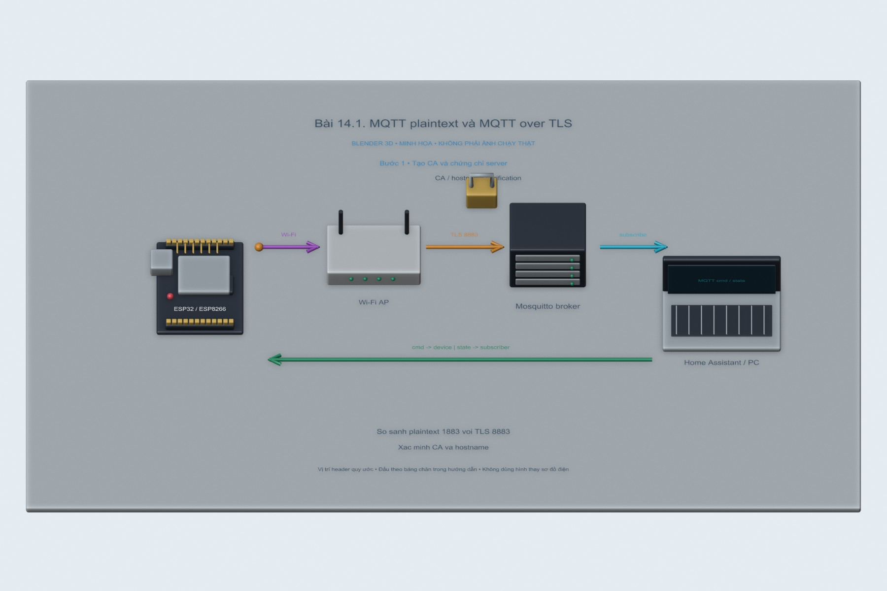
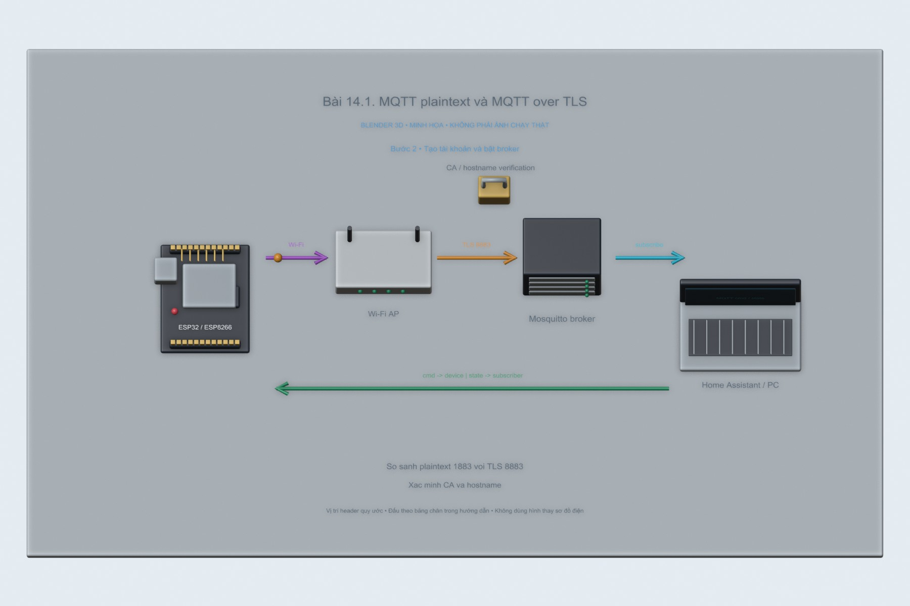
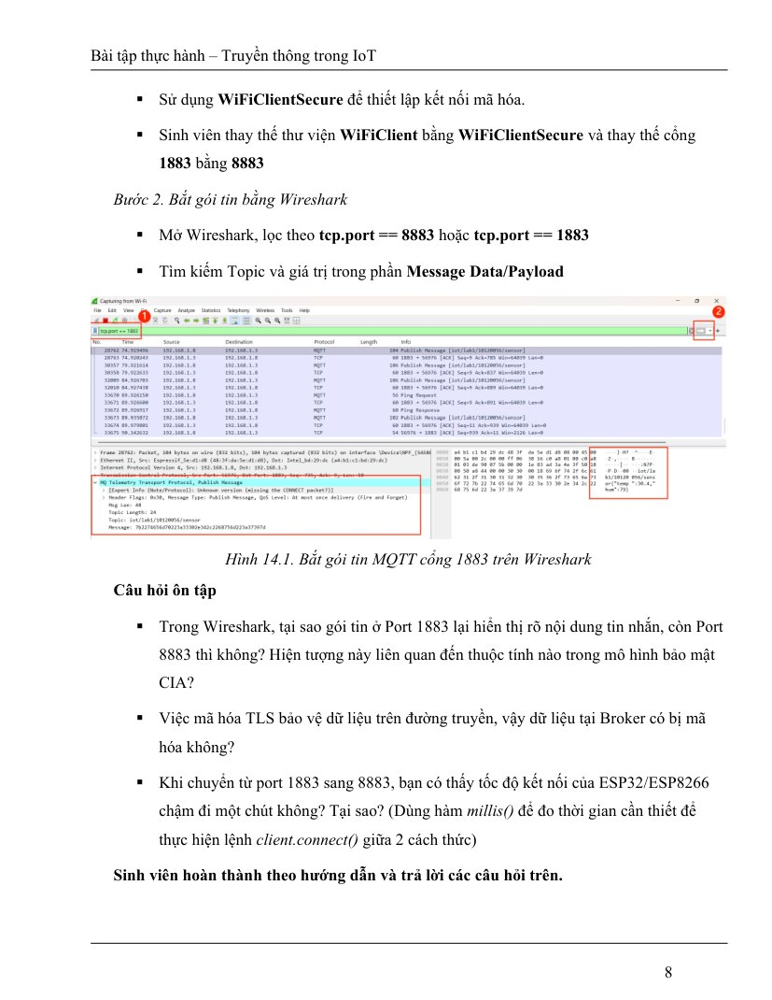
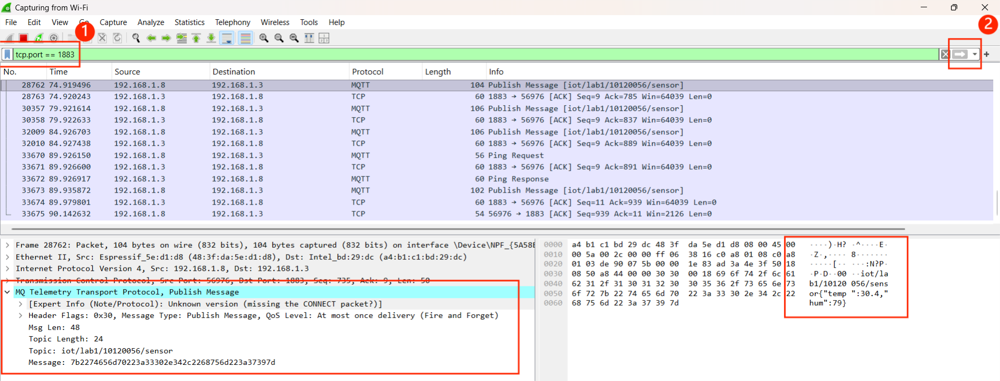

# Bài 14.1. MQTT plaintext và MQTT over TLS

Nguồn: [đề gốc](../tai-lieu-goc/BTH14_Bao-mat.pdf), trang 3-8. Số bài nhỏ được chuẩn hóa theo số bài thực hành; xem đối chiếu ở README.

## Chuẩn bị

ESP32 DevKit, core Arduino ESP32 3.x; PubSubClient 2.8, ArduinoJson 7 cho bài replay, Python 3 với paho-mqtt 2.1.0, Mosquitto và Wireshark. Dùng mạng riêng của phòng thực hành và LED đại diện khóa.

## Kết nối và cấu hình

LED đơn nối GPIO2 qua điện trở xuống GND, hoặc LED onboard đúng loại. ESP32-S3 dùng LED RGB cần code khác. Sao config.example.h thành config.local.h trong từng sketch, điền Wi-Fi và tài khoản broker. Giữ credential và HMAC key trong file local bị gitignore.


<!-- blender-intro -->
## Xem mô hình khi chưa có đủ linh kiện

[Tải cảnh Blender bài 14.1](../mo-phong-3d/14.1/bai-14.1.blend) · [Cách mở, xoay và xem timeline](../mo-phong-3d/README.md) · [Ảnh linh kiện trên mạng và nguồn](../docs/linh-kien/README.md).

Các hình theo bước dưới đây là **cảnh Blender 3D minh họa bố trí và tín hiệu**. Mốc trên timeline tương ứng số bước; vị trí hạt tín hiệu chỉ diễn họa hướng truyền. Phần nạp code/click menu làm theo chỉ dẫn bằng chữ và ảnh giao diện gốc bên dưới; hình 3D không giả làm màn hình phần mềm hay kết quả đo.

**Đọc cảnh:** xanh lơ/cam/tím là các đường tín hiệu có nhãn; dây đỏ là nguồn, dây đen là GND trong cảnh mạch điện. Với cảnh mạng, mũi tên chỉ luồng logic. Header được giản lược để dễ nhìn, nên dùng bảng nối dây trong bài để tìm chân thật.
<!-- /blender-intro -->

## Thực hiện từng bước

### Bước 1. Tạo CA và chứng chỉ server

Trên Debian/VM, cài Docker và OpenSSL theo tài liệu chính thức. Trong thư mục mosquitto chạy `bash create-certificates.sh IP_LAN_BROKER`, thay IP bằng địa chỉ thực. Script tạo CA riêng, chứng chỉ server có SAN chứa IP đó và broker.iot.local. Không dùng private key làm CA cho ESP.



### Bước 2. Tạo tài khoản và bật broker

Trong thư mục mosquitto, chạy trên Linux:

```bash
docker run --rm -it -v "$PWD:/mosquitto/config" eclipse-mosquitto:2 mosquitto_passwd -c /mosquitto/config/passwd mqtt-user
docker run --rm -it -v "$PWD:/mosquitto/config" eclipse-mosquitto:2 mosquitto_passwd /mosquitto/config/passwd labpc
docker compose up -d
docker compose logs broker
```

ACL đã có quyền cho hai tài khoản. Nếu volume data bị lỗi quyền, cấp quyền thư mục cho UID container theo log. Không tắt xác thực để né lỗi.



### Bước 3. Chạy bản plaintext làm đối chiếu

Mở 14.1_TLS, đặt USE_TLS=0 trong config.local.h, nạp vào ESP32. Mở Serial 115200, ghi connect_ms. Wireshark lọc `tcp.port == 1883`; xem CONNECT, topic và payload. Chỉ dùng tài khoản lab vì kết nối này truyền rõ.


**Đối chiếu tài liệu gốc, trang 8** (ảnh/giá trị mẫu trong đề, không phải kết quả mới; áp dụng hiệu chỉnh trong hướng dẫn):



### Bước 4. Bật TLS và xác thực CA

Sao ca.example.h thành ca.h, thay toàn bộ PEM bằng nội dung certs/ca.crt. Đặt USE_TLS=1, MQTT_HOST là IP có trong SAN. Chờ NTP đồng bộ, nạp lại. Firmware dùng setCACert, không dùng setInsecure. Lọc `tcp.port == 8883` và xem TLS records.


### Bước 5. Đo và kiểm tra sai chứng chỉ

Ghi ít nhất 5 lần connect_ms cho mỗi cấu hình, so sánh trung vị. Thử CA sai hoặc địa chỉ không khớp SAN phải kết nối thất bại. Khôi phục CA/IP đúng sau thử; lưu capture và bảng đo thật.


## Kiểm tra và kết quả cần thu

Hai capture trước/sau, bảng 5 lần connect_ms, ảnh lỗi CA/hostname sai và ảnh kết nối thành công với CA đúng. Chứng chỉ/khóa thật không được commit. Firmware đã compile; chưa kiểm thử handshake với broker lab thật.

## Giải thích và trả lời câu hỏi

TLS bảo vệ tính bí mật và toàn vẹn trên đường truyền; kiểm chứng CA/hostname xác thực server. Broker giải mã dữ liệu để xử lý MQTT, vì vậy TLS không tự mã hóa dữ liệu lưu trên broker. Handshake có trao đổi và tính toán bổ sung, mức chậm hơn cần đo. Chỉ đổi port hoặc tên lớp WiFiClientSecure mà thiếu CA, thời gian và chứng chỉ đúng SAN chưa hoàn thành TLS.

## Bằng chứng thực hành

Các hình Blender trong bài là minh họa tự dựng; ảnh giao diện từ PDF được ghi nguồn riêng. Chưa có ảnh phần cứng của người dùng cho bài này, nên chưa xác nhận kết quả thực nghiệm. [Xem toàn bộ trang đề gốc](../tai-lieu-goc/README.md). Tạo thư mục `ket-qua/` tại bài này để lưu ảnh chụp thật, log Serial, pcapng hoặc XML sau khi chạy. Không điền số đo khi chưa thực nghiệm.


<!-- source-crops -->
## Ảnh giao diện / mạch trong tài liệu gốc

Các ảnh sau lấy từ đúng các trang đề của bài. Khoanh vùng và mũi tên có sẵn trong nguồn; địa chỉ, COM, tên thiết bị và phiên bản là ví dụ. Áp dụng các hiệu chỉnh trong phần thao tác ở trên.

**Trang 8, hình 1** — [mở trang gốc](../tai-lieu-goc/trang/BTH14_Bao-mat/page-08.jpg).



<!-- /source-crops -->
