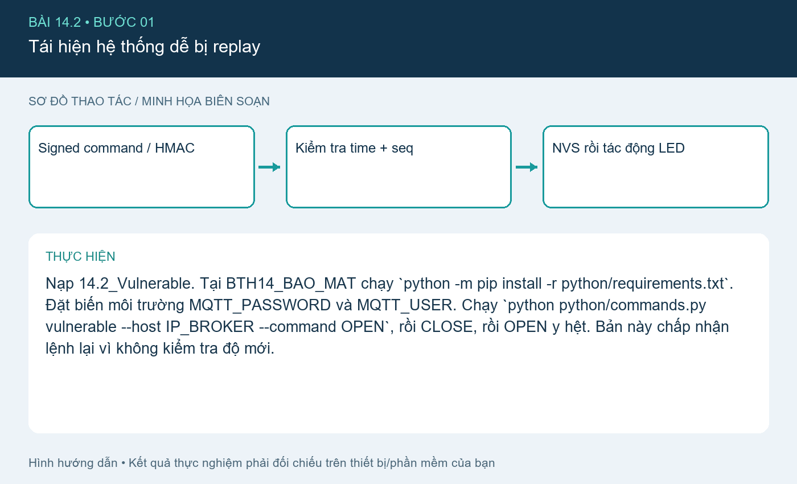
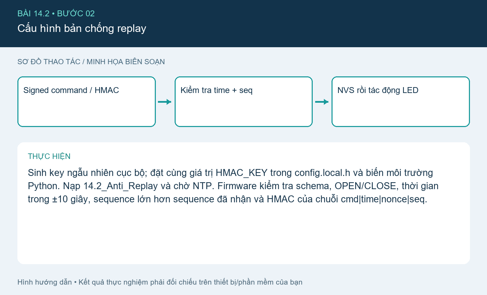
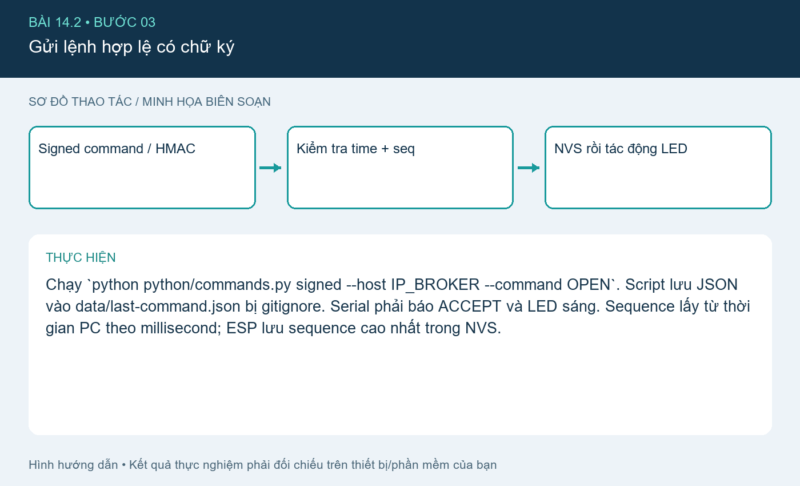
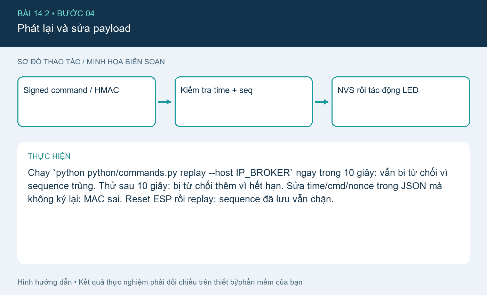
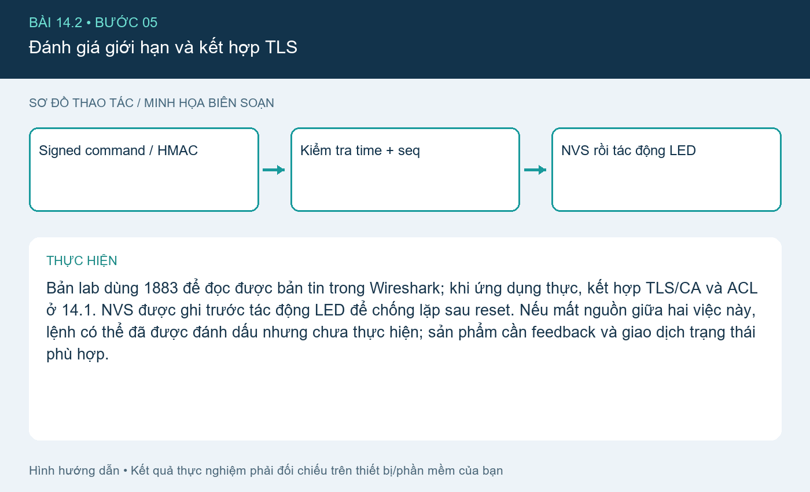

# Bài 14.2. Replay và chống trùng bằng HMAC, thời gian, sequence

Nguồn: [đề gốc](../tai-lieu-goc/BTH14_Bao-mat.pdf), trang 9-11. Số bài nhỏ được chuẩn hóa theo số bài thực hành; xem đối chiếu ở README.

## Chuẩn bị

ESP32 DevKit, core Arduino ESP32 3.x; PubSubClient 2.8, ArduinoJson 7 cho bài replay, Python 3 với paho-mqtt 2.1.0, Mosquitto và Wireshark. Dùng mạng riêng của phòng thực hành và LED đại diện khóa.

## Kết nối và cấu hình

LED đơn nối GPIO2 qua điện trở xuống GND, hoặc LED onboard đúng loại. ESP32-S3 dùng LED RGB cần code khác. Sao config.example.h thành config.local.h trong từng sketch, điền Wi-Fi và tài khoản broker. Giữ credential và HMAC key trong file local bị gitignore.

## Thực hiện từng bước

### Bước 1. Tái hiện hệ thống dễ bị replay

Nạp 14.2_Vulnerable. Tại BTH14_BAO_MAT chạy `python -m pip install -r python/requirements.txt`. Đặt biến môi trường MQTT_PASSWORD và MQTT_USER. Chạy `python python/commands.py vulnerable --host IP_BROKER --command OPEN`, rồi CLOSE, rồi OPEN y hệt. Bản này chấp nhận lệnh lại vì không kiểm tra độ mới.

### Bước 2. Cấu hình bản chống replay

Sinh key ngẫu nhiên cục bộ; đặt cùng giá trị HMAC_KEY trong config.local.h và biến môi trường Python. Nạp 14.2_Anti_Replay và chờ NTP. Firmware kiểm tra schema, OPEN/CLOSE, thời gian trong ±10 giây, sequence lớn hơn sequence đã nhận và HMAC của chuỗi cmd|time|nonce|seq.

### Bước 3. Gửi lệnh hợp lệ có chữ ký

Chạy `python python/commands.py signed --host IP_BROKER --command OPEN`. Script lưu JSON vào data/last-command.json bị gitignore. Serial phải báo ACCEPT và LED sáng. Sequence lấy từ thời gian PC theo millisecond; ESP lưu sequence cao nhất trong NVS.

### Bước 4. Phát lại và sửa payload

Chạy `python python/commands.py replay --host IP_BROKER` ngay trong 10 giây: vẫn bị từ chối vì sequence trùng. Thử sau 10 giây: bị từ chối thêm vì hết hạn. Sửa time/cmd/nonce trong JSON mà không ký lại: MAC sai. Reset ESP rồi replay: sequence đã lưu vẫn chặn.

### Bước 5. Đánh giá giới hạn và kết hợp TLS

Bản lab dùng 1883 để đọc được bản tin trong Wireshark; khi ứng dụng thực, kết hợp TLS/CA và ACL ở 14.1. NVS được ghi trước tác động LED để chống lặp sau reset. Nếu mất nguồn giữa hai việc này, lệnh có thể đã được đánh dấu nhưng chưa thực hiện; sản phẩm cần feedback và giao dịch trạng thái phù hợp.

## Kiểm tra và kết quả cần thu

Ghi bảng: hợp lệ=ACCEPT; replay ngay=REJECT; replay cũ=REJECT; sửa nội dung=REJECT; reset rồi replay=REJECT. Hàm ký có kiểm thử Python; LED/NVS cần xác minh trên board. Không chạy lệnh thử lên cửa thật hay broker công cộng.

## Giải thích và trả lời câu hỏi

Timestamp đơn thuần không ngăn replay còn trong cửa sổ 10 giây và không xác thực người sửa timestamp. HMAC bảo vệ tính xác thực/toàn vẹn của nội dung; sequence tăng, lưu bền vững, chống bản tin trùng qua reset. Nonce nằm trong chữ ký, nhưng ở bản triển khai này sequence là cơ chế nhớ các lệnh đã chấp nhận.

Đổi mật khẩu chỉ giúp thu hồi quyền kết nối cũ khi được thực hiện đầy đủ, không thay freshness từng message. Không có NTP có thể dùng challenge/nonce từ bên nhận hoặc bộ đếm bền vững kèm MAC. TLS có cơ chế bảo vệ record; người ngoài chỉ bắt được ciphertext không mặc nhiên biết payload để replay logic. Bài replay giả định có bản tin ứng dụng và quyền publish trong lab. Không coi đây là cách vượt TLS.

## Bằng chứng thực hành

Các hình `images/*-buoc-*.png` là sơ đồ hướng dẫn biên soạn, không phải ảnh chụp kết quả chạy. [Xem toàn bộ trang đề gốc](../tai-lieu-goc/README.md). Tạo thư mục `ket-qua/` tại bài này để lưu ảnh chụp thật, log Serial, pcapng hoặc XML sau khi chạy. Không điền số đo khi chưa thực nghiệm.
