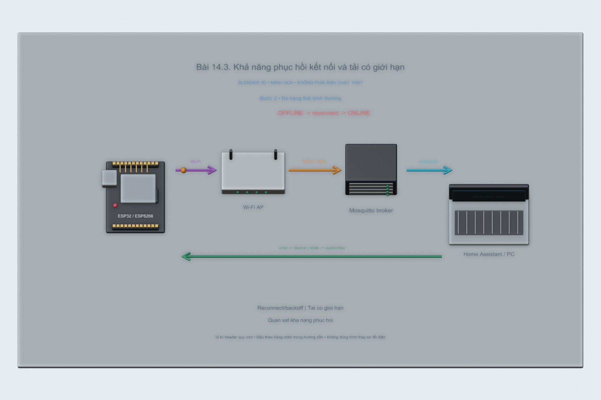
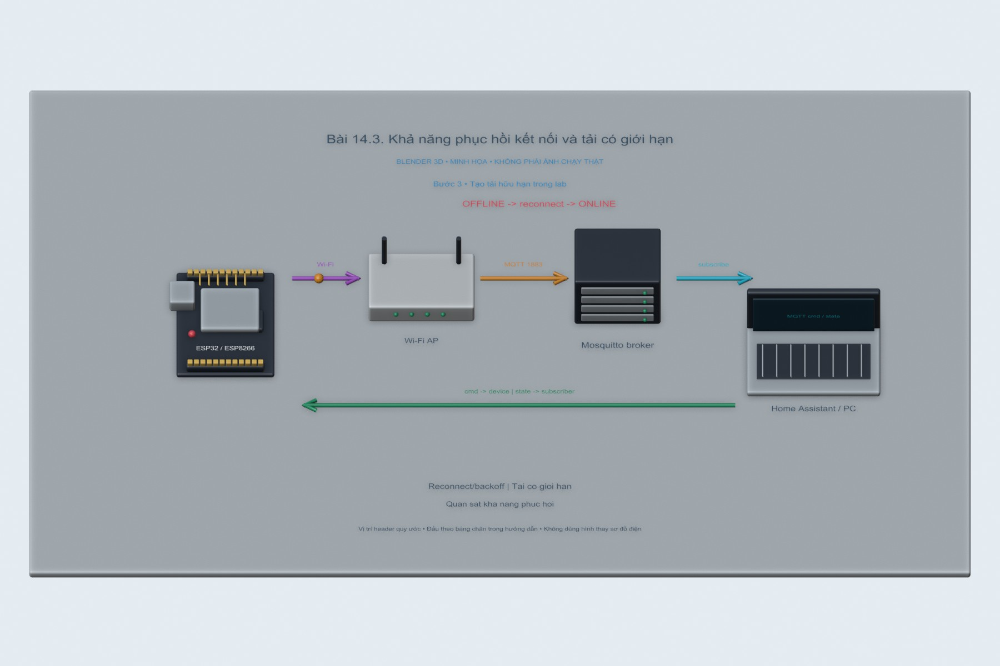
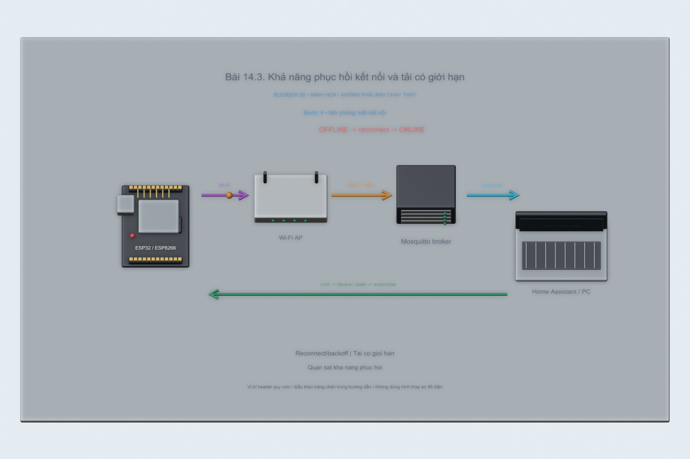
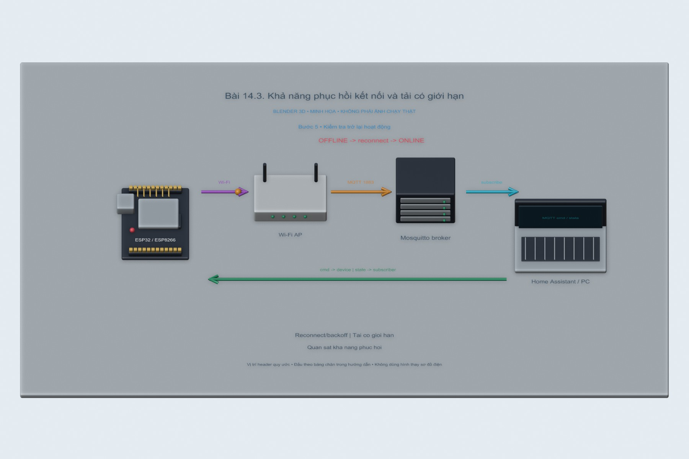

# Bài 14.3. Khả năng phục hồi kết nối và tải có giới hạn

Bài này thử việc kết nối lại sau khi một client MQTT bị ngắt socket. Em gửi một số lệnh ON/OFF trước, chủ động ngắt đúng client đang thử rồi theo dõi CONNECT và SUBSCRIBE sau khi nó kết nối lại.

Nguồn: [đề gốc](../tai-lieu-goc/BTH14_Bao-mat.pdf), trang 11-16.

## Dụng cụ và phần mềm

ESP32 DevKit, core Arduino ESP32 3.x; PubSubClient 2.8, ArduinoJson 7 cho bài replay, Python 3 với paho-mqtt 2.1.0, Mosquitto và Wireshark. Dùng mạng riêng của phòng thực hành và LED đại diện khóa.

## Kết nối và cấu hình

LED đơn nối GPIO2 qua điện trở xuống GND, hoặc LED onboard đúng loại. ESP32-S3 dùng LED RGB cần code khác. Sao config.example.h thành config.local.h trong từng sketch, điền Wi-Fi và tài khoản broker. Giữ credential và HMAC key trong file local bị gitignore.

<!-- actual-wireshark -->
## Thử trên PC và đọc kết quả Wireshark

Em cho client `pc-reconnecting-client` kết nối, gửi **10 lệnh ON/OFF** với khoảng nghỉ 100 ms giữa các lần phát, rồi chủ động ngắt socket của chính client đó. Log ghi nhận lần kết nối lại sau khoảng **0,5 giây**.

Trong Wireshark, CONNECT đầu nằm ở frame **15**, CONNECT tiếp theo ở **150**, cả hai dùng cùng Client ID. Sau đó frame **154** đăng ký lại topic, **156/162** gửi trạng thái online. Hai ảnh cho phép đối chiếu trước và sau lúc ngắt.

Lần này em thử cơ chế reconnect của MQTT.js trên PC. Khoảng 0,5 giây là tham số của client đang chạy; chưa dùng kết quả này để đánh giá backoff hoặc watchdog của firmware ESP32.

[Cách mở, chọn frame và tái lập](../docs/wireshark-thuc-te/README.md) · [Số liệu đọc từ bản ghi](../docs/wireshark-thuc-te/analysis.json).

[14.3.pcapng](../docs/wireshark-thuc-te/14.3.pcapng) · [log](../docs/wireshark-thuc-te/14.3.log) · [CSV các frame](../docs/wireshark-thuc-te/14.3-packets.csv).

<!-- /actual-wireshark -->

<!-- blender-intro -->
## Hình minh họa

Các ảnh 3D mô tả vị trí các thành phần và hướng trao đổi dữ liệu. Có thể mở [file Blender bài 14.3](../mo-phong-3d/14.3/bai-14.3.blend) để xem các mốc của từng bước.
<!-- /blender-intro -->

## Thực hiện tiếp với ESP

### Bước 1. Nạp chương trình chịu lỗi

Nạp 14.3_Resilience. Code dùng API watchdog của ESP32 core 3.x, thời hạn 10 giây; giới hạn xử lý 10 lệnh/giây, payload tối đa 50 byte, chỉ nhận ON/OFF. mqtt.loop được gọi thường xuyên để xử lý keepalive và dữ liệu.

### Bước 2. Đo trạng thái bình thường

Listen topic iot/resilience/sv01/status, gửi ON/OFF vào iot/resilience/sv01/cmd. Ghi uptime_ms, dropped và thời gian phản hồi LED để có dữ liệu đối chiếu trước khi thêm tải.

### Bước 3. Tạo tải hữu hạn trong lab

Chạy `python python/commands.py load --host IP_BROKER --count 100 --rate 20`. Script giới hạn tối đa 200 bản tin và 20 bản tin/giây, chỉ chấp nhận IP riêng/loopback. Theo dõi dropped và uptime. Đây là thử tải nhỏ, không giả định tương đương hàng nghìn bản tin/giây.

### Bước 4. Mô phỏng mất kết nối

Dừng broker bằng docker compose stop rồi khởi động lại, hoặc tạm tắt AP riêng của lab. Firmware thử Wi-Fi mỗi 10 giây, MQTT backoff 1→2→4… tối đa 30 giây, socket timeout 2 giây. Không cần gửi deauth hoặc gây nhiễu RF để thử cơ chế phục hồi.

### Bước 5. Kiểm tra trở lại hoạt động

Khi broker/AP trở lại, ghi thời gian kết nối lại và xác nhận nhận được ON/OFF. Uptime giúp xác định board có reset hay không. Watchdog hỗ trợ thoát tình trạng task kẹt; trong thử tải bình thường không cần cố ý làm watchdog reset. Lưu log và khôi phục toàn bộ dịch vụ sau thử.

## Kiểm tra khi chạy trên board

Có log baseline, tải 100 bản tin, broker ngừng và phục hồi; ghi uptime, dropped, thời gian reconnect và LED. Không ghi đã kiểm chứng chống jamming thật. Bài thử có điểm dừng rõ ràng.

## Nhận xét và trả lời câu hỏi

DoS có thể làm mất tính sẵn sàng mà không cần biết mật khẩu, như chiếm tài nguyên hoặc phá kết nối. Watchdog reset task/hệ thống khi không được feed đúng hạn, không loại bỏ nguồn gây nghẽn. Rate limit và kiểm tra payload giảm chi phí xử lý ứng dụng, không ngăn được jamming RF. TLS cũng không chống mọi DoS. QoS1 có thể giao trùng nên vẫn cần idempotency; PubSubClient publish QoS0 không tự đổi thành QoS1 vì subscribe QoS1. Bài này dùng mất liên kết có kiểm soát để đánh giá recovery.

## Kết quả của bài

Client kết nối lại sau khoảng 0,5 giây và đăng ký lại topic. Đây là thời gian theo cấu hình MQTT.js trong lần thử; backoff và watchdog của firmware ESP32 cần đo bằng log của board.
