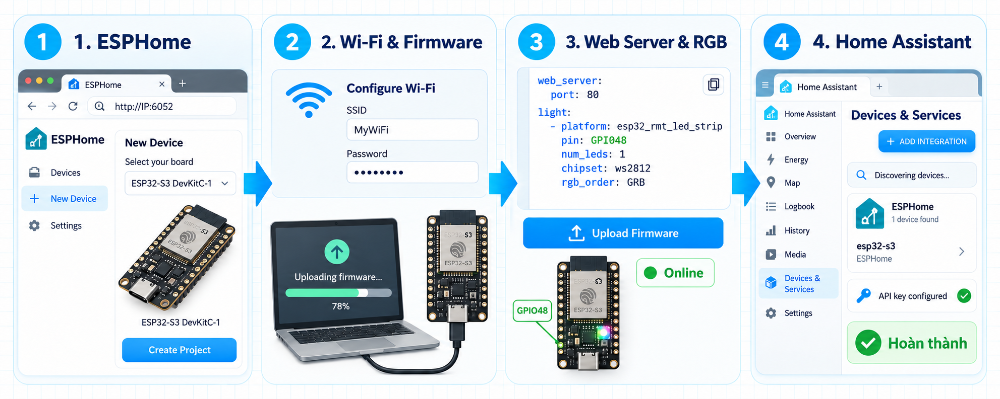
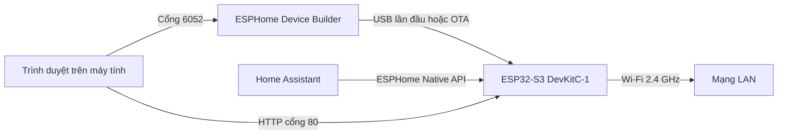

# Thêm ESP32-S3 DevKitC-1 vào Home Assistant bằng ESPHome

## 1. Mục tiêu

Bài thực hành cấu hình một bo **ESP32-S3 DevKitC-1** bằng ESPHome, kết nối bo vào Wi-Fi, bật Web Server và LED RGB tích hợp, sau đó thêm thiết bị vào Home Assistant thông qua ESPHome Native API.



## 2. Mô hình hoạt động



Các thành phần phải truy cập được lẫn nhau trong cùng mạng LAN. Lần nạp đầu tiên cần USB; các lần sau có thể cập nhật OTA khi ESP32 đã online.

## 3. Chuẩn bị

- Home Assistant đã hoạt động.
- ESPHome Device Builder đã hoạt động tại `http://<IP_MAY_CHU>:6052`.
- Bo ESP32-S3 DevKitC-1 và cáp USB có truyền dữ liệu.
- Mạng Wi-Fi 2.4 GHz.
- Nếu ESPHome chạy trong máy ảo, đặt card mạng VMware ở chế độ **Bridged**.

> Không đưa mật khẩu Wi-Fi, mật khẩu fallback AP hoặc khóa API thật lên GitHub. Repository chỉ lưu file mẫu `secrets.example.yaml`.

## 4. Bước 1 - Tạo thiết bị trong ESPHome

1. Mở trình duyệt và truy cập:

   ```text
   http://<IP_MAY_CHU>:6052
   ```

   Ví dụ: `http://10.246.27.180:6052`.

2. Chọn **New Device**.
3. Chọn bo **ESP32-S3 DevKitC-1**.
4. Đặt tên dễ nhận biết, ví dụ:

   ```text
   esp32-s3-devkitc1
   ```

5. Hoàn tất để ESPHome tạo project và file YAML ban đầu.

Tên trong `esphome.name` trở thành hostname mạng. Chỉ nên dùng chữ thường, chữ số và dấu gạch ngang.

## 5. Bước 2 - Cấu hình Wi-Fi và nạp firmware lần đầu

Trong phần Wi-Fi của Device Builder, nhập SSID và mật khẩu. ESPHome lưu chúng trong `secrets.yaml` và YAML thiết bị chỉ tham chiếu bằng `!secret`:

```yaml
wifi:
  ssid: !secret wifi_ssid
  password: !secret wifi_password
```

Nhấn **Save**, sau đó nhấn **Install**.

- Nếu USB đang nối vào máy mở trình duyệt, chọn **Plug into this computer**.
- Nếu USB đã được chuyển vào máy ảo chạy ESPHome, chọn **Plug into computer running ESPHome Device Builder**.
- Chọn đúng cổng USB của ESP32-S3 và chờ ghi firmware hoàn tất.

Sau khi bo khởi động lại, mở **Logs**. Kết quả đúng phải có địa chỉ IP và trạng thái kết nối Wi-Fi. Trên dashboard ESPHome, thiết bị chuyển sang **Online**.

## 6. Bước 3 - Bật Web Server và LED RGB GPIO48

Mở **Edit** của thiết bị và dùng cấu hình mẫu trong [`esp32-s3-devkitc1.yaml`](esp32-s3-devkitc1.yaml). Hai phần chính cần thêm là:

```yaml
web_server:
  port: 80

light:
  - platform: esp32_rmt_led_strip
    name: "Onboard RGB"
    pin: GPIO48
    num_leds: 1
    chipset: ws2812
    rgb_order: GRB
```

Ý nghĩa:

- `web_server` mở trang điều khiển trực tiếp trên ESP32 qua HTTP cổng 80.
- `esp32_rmt_led_strip` điều khiển LED địa chỉ WS2812 bằng ngoại vi RMT của ESP32.
- `GPIO48` là chân LED RGB tích hợp trên bo sử dụng trong bài.
- `num_leds: 1` khai báo bo có một LED RGB.
- `rgb_order: GRB` đặt đúng thứ tự ba kênh màu.

Nhấn **Save → Install → On the network** để cập nhật OTA. Khi cài xong, truy cập:

```text
http://<IP_CUA_ESP32>/
```

Trang Web Server phải hiển thị thực thể **Onboard RGB** và cho phép bật, tắt, đổi màu.

## 7. Bước 4 - Thêm ESP32 vào Home Assistant

1. Mở Home Assistant.
2. Vào **Settings → Devices & services**.
3. Trong phần **Discovered**, tìm thiết bị ESPHome vừa tạo.
4. Nhấn **Add**.
5. Khi được hỏi khóa mã hóa, sao chép giá trị `api.encryption.key` từ YAML hoặc phần Native API của ESPHome Device Builder rồi dán vào.
6. Hoàn tất trình hướng dẫn và chọn Area nếu cần.

Khóa này bảo vệ kết nối ESPHome Native API giữa Home Assistant và ESP32. Khóa phải trùng chính xác với firmware đang chạy trên bo.

## 8. Cấu hình mẫu

File [`esp32-s3-devkitc1.yaml`](esp32-s3-devkitc1.yaml) là cấu hình hoàn chỉnh nhưng không chứa thông tin bí mật. Tạo `secrets.yaml` dựa trên [`secrets.example.yaml`](secrets.example.yaml), sau đó thay các giá trị mẫu bằng thông tin của hệ thống.

```yaml
api:
  encryption:
    key: !secret api_encryption_key
```

Không commit file `secrets.yaml`.

## 9. Kiểm tra kết quả

Bài thực hành hoàn thành khi đáp ứng đủ các điều kiện:

- ESP32-S3 hiển thị **Online** trong ESPHome Device Builder.
- Mở được `http://<IP_CUA_ESP32>/`.
- Web Server hiển thị điều khiển **Onboard RGB**.
- Home Assistant có thiết bị ESPHome tương ứng.
- Trong thiết bị có entity đèn RGB và điều khiển được LED thật.

## 10. Lỗi thường gặp

### ESPHome báo Offline

- Kiểm tra SSID và mật khẩu Wi-Fi.
- ESP32-S3 chỉ nên kết nối mạng 2.4 GHz.
- Kiểm tra máy ảo dùng **Bridged**, không dùng Host-only.
- Xem địa chỉ IP trong Logs thay vì chỉ dựa vào tên `.local`.

### Nạp USB không thấy cổng

- Dùng cáp USB có truyền dữ liệu.
- Đóng Serial Monitor và các trang ESPHome Web đang giữ cổng COM.
- Nếu dùng VMware, chuyển thiết bị USB về đúng máy đang thực hiện thao tác nạp.

### Home Assistant không tìm thấy thiết bị

- Kiểm tra Home Assistant và ESP32 ở cùng LAN.
- Thử thêm integration ESPHome thủ công bằng IP của ESP32.
- Kiểm tra `api:` còn tồn tại trong YAML và firmware mới đã được nạp.

### API key không hợp lệ

- Sao chép đúng `api.encryption.key` của chính thiết bị đó.
- Không dùng mật khẩu Wi-Fi, mật khẩu fallback AP hoặc OTA password thay cho API key.
- Nếu vừa đổi khóa, nạp lại firmware trước khi thêm thiết bị.

