# Ảnh giao diện và mạch từ tài liệu gốc

84 hình được trích nguyên vùng hình từ PDF người dùng cung cấp. Các khoanh đỏ/mũi tên có sẵn thuộc tài liệu; đây không phải ảnh chụp chạy mới trên máy hiện tại. Phiên bản phần mềm và giá trị mẫu có thể khác máy của bạn.

Mở hướng dẫn từng bài để áp dụng bảng chân, cấu hình và các hiệu chỉnh; không sao chép mật khẩu/địa chỉ mẫu trong ảnh.

## BTH12_MQTT-p08-i0

Nguồn: [BTH12_MQTT.pdf — trang 8](../../tai-lieu-goc/BTH12_MQTT.pdf).

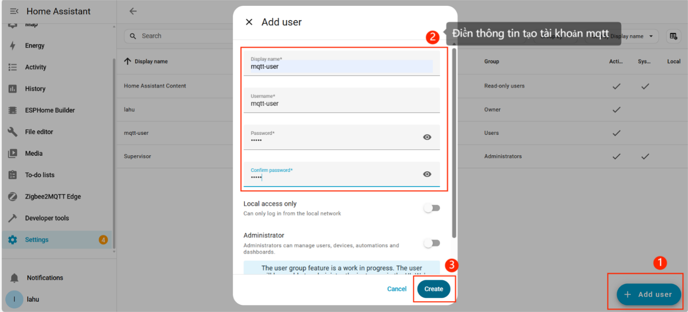

## BTH12_MQTT-p08-i1

Nguồn: [BTH12_MQTT.pdf — trang 8](../../tai-lieu-goc/BTH12_MQTT.pdf).

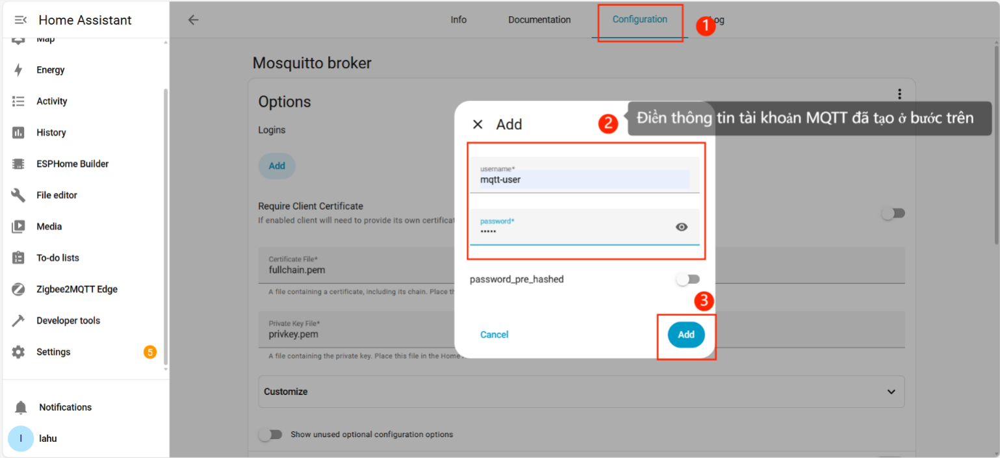

## BTH12_MQTT-p09-i0

Nguồn: [BTH12_MQTT.pdf — trang 9](../../tai-lieu-goc/BTH12_MQTT.pdf).

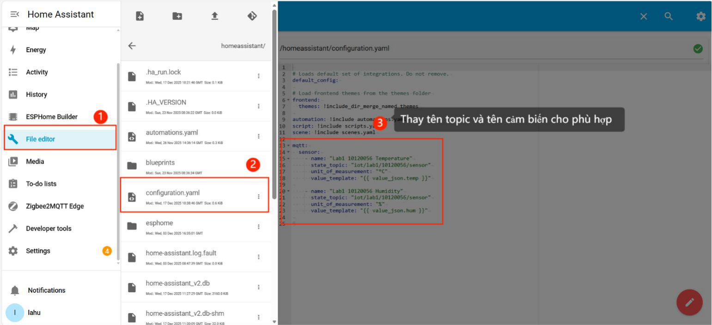

## BTH12_MQTT-p10-i0

Nguồn: [BTH12_MQTT.pdf — trang 10](../../tai-lieu-goc/BTH12_MQTT.pdf).

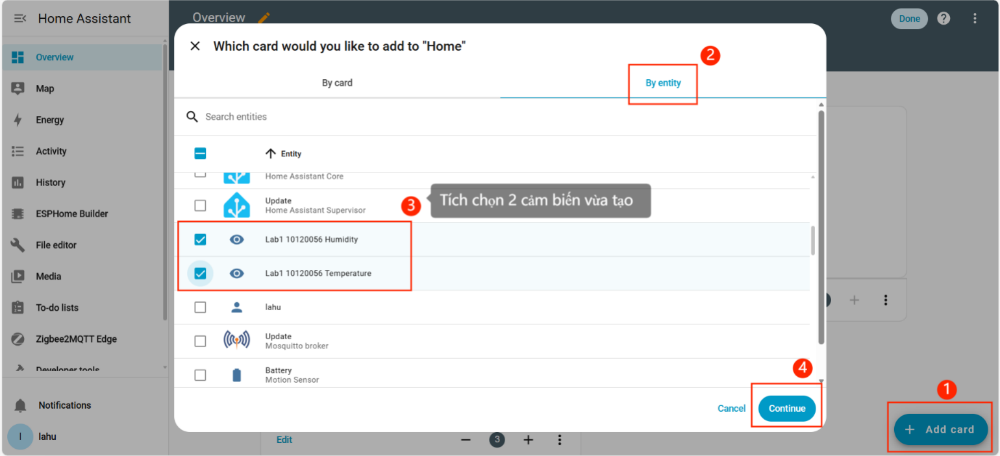

## BTH12_MQTT-p10-i1

Nguồn: [BTH12_MQTT.pdf — trang 10](../../tai-lieu-goc/BTH12_MQTT.pdf).

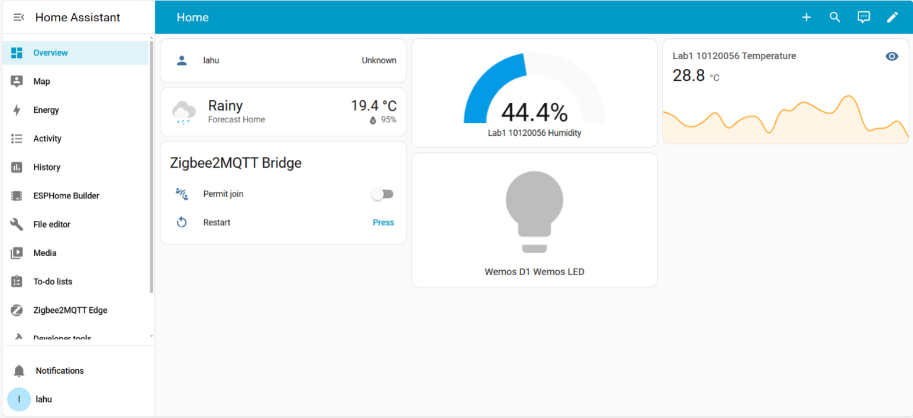

## BTH12_MQTT-p11-i0

Nguồn: [BTH12_MQTT.pdf — trang 11](../../tai-lieu-goc/BTH12_MQTT.pdf).

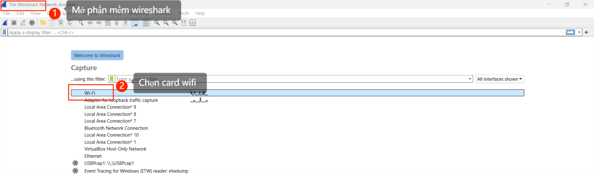

## BTH12_MQTT-p11-i1

Nguồn: [BTH12_MQTT.pdf — trang 11](../../tai-lieu-goc/BTH12_MQTT.pdf).

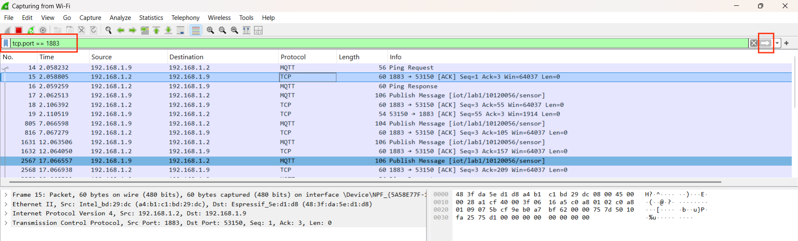

## BTH14_Bao-mat-p08-i0

Nguồn: [BTH14_Bao-mat.pdf — trang 8](../../tai-lieu-goc/BTH14_Bao-mat.pdf).

## BTH2_UART-p03-i0

Nguồn: [BTH2_UART.pdf — trang 3](../../tai-lieu-goc/BTH2_UART.pdf).

## BTH2_UART-p04-i0

Nguồn: [BTH2_UART.pdf — trang 4](../../tai-lieu-goc/BTH2_UART.pdf).

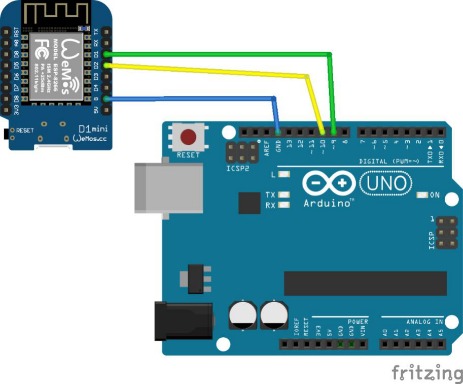

## BTH2_UART-p05-i0

Nguồn: [BTH2_UART.pdf — trang 5](../../tai-lieu-goc/BTH2_UART.pdf).

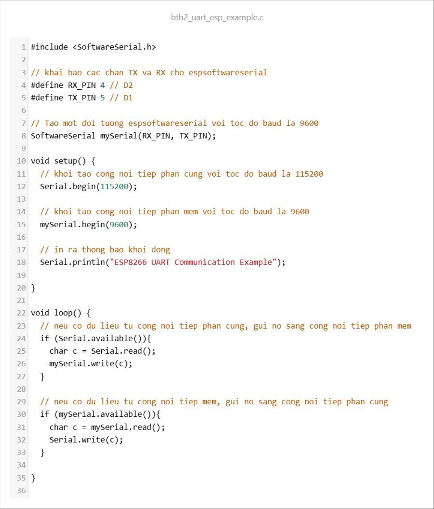

## BTH2_UART-p06-i0

Nguồn: [BTH2_UART.pdf — trang 6](../../tai-lieu-goc/BTH2_UART.pdf).

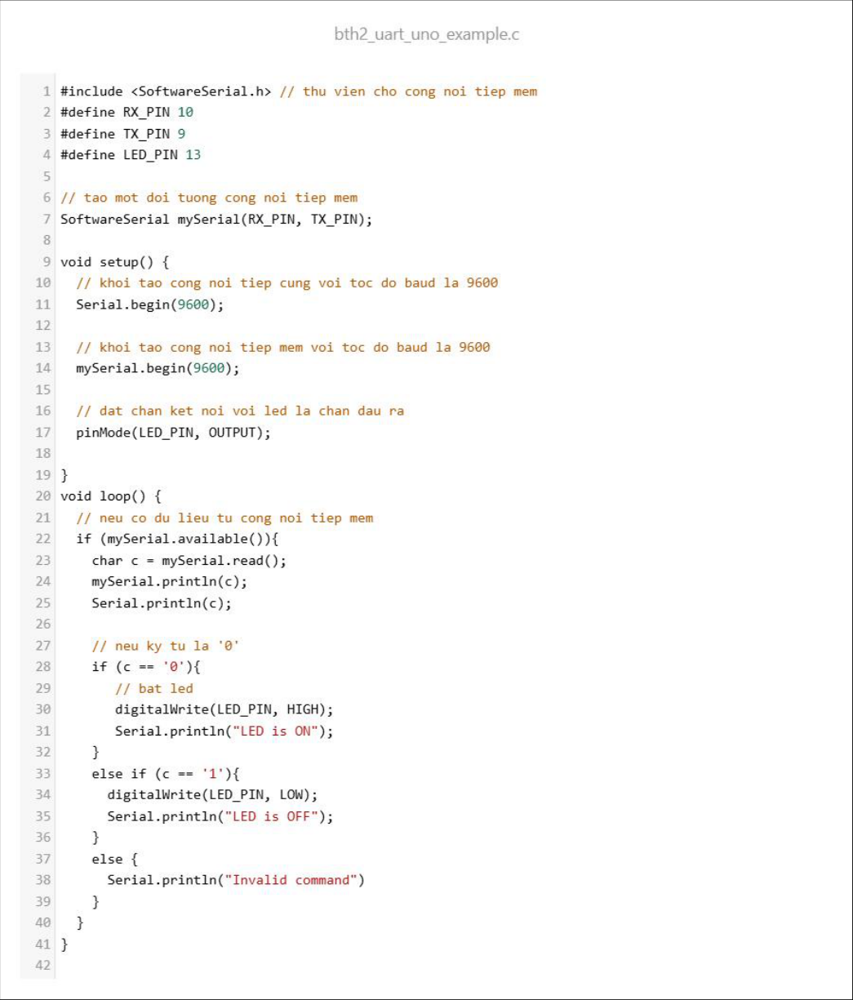

## BTH3_SPI_I2C-p05-i0

Nguồn: [BTH3_SPI_I2C.pdf — trang 5](../../tai-lieu-goc/BTH3_SPI_I2C.pdf).

## BTH3_SPI_I2C-p08-i0

Nguồn: [BTH3_SPI_I2C.pdf — trang 8](../../tai-lieu-goc/BTH3_SPI_I2C.pdf).

## BTH4_ETHERNET-TCPIP-p04-i0

Nguồn: [BTH4_ETHERNET-TCPIP.pdf — trang 4](../../tai-lieu-goc/BTH4_ETHERNET-TCPIP.pdf).

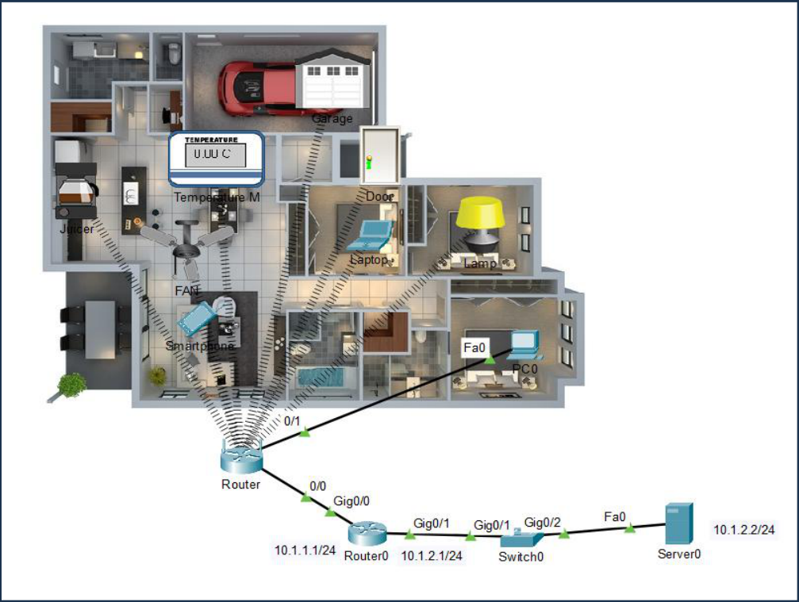

## BTH4_ETHERNET-TCPIP-p05-i0

Nguồn: [BTH4_ETHERNET-TCPIP.pdf — trang 5](../../tai-lieu-goc/BTH4_ETHERNET-TCPIP.pdf).

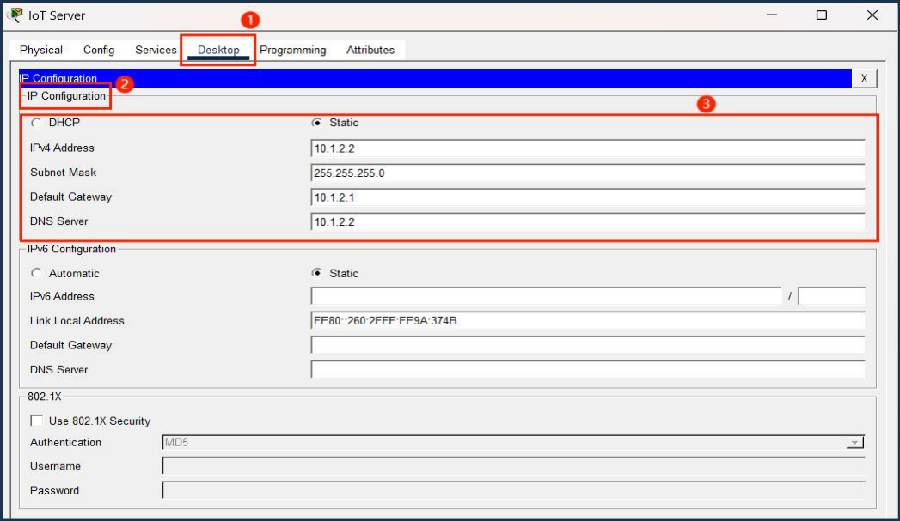

## BTH4_ETHERNET-TCPIP-p06-i0

Nguồn: [BTH4_ETHERNET-TCPIP.pdf — trang 6](../../tai-lieu-goc/BTH4_ETHERNET-TCPIP.pdf).

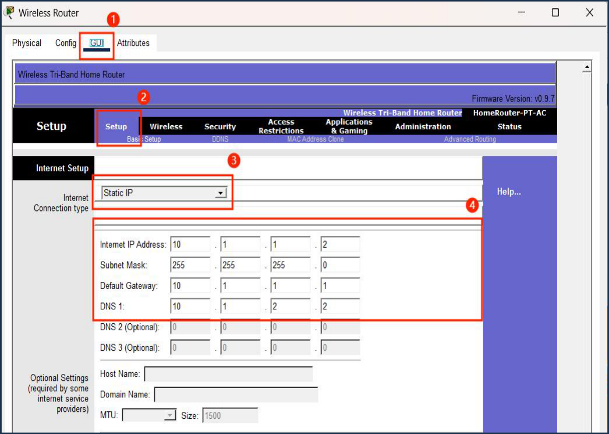

## BTH4_ETHERNET-TCPIP-p07-i0

Nguồn: [BTH4_ETHERNET-TCPIP.pdf — trang 7](../../tai-lieu-goc/BTH4_ETHERNET-TCPIP.pdf).

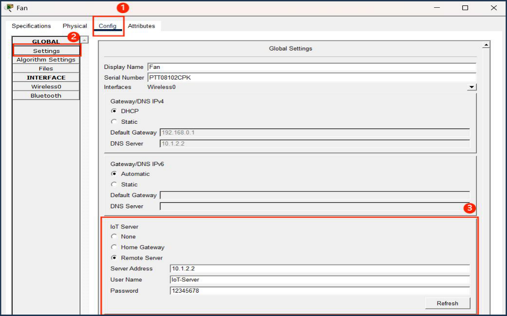

## BTH4_ETHERNET-TCPIP-p08-i0

Nguồn: [BTH4_ETHERNET-TCPIP.pdf — trang 8](../../tai-lieu-goc/BTH4_ETHERNET-TCPIP.pdf).

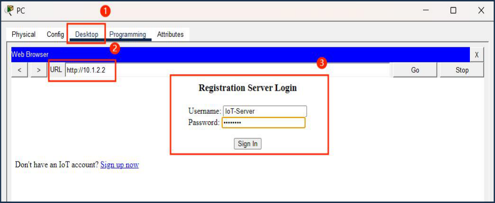

## BTH4_ETHERNET-TCPIP-p08-i1

Nguồn: [BTH4_ETHERNET-TCPIP.pdf — trang 8](../../tai-lieu-goc/BTH4_ETHERNET-TCPIP.pdf).

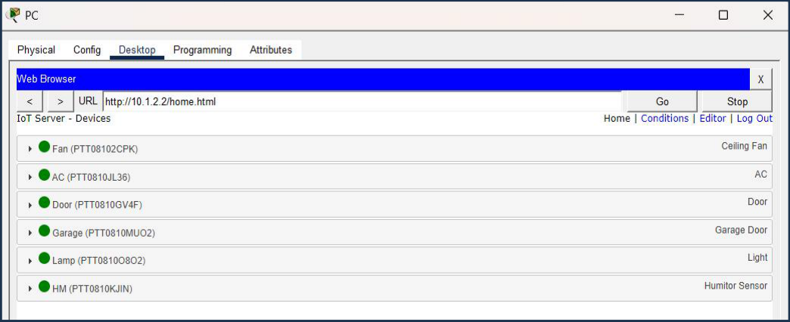

## BTH4_ETHERNET-TCPIP-p10-i0

Nguồn: [BTH4_ETHERNET-TCPIP.pdf — trang 10](../../tai-lieu-goc/BTH4_ETHERNET-TCPIP.pdf).

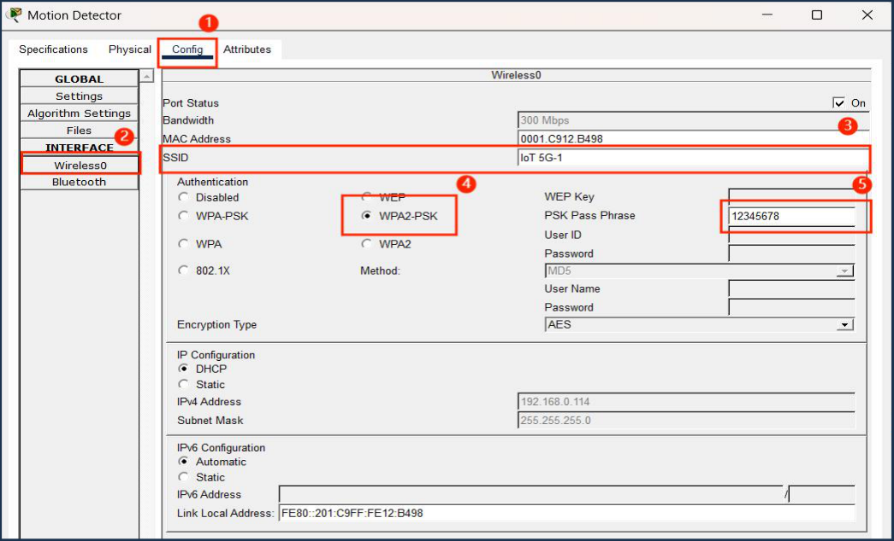

## BTH4_ETHERNET-TCPIP-p11-i0

Nguồn: [BTH4_ETHERNET-TCPIP.pdf — trang 11](../../tai-lieu-goc/BTH4_ETHERNET-TCPIP.pdf).

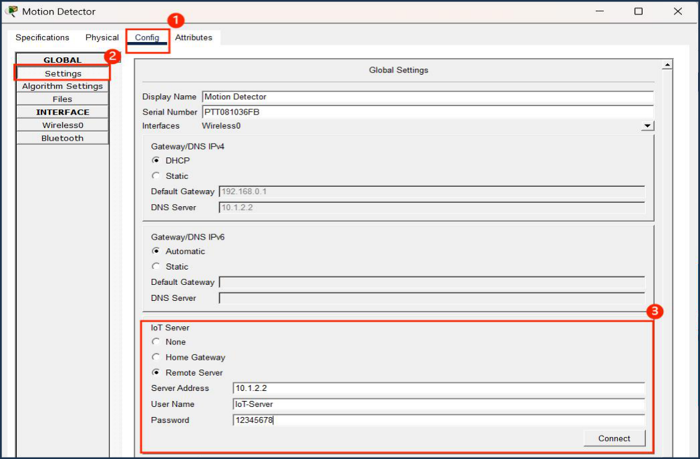

## BTH4_ETHERNET-TCPIP-p12-i0

Nguồn: [BTH4_ETHERNET-TCPIP.pdf — trang 12](../../tai-lieu-goc/BTH4_ETHERNET-TCPIP.pdf).

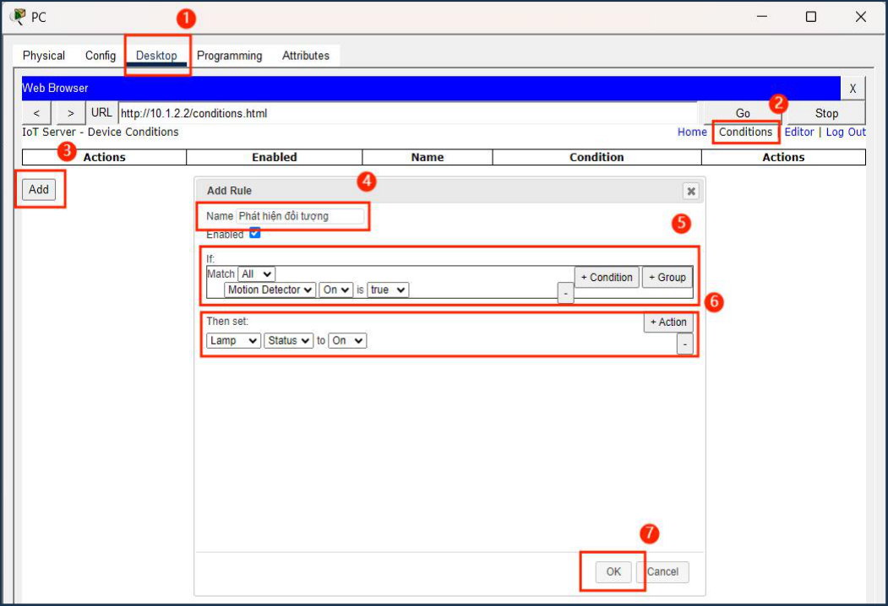

## BTH5_BLUETOOTH-p04-i0

Nguồn: [BTH5_BLUETOOTH.pdf — trang 4](../../tai-lieu-goc/BTH5_BLUETOOTH.pdf).

## BTH5_BLUETOOTH-p08-i0

Nguồn: [BTH5_BLUETOOTH.pdf — trang 8](../../tai-lieu-goc/BTH5_BLUETOOTH.pdf).

## BTH5_BLUETOOTH-p09-i0

Nguồn: [BTH5_BLUETOOTH.pdf — trang 9](../../tai-lieu-goc/BTH5_BLUETOOTH.pdf).

## BTH6_Cai_dat_DebianOS-p01-i0

Nguồn: [BTH6_Cai_dat_DebianOS.pdf — trang 1](../../tai-lieu-goc/BTH6_Cai_dat_DebianOS.pdf).

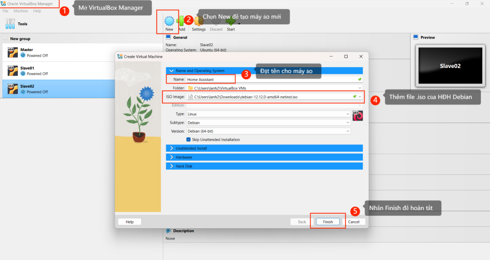

## BTH6_Cai_dat_DebianOS-p01-i1

Nguồn: [BTH6_Cai_dat_DebianOS.pdf — trang 1](../../tai-lieu-goc/BTH6_Cai_dat_DebianOS.pdf).

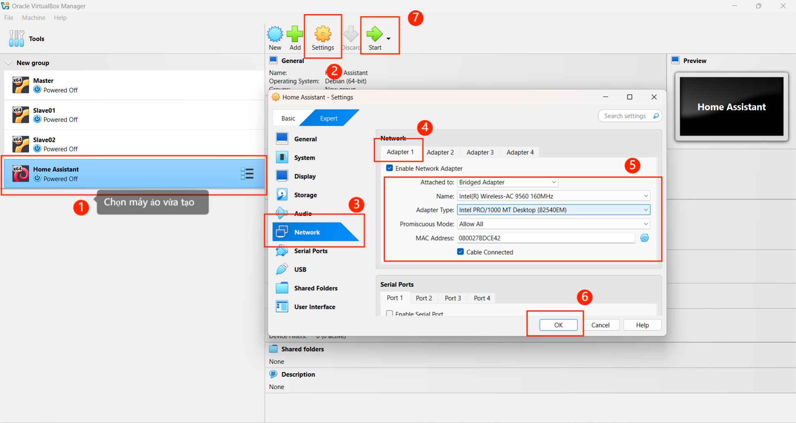

## BTH6_Cai_dat_DebianOS-p02-i0

Nguồn: [BTH6_Cai_dat_DebianOS.pdf — trang 2](../../tai-lieu-goc/BTH6_Cai_dat_DebianOS.pdf).

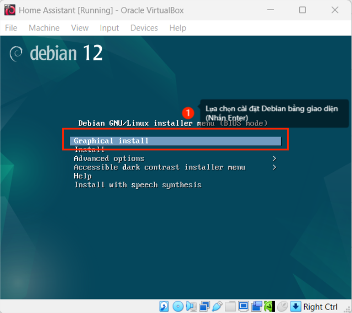

## BTH6_Cai_dat_DebianOS-p02-i1

Nguồn: [BTH6_Cai_dat_DebianOS.pdf — trang 2](../../tai-lieu-goc/BTH6_Cai_dat_DebianOS.pdf).

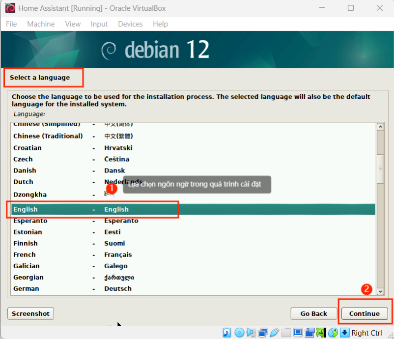

## BTH6_Cai_dat_DebianOS-p03-i0

Nguồn: [BTH6_Cai_dat_DebianOS.pdf — trang 3](../../tai-lieu-goc/BTH6_Cai_dat_DebianOS.pdf).

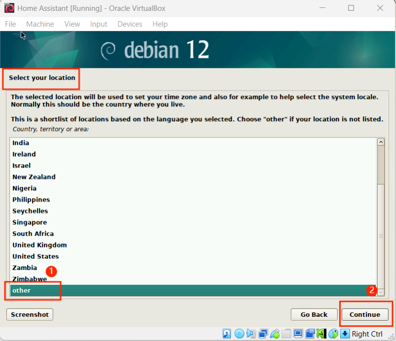

## BTH6_Cai_dat_DebianOS-p03-i1

Nguồn: [BTH6_Cai_dat_DebianOS.pdf — trang 3](../../tai-lieu-goc/BTH6_Cai_dat_DebianOS.pdf).

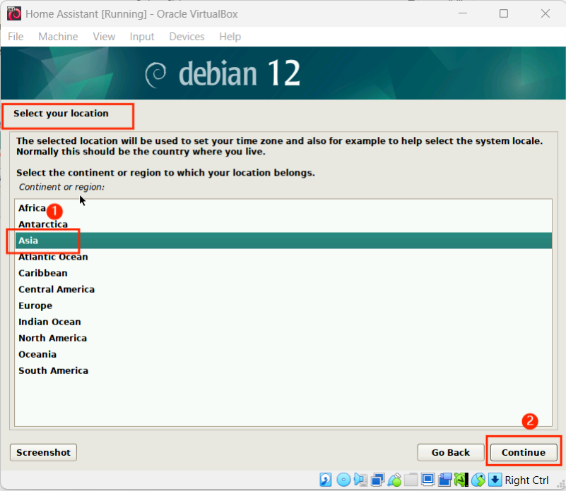

## BTH6_Cai_dat_DebianOS-p04-i0

Nguồn: [BTH6_Cai_dat_DebianOS.pdf — trang 4](../../tai-lieu-goc/BTH6_Cai_dat_DebianOS.pdf).

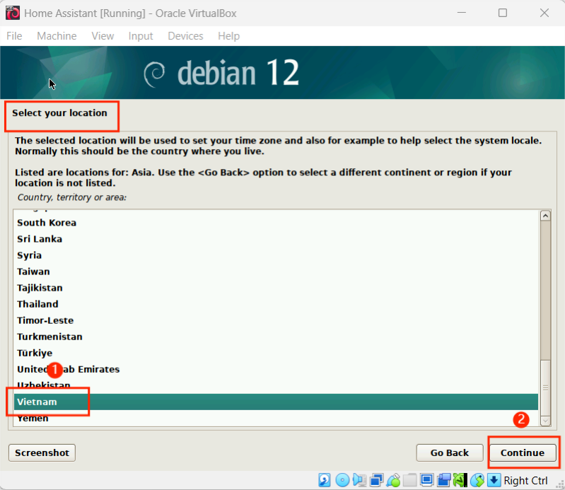

## BTH6_Cai_dat_DebianOS-p04-i1

Nguồn: [BTH6_Cai_dat_DebianOS.pdf — trang 4](../../tai-lieu-goc/BTH6_Cai_dat_DebianOS.pdf).

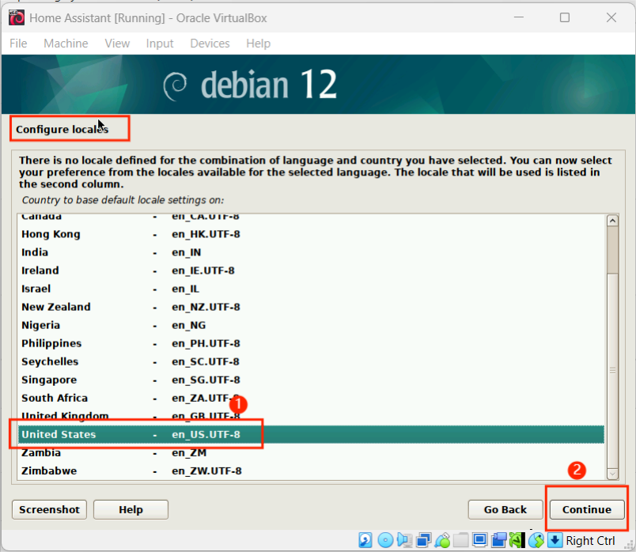

## BTH6_Cai_dat_DebianOS-p05-i0

Nguồn: [BTH6_Cai_dat_DebianOS.pdf — trang 5](../../tai-lieu-goc/BTH6_Cai_dat_DebianOS.pdf).

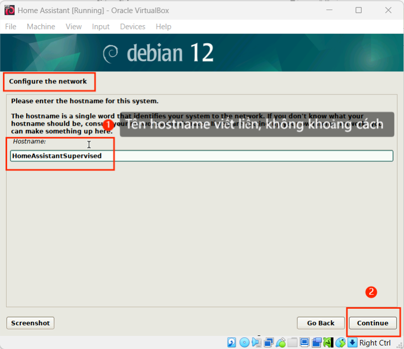

## BTH6_Cai_dat_DebianOS-p05-i1

Nguồn: [BTH6_Cai_dat_DebianOS.pdf — trang 5](../../tai-lieu-goc/BTH6_Cai_dat_DebianOS.pdf).

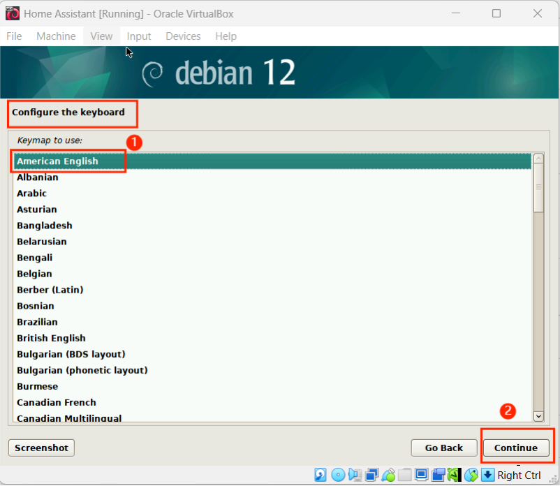

## BTH6_Cai_dat_DebianOS-p06-i0

Nguồn: [BTH6_Cai_dat_DebianOS.pdf — trang 6](../../tai-lieu-goc/BTH6_Cai_dat_DebianOS.pdf).

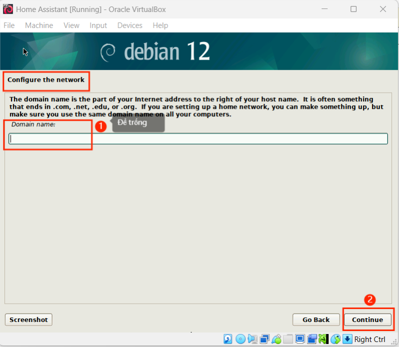

## BTH6_Cai_dat_DebianOS-p06-i1

Nguồn: [BTH6_Cai_dat_DebianOS.pdf — trang 6](../../tai-lieu-goc/BTH6_Cai_dat_DebianOS.pdf).

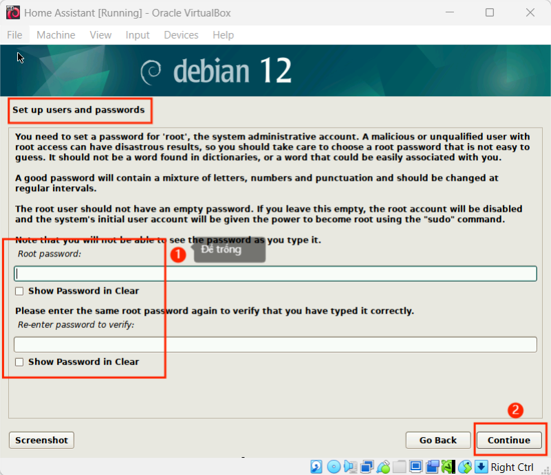

## BTH6_Cai_dat_DebianOS-p07-i0

Nguồn: [BTH6_Cai_dat_DebianOS.pdf — trang 7](../../tai-lieu-goc/BTH6_Cai_dat_DebianOS.pdf).

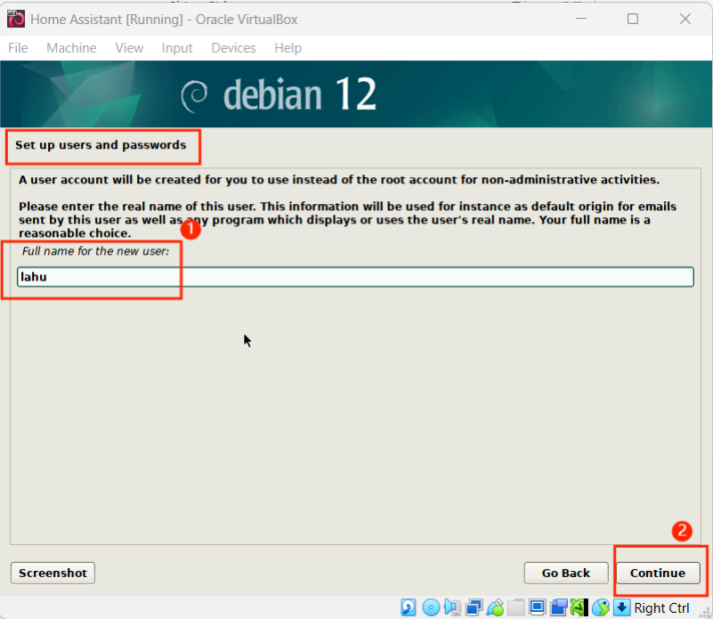

## BTH6_Cai_dat_DebianOS-p07-i1

Nguồn: [BTH6_Cai_dat_DebianOS.pdf — trang 7](../../tai-lieu-goc/BTH6_Cai_dat_DebianOS.pdf).

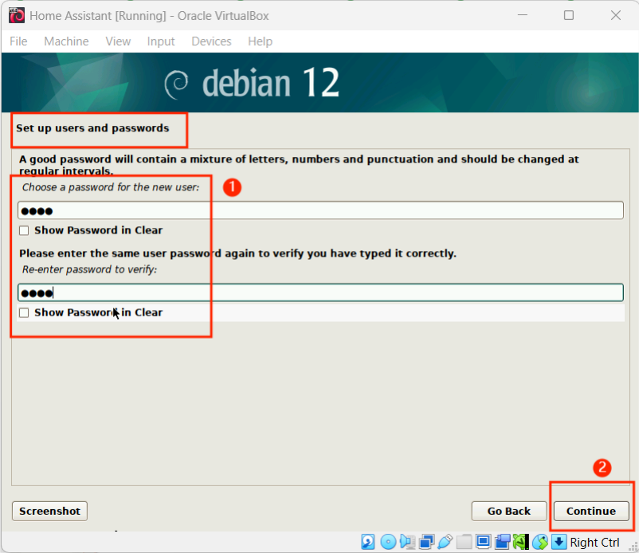

## BTH6_Cai_dat_DebianOS-p08-i0

Nguồn: [BTH6_Cai_dat_DebianOS.pdf — trang 8](../../tai-lieu-goc/BTH6_Cai_dat_DebianOS.pdf).

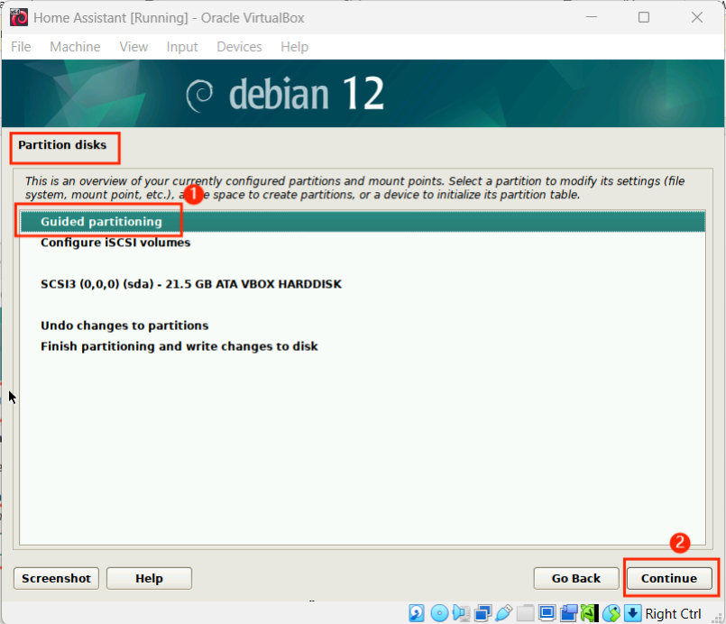

## BTH6_Cai_dat_DebianOS-p08-i1

Nguồn: [BTH6_Cai_dat_DebianOS.pdf — trang 8](../../tai-lieu-goc/BTH6_Cai_dat_DebianOS.pdf).

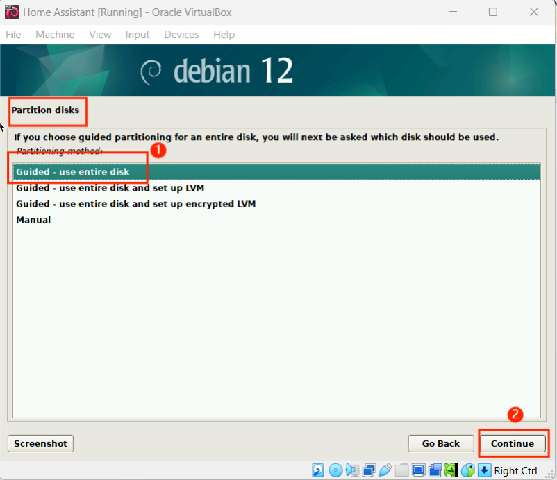

## BTH6_Cai_dat_DebianOS-p09-i0

Nguồn: [BTH6_Cai_dat_DebianOS.pdf — trang 9](../../tai-lieu-goc/BTH6_Cai_dat_DebianOS.pdf).

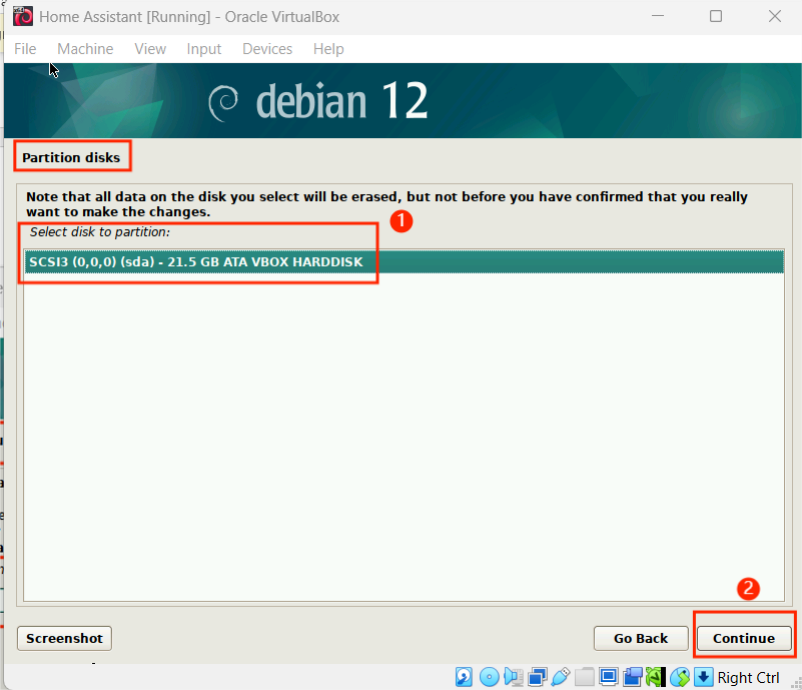

## BTH6_Cai_dat_DebianOS-p09-i1

Nguồn: [BTH6_Cai_dat_DebianOS.pdf — trang 9](../../tai-lieu-goc/BTH6_Cai_dat_DebianOS.pdf).

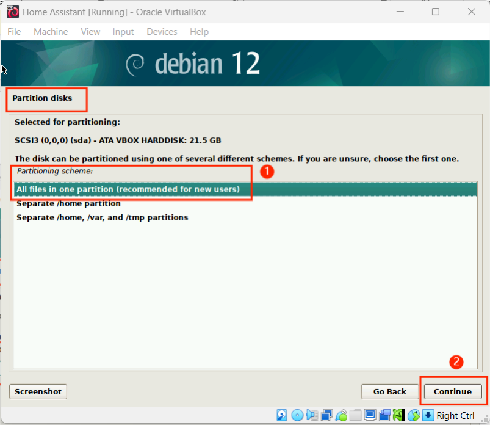

## BTH6_Cai_dat_DebianOS-p10-i0

Nguồn: [BTH6_Cai_dat_DebianOS.pdf — trang 10](../../tai-lieu-goc/BTH6_Cai_dat_DebianOS.pdf).

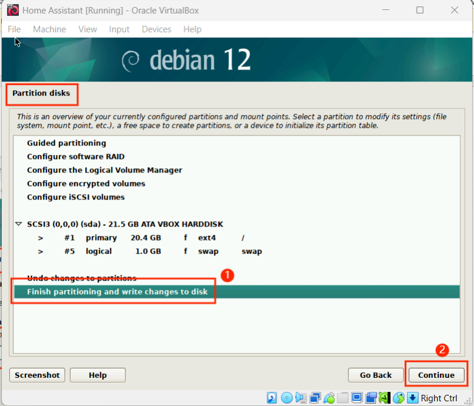

## BTH6_Cai_dat_DebianOS-p10-i1

Nguồn: [BTH6_Cai_dat_DebianOS.pdf — trang 10](../../tai-lieu-goc/BTH6_Cai_dat_DebianOS.pdf).

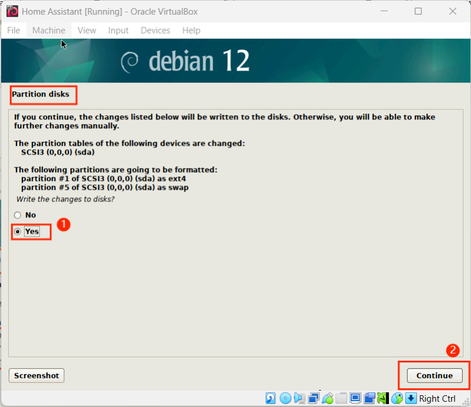

## BTH6_Cai_dat_DebianOS-p11-i0

Nguồn: [BTH6_Cai_dat_DebianOS.pdf — trang 11](../../tai-lieu-goc/BTH6_Cai_dat_DebianOS.pdf).

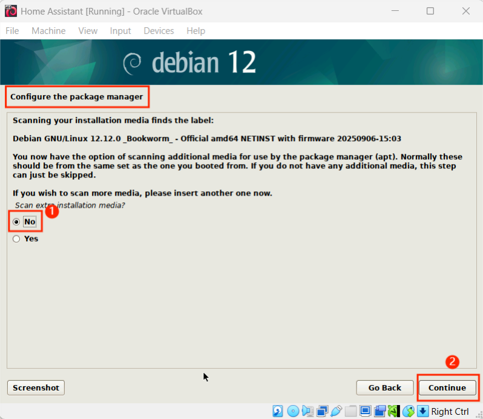

## BTH6_Cai_dat_DebianOS-p11-i1

Nguồn: [BTH6_Cai_dat_DebianOS.pdf — trang 11](../../tai-lieu-goc/BTH6_Cai_dat_DebianOS.pdf).

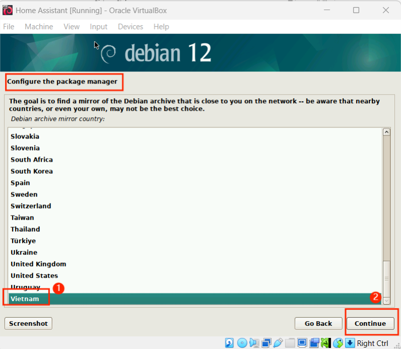

## BTH6_Cai_dat_DebianOS-p12-i0

Nguồn: [BTH6_Cai_dat_DebianOS.pdf — trang 12](../../tai-lieu-goc/BTH6_Cai_dat_DebianOS.pdf).

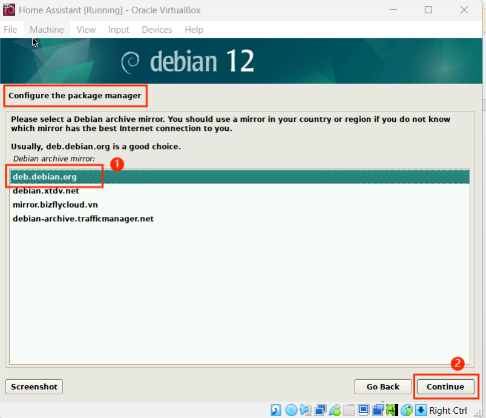

## BTH6_Cai_dat_DebianOS-p12-i1

Nguồn: [BTH6_Cai_dat_DebianOS.pdf — trang 12](../../tai-lieu-goc/BTH6_Cai_dat_DebianOS.pdf).

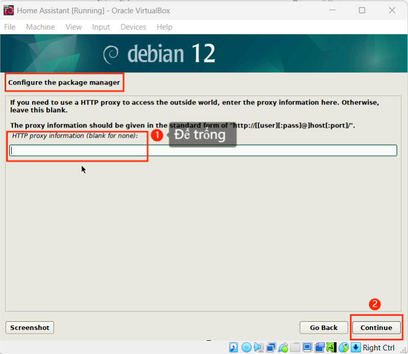

## BTH6_Cai_dat_DebianOS-p13-i0

Nguồn: [BTH6_Cai_dat_DebianOS.pdf — trang 13](../../tai-lieu-goc/BTH6_Cai_dat_DebianOS.pdf).

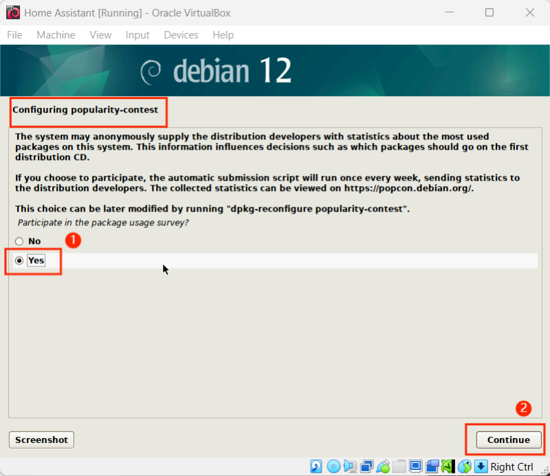

## BTH6_Cai_dat_DebianOS-p13-i1

Nguồn: [BTH6_Cai_dat_DebianOS.pdf — trang 13](../../tai-lieu-goc/BTH6_Cai_dat_DebianOS.pdf).

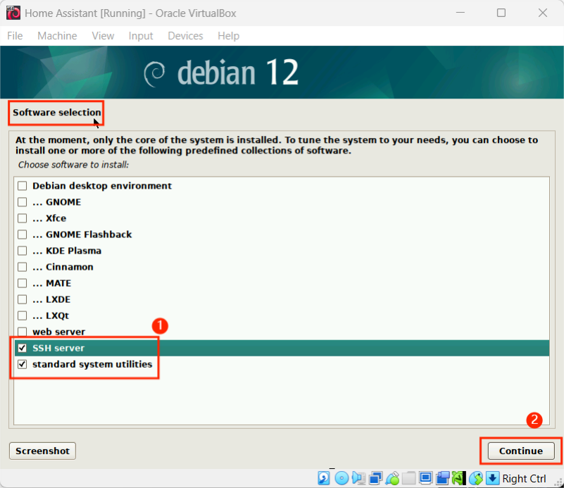

## BTH6_Cai_dat_DebianOS-p14-i0

Nguồn: [BTH6_Cai_dat_DebianOS.pdf — trang 14](../../tai-lieu-goc/BTH6_Cai_dat_DebianOS.pdf).

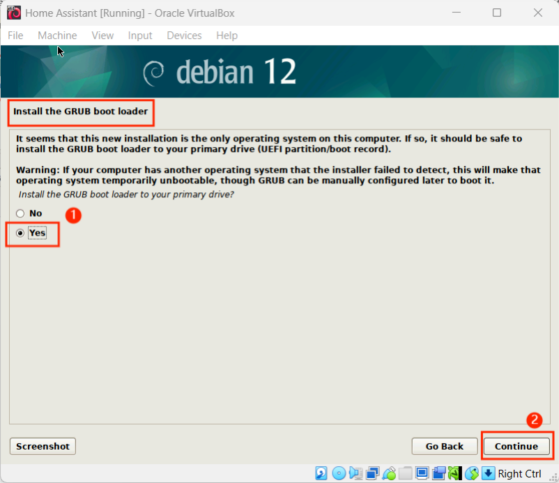

## BTH6_Cai_dat_DebianOS-p14-i1

Nguồn: [BTH6_Cai_dat_DebianOS.pdf — trang 14](../../tai-lieu-goc/BTH6_Cai_dat_DebianOS.pdf).

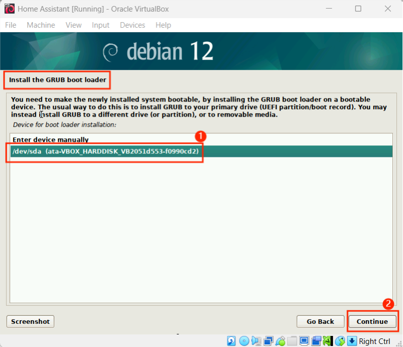

## BTH6_Cai_dat_DebianOS-p15-i0

Nguồn: [BTH6_Cai_dat_DebianOS.pdf — trang 15](../../tai-lieu-goc/BTH6_Cai_dat_DebianOS.pdf).

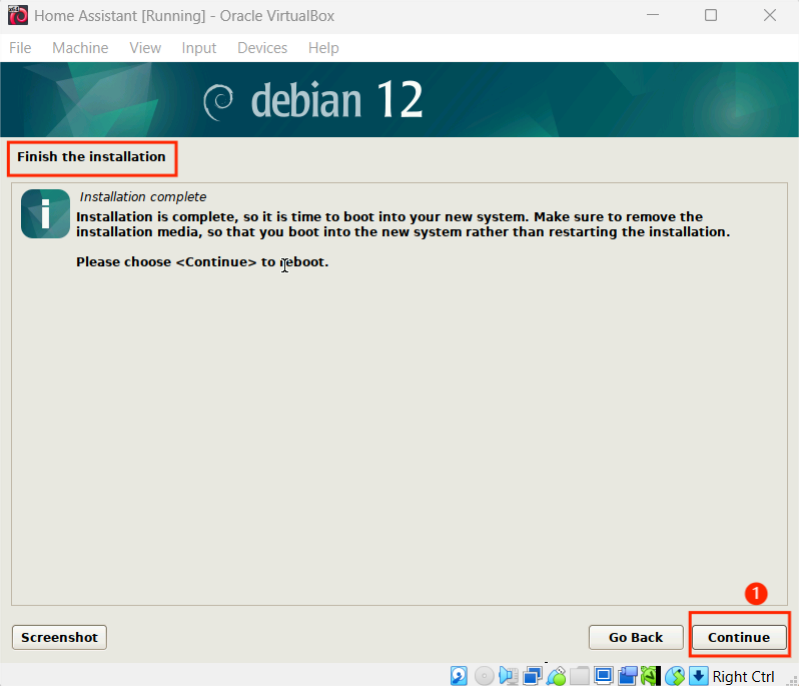

## BTH6_Cai_dat_DebianOS-p15-i1

Nguồn: [BTH6_Cai_dat_DebianOS.pdf — trang 15](../../tai-lieu-goc/BTH6_Cai_dat_DebianOS.pdf).

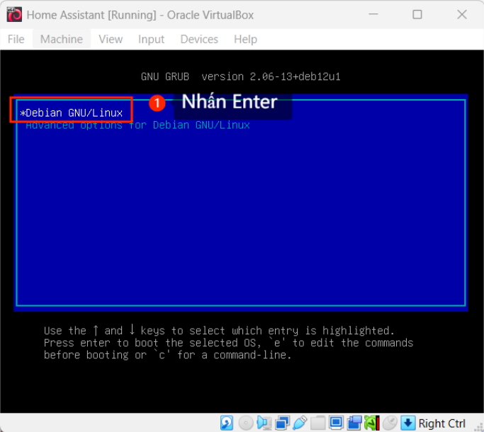

## BTH6_Cai_dat_DebianOS-p16-i0

Nguồn: [BTH6_Cai_dat_DebianOS.pdf — trang 16](../../tai-lieu-goc/BTH6_Cai_dat_DebianOS.pdf).

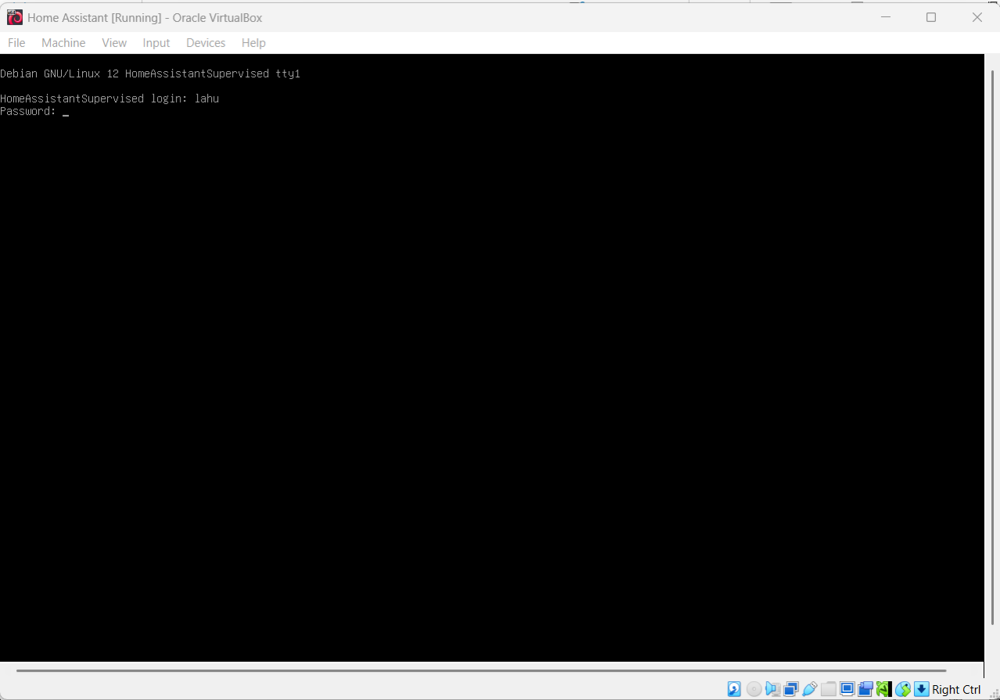

## BTH6_Cai_dat_DebianOS-p17-i0

Nguồn: [BTH6_Cai_dat_DebianOS.pdf — trang 17](../../tai-lieu-goc/BTH6_Cai_dat_DebianOS.pdf).

## BTH6_Cai_dat_HomeAssistant_MQTT_Broker-p01-i0

Nguồn: [BTH6_Cai_dat_HomeAssistant_MQTT_Broker.pdf — trang 1](../../tai-lieu-goc/BTH6_Cai_dat_HomeAssistant_MQTT_Broker.pdf).

## BTH6_Cai_dat_HomeAssistant_MQTT_Broker-p06-i0

Nguồn: [BTH6_Cai_dat_HomeAssistant_MQTT_Broker.pdf — trang 6](../../tai-lieu-goc/BTH6_Cai_dat_HomeAssistant_MQTT_Broker.pdf).

## BTH6_Cai_dat_HomeAssistant_MQTT_Broker-p07-i0

Nguồn: [BTH6_Cai_dat_HomeAssistant_MQTT_Broker.pdf — trang 7](../../tai-lieu-goc/BTH6_Cai_dat_HomeAssistant_MQTT_Broker.pdf).

## BTH6_Cai_dat_HomeAssistant_MQTT_Broker-p07-i1

Nguồn: [BTH6_Cai_dat_HomeAssistant_MQTT_Broker.pdf — trang 7](../../tai-lieu-goc/BTH6_Cai_dat_HomeAssistant_MQTT_Broker.pdf).

## BTH6_Cai_dat_HomeAssistant_MQTT_Broker-p08-i0

Nguồn: [BTH6_Cai_dat_HomeAssistant_MQTT_Broker.pdf — trang 8](../../tai-lieu-goc/BTH6_Cai_dat_HomeAssistant_MQTT_Broker.pdf).

## BTH6_Cai_dat_HomeAssistant_MQTT_Broker-p09-i0

Nguồn: [BTH6_Cai_dat_HomeAssistant_MQTT_Broker.pdf — trang 9](../../tai-lieu-goc/BTH6_Cai_dat_HomeAssistant_MQTT_Broker.pdf).

## BTH6_Cai_dat_HomeAssistant_MQTT_Broker-p10-i0

Nguồn: [BTH6_Cai_dat_HomeAssistant_MQTT_Broker.pdf — trang 10](../../tai-lieu-goc/BTH6_Cai_dat_HomeAssistant_MQTT_Broker.pdf).

## BTH6_Cai_dat_HomeAssistant_MQTT_Broker-p10-i1

Nguồn: [BTH6_Cai_dat_HomeAssistant_MQTT_Broker.pdf — trang 10](../../tai-lieu-goc/BTH6_Cai_dat_HomeAssistant_MQTT_Broker.pdf).

## BTH6_Cai_dat_HomeAssistant_MQTT_Broker-p14-i0

Nguồn: [BTH6_Cai_dat_HomeAssistant_MQTT_Broker.pdf — trang 14](../../tai-lieu-goc/BTH6_Cai_dat_HomeAssistant_MQTT_Broker.pdf).

## BTH6_Cai_dat_HomeAssistant_MQTT_Broker-p15-i0

Nguồn: [BTH6_Cai_dat_HomeAssistant_MQTT_Broker.pdf — trang 15](../../tai-lieu-goc/BTH6_Cai_dat_HomeAssistant_MQTT_Broker.pdf).

## BTH6_ZigBee-p05-i0

Nguồn: [BTH6_ZigBee.pdf — trang 5](../../tai-lieu-goc/BTH6_ZigBee.pdf).

## BTH6_ZigBee-p06-i0

Nguồn: [BTH6_ZigBee.pdf — trang 6](../../tai-lieu-goc/BTH6_ZigBee.pdf).

## BTH6_ZigBee-p07-i0

Nguồn: [BTH6_ZigBee.pdf — trang 7](../../tai-lieu-goc/BTH6_ZigBee.pdf).

## BTH6_ZigBee-p08-i0

Nguồn: [BTH6_ZigBee.pdf — trang 8](../../tai-lieu-goc/BTH6_ZigBee.pdf).

## BTH8_WiFi-p04-i0

Nguồn: [BTH8_WiFi.pdf — trang 4](../../tai-lieu-goc/BTH8_WiFi.pdf).

## BTH8_WiFi-p05-i0

Nguồn: [BTH8_WiFi.pdf — trang 5](../../tai-lieu-goc/BTH8_WiFi.pdf).

## BTH8_WiFi-p05-i1

Nguồn: [BTH8_WiFi.pdf — trang 5](../../tai-lieu-goc/BTH8_WiFi.pdf).

## BTH8_WiFi-p06-i0

Nguồn: [BTH8_WiFi.pdf — trang 6](../../tai-lieu-goc/BTH8_WiFi.pdf).

## BTH8_WiFi-p07-i0

Nguồn: [BTH8_WiFi.pdf — trang 7](../../tai-lieu-goc/BTH8_WiFi.pdf).

## BTH8_WiFi-p07-i1

Nguồn: [BTH8_WiFi.pdf — trang 7](../../tai-lieu-goc/BTH8_WiFi.pdf).

## BTH8_WiFi-p08-i0

Nguồn: [BTH8_WiFi.pdf — trang 8](../../tai-lieu-goc/BTH8_WiFi.pdf).

## BTH8_WiFi-p08-i1

Nguồn: [BTH8_WiFi.pdf — trang 8](../../tai-lieu-goc/BTH8_WiFi.pdf).

## BTH8_WiFi-p11-i0

Nguồn: [BTH8_WiFi.pdf — trang 11](../../tai-lieu-goc/BTH8_WiFi.pdf).

## BTH8_WiFi-p11-i1

Nguồn: [BTH8_WiFi.pdf — trang 11](../../tai-lieu-goc/BTH8_WiFi.pdf).

## BTH8_WiFi-p12-i0

Nguồn: [BTH8_WiFi.pdf — trang 12](../../tai-lieu-goc/BTH8_WiFi.pdf).

## BTH9_Huong_dan_tai_NS3-p03-i0

Nguồn: [BTH9_Huong_dan_tai_NS3.pdf — trang 3](../../tai-lieu-goc/BTH9_Huong_dan_tai_NS3.pdf).

