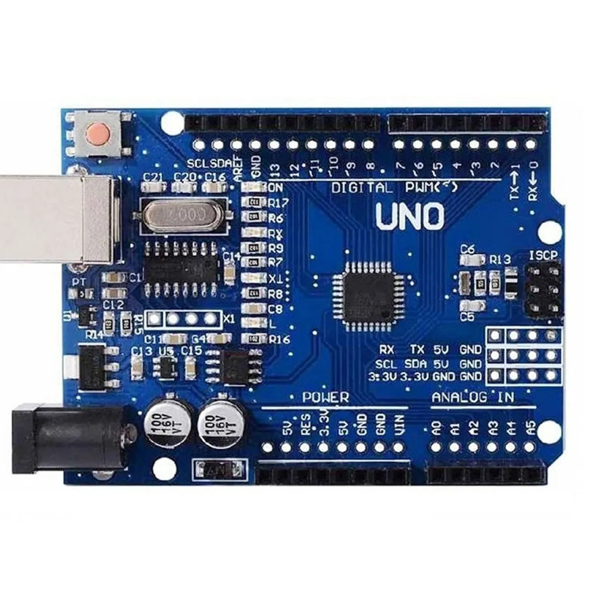
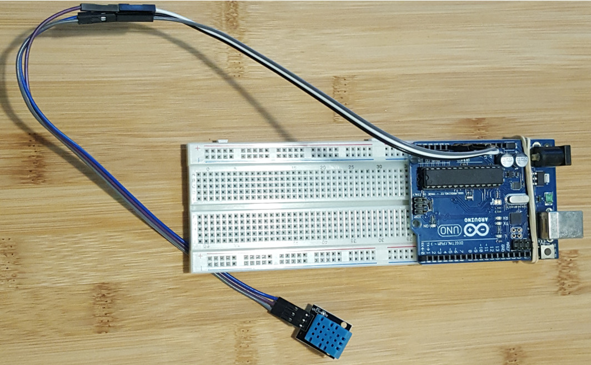
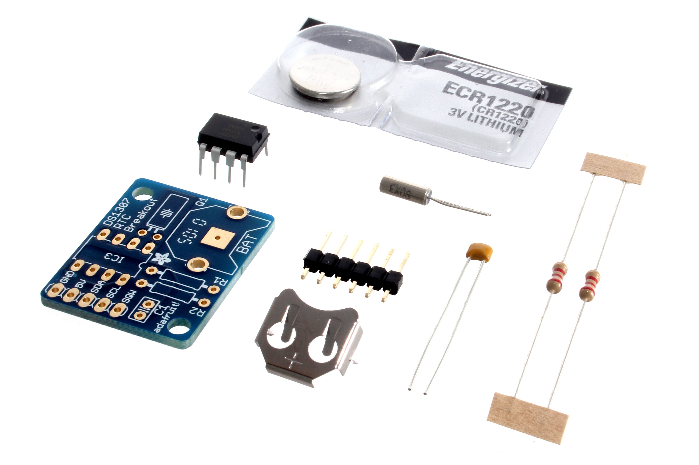

# Hình ảnh linh kiện tham khảo trên mạng

Các ảnh giúp nhận dạng hình dáng trước khi xem mô hình Blender. Chân và điện áp phải đối chiếu đúng module trong bài. Mô hình 3D được dựng bằng hình học trong Blender; không phải quét 3D của ảnh và không xác nhận bạn đang có sẵn linh kiện.

## uno.jpg

Tác giả: Arduino. [Trang nguồn](https://commons.wikimedia.org/wiki/File:Arduino_UNO_microcontroller.jpg) · [CC BY-SA 2.5](https://creativecommons.org/licenses/by-sa/2.5/). Ảnh giữ nguyên, không chỉnh sửa.

## dht11.png

Tác giả: Georgeinza. [Trang nguồn](https://commons.wikimedia.org/wiki/File:DHT11.png) · [CC BY-SA 4.0](https://creativecommons.org/licenses/by-sa/4.0/). Ảnh giữ nguyên, không chỉnh sửa.

## ds1307.jpg

Tác giả: oomlout. [Trang nguồn](https://commons.wikimedia.org/wiki/File:Adafruit_DS1307_Real_Time_Clock_module_-_parts.jpg) · [CC BY-SA 2.0](https://creativecommons.org/licenses/by-sa/2.0/). Ảnh giữ nguyên, không chỉnh sửa.

## Hình và tài liệu tham chiếu bổ sung

| Linh kiện | Nguồn ảnh/tham khảo | Bài dùng |
|---|---|---|
| HC-05 | [Ảnh mạch và chân từ NIMH](https://monkeylogic.nimh.nih.gov/docs_BluetoothRewardTrigger_HC05.html) | 5.1, 5.3, 5.4 |
| LCD1602 | [Ảnh module LCD 16×2 từ Adafruit](https://learn.adafruit.com/character-lcds?view=all) — ảnh dạng LCD thường; bài 3.2 dùng thêm backpack I²C | 3.2 |
| MAX7219 | [Hình module trong Wokwi](https://wokwi.com/projects/420608324577339393), [datasheet của Analog Devices](https://www.analog.com/media/en/technical-documentation/data-sheets/MAX7219-MAX7221.pdf). Mạch Wokwi tham khảo hình dáng, không phải mạch nộp của bài 3.3 | 3.3 |
| PIR | [Hình cảm biến và cấu tạo từ Adafruit](https://learn.adafruit.com/pir-passive-infrared-proximity-motion-sensor/overview) | 4.2, 4.3 |
| CC2531 USB | [Ảnh dongle CC2531](https://shop.dialedin.com.au/products/sonoff-cc2531) — tham khảo hình dáng; firmware sniffer và coordinator khác nhau | 6.1–6.3 |
| ESP32-S3 DevKitC-1 | [Hình và chân từ Espressif](https://docs.espressif.com/projects/esp-idf/en/v4.4.8/esp32s3/hw-reference/esp32s3/user-guide-devkitc-1.html), kèm ảnh board thật của người dùng tại bài 8.1 | 8.1 |
| Wemos D1 mini | [Ảnh chân trong PDF gốc](../giao-dien-goc/BTH8_WiFi-p04-i0.png) | 8.3, 8.4 |

Những nguồn bổ sung được dẫn trực tiếp tới trang ảnh; không gán giấy phép Commons cho ảnh của hãng hoặc cửa hàng. Các router, PC, server, điện thoại, trạm LTE, còi và camera trong Blender là hình học biểu tượng do dự án dựng, không đại diện một sản phẩm thương mại cụ thể.

[Xem toàn bộ mô hình Blender](../../mo-phong-3d/README.md).