# Wireshark thực tế — MQTT, CoAP và bảo mật

Thực hiện ngày **16/10/2026 (UTC+7)** trên máy Windows này. **11 file pcapng, 17 ảnh phân tích + 1 ảnh giao diện Wireshark**, bao phủ **9 bài 12.1–12.3, 13.1–13.3, 14.1–14.3**.

Các gói được TShark/Npcap bắt từ socket TCP/UDP thật trên 127.0.0.1, sau đó mở bằng Wireshark 4.6.9 để chụp cửa sổ nguyên bản. Không dựng lại giao diện, không vẽ số liệu lên ảnh và không tự tạo file pcap. MQTT dùng broker Aedes 0.51.3 và MQTT.js 5.14.1; CoAP dùng server trong repo và coap 1.4.1. Các vai trò device/dashboard/sensor là chương trình trên PC, chưa phải ESP hoặc Home Assistant thật.

[Dữ liệu đo từ packet](analysis.json) · [Manifest và SHA256 pcap](capture-report.json) · [Nguồn và SHA256 ảnh](screenshots.json) · [Mã chạy thí nghiệm](../../tools/wireshark/traffic.cjs).

## Tự mở và đối chiếu từng bước

1. Tải file `.pcapng` của ca cần xem; trong Wireshark dùng **File → Open**. File chụp chỉ chứa các cổng của lab trên Loopback.
2. Nhập bộ lọc hiển thị `coap || mqtt || tls`, nhấn Enter. Dùng `coap`, `mqtt`, hoặc `tcp.port == 8883` khi muốn xem riêng từng giao thức.
3. Click đúng **số frame** ghi dưới mỗi bài. Mở tam giác ở khung chi tiết bên trái: CoAP hoặc MQ Telemetry Transport Protocol hoặc TLS. Khung bytes bên phải thể hiện dữ liệu nhận thật.
4. Với CoAP proxy5684, làm **Analyze → Decode As → UDP port 5684 → CoAP**. Đây là ca cố ý dùng CoAP plaintext trên cổng thường gán DTLS; không phải dữ liệu DTLS lỗi.
5. Xem số gói ở status bar; đối chiếu CSV bên dưới để có số frame, thời gian, MID/token, topic/payload. Count của capture MQTT gồm cả TCP handshake, ACK và teardown; không coi toàn bộ frame là số PUBLISH.

Khi tự bắt lại, chọn **Adapter for loopback traffic capture** cho các chương trình PC này. Wi-Fi không thấy traffic 127.0.0.1. Hình sau là giao diện ban đầu, trước khi chọn adapter:

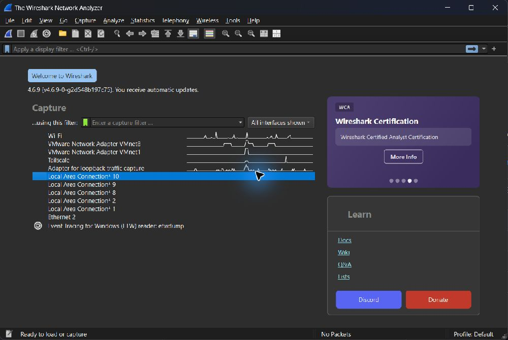

## Danh mục bản ghi

| Ca | Frame toàn capture | PCAP mở được | Log ứng dụng | Packet CSV |
|---|---:|---|---|---|
| 12.1 | 54 | [12.1.pcapng](12.1.pcapng) | [Log](12.1.log) | [CSV](12.1-packets.csv) |
| 12.2 | 62 | [12.2.pcapng](12.2.pcapng) | [Log](12.2.log) | [CSV](12.2-packets.csv) |
| 12.3 | 77 | [12.3.pcapng](12.3.pcapng) | [Log](12.3.log) | [CSV](12.3-packets.csv) |
| 13.1-base | 4 | [13.1-base.pcapng](13.1-base.pcapng) | [Log](13.1-base.log) | [CSV](13.1-base-packets.csv) |
| 13.1-retry | 7 | [13.1-retry.pcapng](13.1-retry.pcapng) | [Log](13.1-retry.log) | [CSV](13.1-retry-packets.csv) |
| 13.2-observe | 24 | [13.2-observe.pcapng](13.2-observe.pcapng) | [Log](13.2-observe.log) | [CSV](13.2-observe-packets.csv) |
| 13.2-poll | 60 | [13.2-poll.pcapng](13.2-poll.pcapng) | [Log](13.2-poll.log) | [CSV](13.2-poll-packets.csv) |
| 13.3 | 32 | [13.3.pcapng](13.3.pcapng) | [Log](13.3.log) | [CSV](13.3-packets.csv) |
| 14.1 | 40 | [14.1.pcapng](14.1.pcapng) | [Log](14.1.log) | [CSV](14.1-packets.csv) |
| 14.2 | 50 | [14.2.pcapng](14.2.pcapng) | [Log](14.2.log) | [CSV](14.2-packets.csv) |
| 14.3 | 177 | [14.3.pcapng](14.3.pcapng) | [Log](14.3.log) | [CSV](14.3-packets.csv) |

## Bài 12.1 — MQTT telemetry

Mở `12.1.pcapng`, lọc `mqtt`. Chọn frame **19**, mở **MQ Telemetry Transport Protocol**: Topic là `iot/lab1/sv01/sensor`, QoS 1 và có Message Identifier. Khung bytes bên phải chứa JSON `simulated=true`, `source=PC`. Ba mẫu được gửi thật qua TCP; mỗi mẫu có PUBLISH phía publisher và một PUBLISH giao tới subscriber. Các giá trị 28/28.5/29°C là dữ liệu tạo trên PC, không phải số đo DHT11.

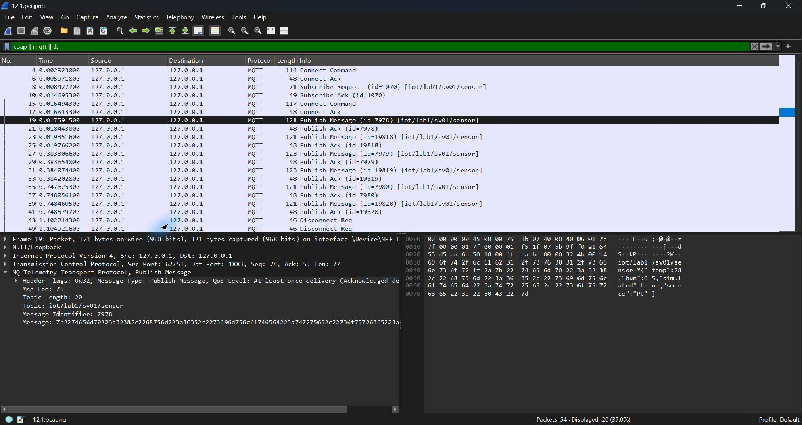


## Bài 12.2 — MQTT lệnh và trạng thái

Mở `12.2.pcapng`, lọc `mqtt`. Các frame **23/27** chứa lệnh ON trên topic `iot/lab2/sv01/cmd`; frame **29/33** chứa phản hồi ON trên `iot/lab2/sv01/state`. Lệnh OFF và phản hồi tiếp theo ở nhóm frame **37–47**. Ảnh chọn frame **33**, thấy bytes `4f4e` tương ứng ON. Device trong lần chạy này là chương trình Node, chưa điều khiển LED vật lý.


## Bài 12.3 — MQTT Retain và Last Will

Mở `12.3.pcapng`, lọc `mqtt`. Client đến muộn CONNECT ở frame **36**, SUBSCRIBE ở **42** rồi nhận trạng thái đã lưu: frame **46** có `Retain: Set`, payload `online`; frame **50** có state ON. Sau khi chương trình cố ý đóng socket mà không gửi MQTT DISCONNECT, broker phát Last Will `offline` ở frame **58/60**. Gói chuyển tiếp cho subscriber đang đăng ký có Retain=0 là hành vi bình thường, không phủ nhận việc broker lưu retained message. Xem log để phân biệt lần ngắt lỗi với các DISCONNECT dọn dẹp ở cuối.

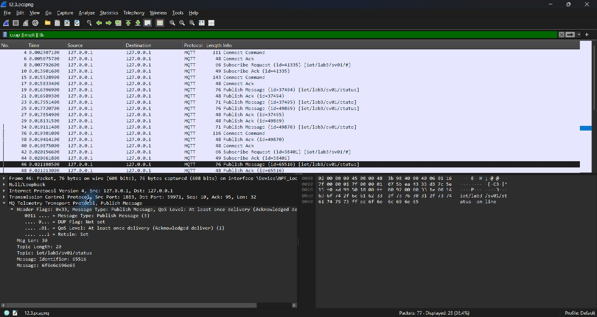

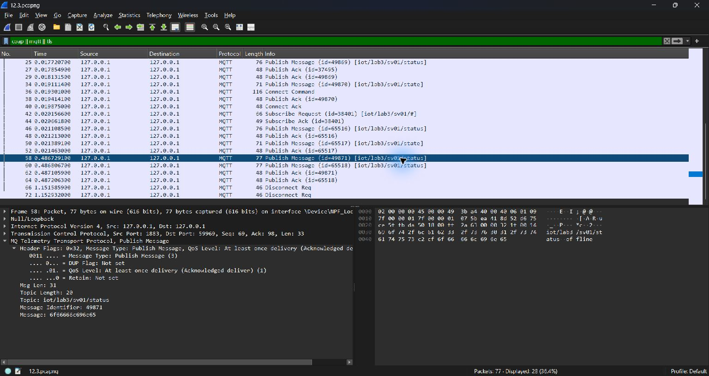


## Bài 13.1 — CoAP NON, CON và retransmission

Mở `13.1-base.pcapng`: frame **1–2** là NON POST và NON response; **3–4** là CON POST và ACK 2.04. Tiếp theo mở `13.1-retry.pcapng`. Vì cổng proxy **5684** mặc định thường được nhận dạng DTLS, chọn frame 1 → **Analyze → Decode As → + → UDP port → 5684 → CoAP → OK**. Ảnh hộp thoại ghi lại đúng thao tác này. Client gửi ở frame **1**, proxy chuyển tiếp ở **2**, server trả ACK ở **3** nhưng proxy bỏ ACK đó. Frame **4** là client gửi lại cùng MID **9552**, cùng token sau **2.199484 giây**; frame **7** mới là phản hồi tới client. Không nhầm ACK server→proxy ở frame 3 với ACK tới client. Bộ lọc `coap` chỉ đầy đủ sau Decode As.

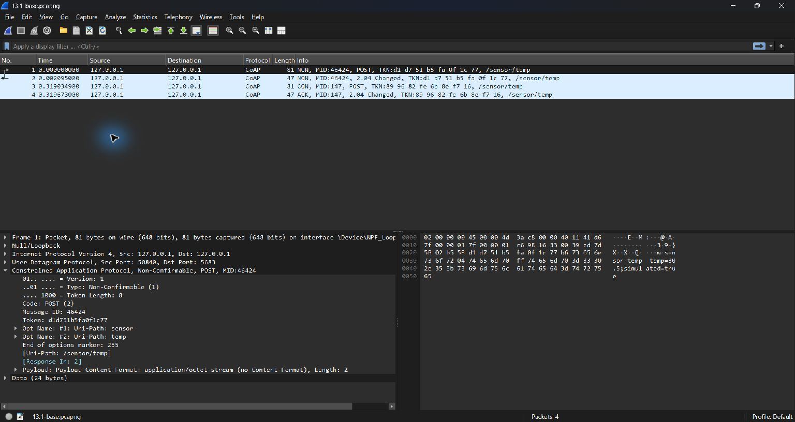

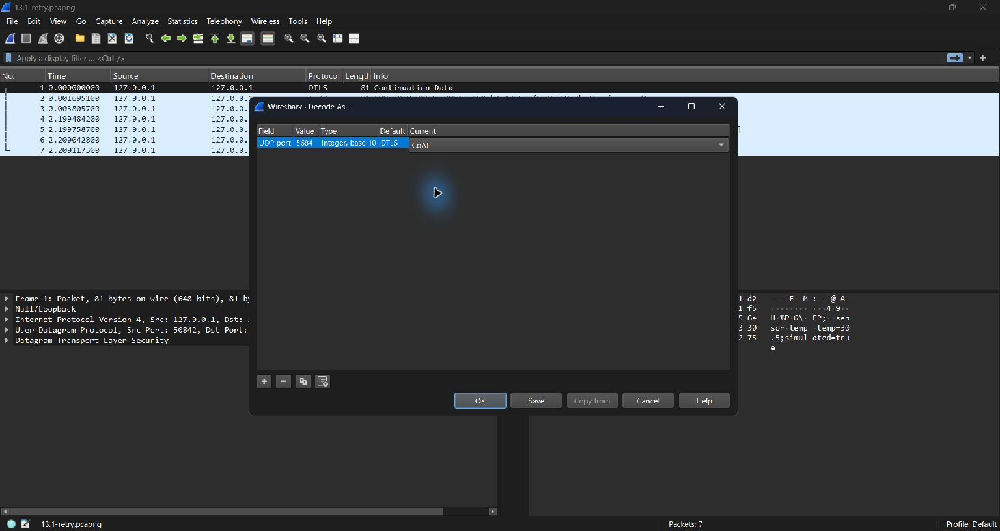

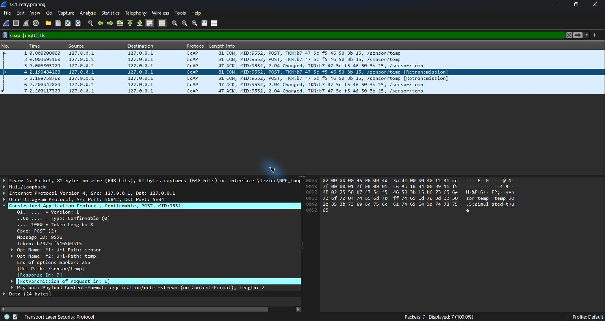


## Bài 13.2 — CoAP Polling và Observe trong 60 giây

Mở hai capture riêng và lọc `coap`. Polling: **30 GET + 30 response = 60 gói**, khoảng 2 giây giữa các GET. Observe: **1 GET đăng ký + 1 response đầu + 11 notification tiếp theo + 11 ACK rỗng = 24 gói**. Token của quan hệ Observe là `d6d72a92e60bd4a1`; MID thay đổi ở notification mới. Mỗi chương trình chạy trong cửa sổ ứng dụng 60 giây; capture có giới hạn 63 giây để bao trùm khởi động/dọn dẹp. Chỉ có traffic đến lần thay đổi dữ liệu trong cửa sổ đó được đếm. Nhiệt độ server là dữ liệu mô phỏng thay đổi mỗi 5 giây.

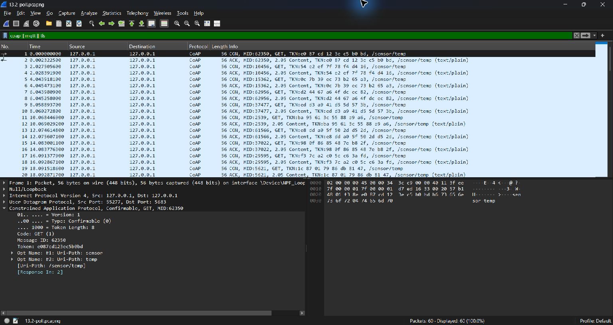

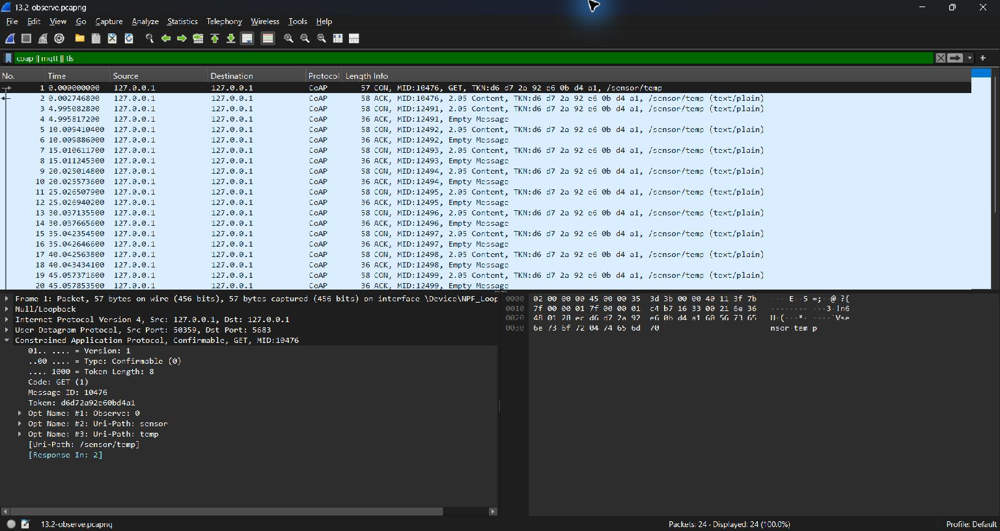

| Phương pháp | GET | Response đầu | Notification tiếp theo | ACK rỗng | Tổng gói CoAP |
|---|---:|---:|---:|---:|---:|
| Polling / 60 s | 30 | 30 | 0 | 0 | 60 |
| Observe / 60 s | 1 | 1 | 11 | 11 | 24 |


## Bài 13.3 — CoAP Block2 và ghép đủ 2 KB

Mở `13.3.pcapng`, lọc `coap`. Có **16 GET + 16 ACK Content = 32 gói**. Chọn frame **2**: Block2 NUM=0, M=1, size=128; tiếp tục tới frame **32**: NUM=15, M=0, size=128. Trong phần chi tiết hiện **16 Blocks (2048 bytes)** và tab **Reassembled CoAP blocks (2048 bytes)**. Chương trình còn kiểm tra nội dung toàn bộ 2048 byte A và SHA256, không chỉ nhìn tổng Length của frame. Ảnh thứ hai là chính phần reassembly hiển thị trong Wireshark.

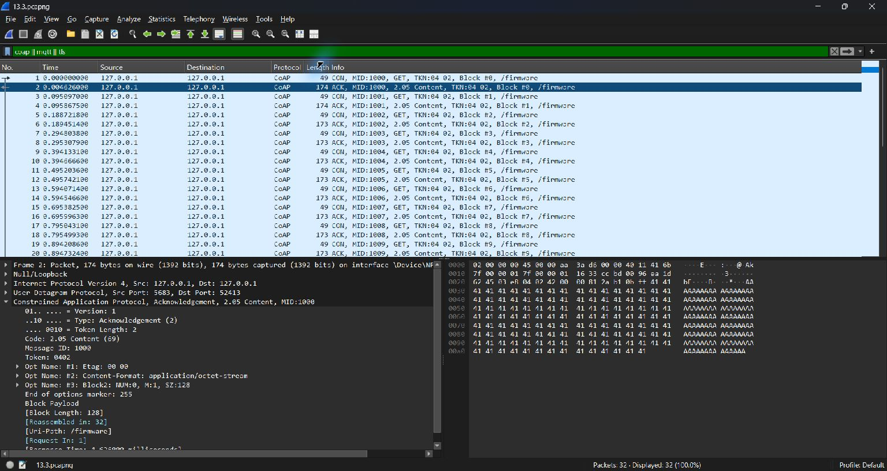

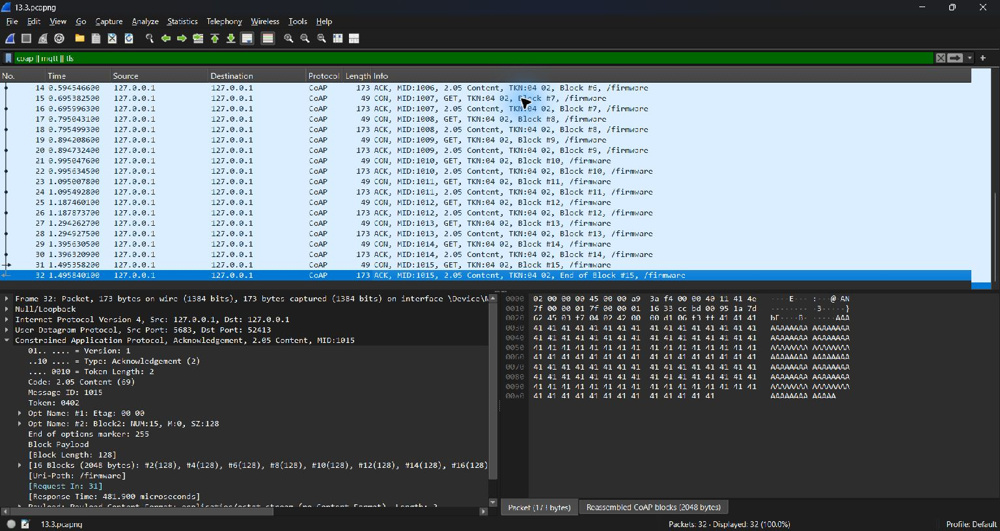


## Bài 14.1 — MQTT plaintext và MQTT qua TLS

Mở `14.1.pcapng`, lọc `mqtt || tls`. CONNECT plaintext ở frame **4** cho thấy username/password mẫu; PUBLISH plaintext ở **8** có topic và payload đọc được. Phiên TLS trên TCP8883 có Client Hello **21**, Server Hello **23**, rồi Application Data mã hóa. Ảnh thứ hai chọn frame **27** và mở TLS record để thấy **Encrypted Application Data**. Client kiểm tra CA và SAN 127.0.0.1 bằng certificate tự sinh cho lab; không tắt kiểm tra chứng chỉ. Giá trị legacy record version 0x0303 có thể hiện là TLS1.2 trong record của phiên TLS1.3: xem phiên bản được thương lượng/nhãn TLSv1.3, không suy ra downgrade chỉ từ trường legacy. [RFC 8446, mục 5.1](https://www.rfc-editor.org/rfc/rfc8446.html#section-5.1).

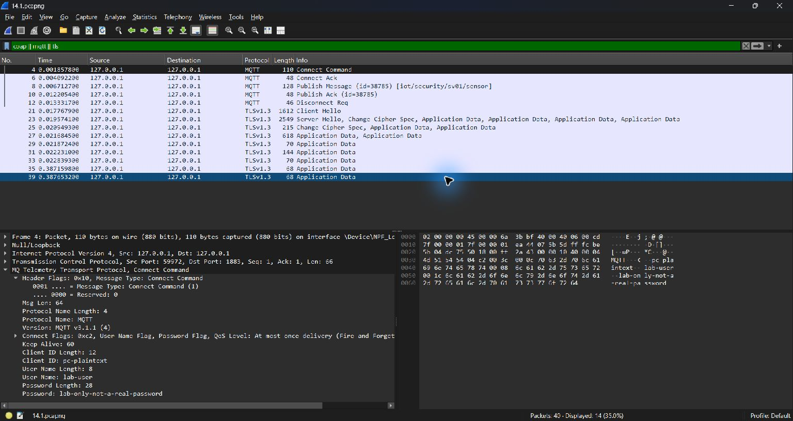

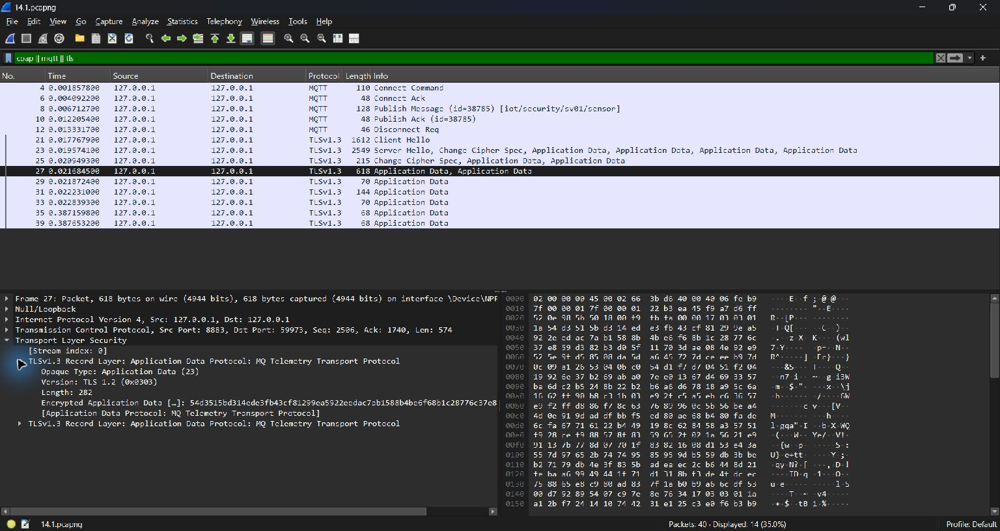


## Bài 14.2 — MQTT phát lại lệnh và kiểm tra độ mới

Mở `14.2.pcapng`, lọc `mqtt`. Publisher gửi OPEN đã ký ở frame **19**, phát lại nguyên payload ở **29**; broker chuyển tới receiver tại **23/33**. Cả hai bản giữ nguyên time, nonce, seq=1 và mac. Receiver phần mềm trả **ACCEPT** tại frame **25**, rồi **REJECT replay/stale/MAC** tại **35**. Khung bytes của hai ảnh cho thấy chính các chuỗi phản hồi đó. Log xác nhận nguyên nhân là sequence cũ; phép thử trên PC không kiểm tra GPIO, NTP hay lưu sequence vào NVS của ESP32.

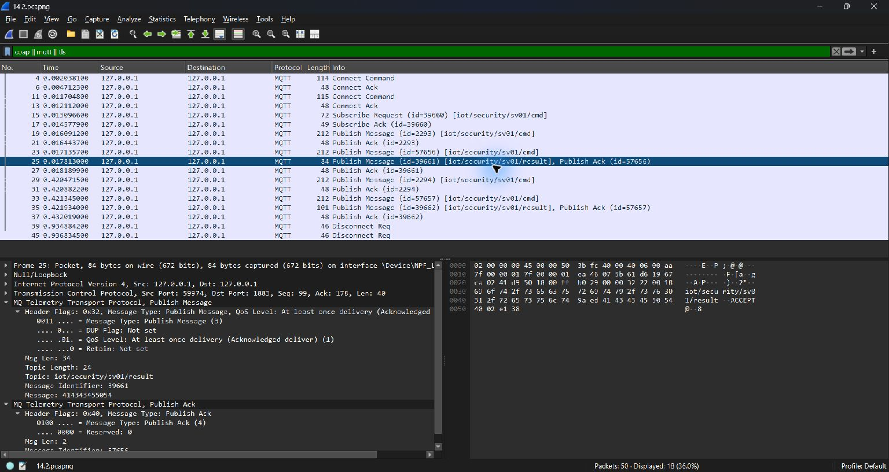

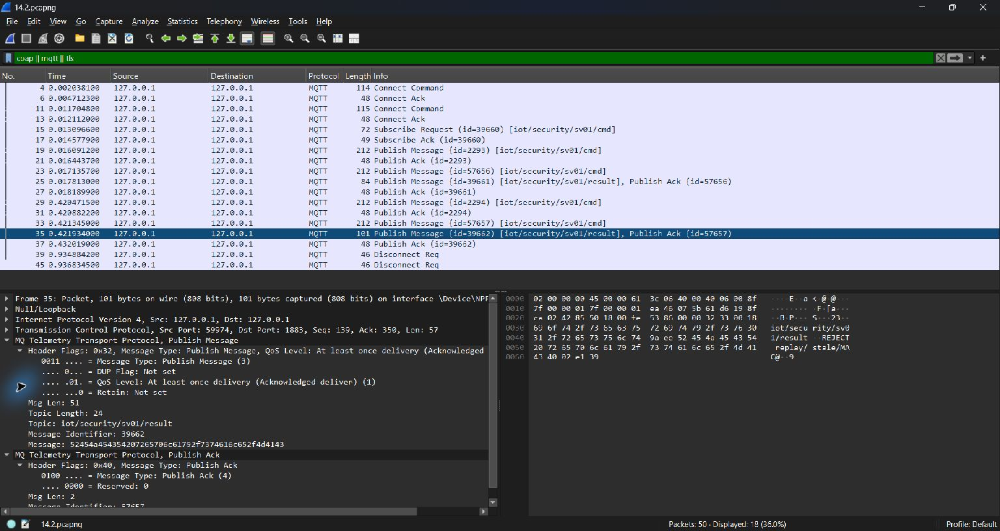


## Bài 14.3 — MQTT tải giới hạn và phục hồi kết nối

Mở `14.3.pcapng`, lọc `mqtt`. Client `pc-reconnecting-client` CONNECT lần đầu tại frame **15** và CONNECT lại cùng Client ID tại **150**. Sau lần chủ động đóng socket thử nghiệm, frame **154** đăng ký lại topic, **156/162** phát trạng thái online. Lần chạy phát 10 lệnh ON/OFF với khoảng nghỉ 100 ms giữa các lần phát, rồi gây ngắt đúng socket của client lab; không tạo tải lên router hay broker bên ngoài. Log ghi reconnect sau khoảng 0.5 giây. Đây là kiểm tra reconnect của MQTT.js trên PC, chưa đo backoff hoặc độ ổn định firmware ESP32.

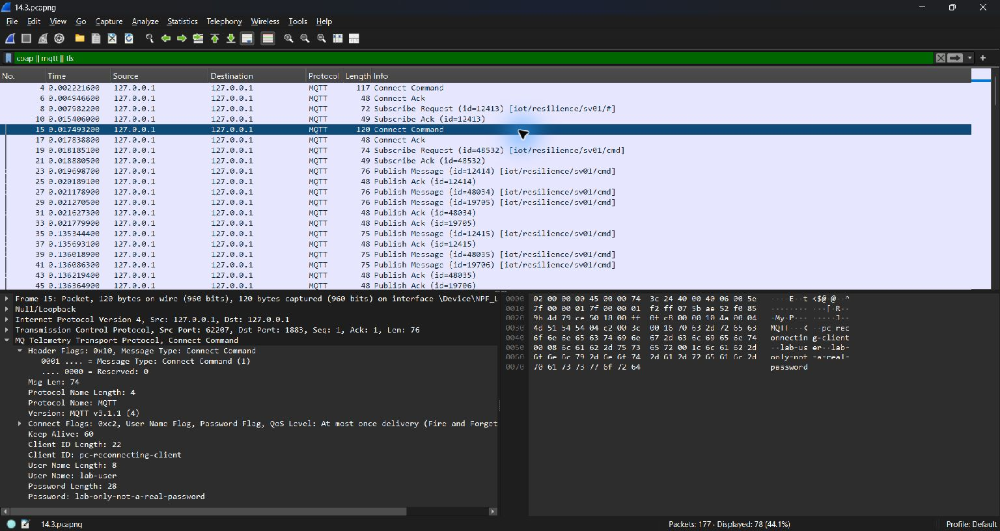

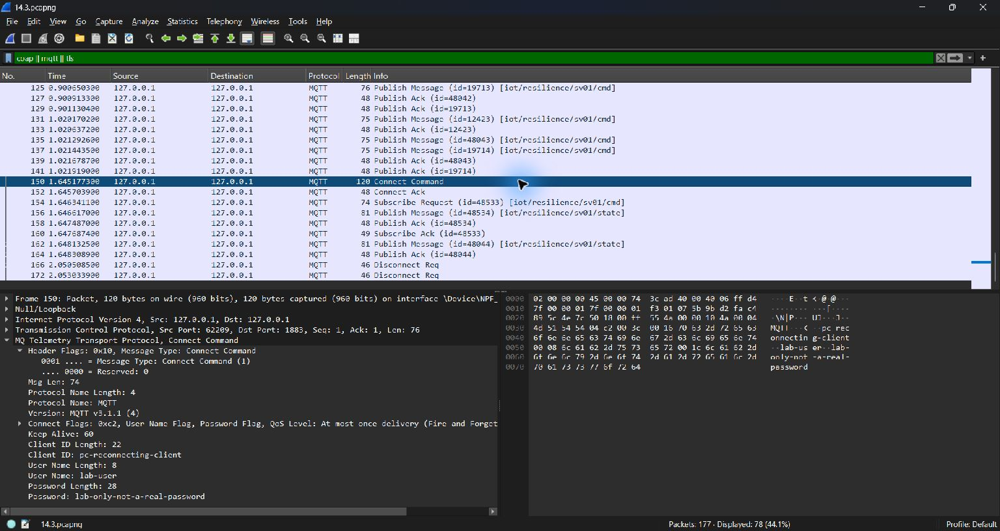

## Tái lập bằng mã nguồn

Cài Node.js và Python, cùng Wireshark/Npcap có adapter Loopback. Cài phụ thuộc gốc và phụ thuộc thí nghiệm riêng. Chứng chỉ/private key tạo trong thư mục tạm, không đưa lên Git. Username/password trong bản ghi là **lab-user / lab-only-not-a-real-password**, chỉ là chuỗi mẫu của thí nghiệm; broker loopback không dùng chúng để kiểm tra xác thực.

```powershell
npm ci
npm ci --prefix tools/wireshark
$labCertDir = Join-Path $env:TEMP "iot-wire-certs"
New-Item -ItemType Directory -Force $labCertDir | Out-Null
& "C:\Program Files\Git\usr\bin\openssl.exe" req -x509 -newkey rsa:2048 -sha256 -days 2 -nodes -keyout "$labCertDir/server.key" -out "$labCertDir/server.crt" -subj "/CN=localhost/O=PC Loopback Lab" -addext "subjectAltName=DNS:localhost,IP:127.0.0.1"
python tools/wireshark/capture.py --cert-dir "$labCertDir"
python tools/wireshark/analyze.py
```

Thay đường dẫn OpenSSL theo nơi cài. Nếu chỉ chạy một ca, thêm tên cuối lệnh capture, ví dụ `13.1-retry`. Lệnh capture sẽ ghi lại file cùng tên; lưu riêng kết quả cũ nếu cần giữ nhiều lần đo. Mọi listener của script ràng buộc 127.0.0.1 và được đóng khi thí nghiệm kết thúc. Chụp màn hình qua Wireshark sau khi mở capture; script không tạo ảnh giả.

## Phần cần thiết bị để tiếp tục

- **Bài 6.1–6.3:** cần coordinator, thiết bị Zigbee và sniffer riêng được nhận dạng đúng. Hiện chưa có capture IEEE802.15.4 từ phần cứng; không thay bằng gói UDP giả.
- **Bài 8.2:** IP ESP và Home Assistant trong ảnh cũ chưa truy cập được tại thời điểm kiểm tra. Cần IP hiện tại và thiết bị online để bắt Native API/mDNS/HTTP của chính ESP. Các file trên chưa phải capture ESPHome.
- Các ca MQTT/bảo mật ở đây xác minh giao thức bằng client PC; kiểm tra LED, cảm biến, NVS và reconnect của board vẫn làm theo hướng dẫn phần cứng của từng bài.

SHA256 ghi lại tính nguyên vẹn của file và ảnh. Nhật ký dùng UTC; giờ Việt Nam = UTC+7.
