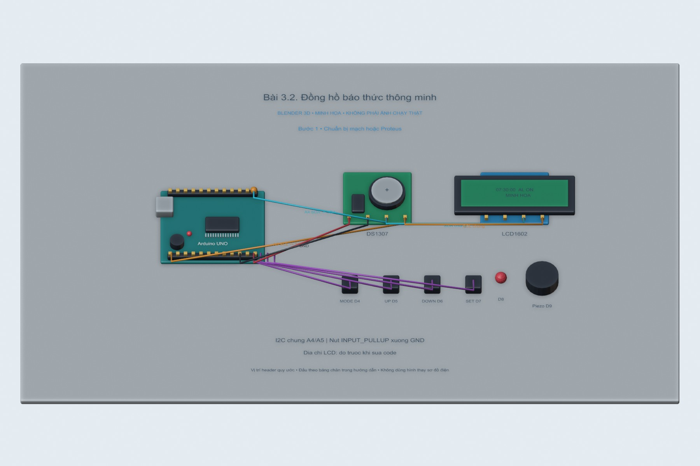
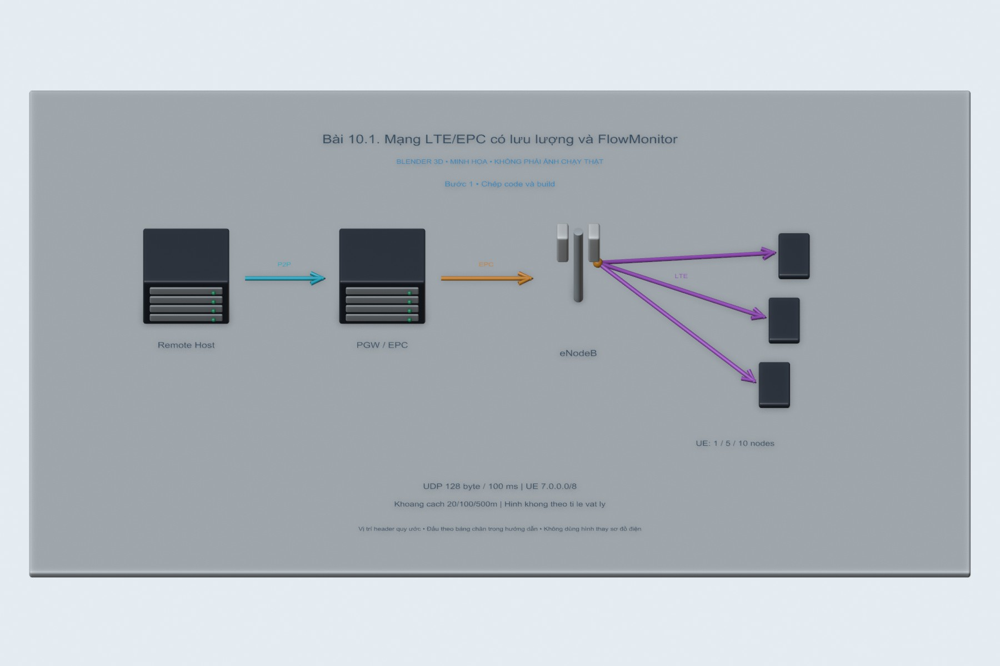

# Mô hình Blender 3D cho các bài thực hành

**30 cảnh `.blend`, 132 hình theo bước**. Bài 8.1 dùng ảnh thao tác và ảnh mạch thật trong bài thực hành; các bài còn lại có mô hình để học khi chưa có đầy đủ linh kiện. [Nguồn ảnh linh kiện tham khảo](../docs/linh-kien/README.md) · [84 hình giao diện từ PDF](../docs/giao-dien-goc/README.md).

## Mở và sử dụng

1. Cài Blender 4.5 LTS từ [nguồn chính thức](https://www.blender.org/download/lts/). Mở liên kết `.blend` của bài trong bảng, chọn **Download raw file** trên GitHub và lưu file về máy.
2. Trong Blender chọn **File → Open**, mở file vừa tải. Dùng bánh xe để zoom, giữ chuột giữa để xoay, Shift + chuột giữa để dịch cảnh. Nhấn **Numpad 0** xem camera; **Home** để lấy toàn cảnh.
3. Chuyển viewport sang **Material Preview** hoặc **Solid → Color: Material** để thấy màu. Cảnh dùng Workbench nên **F12** render trực tiếp, không cần cài add-on hay tải model ngoài.
4. Timeline có mốc mỗi 30 frame: bước 1 ở frame 1, bước 2 ở 31, bước 3 ở 61... Nhập frame theo bước hoặc nhấn Space xem hạt tín hiệu chạy theo đường đầu tiên trong cảnh. Hạt chỉ là diễn họa hướng truyền; màu/trạng thái thiết bị không được tính từ firmware.
5. Đọc bảng chân trong hướng dẫn trước khi đấu mạch. Các header và kích thước 3D được giản lược; không dùng vị trí pin trên hình thay cho pinout thật.
6. Với bài mạng, kết quả gói tin, latency và retransmission phải lấy từ Wireshark/NS-3/chương trình đi kèm. Blender thể hiện bố trí và luồng logic, không chạy mô hình điện, RF hay firmware.

## Danh mục

| Bài | Hướng dẫn | Cảnh chỉnh sửa được | Xem nhanh |
|---|---|---|---|
| 2.1 | [Thao tác từng bước](../BTH02_UART/2.1.md) | [Blender](2.1/bai-2.1.blend) | [Hình bước 1](2.1/buoc-01.jpg) |
| 2.2 | [Thao tác từng bước](../BTH02_UART/2.2.md) | [Blender](2.2/bai-2.2.blend) | [Hình bước 1](2.2/buoc-01.jpg) |
| 2.3 | [Thao tác từng bước](../BTH02_UART/2.3.md) | [Blender](2.3/bai-2.3.blend) | [Hình bước 1](2.3/buoc-01.jpg) |
| 3.1 | [Thao tác từng bước](../BTH03_SPI_I2C/3.1.md) | [Blender](3.1/bai-3.1.blend) | [Hình bước 1](3.1/buoc-01.jpg) |
| 3.2 | [Thao tác từng bước](../BTH03_SPI_I2C/3.2.md) | [Blender](3.2/bai-3.2.blend) | [Hình bước 1](3.2/buoc-01.jpg) |
| 3.3 | [Thao tác từng bước](../BTH03_SPI_I2C/3.3.md) | [Blender](3.3/bai-3.3.blend) | [Hình bước 1](3.3/buoc-01.jpg) |
| 4.1 | [Thao tác từng bước](../BTH04_ETHERNET_TCPIP/4.1.md) | [Blender](4.1/bai-4.1.blend) | [Hình bước 1](4.1/buoc-01.jpg) |
| 4.2 | [Thao tác từng bước](../BTH04_ETHERNET_TCPIP/4.2.md) | [Blender](4.2/bai-4.2.blend) | [Hình bước 1](4.2/buoc-01.jpg) |
| 4.3 | [Thao tác từng bước](../BTH04_ETHERNET_TCPIP/4.3.md) | [Blender](4.3/bai-4.3.blend) | [Hình bước 1](4.3/buoc-01.jpg) |
| 5.1 | [Thao tác từng bước](../BTH05_BLUETOOTH/5.1.md) | [Blender](5.1/bai-5.1.blend) | [Hình bước 1](5.1/buoc-01.jpg) |
| 5.2 | [Thao tác từng bước](../BTH05_BLUETOOTH/5.2.md) | [Blender](5.2/bai-5.2.blend) | [Hình bước 1](5.2/buoc-01.jpg) |
| 5.3 | [Thao tác từng bước](../BTH05_BLUETOOTH/5.3.md) | [Blender](5.3/bai-5.3.blend) | [Hình bước 1](5.3/buoc-01.jpg) |
| 5.4 | [Thao tác từng bước](../BTH05_BLUETOOTH/5.4.md) | [Blender](5.4/bai-5.4.blend) | [Hình bước 1](5.4/buoc-01.jpg) |
| 6.1 | [Thao tác từng bước](../BTH06_ZIGBEE/6.1.md) | [Blender](6.1/bai-6.1.blend) | [Hình bước 1](6.1/buoc-01.jpg) |
| 6.2 | [Thao tác từng bước](../BTH06_ZIGBEE/6.2.md) | [Blender](6.2/bai-6.2.blend) | [Hình bước 1](6.2/buoc-01.jpg) |
| 6.3 | [Thao tác từng bước](../BTH06_ZIGBEE/6.3.md) | [Blender](6.3/bai-6.3.blend) | [Hình bước 1](6.3/buoc-01.jpg) |
| 8.2 | [Thao tác từng bước](../BTH08_WIFI/8.2.md) | [Blender](8.2/bai-8.2.blend) | [Hình bước 1](8.2/buoc-01.jpg) |
| 8.3 | [Thao tác từng bước](../BTH08_WIFI/8.3.md) | [Blender](8.3/bai-8.3.blend) | [Hình bước 1](8.3/buoc-01.jpg) |
| 8.4 | [Thao tác từng bước](../BTH08_WIFI/8.4.md) | [Blender](8.4/bai-8.4.blend) | [Hình bước 1](8.4/buoc-01.jpg) |
| 9.1 | [Thao tác từng bước](../BTH09_NS3/9.1.md) | [Blender](9.1/bai-9.1.blend) | [Hình bước 1](9.1/buoc-01.jpg) |
| 10.1 | [Thao tác từng bước](../BTH10_NB_IOT_LTE/10.1.md) | [Blender](10.1/bai-10.1.blend) | [Hình bước 1](10.1/buoc-01.jpg) |
| 12.1 | [Thao tác từng bước](../BTH12_MQTT/12.1.md) | [Blender](12.1/bai-12.1.blend) | [Hình bước 1](12.1/buoc-01.jpg) |
| 12.2 | [Thao tác từng bước](../BTH12_MQTT/12.2.md) | [Blender](12.2/bai-12.2.blend) | [Hình bước 1](12.2/buoc-01.jpg) |
| 12.3 | [Thao tác từng bước](../BTH12_MQTT/12.3.md) | [Blender](12.3/bai-12.3.blend) | [Hình bước 1](12.3/buoc-01.jpg) |
| 13.1 | [Thao tác từng bước](../BTH13_COAP/13.1.md) | [Blender](13.1/bai-13.1.blend) | [Hình bước 1](13.1/buoc-01.jpg) |
| 13.2 | [Thao tác từng bước](../BTH13_COAP/13.2.md) | [Blender](13.2/bai-13.2.blend) | [Hình bước 1](13.2/buoc-01.jpg) |
| 13.3 | [Thao tác từng bước](../BTH13_COAP/13.3.md) | [Blender](13.3/bai-13.3.blend) | [Hình bước 1](13.3/buoc-01.jpg) |
| 14.1 | [Thao tác từng bước](../BTH14_BAO_MAT/14.1.md) | [Blender](14.1/bai-14.1.blend) | [Hình bước 1](14.1/buoc-01.jpg) |
| 14.2 | [Thao tác từng bước](../BTH14_BAO_MAT/14.2.md) | [Blender](14.2/bai-14.2.blend) | [Hình bước 1](14.2/buoc-01.jpg) |
| 14.3 | [Thao tác từng bước](../BTH14_BAO_MAT/14.3.md) | [Blender](14.3/bai-14.3.blend) | [Hình bước 1](14.3/buoc-01.jpg) |

## Một số cảnh tiêu biểu

### Bài 3.2



### Bài 3.3


### Bài 5.4


### Bài 6.1


### Bài 10.1



### Bài 14.1


## Dựng lại từ mã nguồn

Toàn bộ hình học nằm trong [build_scenes.py](build_scenes.py); không nhập model của bên thứ ba. Các ảnh linh kiện chỉ dùng tham khảo nhận dạng, không được dán vào mô hình để giả ảnh thật. Font tiếng Việt được đóng gói trong file Blender.

```powershell
& "C:\Program Files\Blender Foundation\Blender 4.5\blender.exe" -b --python mo-phong-3d/build_scenes.py
# Hoặc chỉ dựng một số bài:
& "C:\Program Files\Blender Foundation\Blender 4.5\blender.exe" -b --python mo-phong-3d/build_scenes.py -- 3.2 5.4
python tools/update_illustrations.py
```

Chạy tại thư mục gốc repository, thay đường dẫn Blender theo máy. Nếu chỉ dựng vài bài, file manifest-part.json là báo cáo riêng; manifest.json của toàn bộ bộ bài vẫn được giữ. Hình render 1800×1200, JPEG chất lượng 90; mỗi bài giữ file `.blend` nén.

Bản dựng đã kiểm tra: Blender 4.5.14 LTS Windows x64; archive SHA256 `b9533d2397ac1984db4466fb23a7a4649391cca93f6e84209f9bcc60d071c8b9`. Blender portable được cài trong thư mục làm việc ngoài Git, không đưa bộ cài vào repository.
