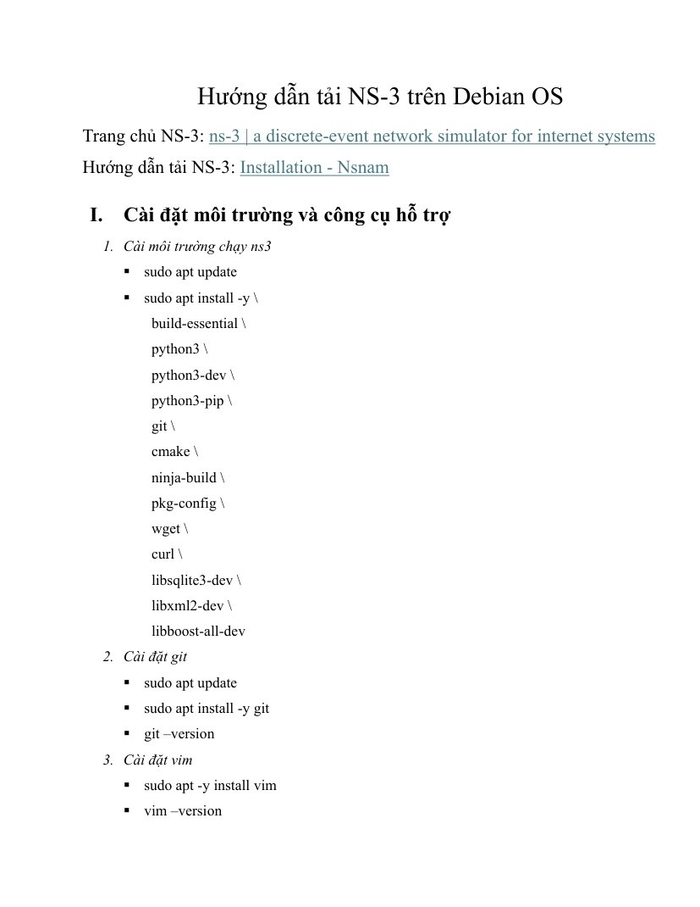
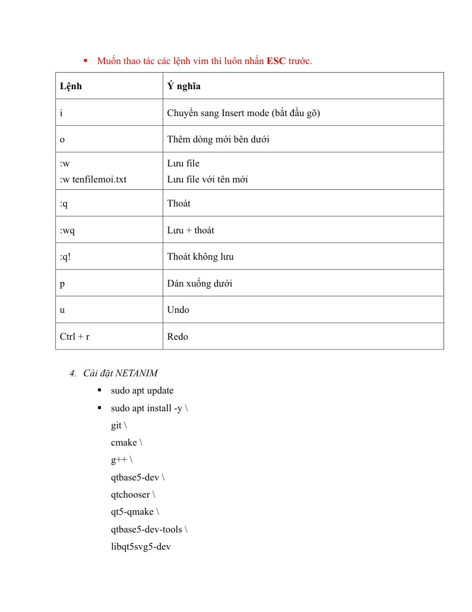
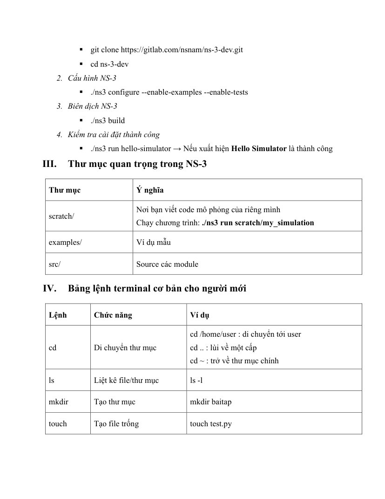
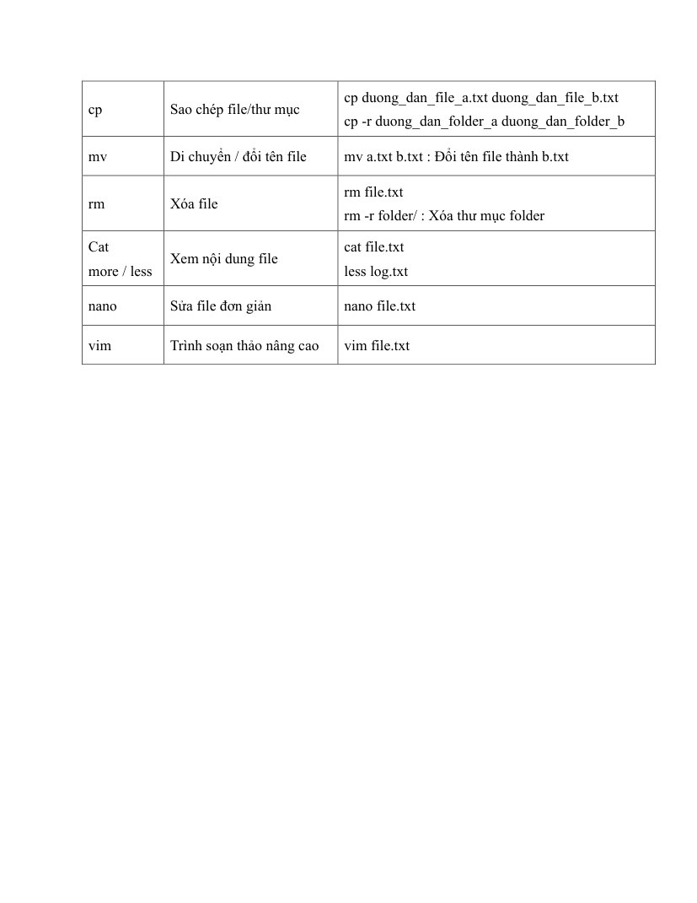

# BTH9_Huong_dan_tai_NS3: toàn bộ 5 trang

[Mở PDF gốc](BTH9_Huong_dan_tai_NS3.pdf)

Ảnh dưới đây được render từ tài liệu người dùng cung cấp, không phải kết quả thực nghiệm mới. Nội dung đề và ví dụ được lưu nguyên bản; các hiệu chỉnh triển khai nằm trong hướng dẫn từng bài.

## Trang 1

## Trang 2

## Trang 3

## Trang 4

## Trang 5

